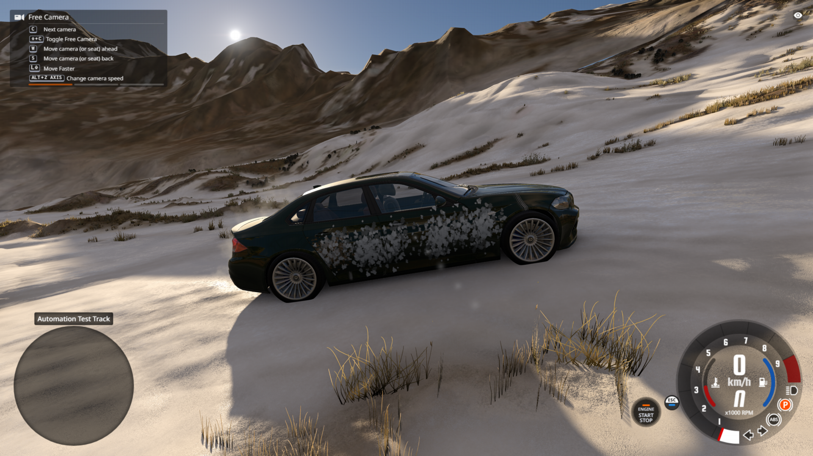
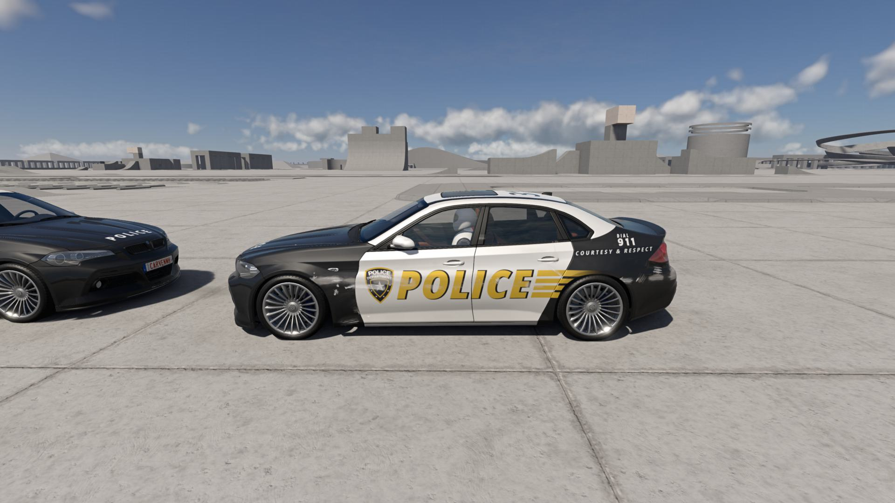
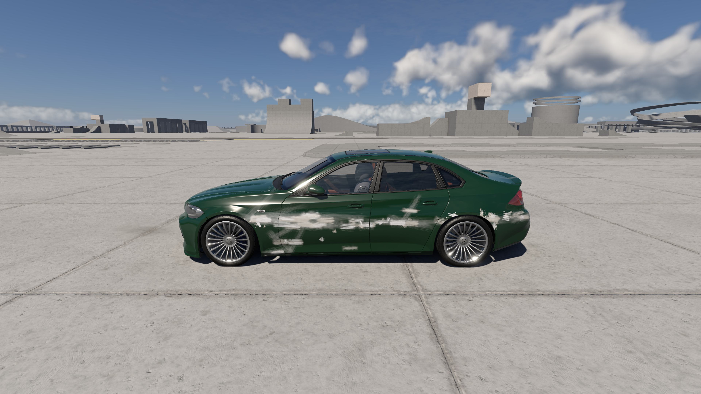

# scratches_mod

Procedural scratches, scrape streaks, and impact chips for BeamNG.drive vehicle
panels. The mod listens to real physics contact events and bakes cosmetic
scratch decals onto the body where the car actually touched something — slide
on your roof and the roof panels get long scrape marks; clip a wall and that
corner gets a chip cluster.

It is purely cosmetic. It does **not** change BeamNG's soft-body deformation;
it paints texture damage on top of whatever the physics already did.

## Milestone 5: performance investigation (release blocked)

**Projection-free synthetic anchors (current default).** The native
`projectDynamicDecals` pass only read back the plane a decal is baked against; the
detector already knows each contact point and normal. Captured layers are now
anchored directly at their own contacts, so the scratch path makes **no native
projection calls**. On the exact tested setup (BeamNG 0.40.5.0, RTX 3090, ETK 800
Police, full 4096x2048 detail, every accepted layer kept):

* **Vulkan**: largest native call **35.4 ms** across 57 untraced fixtures including a
  ten-minute endurance (previously 508 ms); oldest input-to-completed-layer age
  **318 ms** (previously 1,012 ms). Intermittent ~410 ms engine render-phase frame
  pauses still occur (2 of 18 short fixtures; none above 250 ms in the endurance).
* **D3D12**: delivery age passes (max 600 ms), but **446/447 ms bake batches** still
  occur, so the native-call gate fails on D3D12.

The remaining stall is traced to the engine's native bake: every baked layer creates
and destroys about 112 MiB of full-resolution transient textures, which Lua cannot
pool or defer. `scratches_paint.setSyntheticAnchors(false)` restores the legacy
projected path for comparison. Stable release remains blocked; see
[investigation 12](investigations/12-synthetic-anchors.md) for measurements,
captures and the allocation evidence.

The private ETK projection is reused across attachments, and captured layers drain
before more projection work. The full-detail experiment uses three-layer native
bake batches, faster flushing and same-panel grouping, with explicit conservation
of every accepted layer. Optional lower-resolution targets and representative
coalescing remain documented quality tradeoffs. Original paint/livery and the
separate washable soil target retain their resolution and materials. Default
damage remains 4096x2048.

Merged stream bands no longer duplicate later paths in the first band's haze.
ETK construction now prevents cached private materials from reaching another
vehicle, and unreferenced owned clones are reclaimed after destruction. This
requires invalidating the engine's JBeam construction cache for ETK spawns/reloads;
it can increase construction cost and does not run during steady scraping.

The corrected sustained fixture preserves internal vehicle motion and rejects
mid-run resets. Before synthetic anchors, the full-resolution Vulkan build reproduced a
**508 ms native projection** and a separate **965 ms frame interval** during
endurance, despite favorable cold and warm runs. The latter pushed completed-layer
age to 1,012 ms, failing the one-second gate. D3D12 warm tests of that build reached
**444 ms projection at full resolution and 184 ms at half resolution**. A separate
ETW diagnostic captured a graphics paging packet spanning about 423 ms of a
426 ms native call; the engine/driver root cause remains unresolved. The prior
6.52-second delays came from an older, physically unstable stress fixture and
must not be presented as directly comparable throughput evidence.

Milestone 5 acceptance remains incomplete and unmerged; last merged baseline is
c8bcae6. No milestone 6, stable release or all-hardware FPS claim. See the
[synthetic-anchor results](investigations/12-synthetic-anchors.md),
[resumed implementation, criteria and limits](investigations/11-quality-throughput.md),
[measured cohorts and charts](docs/evidence/milestone5/resumed-summary.md),
[exact compatibility matrix](docs/compatibility.md) and
[reproducible experimental settings](docs/examples.md#resumed-quality-and-throughput-experiments).

## Milestone 4: scratch and impact polish

Play-test visibility adjustment: the damage stage now uses 1.6 opacity and an
unmuted diffuse factor on dark/plain and Police paint; light plain paint retains
its darker coating response. This increases existing baked-mark visibility without
adding projection work or changing soil. A real Police sideslide confirms visible
fender/rear-quarter scuffs, but marks across the white doors remain subtle. This is
a partial visibility improvement, not a completed mixed-livery contrast fix.
[Test report and screenshots](docs/evidence/visibility/report.md).

Smaller, irregular depth-colored scuffs, chips and gouges replace the bright
single-tone brush marks. Four scrape/chip variants avoid immediate family
repeats; narrower bands and sub-centimeter jitter keep marks closer to contact.
The private ETK damage stage adjusts contrast without darkening washable soil.
Original PBR/livery stages and editor isolation remain intact.

[Matched engine captures, rejected experiments, measured costs and limitations](investigations/09-scratch-impact-polish.md).
Light-paint scuffs are deliberately subtle; this is cosmetic color/roughness
approximation, not physical paint-layer fracture or per-mark metal shading.
Support remains ETK 800 main body, empty Paint Design or stock Police. No stable
release, generic compatibility, or milestone 5 certification is claimed.

## Milestone 3: water, washing and drying

On the supported ETK 800 main body (empty Paint Design or stock Police), water
progressively removes mud, dirt and snow while baked scratches remain. A separate
bounded soil texture sits above the original paint/livery and lasting damage.
Wet clearcoat dries back to its exact original values in about 20 simulated seconds.

Enter water that reaches the body and stay immersed to clean; wheel-only puddles
may do nothing. Full body immersion takes about eight simulated seconds for a full
soil cycle. Stationary immersion works, pause freezes progress, and a fully washed
car can collect fresh soil. This is uniform cosmetic fading, not a waterline mask;
partial washing also attenuates new deposits until that soil cycle is fully removed.
Reset, switch, reload and editor suspension still discard all cosmetic marks.

[Engine captures, reproducible probes, measured costs and limitations](investigations/08-water-washing.md).
Milestone 3 evidence predates the milestone 4 polish described above.

## Milestone 2: progressive surface deposits

Driving over real MUD, DIRT or SNOW collision materials adds overlapping soil
patches around the wheels and lower side panels. Rolling tires work without
wheelspin; stationary wheelspin adds nothing. Dedicated mud clumps, fine dirt
coverage and soft snow patches replace the tinted scratch-haze placeholders.
Deposits stop at 96 attempts per reset and share the bounded scratch scheduler.

Validated on the isolated ETK 800 main-body adapter, stock Police and plain
paint, BeamNG 0.40.5.0 build 302427 / D3D12. Gridmap v2 supplied mud/dirt;
Automation Test Track supplied snow. [Actual captures, exact configuration,
resource measurements and limits](investigations/07-progressive-deposits.md).




This is a cosmetic coverage approximation, not volumetric snow or simulated
spray. Projection/bake spikes remain: the rolling cap run peaked at 27.3 ms
painter main-thread elapsed time, including native waits. Broad performance/vehicle certification remains future work.
Milestone 3 adds selective visual washing and wetness for this ETK scope.
Reset clears soil and scratches together.

This is a development build, not a stable public release. See
[compatibility](docs/compatibility.md) and [driving examples](docs/examples.md).

## Milestone 1: ETK 800 paint and police livery

A narrow material-preserving adapter supports the ETK 800 main body with an
**empty Paint Design or stock Police (`etk800_skin_police`)**. It keeps the
original paint/livery material channels beneath a separate scratch layer;
it does not replace the selected design or flatten it into a color image.
Other liveries and pre-existing Dynamic Textures designs are safely skipped.

Actual scratches, clean/reset fidelity, two-car switching, vehicle/extension
reload and editor ownership were checked on **0.40.5.0 build 302427 / Vulkan**.
[Exact scope, matched captures and evidence](investigations/06-etk-material-adapter.md).
This is a development prototype, not generic livery or renderer certification.



The adapter can reload/repair the current car once on first activation to prepare
its private material. Reset, switching, reload and editor suspension discard
cosmetic marks. It pauses while the world/livery editor owns rendering and
resumes after closure. Save editor work before changing vehicles or designs.
Non-ETK plain vehicles retain the older Dynamic Textures path and its material
fidelity limitations. Never remove artwork to force the painter to start.

## Start here

- [Examples and troubleshooting](docs/examples.md)
- [Sequential release plan](docs/plans/release-sequence.md)
- [Contributing and validation](CONTRIBUTING.md)
- [Changelog](CHANGELOG.md)



Actual in-game development capture, 2026-11-14: ETK 800 on Gridmap v2,
Dynamic Textures paint design. The bright scrape appearance is still being
refined. This image demonstrates scratches, not mud, snow or water effects.
There is no stable release download yet; build the experimental ZIP below.

---

## Installation

The mod is two Lua extensions, an ETK material helper, and brush art. It targets a recent version of
BeamNG.drive that includes the **Dynamic Decals** system. Development began on
0.38; the repository records a later 0.39.4 audit. The ETK adapter was tested
on 0.40.5.0 build 302427 with Vulkan (milestone 1) and D3D12 (milestone 2);
other builds/renderers are unverified.

### Players — packaged mod

1. Get `scratches_mod.zip` (see [Packaging for release](#packaging-for-release)
   if you are building it yourself).
2. Open the active user folder using the BeamNG launcher and place the ZIP
   in its `mods/` directory without extracting it. The default used by the
   development tools is `%LOCALAPPDATA%\BeamNG\BeamNG.drive\current\mods\`;
   custom user folders can differ.
3. Launch BeamNG; the mod manager picks it up automatically.
4. Spawn a [supported vehicle](#supported-vehicles--limitations) and drive.

Nothing else is required — both halves of the mod load themselves (see
[How it works](#how-it-works)). No console commands.

### Developers — unpacked

Let `tools/dev.py` install and reload the mod for you (see
[Development](#development)):

```
python tools/dev.py launch     # deploy, then start BeamNG into Gridmap
```

It mirrors `lua/` and `art/` into the user folder's `mods/unpacked/` directory
(BeamNG treats each folder there as a mounted mod):

```text
%LOCALAPPDATA%\BeamNG\BeamNG.drive\current\mods\unpacked\scratches_mod
```

Don't also have `scratches_mod.zip` in `mods/`; the two copies fight.

---

## Using the mod

Once installed, the mod is automatic — drive, crash, and scratches accumulate.

| Action | Effect |
| --- | --- |
| Slide a panel along a surface | A band of parallel scrape lines over a scuffed haze at each contact, running the way the car slid; longer drags scrape deeper (more bare metal) |
| Hit something hard | Chipped paint, plus a gouge on harder hits, sized by impact force |
| **Reset Car** (`Ctrl+R`) | Clears all baked scratches and resets the vehicle |
| **Toggle Scratches Debug Panel** | Opens/closes the in-game debug + tuning panel |

The panel toggle is a **bindable key**. After first launch, open
**Options → Controls → Bindings**, find **"Toggle Scratches Debug Panel"** in
the **Debug** category, and assign a key. It works in any context.

---

## The debug panel

A two-pane in-game window for diagnosing and tuning the mod.

**Left — log pane.** A live, color-coded feed of every mod log line, merged
from both Lua VMs and tagged `[GE]` (painter) or `[VEH]` (detector). Includes a
`W/E only` filter and a `Clear log` button.

**Right — controls.**

- **Copy debug report** — one click copies a compact, paste-ready report
  (environment, stats, tunables, relevant log lines) to the clipboard. This is
  the fastest way to report a bug.
- **Status header** — `Painter: READY` / `NOT READY` plus the current vehicle.
- **Presets** — `Light` · `Default` · `Heavy` · `Max` · `Extreme`, one click to
  swap every tunable.
- **Live counters** — impacts, streams, baked stamps, projection cost, job
  backlog, and how often the canvas is re-composited.
- **Sliders** — slide/impact thresholds, bake limits (aggregate cap,
  projections per frame, cluster radius), and the paint-color seed.
- **Full-rate composite (debug)** — restores the stock every-frame canvas
  composite. Leave it off; it exists only to rule the composite skip out when
  diagnosing missing marks.
- **Buttons** — reset stats, restore defaults, clear stamps, dump full stats.

Controls that need a bound projection grey out until the painter is ready.

---

## How it works

The mod spans BeamNG's two Lua virtual machines and a texture pipeline.

### 1. Detection — vehicle Lua (`scratches_detect.lua`)

Auto-loaded into every vehicle (from `lua/vehicle/extensions/auto/`), but it
only does work in the car the player is driving — AI traffic and parked cars
return immediately. It wraps the global `onNodeCollision` callback and filters
the firehose of contacts down to *paintable body contacts*: body-material
nodes touching a hard surface, with glass, wheels, and internal/mechanical
parts rejected. Each node's verdict is computed once and cached, so the
per-contact cost on the physics tick is a table lookup.

Surviving contacts split into two event kinds:

- **Impacts** — single hard hits past a normal-force threshold.
- **Slides** — sustained slipping contact, accumulated into multi-point
  *streams* that describe the scrape path.

Each render frame, the frame's impacts and every slide stream that ended are
batched and shipped to the game-engine side in **one** `queueGameEngineLua`
call (`scratches_paint.ingest`), tagged with the vehicle id.

### 2. Painting — game-engine Lua (`scratches_paint.lua`)

Owns a **Dynamic Decals** projection for the player vehicle. The ETK adapter
copies the original two material stages into a per-vehicle clone and appends a
damage stage. A construction-time flexbody material override selects the clone;
the Paint Design slot stays intact. A private instance of the installed decal
API keeps scratch clearing separate from editor artwork. Other supported plain
vehicles use the older `dynamicTextures` skin and color-seed path.

Incoming batches become **projection jobs** — one synthetic-camera projection
plus the decal layers captured under it:

- **Impacts** → chipped paint (sharp flakes), plus a gouge on harder hits,
  scaled by force. The frame's stamps are spatially clustered; each cluster is
  one job.
- **Slides** → a scrape band at the latest contact point, aligned with the
  slide (the first→last movement of the contact, flattened onto the panel),
  30–70 cm long so neighbouring contacts join into one rash. It's drawn as a
  translucent clear-coat haze under parallel scrape lines, one brush and tone
  per slide, in overlapping segments. Each stream is one job.

Damage is coloured like layered paint: scuffed clear coat (haze), primer grey,
and bare metal on harder or longer contacts. On light paint the palette shifts
darker so damage contrasts the right way. The brushes are generated by
`tools/generate_brushes.py` at line widths the 4096×2048 canvas can resolve
(~1.5 mm per texel on a car); finer detail just blurs.

Work is scheduled around two measured engine costs:

- **Projection** has a per-frame toll: the first `projectDynamicDecals` in a
  frame costs ~14 ms (an engine-side sync, whether or not physics runs), and
  each further pass ~1.4 ms. So new marks accumulate and are projected in
  batches every 0.2 s (`setFlushInterval`), up to 6 passes per batch
  (`setProjectionBudget`). The first mark after a quiet spell goes out on the
  next frame. Slides within 35 cm of a queued slide on a panel facing the same
  way share its projection, with the camera backed off to fit every band.
- **Baking** costs ~0.85 ms per layer with no toll, so captured layers are
  baked on the frames *between* projection batches, 6 at a time. No frame
  pays both costs.

A spot that has already been painted twice (8 cm grid) skips further marks
until the canvas is cleared, so a long slide doesn't pay to repaint the same
contact point over and over.

The canvas is only composited onto the car on frames that baked or cleared;
the stock API does it every frame. Nearly all of the stock update's cost is
re-binding the texture set to the car's materials (`veh:setTextureSet`,
24–55 ms per call), so the painter re-binds only when the binding can be
stale (setup, and when the car spawns, resets, is switched to, or is cleared).
Every other composite refreshes the projection shape and transforms and calls
`combineTextures`, which costs ~0 ms. Counters and tunables are pushed from
the detector every 0.25 s to drive the debug panel.

### Loading

The vehicle side auto-loads (it lives in an `extensions/auto/` directory). The
game-engine side has no auto-load directory, so the vehicle side bootstraps it
with `extensions.load('scratches_paint')` on its lifecycle hooks. The result:
both sides come up on their own with no console commands.

For the full design history, see `docs/plans/` and `investigations/`.

---

## Supported vehicles & limitations

- **Requires the Dynamic Decals system** and a vehicle that ships a
  `<jbeam>_skin_dynamicTextures` part. Vehicles without it are unsupported and
  the mod cleanly does nothing (the debug panel reports `NOT READY`).
- **Narrow ETK 800 support:** empty Paint Design and stock Police preserve the
  original main-body material beneath damage. Tested with Rennspecht 8R config;
  extra-material panels remain original but do not receive scratches. Custom
  body overrides are skipped. Other liveries and unowned Dynamic Textures
  designs remain skipped. See the [compatibility matrix](docs/examples.md#compatibility-evidence).
- **Editor ownership:** the ETK adapter pauses and clears cosmetic marks during
  editor use, then resumes. Concurrent editor use on the legacy non-ETK path
  remains unsupported; unload the painter before editing there.
- **Cosmetic only.** The mod paints texture damage from contact events; it does
  not add or replace soft-body deformation.
- **Glass and selected mechanical/internal parts are filtered out** so stray
  projection rays don't mark unrelated panels.

---

## Repo layout

```text
lua/vehicle/extensions/auto/scratches_detect.lua   # VLUA contact detection
lua/ge/extensions/scratches/paint.lua              # GELUA dynamic-decal painter
lua/ge/extensions/scratches/etkAdapter.lua         # narrow material-preserving adapter
lua/ge/extensions/core/input/actions/scratches.json # bindable panel hotkey
art/dynamicDecals/textures/                        # scratch brush PNGs + metadata
tools/generate_brushes.py                          # brush generation utility
tools/package.py                                   # release zip builder + preflight
tools/dev.py                                       # dev loop: deploy + hot-reload via BeamNG MCP
tools/bench.py                                     # scripted crash scenarios + frame timing + screenshots
tools/ingame/scratches_bench.lua                   # in-game half of the bench (dev mount only)
tools/sim/harness.lua                              # headless mocked-engine checks
docs/plans/                                        # design notes
investigations/                                    # BeamNG API investigations
```

Every brush PNG must have a matching `.png.dynDecalTexture.json` sidecar next
to it, or the dynamic-decal system loads it invisibly.

---

## Development

Prerequisites: Python 3.10+ and Lua 5.1 (`lua` and `luac` on PATH) for the full
preflight. Packaging uses Python's standard library. Regenerating brush art
additionally needs `python -m pip install pillow numpy`. Live tests require a
local BeamNG installation with MCP enabled. Mock checks cannot verify rendering.

### The dev loop: `tools/dev.py`

Edit, save, and the running game picks up the change in a few seconds:

```
python tools/dev.py launch     # deploy, start BeamNG into Gridmap with MCP on, wait for the car
python tools/dev.py watch      # deploy + hot-reload on every save (Ctrl+C to stop)
python tools/dev.py deploy     # one-shot deploy + hot-reload
python tools/dev.py restart    # quit the game cleanly and launch it again
python tools/dev.py lua "return scratches_paint ~= nil"   # run game-engine Lua
python tools/dev.py status     # paths, game, MCP and mount state
```

Every deploy first runs the same preflight as `package.py` (`luac -p`, the
stray-global check, the harness, brush sidecars). Code that fails it never
reaches the game. The deploy then copies only what changed into
`mods/unpacked/scratches_mod/` and reloads only the affected part:

| Changed | Reload | Typical time |
| --- | --- | --- |
| `lua/ge/` (`paint.lua`) | `extensions.reload('scratches_paint')` | ~2.5 s |
| `lua/vehicle/` (detector) | player vehicle reload (`Ctrl+R` equivalent; clears scratches) | ~4 s |
| input action `.json` | full game-engine Lua reload (`Ctrl+L` equivalent) | ~6 s |
| `art/` (brushes) | painter reload; new brushes load on first use, an edited existing brush needs `dev.py restart` | ~2.5 s |

It then prints the mod's log lines from the reload and fails if any of them is
an error. Errors the game itself logs (shader compiles, level scans) are counted
but don't fail the deploy. A full restart is still safest after changing
material, JBeam or skin data.

**How it talks to the game.** BeamNG 0.39+ ships a local MCP server
(`http://127.0.0.1:29292/mcp`, localhost only) that can run game-engine Lua.
`launch`/`restart` turn it on with `-enablemcp`. For a game you start yourself,
enable **Options → Advanced → Enable MCP server** once. Without MCP, `deploy`
still copies the files and tells you to press `Ctrl+L` / `Ctrl+R`. Log output
is read through `Engine.getFrameLog()`, because `beamng.log` on disk lags by
seconds. That buffer is shared with the in-game console window, so while the
console is open, reload output shows there instead.

**Claude Code.** `.claude/settings.json` has a Stop hook that runs
`dev.py hook` after every Claude turn. If no file changed it does nothing
(about 0.3 s). Otherwise it deploys and hot-reloads, and on a preflight or
in-game error it hands the error back to Claude to fix. `.mcp.json` registers
the game's MCP server as `beamng`, so Claude can also run Lua, read logs, reload
the vehicle and take screenshots of the running game directly.

Overrides: `BEAMNG_USER`, `BEAMNG_GAME`, `BEAMNG_MCP_PORT`, `BEAMNG_LEVEL`
(default `gridmap_v2`). `python tools/dev.py unmount` removes the dev copy.

### Scenario bench: `tools/bench.py`

Scripted crashes for tuning, with the cost of every frame recorded:

```
python tools/bench.py scenarios                    # baseline, roofdrop, sideslide, rollover, nosedive
python tools/bench.py run sideslide
python tools/bench.py run all --tag before
python tools/bench.py run rollover --set paint.setProjectionBudget=3 --tag budget3
python tools/bench.py run roofdrop --repeat 3 --optick
python tools/bench.py list                         # compare runs side by side
```

Each run resets the car (repaired, canvas wiped) at a fixed home pose,
launches it, and records every frame until it settles and the painter's
backlog drains. It then stands the car upright without a reset, with painting
paused, and photographs it from the left, right, front, rear and top with the
HUD hidden. `bench/runs/<run>/` gets `report.md` (marks, rejection reasons,
painter/detector/engine cost, worst frames, screenshots), `frames.csv` (every
engine frame-section timing per frame), `result.json` and the `shot_*.jpg`
files. One summary row per run goes to `bench/runs/index.csv`.

- `--set paint.<fn>=args` / `detect.<fn>=args` call the mod's tuning
  functions before the run (e.g. `detect.setThresholds=0.6,0.8,10`). They're
  undone afterwards by reloading the module, unless you pass `--keep`.
- `--optick` saves an Optick capture of the run (`capture.opt`).
- The background FPS limiter is lifted for the run and restored afterwards,
  so an unfocused game window isn't capped at a few FPS.
- Timing comes from the mod itself: the painter always measures its own frame
  (`scratches_paint.getStats()`, also in the debug report). The detector times
  every contact only while the bench turns profiling on
  (`scratches_detect.setProfile`).
- The in-game half, `tools/ingame/scratches_bench.lua`, is copied into the dev
  mount by `dev.py` and never into the release zip.
- Homes are per level (`gridmap_v2` is built in). On another map, park
  somewhere open and flat and run `python tools/bench.py home --save`.

### Testing without the game

The Lua modules use Lua 5.1 syntax. `tools/sim/harness.lua` runs both of them
in one stock Lua 5.1 state against mocked engine objects — the vehicle →
game-engine payload round trip, player-only gating, the per-frame projection
budget, composite gating, vehicle switch, clear, and the debug panel — so
logic regressions show up without launching BeamNG:

```
lua tools/sim/harness.lua
```

It does not render anything; whether marks *look* right still needs the game.

### Debugging

The fastest loop: reproduce a problem, open the debug panel, click **Copy
debug report**, and paste it. Useful console probes (game-engine Lua) still
exist — `scratches_paint.dumpState()`, `scratches_paint.deepProbe()`,
`scratches_paint.dumpPaintStats()`, `scratches_paint.buildDebugReport()` — and
on the vehicle side, `scratches_detect.dumpStats()`.

---

## Packaging for release

The mod is the `lua/` and `art/` directory trees. Build the distributable zip
with:

```
python tools/package.py          # -> dist/scratches_mod.zip
```

It packs `lua/` and `art/` at the **zip root** (a zip with the trees nested one
folder deeper installs without error and then does nothing), and refuses to
build if a Lua file fails `luac -p`, reads or writes an unexpected global (the
signature of a `local` used above its declaration, which compiles fine and
crashes in game), fails the harness, or a brush PNG is missing its
`.dynDecalTexture.json` sidecar. `docs/`, `investigations/`, `tools/`,
`reference/` and `README.md` are repo-only and are never included.

If Lua tools are absent, the packager warns and skips Lua checks. A successful
ZIP build alone is therefore not evidence that preflight ran; release builds
must show successful syntax, globals, harness and sidecar checks.

To uninstall, remove `scratches_mod.zip` from the active `mods/` folder and
disable/remove any unpacked copy, then restart the game. If a saved vehicle
configuration still selects Dynamic Textures, select its desired Paint Design
again; uninstalling does not rewrite saved configurations.

Then test it: remove the unpacked dev mount (`python tools/dev.py unmount`), drop the zip into `mods/`, restart
BeamNG, and confirm a [clean install](#players--packaged-mod) works.

---

## Known issues

- **Recorded D3D12 failure on the development installation (BeamNG 0.39.4).** The game's own
  dynamic-decal shader (`shaders/common/dynamicDecals/decal.ps.hlsl`) fails to
  compile under D3D12, so every decal draw is dropped
  (`D3D12 cmd: draw skipped (pipelineBindFailed=1 ... dynamicDecals/decal...)`
  in `beamng.log`). This also broke the vanilla decal editor in that investigation.
  This is a recorded environment-specific issue, not a claim about every installation.
  The mod still
  detects and queues marks; nothing reaches the paint. Use Vulkan: **Options →
  Graphics → Vulkan**, or launch with `-gfx vk` for one session
  (`python tools/dev.py launch --game-arg=-gfx --game-arg=vk`).
- **Generic livery support remains deferred.** Only the ETK 800 stock Police
  adapter is enabled. It depends on internal engine APIs and the tested material
  layout; changed layouts fail closed. Material clones remain disabled in the
  scene after use for existing mesh references; long-session resource cost is unmeasured.
- **ETK damage opacity follows its red color channel.** Dark deposits/marks can
  look weak; the added stage uses fixed roughness and no metallic response.
  The original paint retains its PBR channels; wetness temporarily changes only
  cloned clearcoat factors. Per-scratch metal glint remains deferred.
- **Scratches have no metal glint** — metallic and roughness are served from
  static factory maps instead of the dynamic canvas (the fix that removed the
  paint seam), so scratch decals read as colour marks only. Base gloss is
  uniform on that legacy path, but exact factory PBR fidelity is not verified.
  The ETK adapter instead preserves the original channels below its damage stage.

See `docs/plans/2026-05-21-release-roadmap.md` for the current roadmap.
