# scratches_mod for BeamNG.drive

**Contact-driven paint damage, mud, snow and washing for BeamNG.drive.**
Slide along the tarmac and the panels that touched get scrape bands running
the way the car slid. Clip a wall and that corner chips. Drive through mud or
snow and it builds up behind the wheels. Drive into deep water and it washes
off, while the scratches stay. Every mark comes from a physics contact that
actually happened and is baked into the car's paint without touching its livery.


> **Status: development preview.** Everything on this page runs in game today on
> BeamNG.drive 0.40.5.0. On `master` the material-preserving adapter covers **all
> 38 stock cars, trucks and buses that ship Dynamic Textures**, with any paint
> colour or factory livery. The published
> **[v0.1.0-preview](https://github.com/stephenfjohnson/beamng-scratches-mod/releases/tag/v0.1.0-preview)**
> (MIT licensed) predates that and supports the ETK 800 only; or
> [build the ZIP yourself](#packaging-for-release) from `master`.
> Release blockers, open bugs and ideas parked on archived branches live in
> **[TODO.md](TODO.md)**.

It is purely cosmetic: the mod paints texture damage on top of whatever the
soft-body physics already did. It never changes deformation.

All images below are crops of real in-game captures from the
[evidence folders](docs/evidence/). Before/after pairs come from the same run,
with the mod's stage switched on and off. `python tools/make_showcase.py`
rebuilds them.

## Features

- [Scrapes that follow the slide](#scrapes-that-follow-the-slide)
- [Impact chips and gouges](#impact-chips-and-gouges)
- [Your paint and livery stay underneath](#your-paint-and-livery-stay-underneath)
- [Works across the fleet](#works-across-the-fleet)
- [Mud, dirt and snow build up as you drive](#mud-dirt-and-snow-build-up-as-you-drive)
- [Splashes cross panel seams](#splashes-cross-panel-seams)
- [Mud the color of the ground](#mud-the-color-of-the-ground)
- [Soil that catches the light](#soil-that-catches-the-light)
- [Water washes soil off; scratches stay](#water-washes-soil-off-scratches-stay)
- [Soft ground doesn't scratch](#soft-ground-doesnt-scratch)
- [Stays out of your frame time](#stays-out-of-your-frame-time)
- [Editor-safe, lifecycle-safe](#editor-safe-lifecycle-safe)
- [In-game debug and tuning panel](#in-game-debug-and-tuning-panel)
- [Developer tooling](#developer-tooling)

### Scrapes that follow the slide

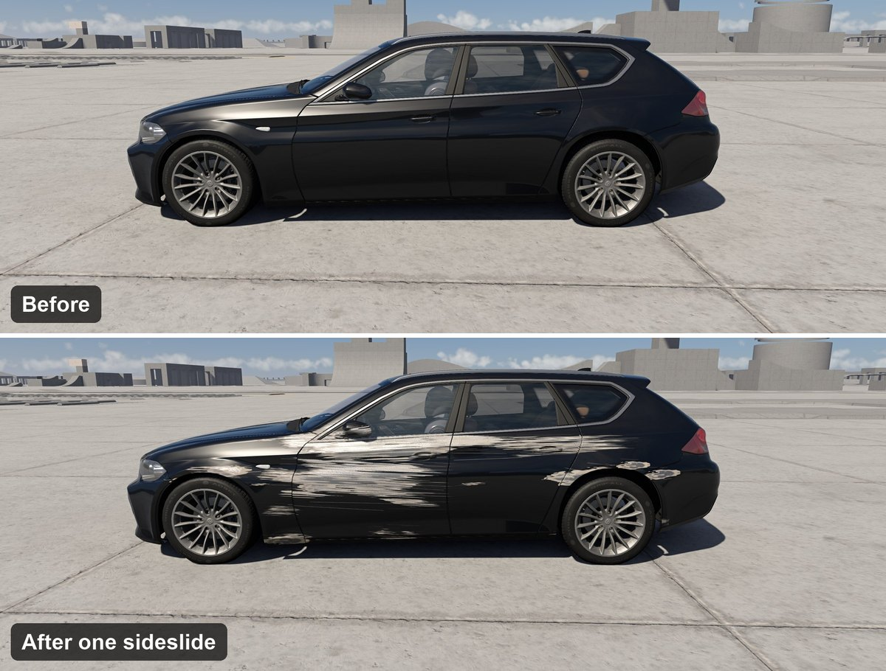

Sustained sliding contact is tracked as a stream. Each contact point becomes a
scrape band aligned with the direction of travel, 30–70 cm long, so neighbouring
contacts join into one continuous rash instead of a row of stickers. Each band is
layered like real paint: scuffed clearcoat haze, primer grey, then bare metal on
harder or longer drags. Four variants per brush family avoid visible repeats,
and on light paint the palette shifts darker so damage contrasts the right way.

### Impact chips and gouges


Single hard hits past a normal-force threshold stamp chipped paint, plus a gouge
on harder hits, sized by the impact force. Hits in the same frame are clustered
into one job, so a rollover leaves a scatter of chips and dings exactly where
the body struck the ground.

### Your paint and livery stay underneath

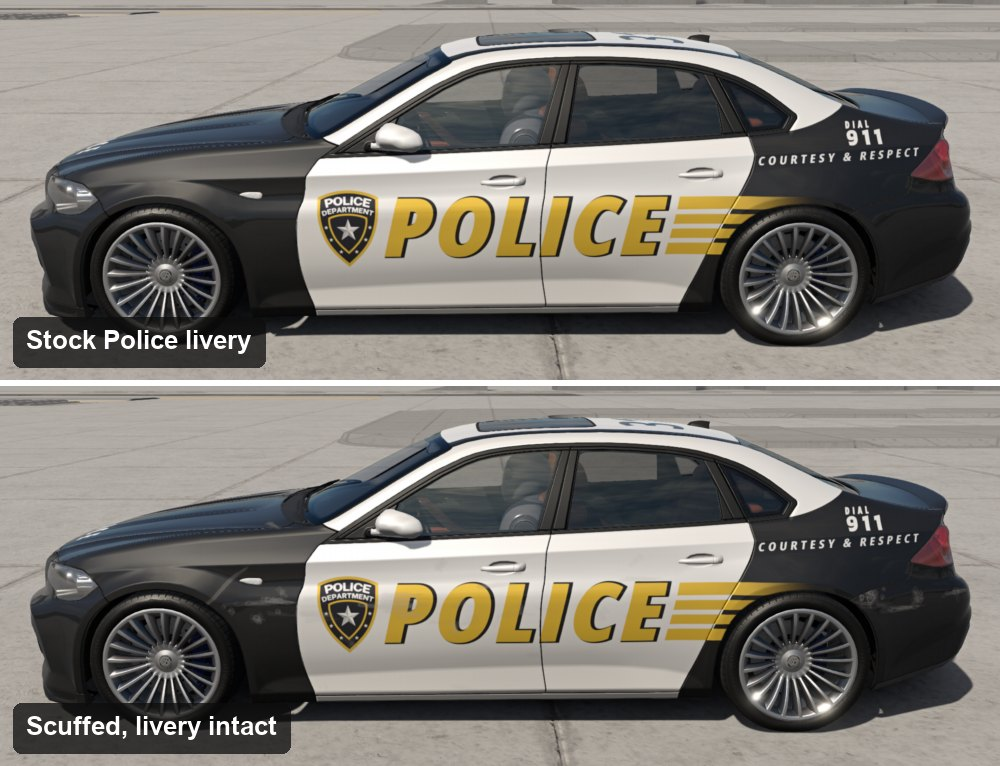

The body adapter clones the car's own body materials per vehicle and appends a
damage stage and a soil stage. The original paint, palette, normal and detail
maps, metallic, roughness, clearcoat and livery artwork all render unchanged
beneath the marks. The Paint Design slot is never rewritten. It finds the body
the same way the game does: every mesh material that has a Dynamic Textures
variant in the vehicle's own folder (the ETK's main body and separate
`etk800_extra` rear quarters, the SBR's four body kits, both Semi cabs). It
clones whichever material the renderer would use for the chosen livery.
Anything unexpected (non-PBR or already-full materials, another mod's body
override, your own Dynamic Textures editor design) is skipped, never overwritten.

### Works across the fleet

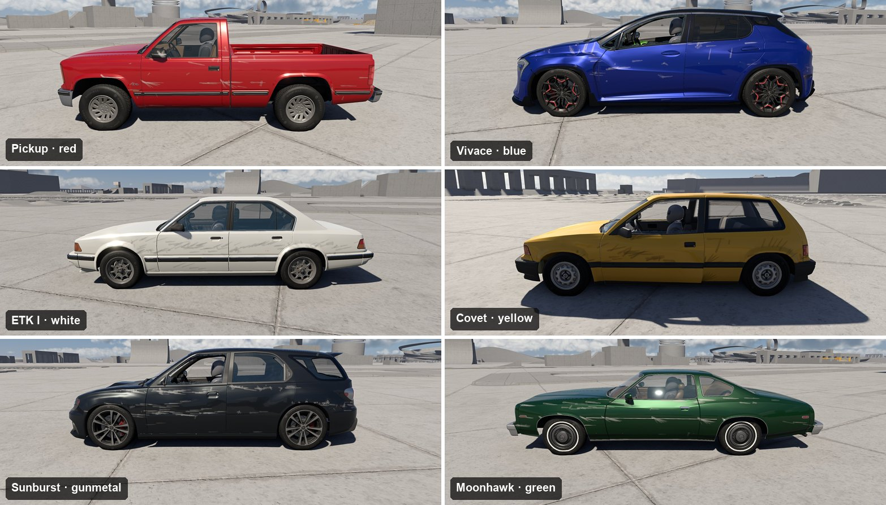

The same crash on six different bodies and paints. Each car keeps its own factory
finish; the scrapes take their colour from the paint layers underneath.

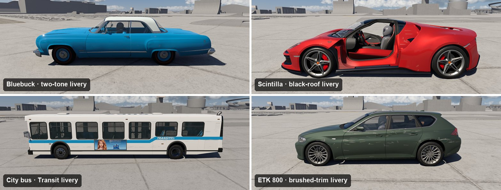

Factory liveries survive too: two-tones, race stripes and the city bus's Transit
artwork stay intact under the damage. Damage on busy liveries is subtler than on
plain paint.

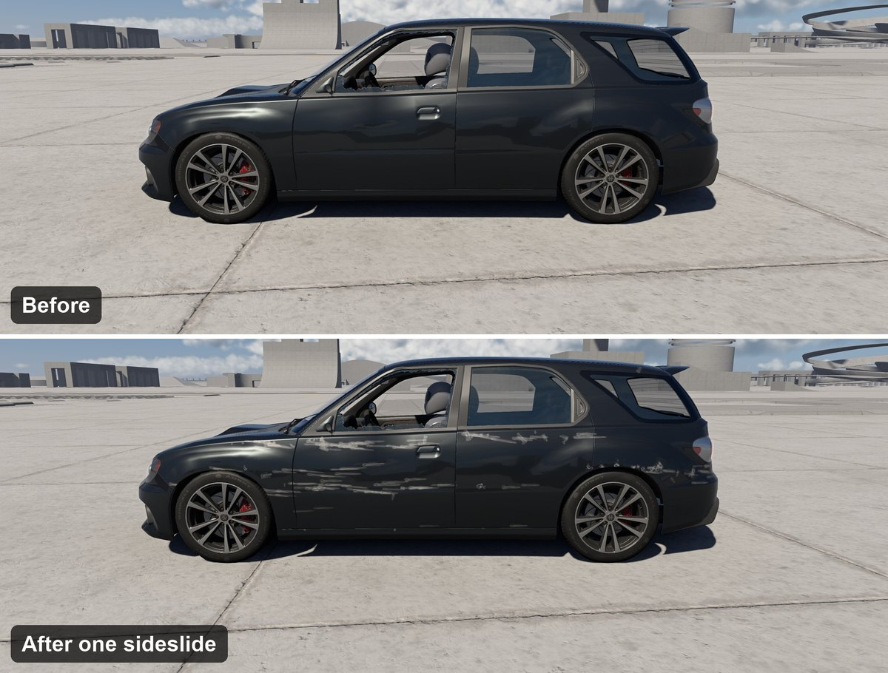

In a sweep of every stock vehicle, **38 of 38** that ship Dynamic Textures attach
to the adapter ([survey](docs/evidence/adapter-survey/survey.json)). The ten above
were crashed and checked: every clone matched its source material in every
original stage, with 0–2.4% of marks missed
([fleet evidence](docs/evidence/showcase/fleet/README.md)). Mud, snow, washing and
wet gloss use the same appended stages on every vehicle, but so far they've only
been driven live on the ETK 800.

### Mud, dirt and snow build up as you drive

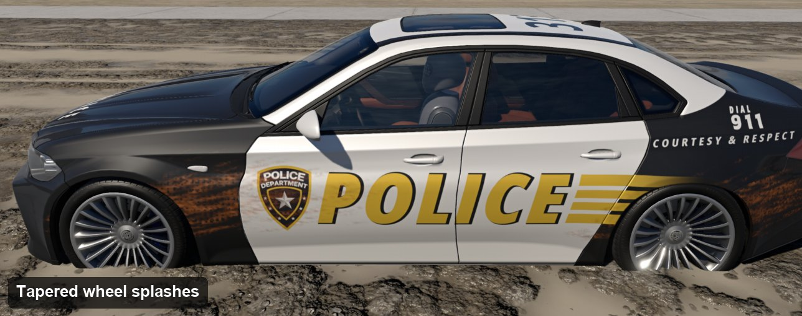

Rolling over real `MUD`, `DIRT` or `SNOW` ground materials deposits soil around
the wheels and lower panels. No wheelspin is needed, and stationary wheelspin adds
nothing. Mud and dirt land as droplet heads with tapered tails aligned against
travel. Faster driving gives longer, flatter trails, and reversing flips them.
Snow lands as soft coverage patches. Soil lives on its own layer above the paint
and damage, capped at 96 deposits per cycle and scheduled with the scratches.

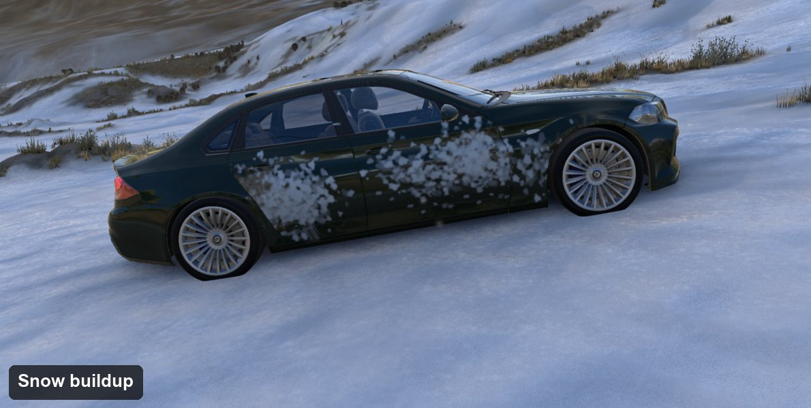

### Splashes cross panel seams

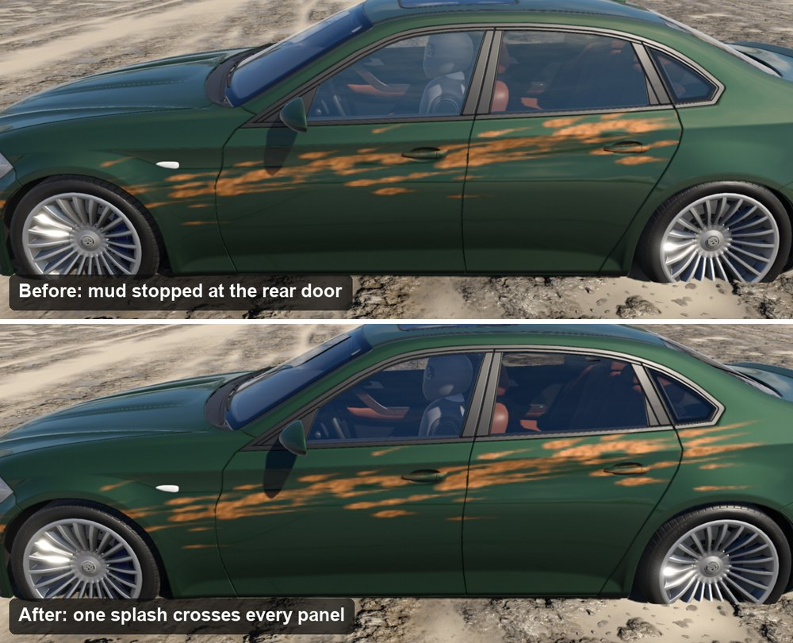

Each wheel splash is a single elongated projection that spans neighbouring
panels, oriented in body space rather than restarted per panel. The ETK's rear
quarters use a different material from the doors. The adapter now clones and
binds that material too, so mud no longer stops dead at the rear door.

### Mud the color of the ground

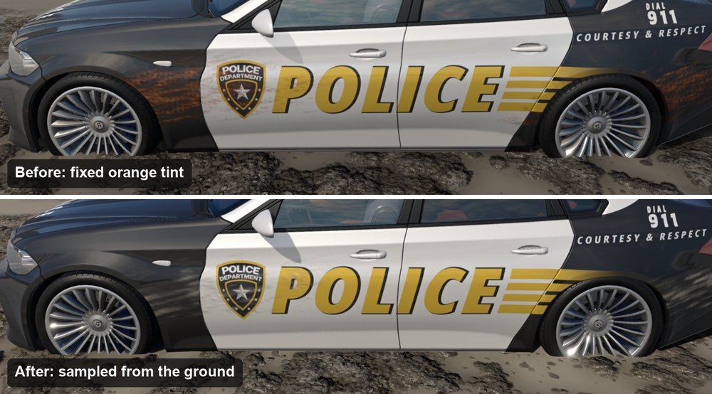

Soil tint is sampled from the terrain material under the wheel: the local base
map color plus averaged detail and macro color, converted into the vehicle
decal's color space. On Gridmap's grey mud strip the result is grey-brown grime
rather than the old fixed orange, which is why the after image looks so much
quieter. Mesh surfaces and unreadable maps fall back to a default tint. The
splash captures above predate this change, so they still show the orange tint.

### Soil that catches the light

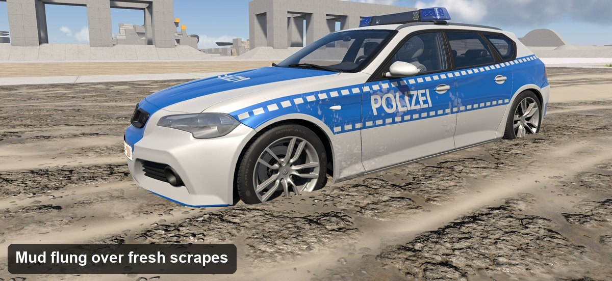

The soil layer carries a masked detail normal, so lumps and grain pick up
highlights while the factory body normal stays intact. The relief fades with the
soil when it washes off. This close-up also shows the white scrape streaks from
an earlier slide sitting under the mud, with the Police artwork untouched.

### Water washes soil off; scratches stay

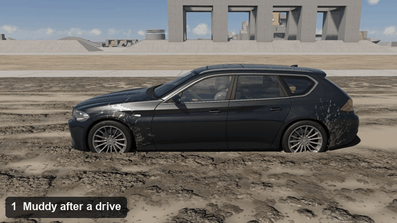

Submerge the body and the soil fades over about eight simulated seconds. Damage
lives on a separate layer, so baked scratches survive the wash. Back out of the
water, the clearcoat stays wet and dries back to its exact original values in
about 20 s. A fully washed car collects fresh soil again, and pausing the game
freezes all of it. The wash is a uniform fade rather than a waterline, so
puddles that only reach the wheels may do nothing.

### Soft ground doesn't scratch

Mud, snow and grass never emit scratch damage, even when a sunk body node pushes
into them hard. They only deposit soil. Dirt, sand, gravel and hard surfaces stay
abrasive. The contact's ground material decides which applies.

### Stays out of your frame time

- **Player car only.** AI traffic and parked cars return immediately; three
  moving traffic cars produced zero detector calls during a player scrape.
- **Cheap detection.** Each node's paintable/not-paintable verdict is cached, so
  the per-contact cost on the physics tick is a table lookup.
- **No native projection.** Baked layers are anchored directly at their own
  contact point and hull-resolved normal (*synthetic anchors*) instead of reading
  the anchor back from a GPU projection pass. Measured on BeamNG 0.40.5.0, RTX 3090,
  full 4096×2048 detail, every accepted mark kept:

  | Worst case per run | Before (projected) | Now (synthetic anchors) |
  | --- | ---: | ---: |
  | Vulkan, native call, 10-minute endurance | 508.5 ms | **35.4 ms** |
  | Vulkan, contact to finished mark | 1,012 ms | **318 ms** |
  | D3D12, native call | 443.8 ms | 446–447 ms ([open](TODO.md#release-blockers)) |

- **Composite only when needed.** The canvas is re-composited only on frames
  that baked or cleared, and the expensive texture-set re-bind (24–55 ms) happens
  only when the binding can actually be stale.
- **Bounded everything.** 160 inputs, 64 queued jobs, 6 baked layers per frame,
  96 soil deposits and per-cell repaint limits.

Details: [investigation 12](investigations/12-synthetic-anchors.md) and the
[measured cohorts](docs/evidence/milestone5/resumed-summary.md).

### Editor-safe, lifecycle-safe

The painter uses a private instance of the Dynamic Decals API, so clearing
scratches never wipes your decal-editor artwork. It pauses while the world or
livery editor owns rendering and resumes afterwards. Reset (`Ctrl+R`), vehicle
switching, vehicle/extension reloads and map changes are all handled cleanly.
They clear cosmetic marks; nothing persists across a reset. Two identical ETKs get separate private materials, and those are reclaimed once
the car and every mesh reference to them are gone.

### In-game debug and tuning panel

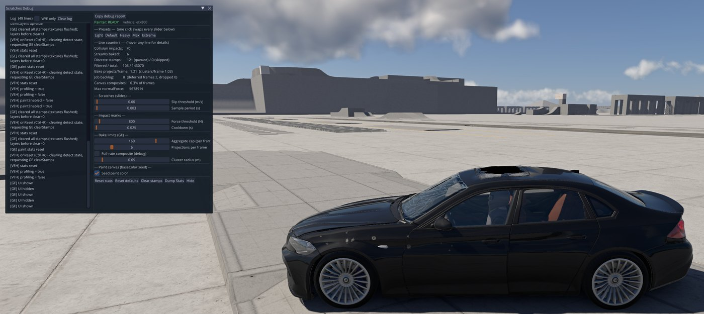

A bindable two-pane window. It has a live log merged from both Lua VMs, one-click
**Copy debug report**, Light→Extreme presets, live counters (impacts, streams,
bakes, backlog, composites) and sliders for every threshold and limit. See
[the debug panel](#the-debug-panel).

### Developer tooling

- [`tools/dev.py`](tools/dev.py) deploys and hot-reloads into the running game
  through BeamNG's built-in MCP server in about 2.5 s, and fails the deploy if
  the mod logs an error.
- [`tools/bench.py`](tools/bench.py) runs scripted crash scenarios with
  per-frame timing and five-angle screenshots.
- [`tools/sim/harness.lua`](tools/sim/harness.lua) has **358 headless checks**
  against mocked engine objects. No game is needed.
- [`tools/package.py`](tools/package.py) builds the release ZIP behind a syntax,
  stray-global, harness and brush-sidecar preflight.
- `tools/perf_*.py` covers renderer cohorts, endurance sessions, ETW traces and
  allocation probes.

## Compatibility at a glance

| Setup | Result |
| --- | --- |
| 38 stock cars, trucks and buses with Dynamic Textures, any paint colour | Material-preserving adapter: scratches over the real paint ([survey](docs/evidence/adapter-survey/survey.json)) |
| The same vehicles with a factory livery | Livery cloned and preserved under the damage |
| Mud, snow, washing, wet gloss | Same stages on every vehicle; driven live on the ETK 800 only so far |
| Your own Dynamic Textures editor design, another mod's body override, non-PBR materials | Detected and skipped; paint untouched |
| Percheron and vehicles without Dynamic Textures | Mod stays idle (`NOT READY`) |
| Vulkan | **Recommended.** Meets the native-call and latency targets in measured runs |
| D3D12 | Works; intermittent ~450 ms bake stalls remain (engine-side, [open](TODO.md#release-blockers)) |

Tested on BeamNG.drive 0.40.5.0 build 302427, Windows 11, RTX 3090 / Ryzen 9
3900XT. Other builds and hardware are untested. Exact configurations are in the
[compatibility matrix](docs/compatibility.md).

## Project docs

- **[TODO.md](TODO.md)**: open work, release blockers and archived-branch ideas
- [Milestone history](docs/milestones.md): what each milestone added, with evidence
- [Changelog](CHANGELOG.md), [release plan](docs/plans/release-sequence.md)
- [Examples and troubleshooting](docs/examples.md), [contributing](CONTRIBUTING.md)
- [MIT license](LICENSE)
- [`investigations/`](investigations/): BeamNG engine/API research behind each decision

---

## Installation

The mod is two Lua extensions, three helper modules (body material adapter,
terrain soil color, coverage accounting) and brush/soil art. It targets a
recent version of BeamNG.drive that includes the **Dynamic Decals** system.
Development began on 0.38; the current build is tested on 0.40.5.0 build 302427
with both Vulkan and D3D12. Other builds are unverified.

### Players — packaged mod

1. Download `scratches_mod.zip` from the [latest release](https://github.com/stephenfjohnson/beamng-scratches-mod/releases/tag/v0.1.0-preview) and check it
   against `scratches_mod.zip.sha256` if you like (or [build it](#packaging-for-release)).
2. Open the active user folder using the BeamNG launcher and place the ZIP
   in its `mods/` directory without extracting it. The default used by the
   development tools is `%LOCALAPPDATA%\BeamNG\BeamNG.drive\current\mods\`;
   custom user folders can differ.
3. Launch BeamNG; the mod manager picks it up automatically.
4. Spawn a [supported vehicle](#supported-vehicles--limitations) and drive.

Nothing else is required — both halves of the mod load themselves (see
[How it works](#how-it-works)). No console commands.

### Developers — unpacked

Let `tools/dev.py` install and reload the mod for you (see
[Development](#development)):

```
python tools/dev.py launch     # deploy, then start BeamNG into Gridmap
```

It mirrors `lua/` and `art/` into the user folder's `mods/unpacked/` directory
(BeamNG treats each folder there as a mounted mod):

```text
%LOCALAPPDATA%\BeamNG\BeamNG.drive\current\mods\unpacked\scratches_mod
```

Don't also have `scratches_mod.zip` in `mods/`; the two copies fight.

---

## Using the mod

Once installed, the mod is automatic: drive, crash, get dirty, wash it off.

| Action | Effect |
| --- | --- |
| Slide a panel along a surface | A band of parallel scrape lines over a scuffed haze at each contact, running the way the car slid; longer drags scrape deeper (more bare metal) |
| Hit something hard | Chipped paint, plus a gouge on harder hits, sized by impact force |
| Drive over mud, dirt or snow | Soil builds up behind the wheels and on the lower panels, tinted like the ground |
| Drive into water deep enough to reach the body | Soil fades off while scratches stay; the clearcoat looks wet, then dries in ~20 s |
| **Reset Car** (`Ctrl+R`) | Clears all scratches and soil and resets the vehicle |
| **Toggle Scratches Debug Panel** | Opens/closes the in-game debug + tuning panel |

The panel toggle is a **bindable key**. After first launch, open
**Options → Controls → Bindings**, find **"Toggle Scratches Debug Panel"** in
the **Debug** category, and assign a key. It works in any context.

---

## The debug panel

A two-pane in-game window for diagnosing and tuning the mod.

**Left — log pane.** A live, color-coded feed of every mod log line, merged
from both Lua VMs and tagged `[GE]` (painter) or `[VEH]` (detector). Includes a
`W/E only` filter and a `Clear log` button.

**Right — controls.**

- **Copy debug report** — one click copies a compact, paste-ready report
  (environment, stats, tunables, relevant log lines) to the clipboard. This is
  the fastest way to report a bug.
- **Status header** — `Painter: READY` / `NOT READY` plus the current vehicle.
- **Presets** — `Light` · `Default` · `Heavy` · `Max` · `Extreme`, one click to
  swap every tunable.
- **Live counters** — impacts, streams, baked stamps, projection cost, job
  backlog, and how often the canvas is re-composited.
- **Sliders** — slide/impact thresholds, bake limits (aggregate cap,
  projections per frame, cluster radius), and the paint-color seed.
- **Full-rate composite (debug)** — restores the stock every-frame canvas
  composite. Leave it off; it exists only to rule the composite skip out when
  diagnosing missing marks.
- **Buttons** — reset stats, restore defaults, clear stamps, dump full stats.

Controls that need a bound projection grey out until the painter is ready.

---

## How it works

The mod spans BeamNG's two Lua virtual machines and a texture pipeline.

### 1. Detection — vehicle Lua (`scratches_detect.lua`)

Auto-loaded into every vehicle (from `lua/vehicle/extensions/auto/`), but it
only does work in the car the player is driving — AI traffic and parked cars
return immediately. It wraps the global `onNodeCollision` callback and filters
the firehose of contacts down to *paintable body contacts*: body-material
nodes touching a hard surface, with glass, wheels, and internal/mechanical
parts rejected. Each node's verdict is computed once and cached, so the
per-contact cost on the physics tick is a table lookup.

Mud, snow and grass contacts no longer emit scratch damage, even when a sunk
body node carries a large force. Mud/snow deposits are collected independently
and still accumulate. Dirt, sand, gravel and hard surfaces remain abrasive;
the reported contact material determines the result. This prevents new soft-
ground scratches; existing baked scratches remain until cleared/reset.

Surviving contacts split into two event kinds:

- **Impacts** — single hard hits past a normal-force threshold.
- **Slides** — sustained slipping contact, accumulated into multi-point
  *streams* that describe the scrape path.

Each render frame, the frame's impacts and every slide stream that ended are
batched and shipped to the game-engine side in **one** `queueGameEngineLua`
call (`scratches_paint.ingest`), tagged with the vehicle id.

### 2. Painting — game-engine Lua (`scratches_paint.lua`)

Owns a **Dynamic Decals** projection for the player vehicle. The body adapter
(`bodyAdapter.lua`) copies each body material's original stages into a
per-vehicle clone and appends damage and soil stages. Body materials are the
mesh material keys with a `<key>.skin.dynamicTextures` variant in the vehicle's
own folder; the source is resolved by `mapTo` exactly like the renderer
(`<key>.skin.<skinName>`, else `<key>`). A construction-time flexbody material
override selects the clones; the Paint Design slot stays intact. A private
instance of the installed decal API keeps scratch clearing separate from editor
artwork. Vehicles the adapter rejects fall back to the older `dynamicTextures`
skin and colour-seed path when their paint slot is empty.

Incoming batches become **capture jobs**: the decal layers for one cluster of
impacts or one slide stream, captured under a synthetic camera aimed at the
contact:

- **Impacts** → chipped paint (sharp flakes), plus a gouge on harder hits,
  scaled by force. The frame's stamps are spatially clustered; each cluster is
  one job.
- **Slides** → a scrape band at the latest contact point, aligned with the
  slide (the first→last movement of the contact, flattened onto the panel),
  30–70 cm long so neighbouring contacts join into one rash. It's drawn as a
  translucent clear-coat haze under parallel scrape lines, one brush and tone
  per slide, in overlapping segments. Each stream is one job.
- **Soil** → mud/dirt droplet-and-tail splashes or snow patches from rolling
  wheel contacts on soft ground, tinted from the terrain under the wheel and
  baked into a separate 1024×512 soil target that water can fade.

Damage is coloured like layered paint: scuffed clear coat (haze), primer grey,
and bare metal on harder or longer contacts. On light paint the palette shifts
darker so damage contrasts the right way. Brushes are generated by
`tools/generate_damage.py`, `generate_brushes.py` and `generate_soil.py` at line
widths the 4096×2048 canvas can resolve (~1.5 mm per texel on a car).

**Synthetic anchors (default).** A baked decal only needs the plane it sits on
(`decalPos`/`decalNorm`); the camera data comes from the CPU. So the painter
anchors every captured layer at its own contact point, with the detector's
contact normal resolved against the owning hull face, and never calls the
native `projectDynamicDecals` pass, which cost ~30 ms idle and stalled for
hundreds of milliseconds under load. `scratches_paint.setSyntheticAnchors(false)`
restores the legacy projected path for comparison.

New marks accumulate and flush every 0.2 s (`setFlushInterval`); the first mark
after a quiet spell goes out on the next frame. Captured layers are baked in
small batches on later frames (the native bake is the remaining per-layer cost),
and captured layers drain before more capture work starts so the queue can't
starve.

A spot that has already been painted twice (8 cm grid) skips further marks
until the canvas is cleared, so a long slide doesn't pay to repaint the same
contact point over and over.

The canvas is only composited onto the car on frames that baked or cleared;
the stock API does it every frame. Nearly all of the stock update's cost is
re-binding the texture set to the car's materials (`veh:setTextureSet`,
24–55 ms per call), so the painter re-binds only when the binding can be
stale (setup, and when the car spawns, resets, is switched to, or is cleared).
Every other composite refreshes the projection shape and transforms and calls
`combineTextures`, which costs ~0 ms. Counters and tunables are pushed from
the detector every 0.25 s to drive the debug panel.

### Loading

The vehicle side auto-loads (it lives in an `extensions/auto/` directory). The
game-engine side has no auto-load directory, so the vehicle side bootstraps it
with `extensions.load('scratches_paint')` on its lifecycle hooks. The result:
both sides come up on their own with no console commands.

For the full design history, see `docs/plans/` and `investigations/`.

---

## Supported vehicles & limitations

- **Requires the Dynamic Decals system** and a vehicle that ships a
  `<jbeam>_skin_dynamicTextures` part. Vehicles without it are unsupported and
  the mod cleanly does nothing (the debug panel reports `NOT READY`).
- **Material-preserving adapter on every supported vehicle:** any paint colour
  or factory livery keeps its original materials beneath damage and soil. Your
  own Dynamic Textures design and other mods' body overrides are skipped. See
  the [adapter survey](docs/evidence/adapter-survey/survey.json).
- **Editor ownership:** the adapter pauses and clears cosmetic marks during
  editor use, then resumes. Concurrent editor use on the legacy non-ETK path
  remains unsupported; unload the painter before editing there.
- **Cosmetic only.** The mod paints texture damage from contact events; it does
  not add or replace soft-body deformation.
- **Glass and selected mechanical/internal parts are filtered out** so stray
  projection rays don't mark unrelated panels.

---

## Repo layout

```text
lua/vehicle/extensions/auto/scratches_detect.lua    # VLUA contact detection (impacts, slides, wheel soil, water)
lua/ge/extensions/scratches/paint.lua               # GELUA dynamic-decal painter + scheduler + debug panel
lua/ge/extensions/scratches/bodyAdapter.lua         # generic material-preserving body adapter
lua/ge/extensions/scratches/soilColor.lua           # terrain-sampled soil tint with bounded caching
lua/ge/extensions/scratches/coverage.lua            # request/layer coverage accounting
lua/ge/extensions/core/input/actions/scratches.json # bindable panel hotkey
art/dynamicDecals/textures/                         # brush PNGs + .dynDecalTexture.json sidecars
tools/package.py                                    # release zip builder + preflight
tools/dev.py                                        # dev loop: deploy + hot-reload via BeamNG MCP
tools/bench.py                                      # scripted crash scenarios + frame timing + screenshots
tools/sim/*.lua                                     # headless mocked-engine harnesses (358 checks)
tools/generate_*.py                                 # damage, brush, soil and soil-normal art generators
tools/perf_*.py, tools/*_probe.py                   # performance cohorts, traces and live probes
tools/make_showcase.py                              # rebuilds docs/showcase/ from docs/evidence/
tools/ingame/scratches_bench.lua                    # in-game half of the bench (dev mount only)
docs/showcase/                                      # README feature images
docs/evidence/                                      # in-game captures + state JSON per milestone
docs/plans/, investigations/                        # design notes and BeamNG engine/API research
```

Every brush PNG must have a matching `.png.dynDecalTexture.json` sidecar next
to it, or the dynamic-decal system loads it invisibly.

---

## Development

Prerequisites: Python 3.10+ and Lua 5.1 (`lua` and `luac` on PATH) for the full
preflight. Packaging uses Python's standard library. Regenerating brush art
additionally needs `python -m pip install pillow numpy`. Live tests require a
local BeamNG installation with MCP enabled. Mock checks cannot verify rendering.

### The dev loop: `tools/dev.py`

Edit, save, and the running game picks up the change in a few seconds:

```
python tools/dev.py launch     # deploy, start BeamNG into Gridmap with MCP on, wait for the car
python tools/dev.py watch      # deploy + hot-reload on every save (Ctrl+C to stop)
python tools/dev.py deploy     # one-shot deploy + hot-reload
python tools/dev.py restart    # quit the game cleanly and launch it again
python tools/dev.py lua "return scratches_paint ~= nil"   # run game-engine Lua
python tools/dev.py status     # paths, game, MCP and mount state
```

Every deploy first runs the same preflight as `package.py` (`luac -p`, the
stray-global check, the harness, brush sidecars). Code that fails it never
reaches the game. The deploy then copies only what changed into
`mods/unpacked/scratches_mod/` and reloads only the affected part:

| Changed | Reload | Typical time |
| --- | --- | --- |
| `lua/ge/` (`paint.lua`) | `extensions.reload('scratches_paint')` | ~2.5 s |
| `lua/vehicle/` (detector) | player vehicle reload (`Ctrl+R` equivalent; clears scratches) | ~4 s |
| input action `.json` | full game-engine Lua reload (`Ctrl+L` equivalent) | ~6 s |
| `art/` (brushes) | painter reload; new brushes load on first use, an edited existing brush needs `dev.py restart` | ~2.5 s |

It then prints the mod's log lines from the reload and fails if any of them is
an error. Errors the game itself logs (shader compiles, level scans) are counted
but don't fail the deploy. A full restart is still safest after changing
material, JBeam or skin data.

**How it talks to the game.** BeamNG 0.39+ ships a local MCP server
(`http://127.0.0.1:29292/mcp`, localhost only) that can run game-engine Lua.
`launch`/`restart` turn it on with `-enablemcp`. For a game you start yourself,
enable **Options → Advanced → Enable MCP server** once. Without MCP, `deploy`
still copies the files and tells you to press `Ctrl+L` / `Ctrl+R`. Log output
is read through `Engine.getFrameLog()`, because `beamng.log` on disk lags by
seconds. That buffer is shared with the in-game console window, so while the
console is open, reload output shows there instead.

**Claude Code.** `.claude/settings.json` has a Stop hook that runs
`dev.py hook` after every Claude turn. If no file changed it does nothing
(about 0.3 s). Otherwise it deploys and hot-reloads, and on a preflight or
in-game error it hands the error back to Claude to fix. `.mcp.json` registers
the game's MCP server as `beamng`, so Claude can also run Lua, read logs, reload
the vehicle and take screenshots of the running game directly.

Overrides: `BEAMNG_USER`, `BEAMNG_GAME`, `BEAMNG_MCP_PORT`, `BEAMNG_LEVEL`
(default `gridmap_v2`). `python tools/dev.py unmount` removes the dev copy.

### Scenario bench: `tools/bench.py`

Scripted crashes for tuning, with the cost of every frame recorded:

```
python tools/bench.py scenarios                    # baseline, roofdrop, sideslide, rollover, nosedive
python tools/bench.py run sideslide
python tools/bench.py run all --tag before
python tools/bench.py run rollover --set paint.setProjectionBudget=3 --tag budget3
python tools/bench.py run roofdrop --repeat 3 --optick
python tools/bench.py list                         # compare runs side by side
```

Each run resets the car (repaired, canvas wiped) at a fixed home pose,
launches it, and records every frame until it settles and the painter's
backlog drains. It then stands the car upright without a reset, with painting
paused, and photographs it from the left, right, front, rear and top with the
HUD hidden. `bench/runs/<run>/` gets `report.md` (marks, rejection reasons,
painter/detector/engine cost, worst frames, screenshots), `frames.csv` (every
engine frame-section timing per frame), `result.json` and the `shot_*.jpg`
files. One summary row per run goes to `bench/runs/index.csv`.

- `--set paint.<fn>=args` / `detect.<fn>=args` call the mod's tuning
  functions before the run (e.g. `detect.setThresholds=0.6,0.8,10`). They're
  undone afterwards by reloading the module, unless you pass `--keep`.
- `--optick` saves an Optick capture of the run (`capture.opt`).
- The background FPS limiter is lifted for the run and restored afterwards,
  so an unfocused game window isn't capped at a few FPS.
- Timing comes from the mod itself: the painter always measures its own frame
  (`scratches_paint.getStats()`, also in the debug report). The detector times
  every contact only while the bench turns profiling on
  (`scratches_detect.setProfile`).
- The in-game half, `tools/ingame/scratches_bench.lua`, is copied into the dev
  mount by `dev.py` and never into the release zip.
- Homes are per level (`gridmap_v2` is built in). On another map, park
  somewhere open and flat and run `python tools/bench.py home --save`.

### Testing without the game

The Lua modules use Lua 5.1 syntax. `tools/sim/harness.lua` runs both of them
in one stock Lua 5.1 state against mocked engine objects — the vehicle →
game-engine payload round trip, player-only gating, the per-frame projection
budget, composite gating, vehicle switch, clear, and the debug panel — so
logic regressions show up without launching BeamNG:

```
lua tools/sim/harness.lua
```

It does not render anything; whether marks *look* right still needs the game.

### Debugging

The fastest loop: reproduce a problem, open the debug panel, click **Copy
debug report**, and paste it. Useful console probes (game-engine Lua) still
exist — `scratches_paint.dumpState()`, `scratches_paint.deepProbe()`,
`scratches_paint.dumpPaintStats()`, `scratches_paint.buildDebugReport()` — and
on the vehicle side, `scratches_detect.dumpStats()`.

---

## Packaging for release

The mod is the `lua/` and `art/` directory trees. Build the distributable zip
with:

```
python tools/package.py          # -> dist/scratches_mod.zip
```

It packs `lua/` and `art/` at the **zip root** (a zip with the trees nested one
folder deeper installs without error and then does nothing), and refuses to
build if a Lua file fails `luac -p`, reads or writes an unexpected global (the
signature of a `local` used above its declaration, which compiles fine and
crashes in game), fails the harness, or a brush PNG is missing its
`.dynDecalTexture.json` sidecar. `docs/`, `investigations/`, `tools/`,
`reference/` and `README.md` are repo-only and are never included.

If Lua tools are absent, the packager warns and skips Lua checks. A successful
ZIP build alone is therefore not evidence that preflight ran; release builds
must show successful syntax, globals, harness and sidecar checks.

To uninstall, remove `scratches_mod.zip` from the active `mods/` folder and
disable/remove any unpacked copy, then restart the game. If a saved vehicle
configuration still selects Dynamic Textures, select its desired Paint Design
again; uninstalling does not rewrite saved configurations. If you bound a key to
**Toggle Scratches Debug Panel**, the game logs a harmless
`Couldn't find action scratches_toggle_ui` until you clear that binding.

Then test it: remove the unpacked dev mount (`python tools/dev.py unmount`), drop the zip into `mods/`, restart
BeamNG, and confirm a [clean install](#players--packaged-mod) works.

---

## Known issues

The full, prioritized list is in **[TODO.md](TODO.md)**. The ones most likely to
affect you:

- **D3D12 bake stalls.** Each baked layer makes the engine allocate and free
  ~112 MiB of full-resolution transient textures; on D3D12 this occasionally
  surfaces as a ~450 ms hitch. Lua cannot pool it. Prefer Vulkan: **Options →
  Graphics → Vulkan**, or launch with `-gfx vk`.
- **Older D3D12 shader failure (0.39.4).** On the 0.39.4 development install the
  game's own dynamic-decal shader failed to compile under D3D12 and every decal
  draw was dropped (`draw skipped (pipelineBindFailed=1 ... dynamicDecals/decal...)`
  in `beamng.log`). Recorded for that install, not observed on 0.40.5.0.
- **Slightly slower spawns.** Each supported vehicle gets private materials, so
  the mod clears the JBeam cache before it spawns: about +180 ms per spawn,
  traffic included.
- **Scratches have no metal glint.** Damage reads as colour; the damage stage
  uses fixed roughness and no metallic response, and its opacity follows the red
  channel so very dark marks can look weak.
- **First mud contact hitch.** The first terrain-texture read for soil tint takes
  about 99 ms; later lookups are cached (~0.03 ms).
- **Marks don't persist.** Reset, vehicle switch, reload and editor use clear all
  cosmetic damage and soil.
