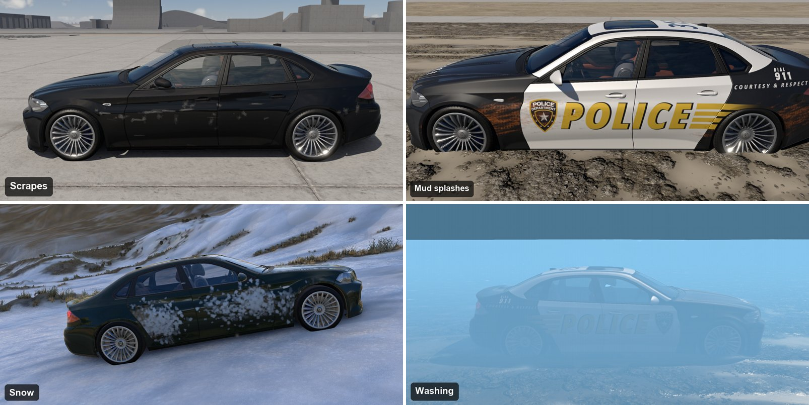
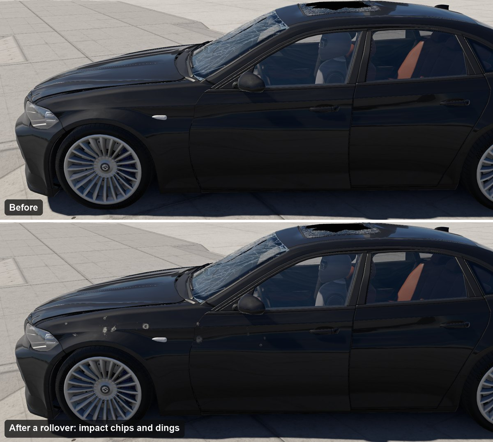
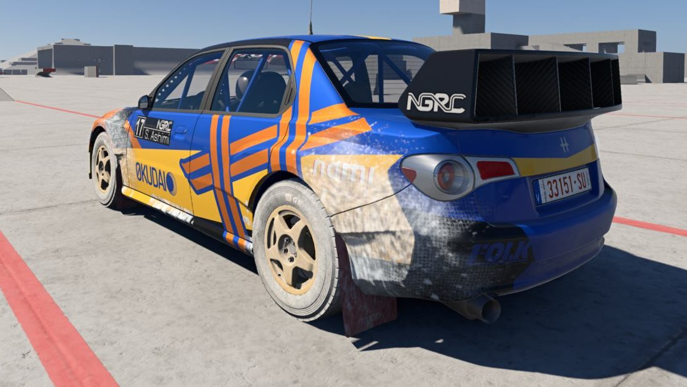
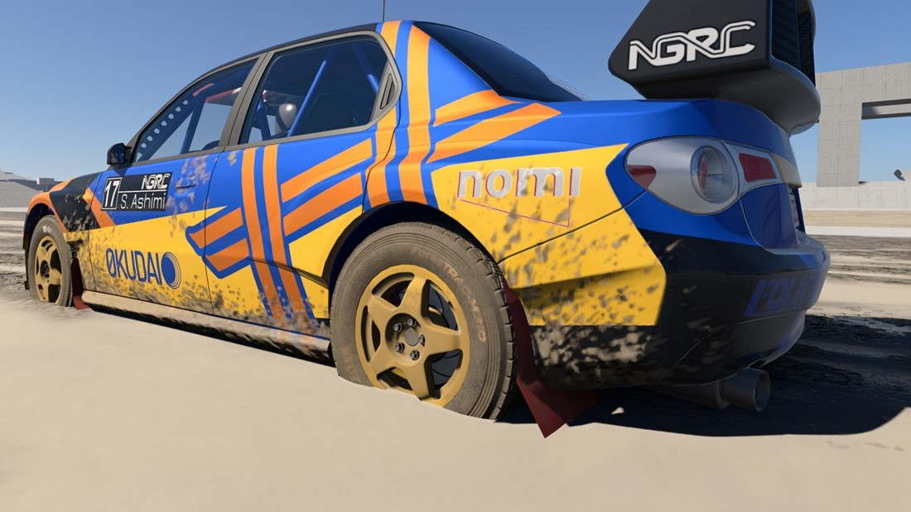
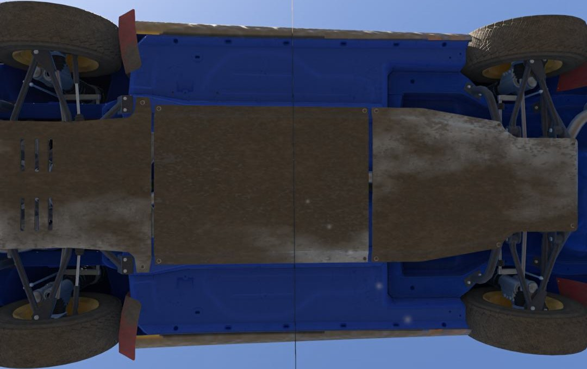
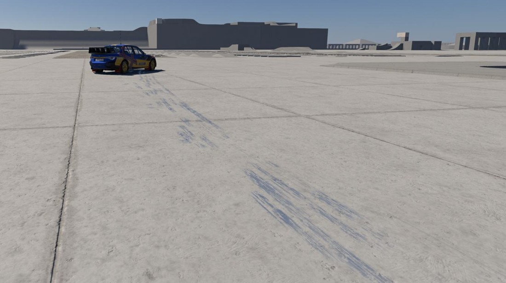

<h1 align="center">Scratches Mod for BeamNG.drive</h1>

  <b>Scrape a wall and the paint comes off right where you scraped it.</b> 
  Scratches, chips, mud, snow and a wash, all from what your car really touched.

  

  
  
  
  

  

## What it feels like

BeamNG bends your car beautifully. The paint stays showroom fresh no matter what
you do to it. This mod makes the paint take the hit too.

Slide down the road on your door and you get long scrape marks running the way
you slid. Clip a barrier and that corner chips. Drive through a mud pit and it
gets thrown up behind the wheels. Then find some deep water, drive in, and the
mud rinses off while the scratches stay.

None of it is random. Every mark is there because that part of the car touched
something. There is nothing to set up and no keys to learn. Install it and go
crash.

Every picture on this page is a real in-game capture.

## Take the tour

### Scrapes that follow the slide

Same car, one sideslide. The marks run the direction you slid. The longer you
grind, the deeper it goes: scuffed clear coat first, then grey primer, then bare
metal that actually shines.

### Chips where you hit

Hard hits chip the paint right where they land. Hit harder, or hit the same
spot again, and the chips get bigger and go down to metal.

### Your paint and livery survive

The mod never repaints your car. Pick any colour or factory livery you like. It
stays exactly as it was, and the damage sits on top of it.

### Works on 38 stock vehicles

Cars, a pickup, even the city bus. The same slide ten times over, and each one
keeps its own paint or livery. It works on every stock vehicle that
supports the game's Dynamic Textures, and that is 38 of them.

### Mud and dirt

<table>
  <tr>
    <td width="50%"></td>
    <td width="50%"></td>
  </tr>
  <tr>
    <td valign="top"><b>Flung up from the wheels.</b> Mud flies up and back from each tyre and builds up the longer you drive. Go faster and it throws further. Reverse and it throws the other way.</td>
    <td valign="top"><b>On top of the scrapes.</b> This car slid first and went mudding after. The mud has a bit of lumpy texture, and the scratches are still there under it.</td>
  </tr>
</table>

### Mud the colour of the ground

Mud used to be one orange colour everywhere. Now it takes its colour from the
ground under your wheels, so grey mud leaves grey grime.

### Washing and snow

<table>
  <tr>
    <td width="50%"></td>
    <td width="50%"></td>
  </tr>
  <tr>
    <td valign="top"><b>It washes off in water.</b> Drive in deep enough to cover the body and the mud rinses away in a few seconds. The car comes out wet and shiny, then dries. The scratches don't wash off.</td>
    <td valign="top"><b>Snow sticks too.</b> Drive through snow and it builds up on the lower panels, the same way mud does.</td>
  </tr>
</table>

<!-- NEW-FEATURES-START -->
## New in this build

### Snow flies now

Snow gets thrown up from the wheels as powder now, the way mud is, instead of
landing in flat patches. It still packs into the arches, and the tyres and rims
go white.

### Muddy wheels, muddy belly

<table>
  <tr>
    <td width="50%"></td>
    <td width="50%"></td>
  </tr>
  <tr>
    <td valign="top"><b>Wheels and tyres get dirty.</b> Tyres cake up fast, rims take a lighter dusting, and both rinse off in water with the rest of the car. Drag a wheel along on its side and the rim gets scuffed.</td>
    <td valign="top"><b>So does the underside.</b> Skid plates, suspension, exhaust, mud flaps and running boards pick up mud as you drive, and it cakes under the sills. In deep mud it builds up along them too. Bottom out and the belly gets scuffed.</td>
  </tr>
</table>

Mud is also darker and thicker now. It used to be the colour of the dry ground
and half see-through, which was hard to see on bright paint. Wet mud is darker
than the dirt it came from, and it covers what it lands on.

### You leave paint behind

Scrape along the road and the road keeps some of it: streaks of your paint, then
primer and bare metal as the panel wears through. Wheels dragged on their sides
leave marks too. The marks fade after a few minutes.

These are fresh. They have been driven on Vulkan on a handful of cars, with the
snow fed in by hand because the test map has none. The
[known issues](docs/known-issues.md) page says what is still missing.
<!-- NEW-FEATURES-END -->

## Install

1. **Download** `scratches_mod.zip` from the [newest release](https://github.com/stephenfjohnson/beamng-scratches-mod/releases).
2. **Drop it in your mods folder.** Don't unzip it. In the BeamNG launcher, open
   your user folder and put the ZIP in `mods`. For most people that is
   `%LOCALAPPDATA%\BeamNG\BeamNG.drive\current\mods\`.
3. **Drive.** Start the game, spawn a car and go hit something. No console
   commands, no settings.

To remove it, delete the ZIP and restart the game. The
[install page](docs/install.md) has the full notes.

## Good to know

- **It's cosmetic.** It only paints the car. It doesn't change how the car bends
  or drives.
- **Marks clear when you reset.** Press `Ctrl+R` and you get a clean car.
  Switching or reloading the car clears them too. Nothing is saved.
- **Use Vulkan if you can.** On DirectX 12 the game can freeze for about half a
  second now and then while a mark is painted. Switch in Options, Graphics.
- **It's a preview.** Scrapes have been crash-tested on a spread of vehicles.
  Mud, snow and washing have mostly been driven on the ETK 800, with mud also on
  a Covet. Expect some rough edges, including a rare half-second pause in a crash.
- **Some cars are left alone.** If a vehicle has no Dynamic Textures support, or
  you are using your own Dynamic Textures design or another mod's body, the mod
  skips that car and leaves its paint as it is.
- **Found a bug?** The mod has a [debug panel](docs/debug-panel.md) with a
  one-click report you can paste into an issue.

The full list is in [known issues](docs/known-issues.md).

## Docs

All the technical detail lives in [`docs/`](docs/README.md):

- [Features in detail](docs/features.md)
- [Install, use and uninstall](docs/install.md)
- [Known issues and supported vehicles](docs/known-issues.md), plus the tested [compatibility matrix](docs/compatibility.md)
- [The debug panel](docs/debug-panel.md)
- [How it works](docs/how-it-works.md)
- [Performance](docs/performance.md)
- [Development and packaging](docs/development.md), [contributing](CONTRIBUTING.md)
- [Changelog](CHANGELOG.md), [open work](TODO.md), [milestone history](docs/milestones.md)

## License

[MIT](LICENSE). Do what you like with it.
