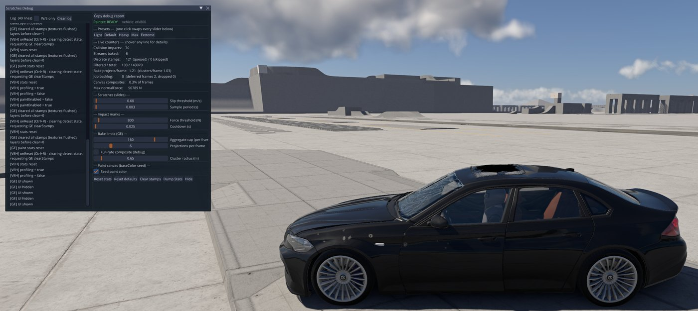

# The debug panel

[Docs index](README.md) · [Back to the project front page](../README.md)

A bindable two-pane window. It has a live log merged from both Lua VMs, one-click
**Copy debug report**, Light→Extreme presets, live counters (impacts, streams,
bakes, backlog, composites) and sliders for every threshold and limit.

A two-pane in-game window for diagnosing and tuning the mod.

**Left — log pane.** A live, color-coded feed of every mod log line, merged
from both Lua VMs and tagged `[GE]` (painter) or `[VEH]` (detector). Includes a
`W/E only` filter and a `Clear log` button.

**Right — controls.**

- **Copy debug report** — one click copies a compact, paste-ready report
  (environment, stats, tunables, relevant log lines) to the clipboard. This is
  the fastest way to report a bug.
- **Status header** — `Painter: READY` / `NOT READY` plus the current vehicle.
- **Presets** — `Light` · `Default` · `Heavy` · `Max` · `Extreme`, one click to
  swap every tunable.
- **Live counters** — impacts, streams, baked stamps, projection cost, job
  backlog, and how often the canvas is re-composited.
- **Sliders** — slide/impact thresholds, bake limits (aggregate cap,
  projections per frame, cluster radius), and the paint-color seed.
- **Full-rate composite (debug)** — restores the stock every-frame canvas
  composite. Leave it off; it exists only to rule the composite skip out when
  diagnosing missing marks.
- **Buttons** — reset stats, restore defaults, clear stamps, dump full stats.

Controls that need a bound projection grey out until the painter is ready.

## Opening it

The panel toggle is a **bindable key**. After first launch, open
**Options → Controls → Bindings**, find **"Toggle Scratches Debug Panel"** in
the **Debug** category, and assign a key. It works in any context.

## Console probes

The fastest loop: reproduce a problem, open the debug panel, click **Copy
debug report**, and paste it. Useful console probes (game-engine Lua) still
exist — `scratches_paint.dumpState()`, `scratches_paint.deepProbe()`,
`scratches_paint.dumpPaintStats()`, `scratches_paint.buildDebugReport()` — and
on the vehicle side, `scratches_detect.dumpStats()`.
