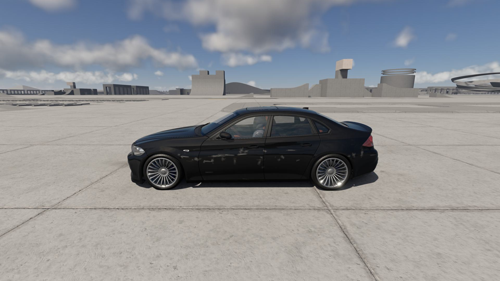
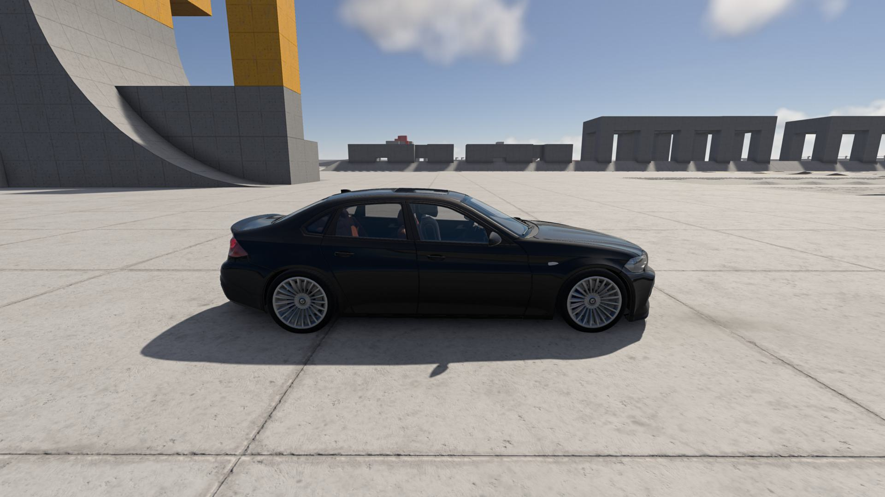
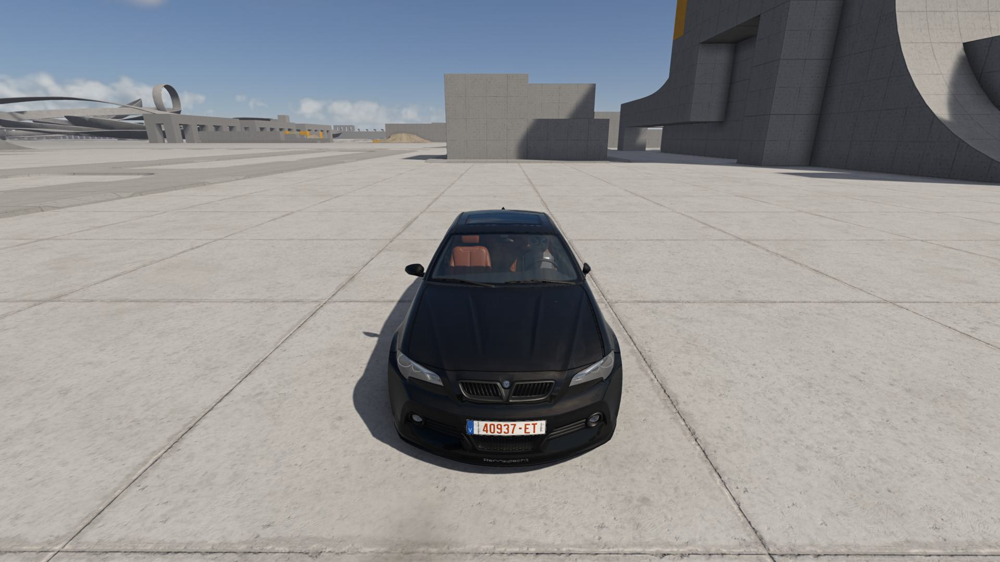
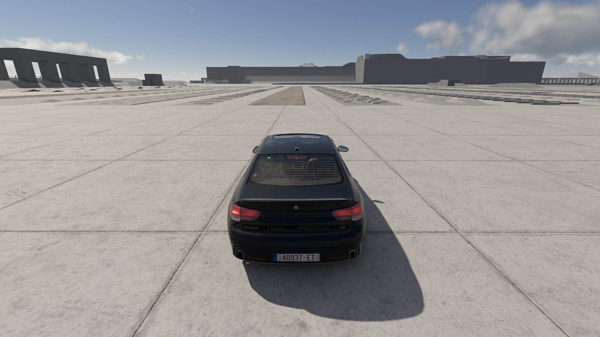
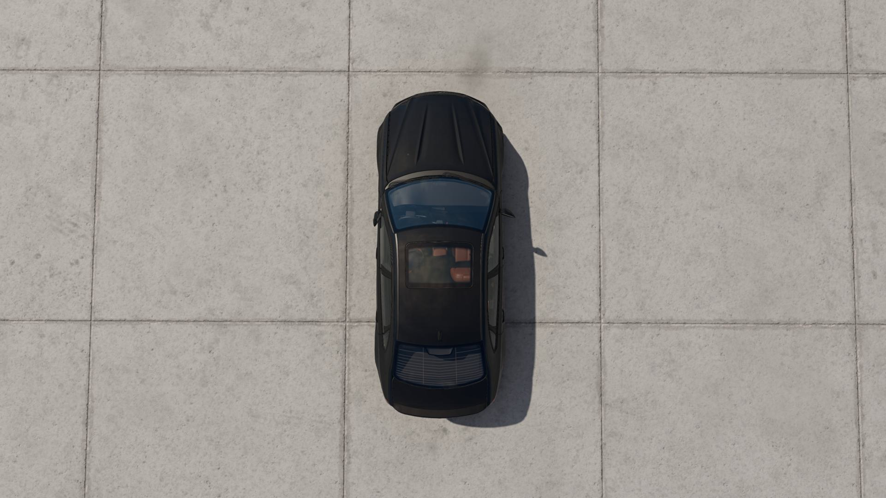

# sideslide - 20261114-162635_sideslide_m4-accepted-plain-dark

_on its side, sliding along the ground at 14 m/s - one long scrape_

Settled: True after 4.442 s - 140 frames, 31.4 fps average (background limiter lifted)
Went past upside down: True (lowest up-vector z -0.172)

## Marks

| contacts | passed filters | impacts | streams | stamps | projections | bakes | missed | jobs dropped | deferred frames |
|---|---|---|---|---|---|---|---|---|---|
| 864 | 243 | 114 | 45 | 201 | 79 | 58 | 0.0% | 0 | 8 |

Rejected contacts: Wheel 427, BelowThresh 193, NormalForce 1

Body materials: METAL 176, PLASTIC 67

Surfaces: ASPHALT 243

## Cost

| | avg | p95 | max |
|---|---|---|---|
| painter (GE), ms/frame | 18.894 | 44.439 | 62.297 |
| whole frame, ms | 28.761 (p50) | 55.644 | 72.845 |
| all GE Lua, ms | | 45.551 | 63.549 |
| physics + vehicle Lua, ms | | 7.164 | 10.373 |
| render, ms | | 2.728 | |

- Painter frames over 4 ms: 76; worst flush (project + bake) 62.267 ms, worst composite 0.123 ms.
- Detector: 1.985 us per contact, 4.438 ms total, worst frame 0.678 ms (profiled; the timer adds a little).

### Worst frames

| t (s) | frame ms | painter ms | GE Lua ms | physics+VLUA ms | render ms |
|---|---|---|---|---|---|
| 3.48 | 72.84 | 44.44 | 0.92 | 9.82 | 1.90 |
| 1.66 | 71.86 | 62.30 | 0.99 | 2.32 | 1.54 |
| 0.59 | 71.01 | 42.25 | 1.13 | 3.37 | 1.79 |
| 1.44 | 70.76 | 50.86 | 19.59 | 0.12 | 2.81 |
| 0.38 | 69.27 | 58.27 | 0.97 | 0.05 | 2.04 |

## Screenshots

