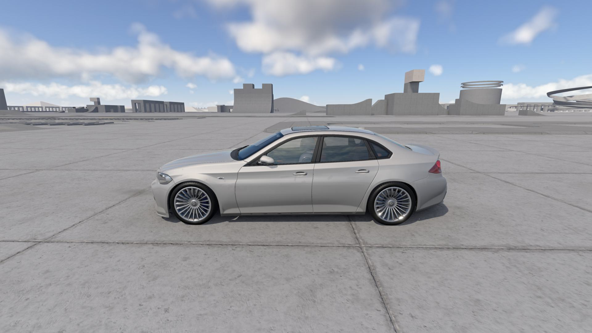
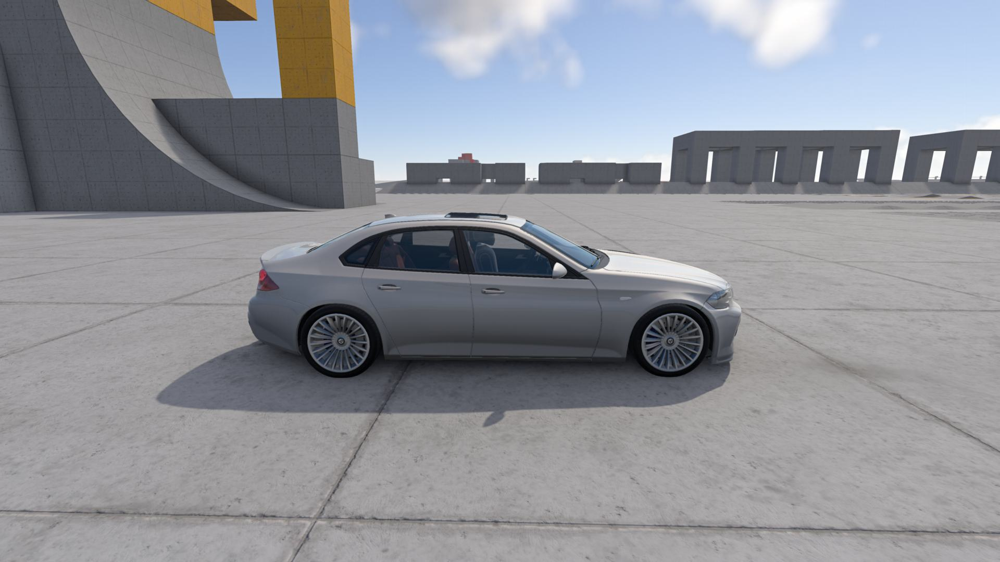
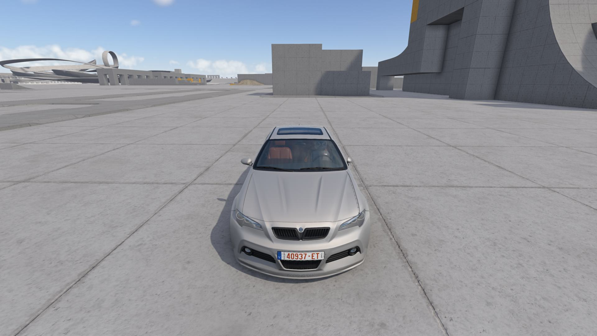
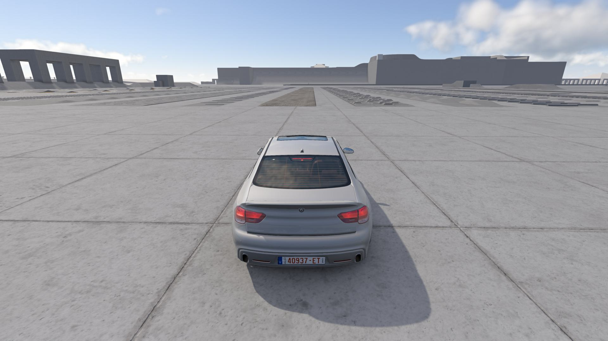
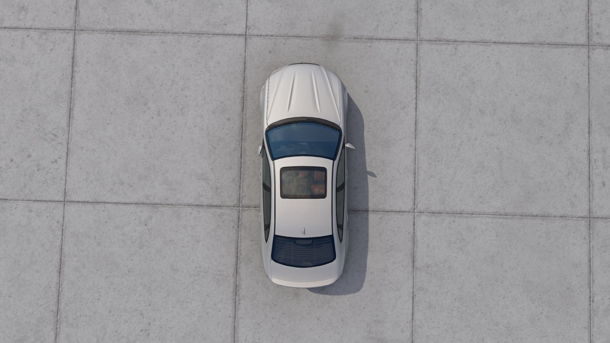

# sideslide - 20261114-162713_sideslide_m4-accepted-plain-light

_on its side, sliding along the ground at 14 m/s - one long scrape_

Settled: True after 5.409 s - 113 frames, 20.7 fps average (background limiter lifted)
Went past upside down: True (lowest up-vector z -0.17)

## Marks

| contacts | passed filters | impacts | streams | stamps | projections | bakes | missed | jobs dropped | deferred frames |
|---|---|---|---|---|---|---|---|---|---|
| 790 | 246 | 106 | 43 | 210 | 91 | 56 | 0.0% | 0 | 9 |

Rejected contacts: Wheel 348, BelowThresh 194, NormalForce 2

Body materials: METAL 182, PLASTIC 64

Surfaces: ASPHALT 246

## Cost

| | avg | p95 | max |
|---|---|---|---|
| painter (GE), ms/frame | 40.469 | 61.213 | 1098.062 |
| whole frame, ms | 57.53 (p50) | 75.616 | 1113.563 |
| all GE Lua, ms | | 62.594 | 1101.319 |
| physics + vehicle Lua, ms | | 11.359 | 13.903 |
| render, ms | | 3.341 | |

- Painter frames over 4 ms: 76; worst flush (project + bake) 1098.008 ms, worst composite 0.176 ms.
- Detector: 3.492 us per contact, 6.527 ms total, worst frame 0.908 ms (profiled; the timer adds a little).

### Worst frames

| t (s) | frame ms | painter ms | GE Lua ms | physics+VLUA ms | render ms |
|---|---|---|---|---|---|
| 4.52 | 1113.56 | 1098.06 | 1.05 | 4.99 | 2.77 |
| 1.30 | 83.88 | 63.42 | 55.74 | 0.10 | 3.07 |
| 2.75 | 78.60 | 66.61 | 50.71 | 0.14 | 2.98 |
| 1.09 | 77.37 | 55.70 | 37.92 | 0.09 | 2.76 |
| 3.54 | 76.81 | 61.64 | 45.83 | 0.13 | 2.51 |

## Screenshots

