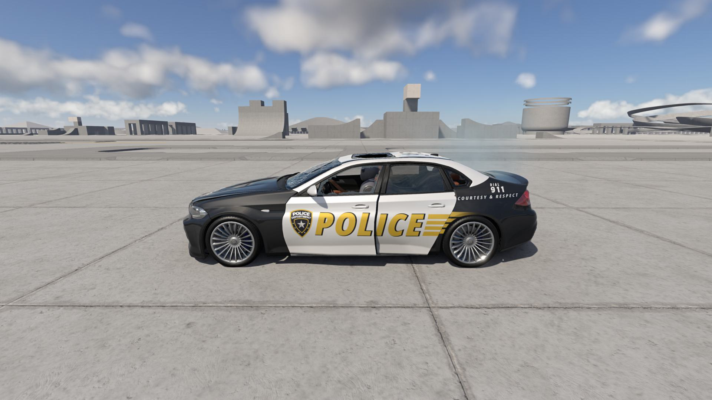
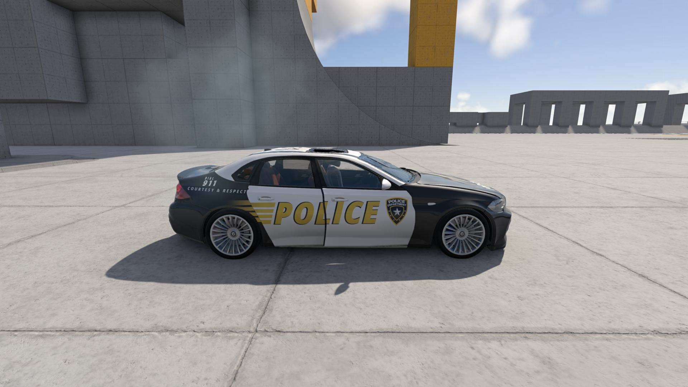
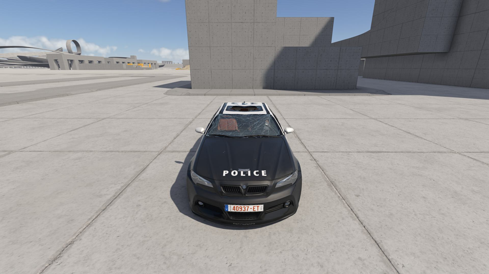
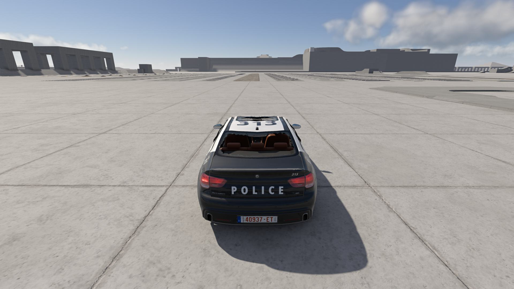
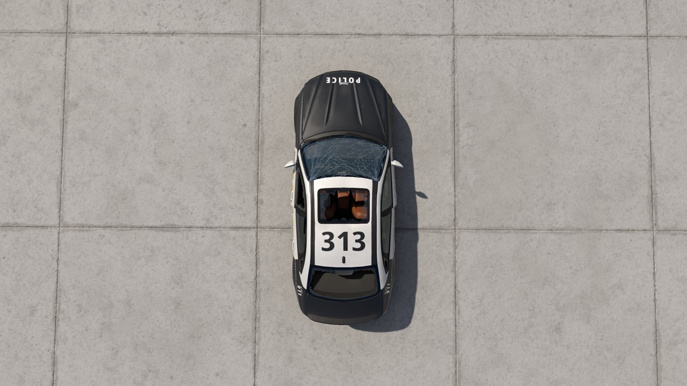

# roofdrop - 20261114-162741_roofdrop_m4-accepted-police-dark

_dropped upside down from about 1 m - roof impacts_

Settled: True after 6.313 s - 508 frames, 80.3 fps average (background limiter lifted)
Went past upside down: True (lowest up-vector z -1.0)

## Marks

| contacts | passed filters | impacts | streams | stamps | projections | bakes | missed | jobs dropped | deferred frames |
|---|---|---|---|---|---|---|---|---|---|
| 1340 | 57 | 57 | 0 | 51 | 19 | 15 | 0.0% | 0 | 0 |

Rejected contacts: PartExcluded 777, BelowThresh 506

Body materials: METAL 56, PLASTIC 1

Surfaces: ASPHALT 57

## Cost

| | avg | p95 | max |
|---|---|---|---|
| painter (GE), ms/frame | 1.403 | 7.46 | 54.043 |
| whole frame, ms | 11.217 (p50) | 20.543 | 65.103 |
| all GE Lua, ms | | 8.751 | 55.142 |
| physics + vehicle Lua, ms | | 0.128 | 1.772 |
| render, ms | | 3.465 | |

- Painter frames over 4 ms: 28; worst flush (project + bake) 31.557 ms, worst composite 0.116 ms.
- Detector: 2.831 us per contact, 7.631 ms total, worst frame 0.787 ms (profiled; the timer adds a little).

### Worst frames

| t (s) | frame ms | painter ms | GE Lua ms | physics+VLUA ms | render ms |
|---|---|---|---|---|---|
| 0.74 | 65.10 | 54.04 | 31.71 | 0.15 | 2.83 |
| 0.95 | 57.28 | 41.31 | 16.36 | 0.10 | 2.55 |
| 1.18 | 52.04 | 40.66 | 14.72 | 0.08 | 2.80 |
| 1.59 | 49.73 | 39.67 | 32.54 | 0.06 | 2.24 |
| 1.16 | 42.83 | 13.42 | 1.05 | 0.22 | 3.66 |

## Screenshots

