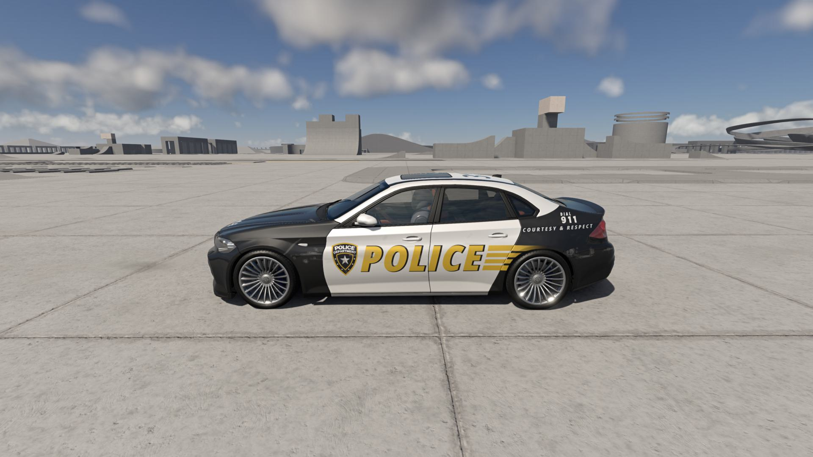
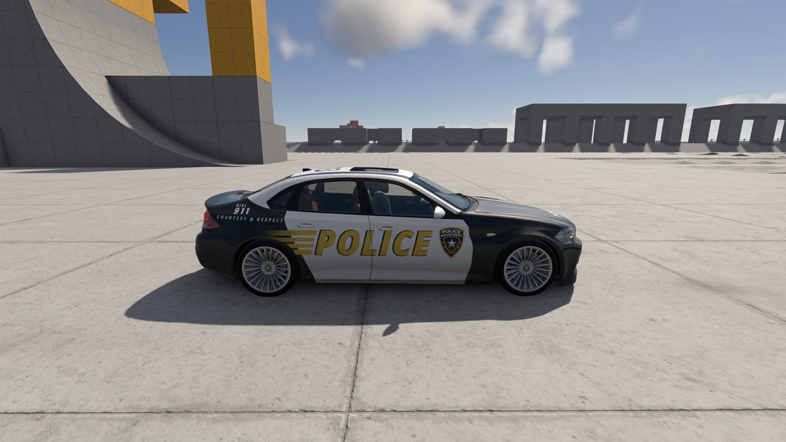
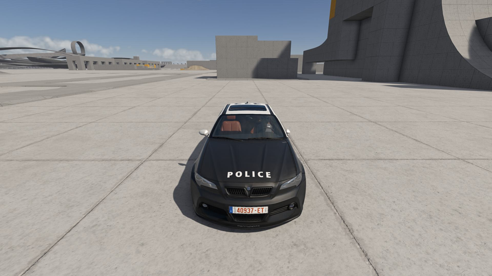
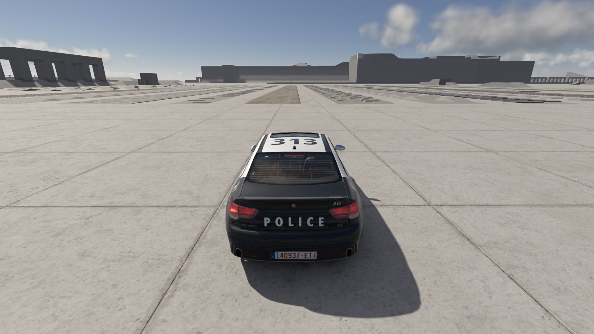
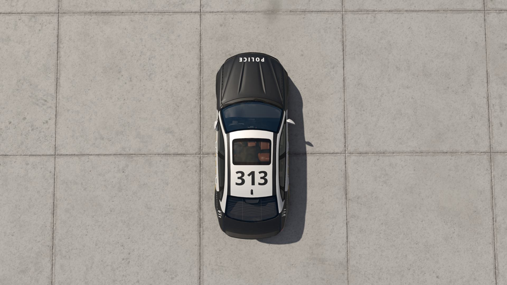

# sideslide - 20261114-162810_sideslide_m4-accepted-police-light

_on its side, sliding along the ground at 14 m/s - one long scrape_

Settled: True after 4.268 s - 127 frames, 29.5 fps average (background limiter lifted)
Went past upside down: True (lowest up-vector z -0.156)

## Marks

| contacts | passed filters | impacts | streams | stamps | projections | bakes | missed | jobs dropped | deferred frames |
|---|---|---|---|---|---|---|---|---|---|
| 960 | 288 | 76 | 65 | 142 | 86 | 54 | 0.0% | 0 | 11 |

Rejected contacts: Wheel 507, BelowThresh 165

Body materials: METAL 213, PLASTIC 75

Surfaces: ASPHALT 288

## Cost

| | avg | p95 | max |
|---|---|---|---|
| painter (GE), ms/frame | 21.718 | 49.759 | 55.444 |
| whole frame, ms | 39.638 (p50) | 63.864 | 81.617 |
| all GE Lua, ms | | 50.957 | 56.958 |
| physics + vehicle Lua, ms | | 8.289 | 11.172 |
| render, ms | | 2.909 | |

- Painter frames over 4 ms: 71; worst flush (project + bake) 55.404 ms, worst composite 0.115 ms.
- Detector: 2.449 us per contact, 5.769 ms total, worst frame 1.089 ms (profiled; the timer adds a little).

### Worst frames

| t (s) | frame ms | painter ms | GE Lua ms | physics+VLUA ms | render ms |
|---|---|---|---|---|---|
| 0.59 | 81.62 | 49.76 | 1.18 | 0.07 | 9.54 |
| 1.90 | 73.60 | 55.44 | 27.71 | 0.16 | 2.62 |
| 2.10 | 69.24 | 49.59 | 41.63 | 0.11 | 2.70 |
| 0.38 | 68.80 | 55.31 | 1.23 | 0.09 | 2.54 |
| 0.67 | 65.29 | 49.20 | 40.39 | 0.13 | 2.22 |

## Screenshots

