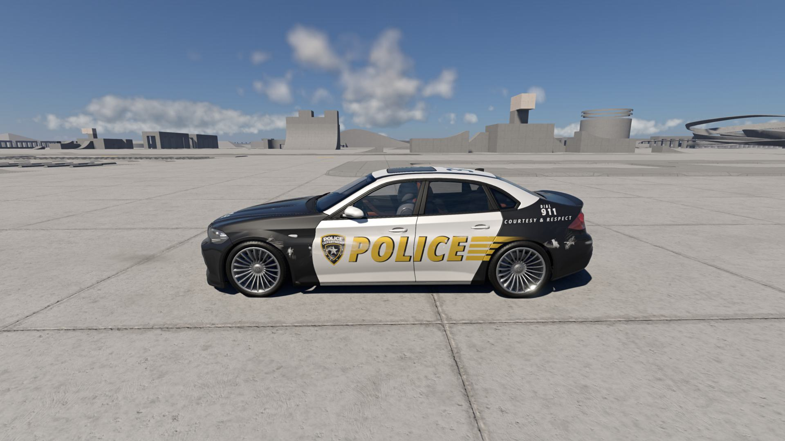
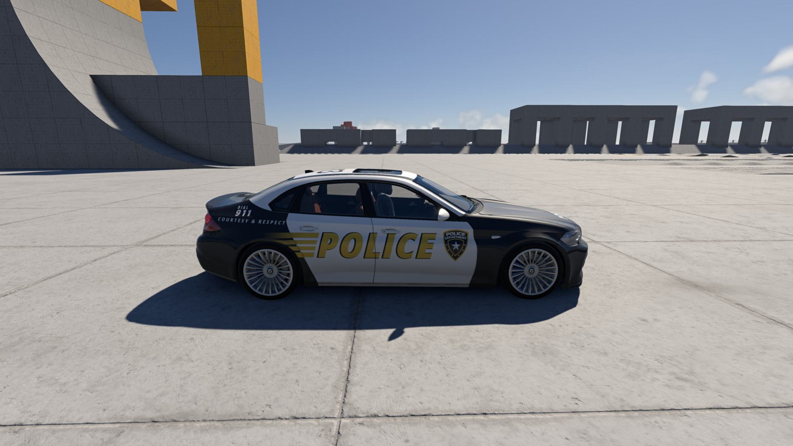
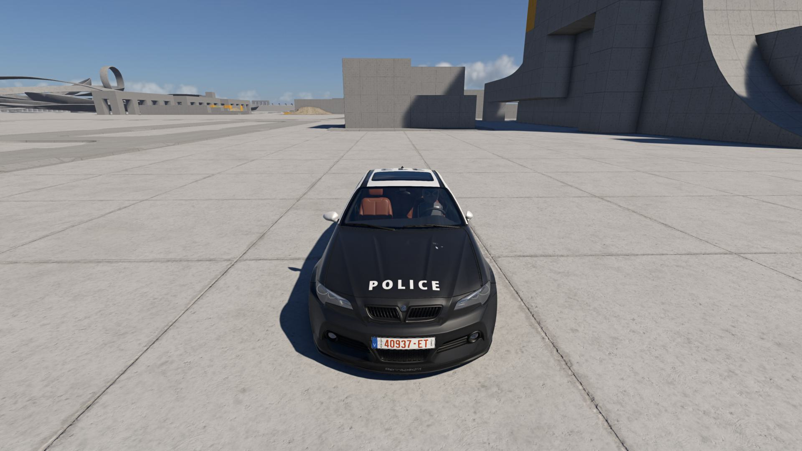
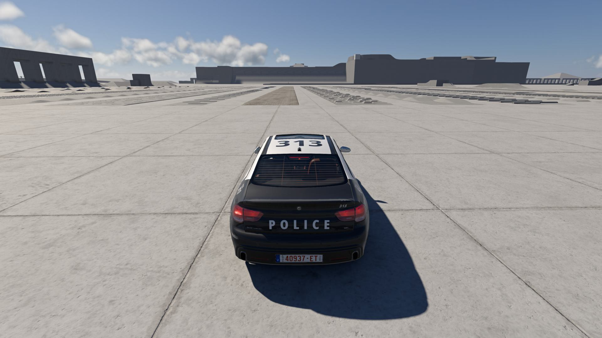
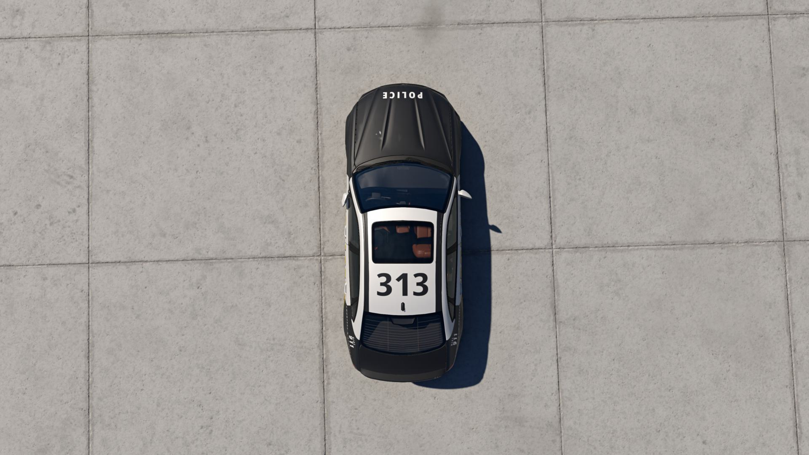

# sideslide - 20261114-161415_sideslide_m4-before

_on its side, sliding along the ground at 14 m/s - one long scrape_

Settled: True after 4.295 s - 118 frames, 27.2 fps average (background limiter lifted)
Went past upside down: True (lowest up-vector z -0.153)

## Marks

| contacts | passed filters | impacts | streams | stamps | projections | bakes | missed | jobs dropped | deferred frames |
|---|---|---|---|---|---|---|---|---|---|
| 901 | 268 | 102 | 50 | 173 | 83 | 52 | 0.0% | 0 | 12 |

Rejected contacts: Wheel 469, BelowThresh 162, NormalForce 2

Body materials: METAL 200, PLASTIC 68

Surfaces: ASPHALT 268

## Cost

| | avg | p95 | max |
|---|---|---|---|
| painter (GE), ms/frame | 23.013 | 53.331 | 68.303 |
| whole frame, ms | 41.94 (p50) | 65.172 | 83.088 |
| all GE Lua, ms | | 54.582 | 69.168 |
| physics + vehicle Lua, ms | | 8.643 | 13.827 |
| render, ms | | 2.763 | |

- Painter frames over 4 ms: 68; worst flush (project + bake) 68.26 ms, worst composite 0.116 ms.
- Detector: 2.083 us per contact, 5.075 ms total, worst frame 1.094 ms (profiled; the timer adds a little).

### Worst frames

| t (s) | frame ms | painter ms | GE Lua ms | physics+VLUA ms | render ms |
|---|---|---|---|---|---|
| 0.38 | 83.09 | 68.30 | 0.96 | 0.07 | 2.43 |
| 2.19 | 70.28 | 62.55 | 0.88 | 0.08 | 2.00 |
| 2.05 | 68.18 | 56.99 | 40.37 | 0.07 | 2.58 |
| 0.39 | 68.10 | 60.92 | 69.17 | 0.06 | 1.72 |
| 1.95 | 67.11 | 59.49 | 7.44 | 0.10 | 1.63 |

## Screenshots

