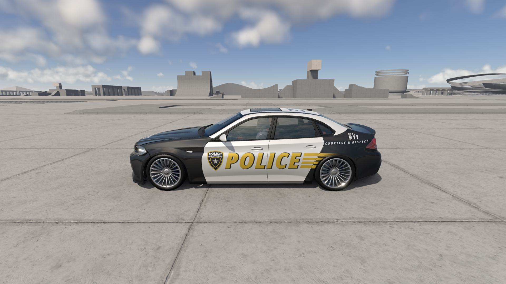
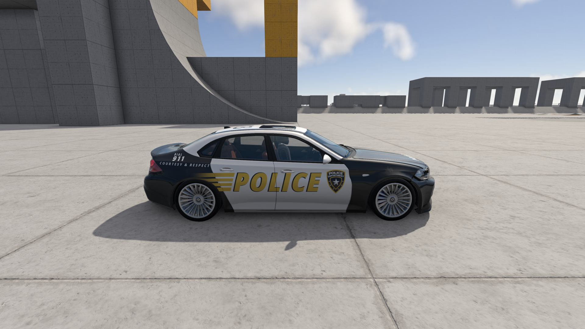
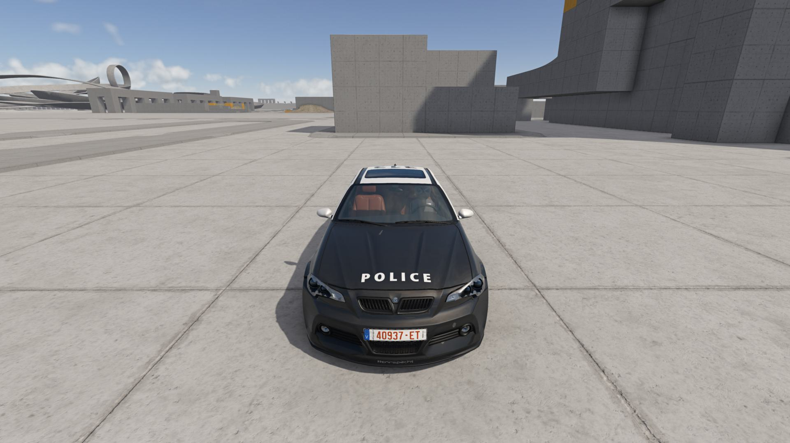
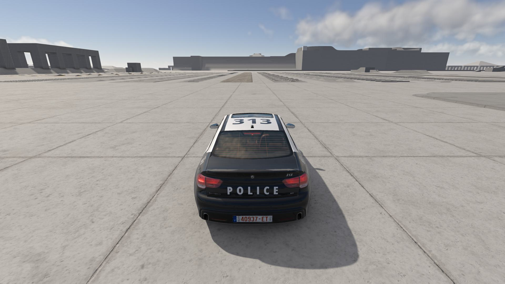
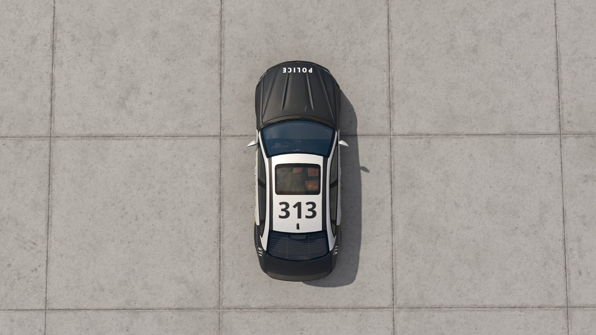

# nosedive - 20261114-163046_nosedive_m4-impact-police

_pitched nose-down 40 deg, dropped from 1.6 m at 9 m/s_

Settled: True after 3.161 s - 293 frames, 92.4 fps average (background limiter lifted)
Went past upside down: False (lowest up-vector z 0.77)

## Marks

| contacts | passed filters | impacts | streams | stamps | projections | bakes | missed | jobs dropped | deferred frames |
|---|---|---|---|---|---|---|---|---|---|
| 2450 | 77 | 19 | 9 | 37 | 16 | 12 | 0.0% | 0 | 1 |

Rejected contacts: Wheel 2348, BelowThresh 15, PartExcluded 10

Body materials: PLASTIC 75, METAL 2

Surfaces: ASPHALT 77

## Cost

| | avg | p95 | max |
|---|---|---|---|
| painter (GE), ms/frame | 2.006 | 22.829 | 50.656 |
| whole frame, ms | 10.602 (p50) | 32.263 | 60.107 |
| all GE Lua, ms | | 23.807 | 51.609 |
| physics + vehicle Lua, ms | | 0.1 | 0.608 |
| render, ms | | 2.886 | |

- Painter frames over 4 ms: 18; worst flush (project + bake) 49.716 ms, worst composite 0.098 ms.
- Detector: 0.822 us per contact, 4.402 ms total, worst frame 0.953 ms (profiled; the timer adds a little).

### Worst frames

| t (s) | frame ms | painter ms | GE Lua ms | physics+VLUA ms | render ms |
|---|---|---|---|---|---|
| 0.43 | 60.11 | 50.66 | 41.78 | 0.05 | 1.88 |
| 0.85 | 60.03 | 49.75 | 0.81 | 0.08 | 2.04 |
| 0.66 | 58.18 | 48.52 | 30.03 | 0.25 | 2.48 |
| 0.42 | 54.41 | 40.86 | 0.82 | 0.04 | 1.83 |
| 1.09 | 53.31 | 37.74 | 38.44 | 0.07 | 2.38 |

## Screenshots

