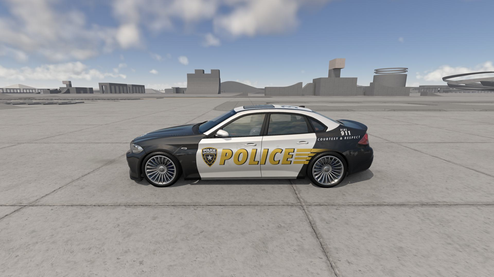
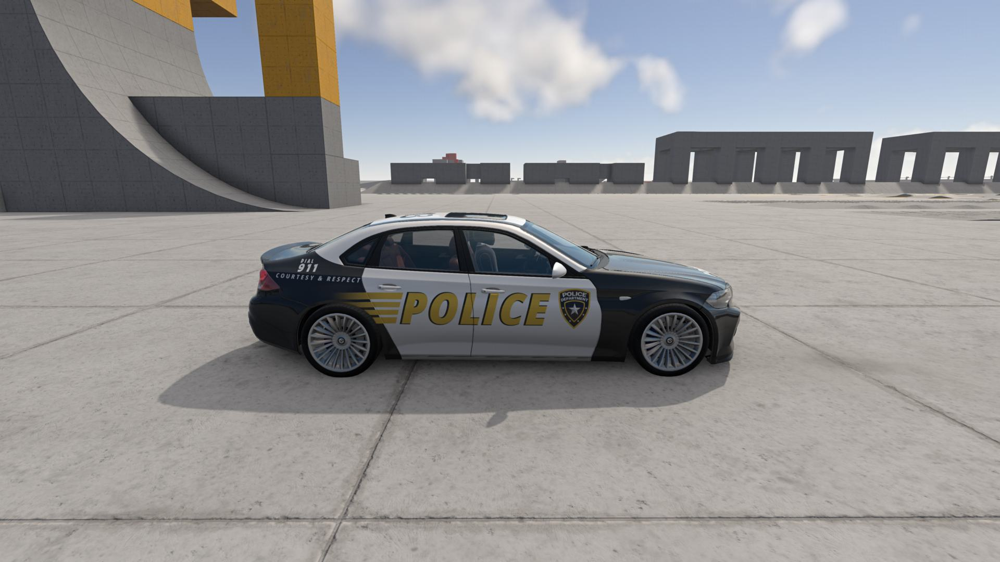
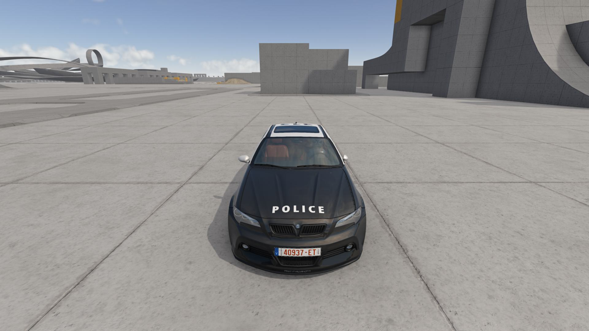
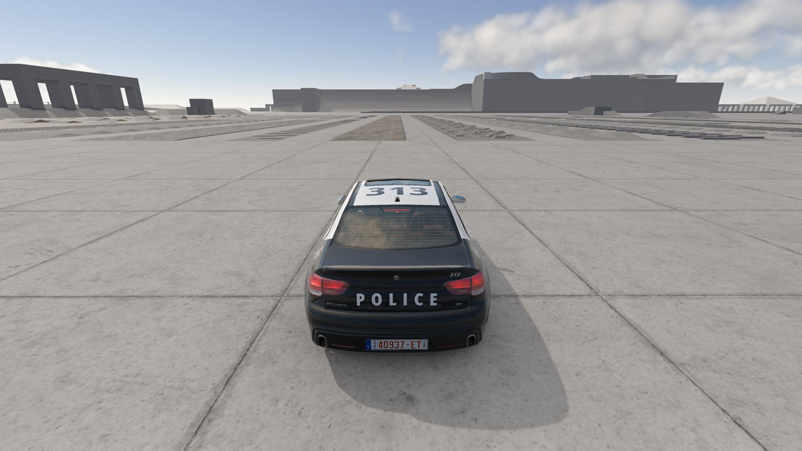
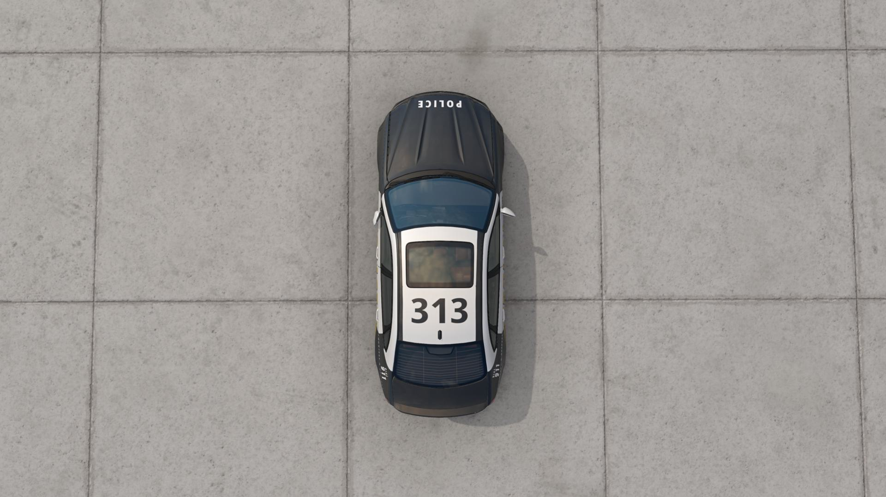

# sideslide - 20261114-163117_sideslide_m4-persistence

_on its side, sliding along the ground at 14 m/s - one long scrape_

Settled: True after 4.714 s - 142 frames, 30.0 fps average (background limiter lifted)
Went past upside down: True (lowest up-vector z -0.17)

## Marks

| contacts | passed filters | impacts | streams | stamps | projections | bakes | missed | jobs dropped | deferred frames |
|---|---|---|---|---|---|---|---|---|---|
| 993 | 260 | 97 | 51 | 187 | 87 | 57 | 0.0% | 0 | 14 |

Rejected contacts: Wheel 463, BelowThresh 270

Body materials: METAL 191, PLASTIC 69

Surfaces: ASPHALT 260

## Cost

| | avg | p95 | max |
|---|---|---|---|
| painter (GE), ms/frame | 18.621 | 45.46 | 57.97 |
| whole frame, ms | 25.008 (p50) | 59.066 | 70.936 |
| all GE Lua, ms | | 47.431 | 59.183 |
| physics + vehicle Lua, ms | | 8.401 | 11.599 |
| render, ms | | 2.957 | |

- Painter frames over 4 ms: 75; worst flush (project + bake) 57.882 ms, worst composite 0.102 ms.
- Detector: 2.037 us per contact, 4.819 ms total, worst frame 0.634 ms (profiled; the timer adds a little).

### Worst frames

| t (s) | frame ms | painter ms | GE Lua ms | physics+VLUA ms | render ms |
|---|---|---|---|---|---|
| 2.66 | 70.94 | 57.97 | 1.21 | 3.40 | 2.60 |
| 2.42 | 67.64 | 47.93 | 40.89 | 0.11 | 1.89 |
| 3.36 | 64.37 | 45.46 | 35.49 | 0.08 | 1.89 |
| 0.60 | 63.90 | 52.12 | 0.94 | 4.53 | 1.56 |
| 0.69 | 60.85 | 44.07 | 40.45 | 0.10 | 1.81 |

## Screenshots

