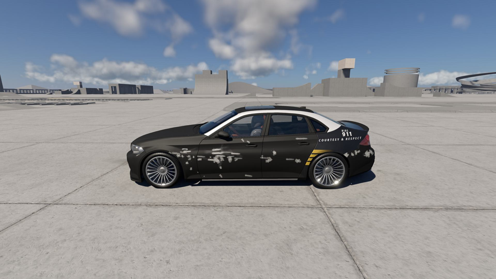
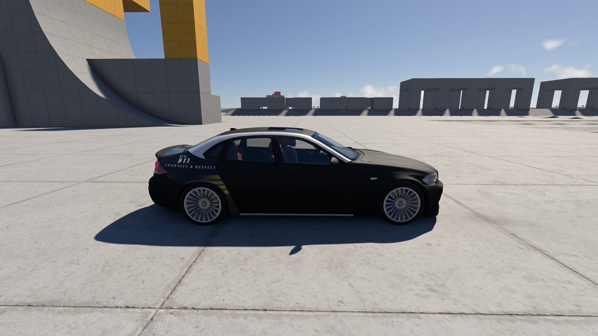
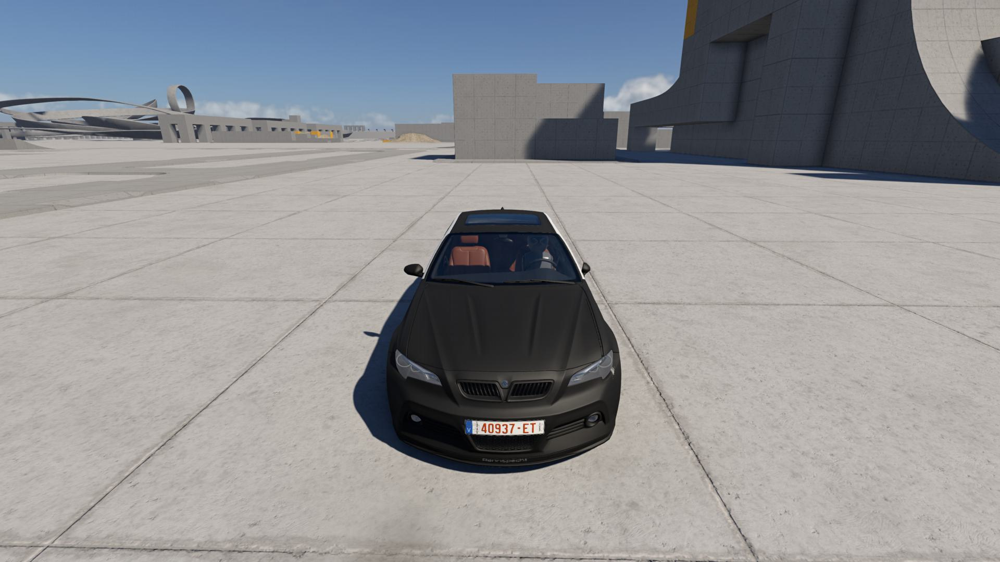
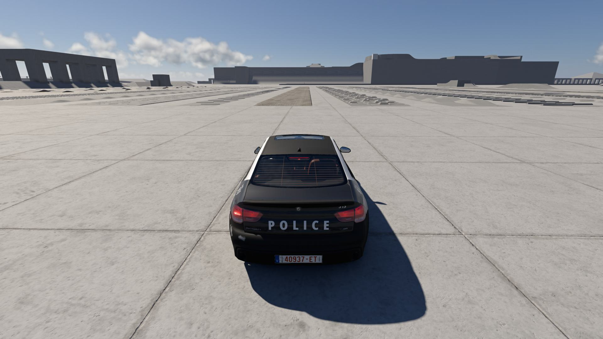
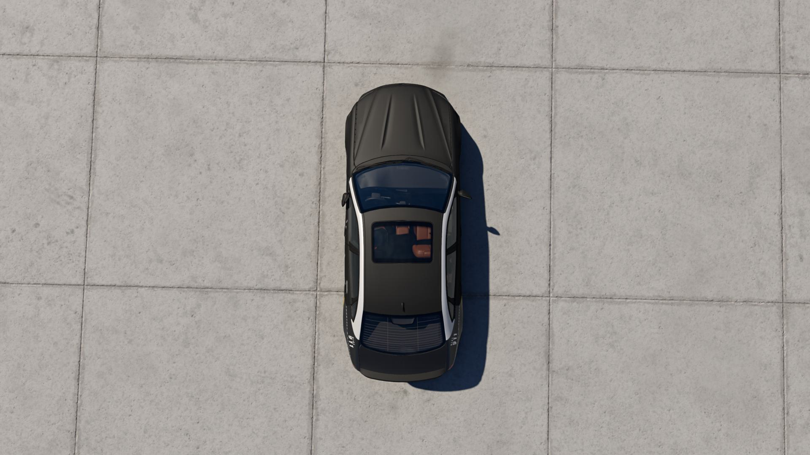

# sideslide - 20261114-161651_sideslide_m4-mask-metallic

_on its side, sliding along the ground at 14 m/s - one long scrape_

Settled: True after 4.438 s - 142 frames, 31.9 fps average (background limiter lifted)
Went past upside down: True (lowest up-vector z -0.174)

## Marks

| contacts | passed filters | impacts | streams | stamps | projections | bakes | missed | jobs dropped | deferred frames |
|---|---|---|---|---|---|---|---|---|---|
| 923 | 244 | 121 | 45 | 206 | 86 | 57 | 0.0% | 0 | 10 |

Rejected contacts: Wheel 436, BelowThresh 241, NormalForce 2

Body materials: METAL 178, PLASTIC 66

Surfaces: ASPHALT 244

## Cost

| | avg | p95 | max |
|---|---|---|---|
| painter (GE), ms/frame | 17.723 | 44.335 | 55.908 |
| whole frame, ms | 25.641 (p50) | 56.148 | 73.363 |
| all GE Lua, ms | | 46.585 | 57.187 |
| physics + vehicle Lua, ms | | 6.04 | 7.976 |
| render, ms | | 2.847 | |

- Painter frames over 4 ms: 74; worst flush (project + bake) 55.844 ms, worst composite 0.115 ms.
- Detector: 1.792 us per contact, 4.238 ms total, worst frame 0.463 ms (profiled; the timer adds a little).

### Worst frames

| t (s) | frame ms | painter ms | GE Lua ms | physics+VLUA ms | render ms |
|---|---|---|---|---|---|
| 0.60 | 73.36 | 55.91 | 1.25 | 6.43 | 2.66 |
| 3.25 | 63.09 | 53.26 | 1.05 | 3.01 | 1.43 |
| 2.37 | 62.91 | 53.16 | 0.84 | 3.81 | 1.43 |
| 0.69 | 60.83 | 41.06 | 43.26 | 0.10 | 2.44 |
| 3.02 | 57.76 | 43.41 | 35.32 | 0.05 | 1.59 |

## Screenshots

