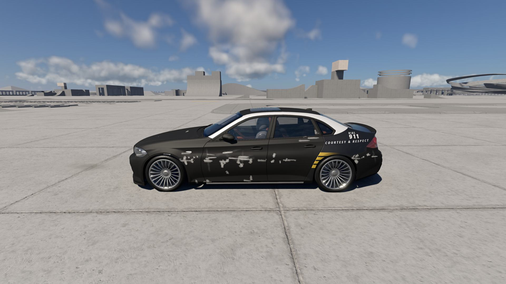
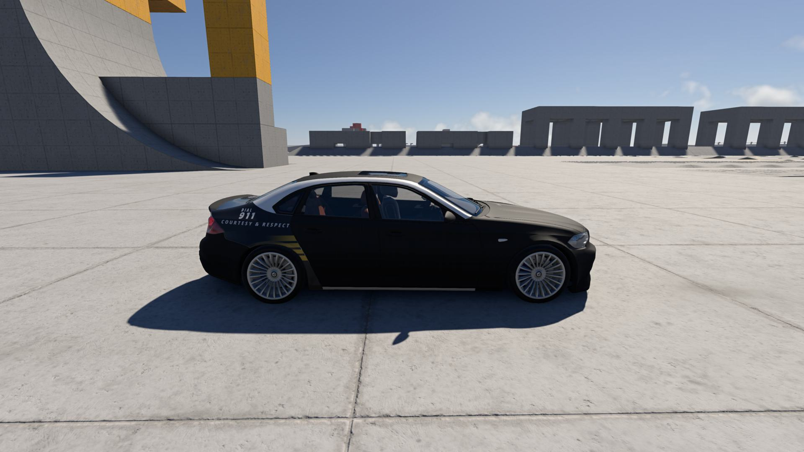
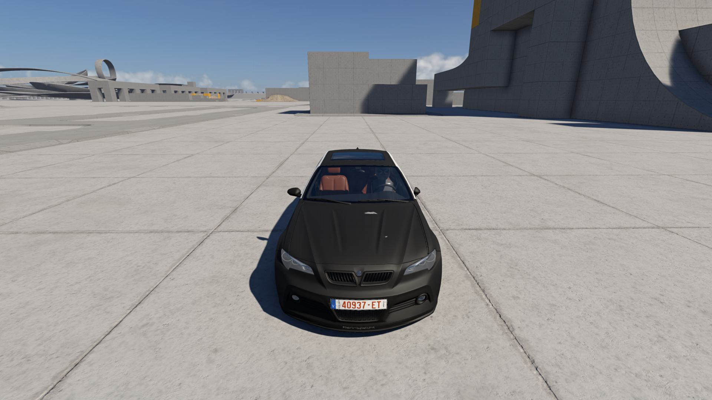
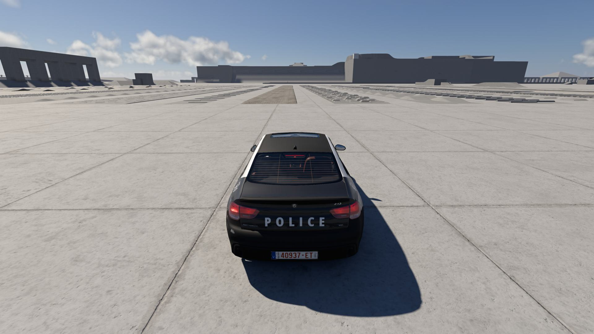
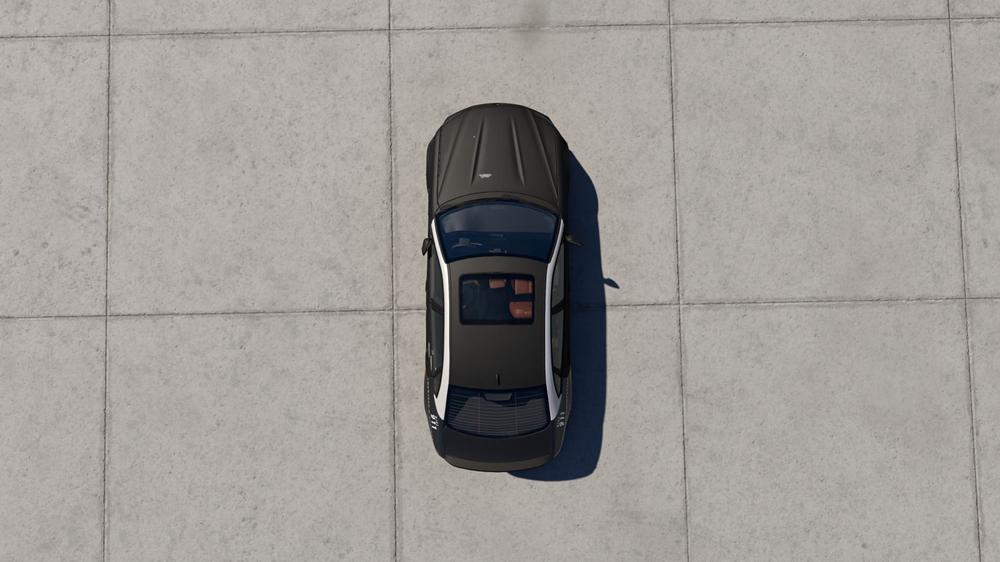

# sideslide - 20261114-161611_sideslide_m4-candidate

_on its side, sliding along the ground at 14 m/s - one long scrape_

Settled: True after 4.577 s - 108 frames, 23.3 fps average (background limiter lifted)
Went past upside down: True (lowest up-vector z -0.148)

## Marks

| contacts | passed filters | impacts | streams | stamps | projections | bakes | missed | jobs dropped | deferred frames |
|---|---|---|---|---|---|---|---|---|---|
| 826 | 223 | 82 | 45 | 181 | 84 | 52 | 0.0% | 0 | 10 |

Rejected contacts: Wheel 441, BelowThresh 160, NormalForce 2

Body materials: METAL 158, PLASTIC 65

Surfaces: ASPHALT 223

## Cost

| | avg | p95 | max |
|---|---|---|---|
| painter (GE), ms/frame | 29.081 | 59.655 | 99.423 |
| whole frame, ms | 53.145 (p50) | 73.746 | 118.882 |
| all GE Lua, ms | | 60.869 | 101.033 |
| physics + vehicle Lua, ms | | 13.748 | 15.956 |
| render, ms | | 3.331 | |

- Painter frames over 4 ms: 70; worst flush (project + bake) 76.954 ms, worst composite 0.382 ms.
- Detector: 2.908 us per contact, 5.498 ms total, worst frame 0.917 ms (profiled; the timer adds a little).

### Worst frames

| t (s) | frame ms | painter ms | GE Lua ms | physics+VLUA ms | render ms |
|---|---|---|---|---|---|
| 0.70 | 118.88 | 99.42 | 44.35 | 0.09 | 3.50 |
| 0.40 | 87.95 | 77.00 | 1.12 | 0.06 | 2.90 |
| 0.74 | 79.46 | 59.28 | 101.03 | 0.14 | 4.03 |
| 1.25 | 74.94 | 59.01 | 50.08 | 0.08 | 2.32 |
| 0.45 | 74.44 | 63.03 | 48.59 | 0.08 | 2.49 |

## Screenshots

