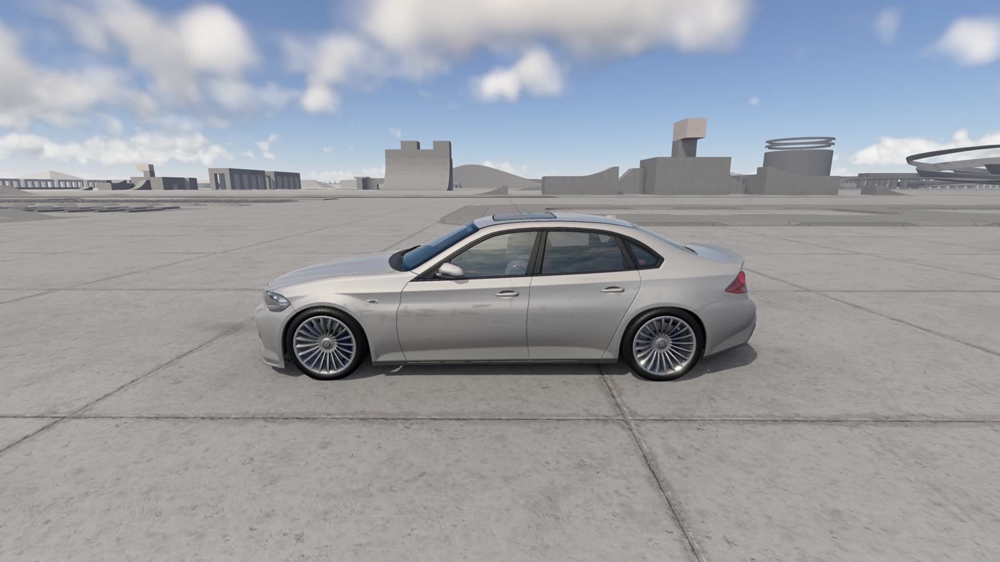
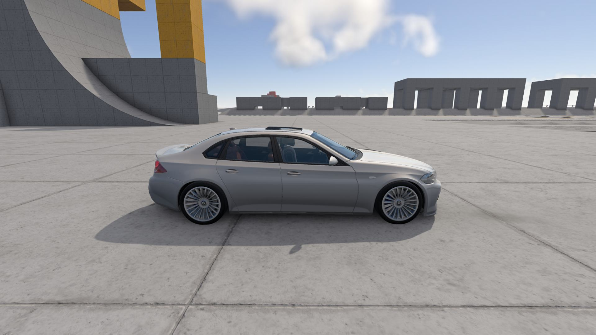
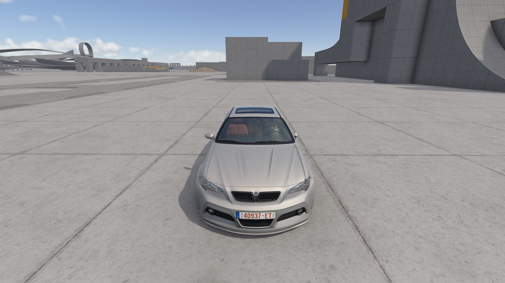
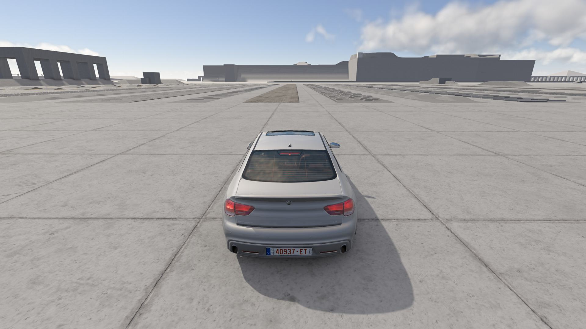
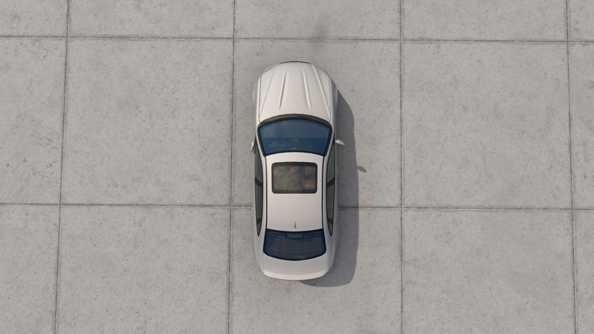

# sideslide - 20261114-163021_sideslide_m4-tone-plain-light

_on its side, sliding along the ground at 14 m/s - one long scrape_

Settled: True after 4.335 s - 141 frames, 32.4 fps average (background limiter lifted)
Went past upside down: True (lowest up-vector z -0.186)

## Marks

| contacts | passed filters | impacts | streams | stamps | projections | bakes | missed | jobs dropped | deferred frames |
|---|---|---|---|---|---|---|---|---|---|
| 1195 | 247 | 86 | 53 | 173 | 83 | 57 | 0.0% | 0 | 10 |

Rejected contacts: Wheel 675, BelowThresh 270, NormalForce 3

Body materials: METAL 172, PLASTIC 75

Surfaces: ASPHALT 247

## Cost

| | avg | p95 | max |
|---|---|---|---|
| painter (GE), ms/frame | 17.509 | 44.67 | 60.855 |
| whole frame, ms | 22.534 (p50) | 55.56 | 72.87 |
| all GE Lua, ms | | 45.751 | 61.921 |
| physics + vehicle Lua, ms | | 5.383 | 9.031 |
| render, ms | | 2.463 | |

- Painter frames over 4 ms: 74; worst flush (project + bake) 60.825 ms, worst composite 0.115 ms.
- Detector: 1.719 us per contact, 4.961 ms total, worst frame 0.857 ms (profiled; the timer adds a little).

### Worst frames

| t (s) | frame ms | painter ms | GE Lua ms | physics+VLUA ms | render ms |
|---|---|---|---|---|---|
| 3.20 | 72.87 | 47.09 | 0.97 | 8.57 | 6.77 |
| 2.09 | 69.05 | 60.86 | 0.83 | 1.46 | 1.48 |
| 0.60 | 64.63 | 51.57 | 1.05 | 4.46 | 1.59 |
| 2.97 | 59.68 | 44.67 | 23.01 | 0.11 | 1.68 |
| 0.68 | 55.79 | 40.32 | 37.20 | 0.09 | 2.30 |

## Screenshots

