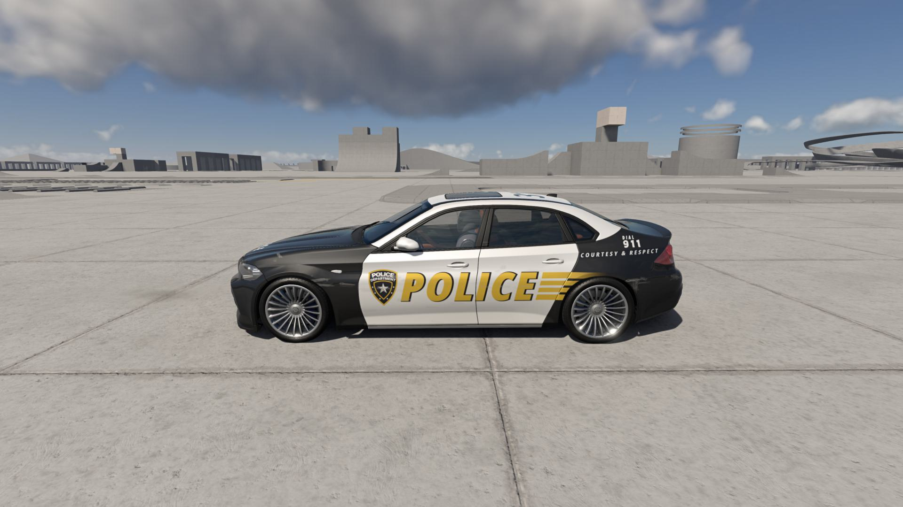
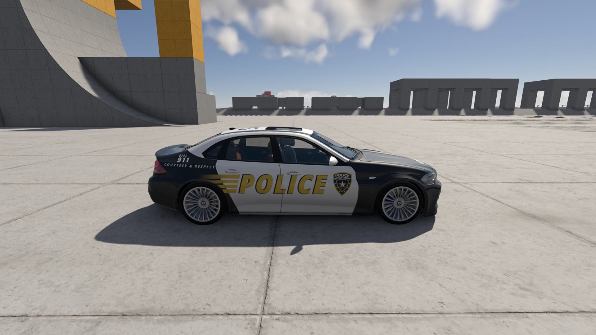
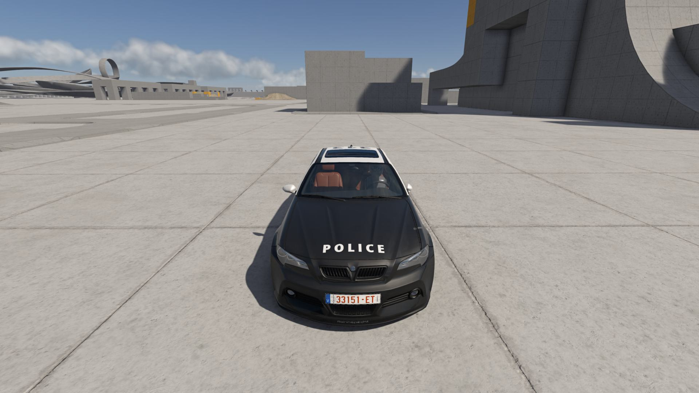
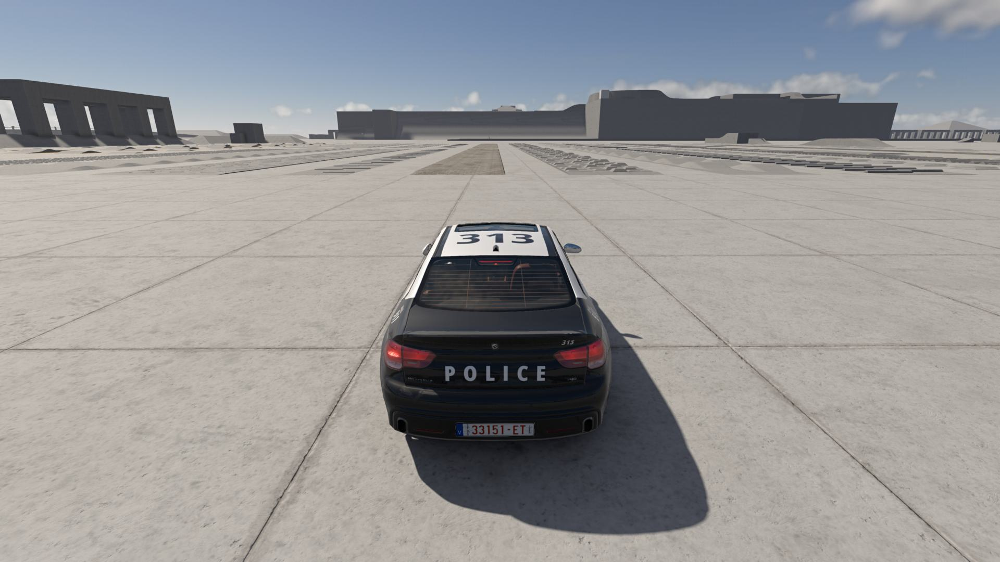
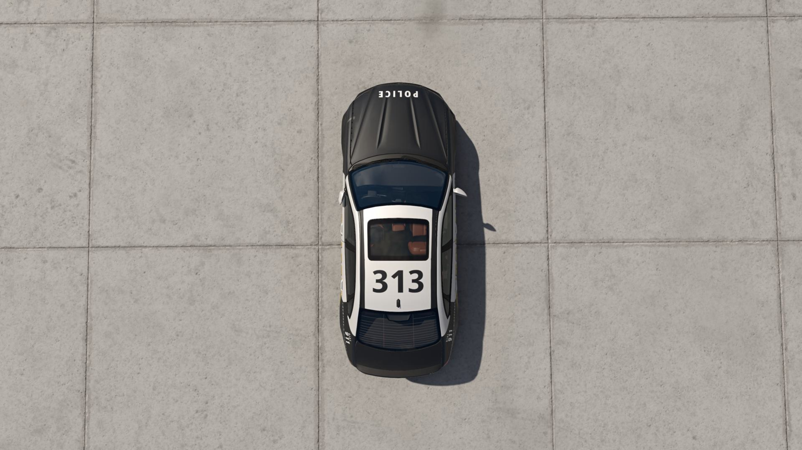

# sideslide - 20261114-192853_sideslide_resumed-control-v2-full-vulkan_r1

_on its side, sliding along the ground at 14 m/s - one long scrape_

Remaining queues: `{"bake": 0, "jobs": 0, "stamps": 0}`

Tuning: `if scratches_detect then scratches_detect.setPaintEnabled(true) end; scratches_paint.setDamageResolution(4096); scratches_paint.setBakeBudget(6); scratches_paint.setFlushInterval(0.2); scratches_paint.setProjectionBudget(6); scratches_paint.setLayerBudget(24)`

Settled: True after 4.192 s - 238 frames, 58.5 fps average from sampled wall intervals (background limiter lifted)
Went past upside down: True (lowest up-vector z -0.156)

## Marks

| contacts | passed filters | impacts | streams | stamps | projections | bakes | missed | jobs dropped | deferred frames |
|---|---|---|---|---|---|---|---|---|---|
| 1948 | 598 | 71 | 111 | 118 | 85 | 70 | 0.0% | 0 | 14 |

Rejected contacts: Wheel 922, BelowThresh 425, NormalForce 3

Body materials: METAL 439, PLASTIC 159

Surfaces: ASPHALT 598

## Cost

| | avg | p95 | max |
|---|---|---|---|
| painter (GE), ms/frame | 4.148 | 21.991 | 48.661 |
| whole frame, ms | 15.188 (p50) | 34.819 | 61.286 |
| all GE Lua, ms | | 23.025 | 49.887 |
| physics + vehicle Lua, ms | | 0.313 | 2.048 |
| render, ms | | 2.235 | |

- Painter frames over 4 ms: 79; worst flush (project + bake) 48.629 ms, worst composite 0.245 ms.
- Detector: 2.535 us per contact, 9.381 ms total, worst frame 0.542 ms (profiled; the timer adds a little).

### Worst frames

| t (s) | frame ms | painter ms | GE Lua ms | physics+VLUA ms | render ms |
|---|---|---|---|---|---|
| 0.19 | 61.29 | 48.66 | 0.87 | 0.07 | 1.68 |
| 0.40 | 57.01 | 45.70 | 0.80 | 0.04 | 1.34 |
| 2.07 | 56.94 | 45.29 | 1.49 | 0.08 | 1.30 |
| 1.86 | 48.39 | 41.88 | 0.79 | 0.53 | 1.27 |
| 3.11 | 46.07 | 17.91 | 2.33 | 0.10 | 2.11 |

## Screenshots

