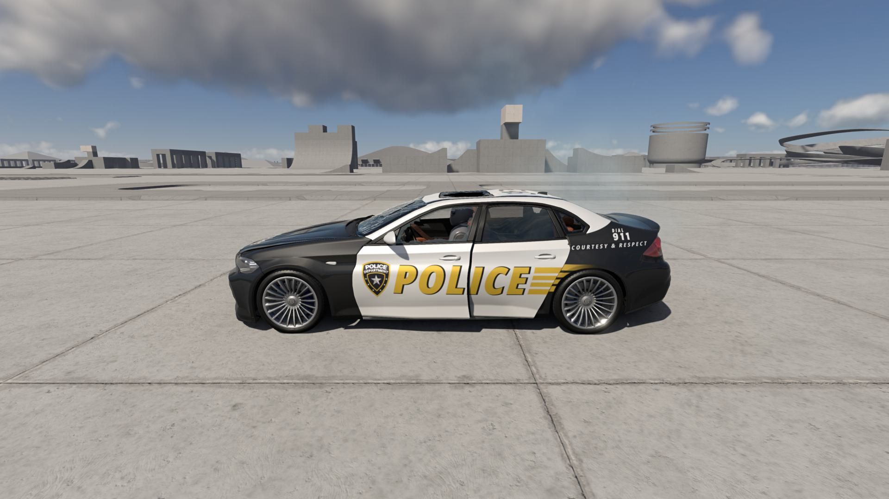
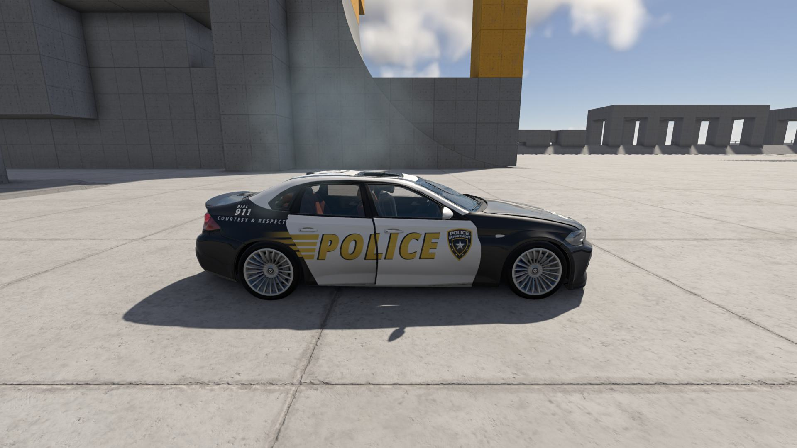
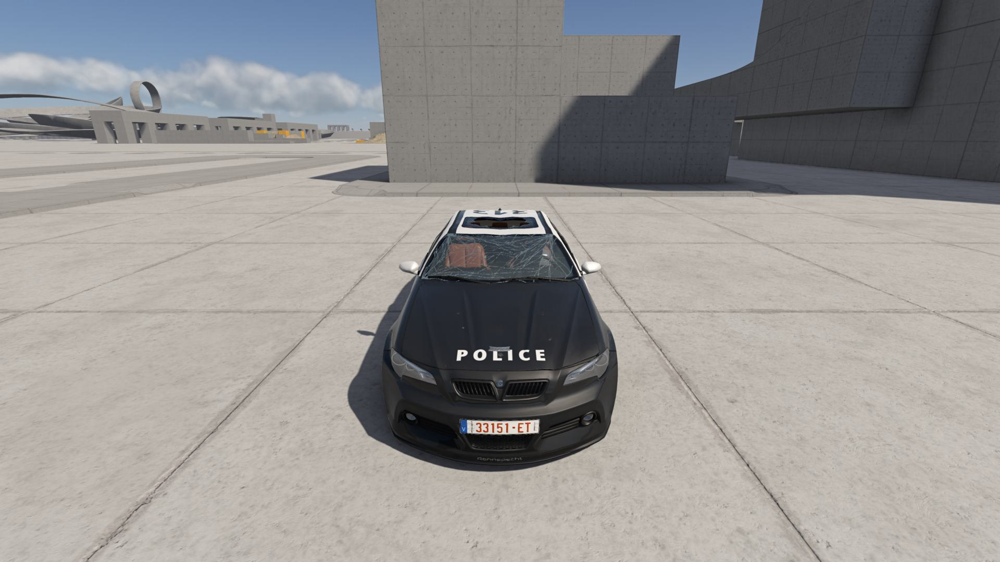
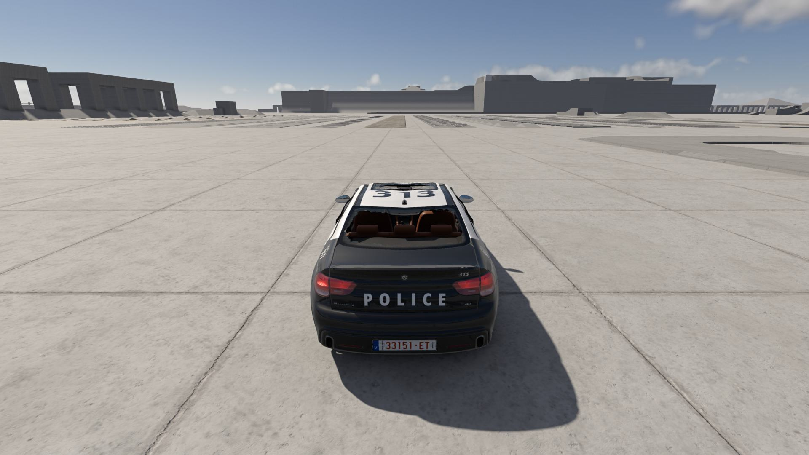
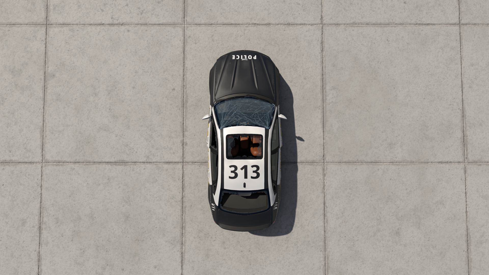

# roofdrop - 20261114-192910_roofdrop_resumed-control-v2-full-vulkan_r1

_dropped upside down from about 1 m - roof impacts_

Remaining queues: `{"bake": 0, "jobs": 0, "stamps": 0}`

Tuning: `if scratches_detect then scratches_detect.setPaintEnabled(true) end; scratches_paint.setDamageResolution(4096); scratches_paint.setBakeBudget(6); scratches_paint.setFlushInterval(0.2); scratches_paint.setProjectionBudget(6); scratches_paint.setLayerBudget(24)`

Settled: True after 6.179 s - 463 frames, 74.8 fps average from sampled wall intervals (background limiter lifted)
Went past upside down: True (lowest up-vector z -1.0)

## Marks

| contacts | passed filters | impacts | streams | stamps | projections | bakes | missed | jobs dropped | deferred frames |
|---|---|---|---|---|---|---|---|---|---|
| 1311 | 56 | 56 | 0 | 52 | 18 | 17 | 0.0% | 0 | 0 |

Rejected contacts: PartExcluded 762, BelowThresh 493

Body materials: METAL 54, PLASTIC 2

Surfaces: ASPHALT 56

## Cost

| | avg | p95 | max |
|---|---|---|---|
| painter (GE), ms/frame | 1.231 | 1.485 | 38.647 |
| whole frame, ms | 12.716 (p50) | 16.816 | 54.302 |
| all GE Lua, ms | | 2.921 | 39.501 |
| physics + vehicle Lua, ms | | 0.08 | 0.174 |
| render, ms | | 1.939 | |

- Painter frames over 4 ms: 21; worst flush (project + bake) 38.62 ms, worst composite 0.084 ms.
- Detector: 1.431 us per contact, 4.666 ms total, worst frame 0.587 ms (profiled; the timer adds a little).

### Worst frames

| t (s) | frame ms | painter ms | GE Lua ms | physics+VLUA ms | render ms |
|---|---|---|---|---|---|
| 0.53 | 54.30 | 36.23 | 1.09 | 0.12 | 2.54 |
| 1.15 | 51.02 | 37.75 | 1.04 | 0.09 | 1.96 |
| 1.57 | 50.85 | 38.63 | 0.83 | 0.04 | 1.38 |
| 5.32 | 50.75 | 38.58 | 0.75 | 0.07 | 1.14 |
| 5.11 | 50.51 | 36.84 | 0.84 | 0.06 | 1.24 |

## Screenshots

