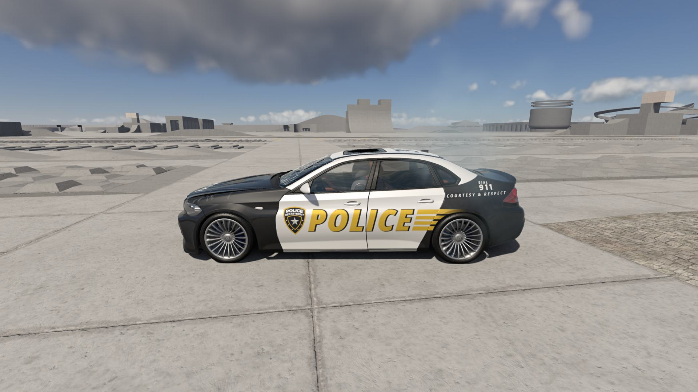
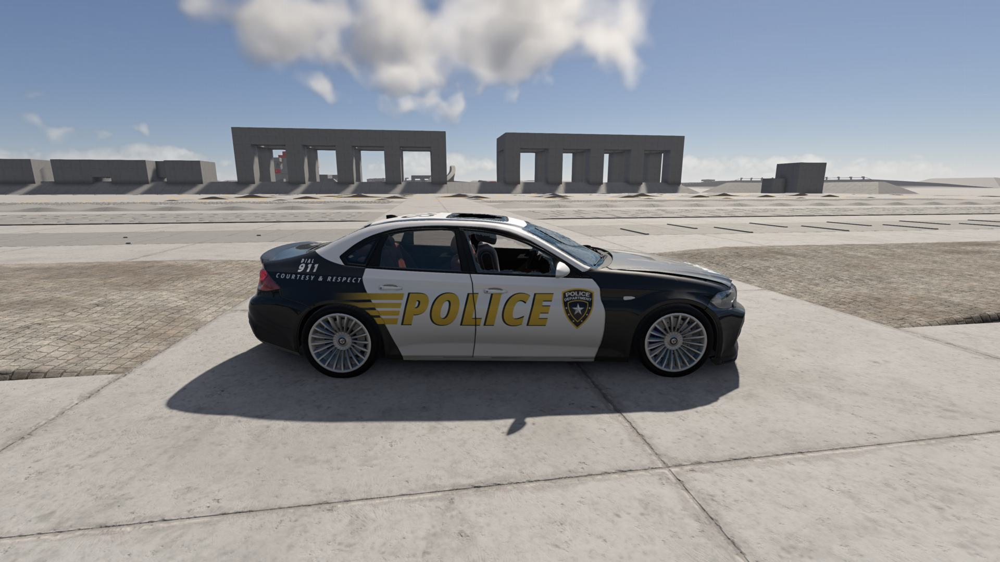
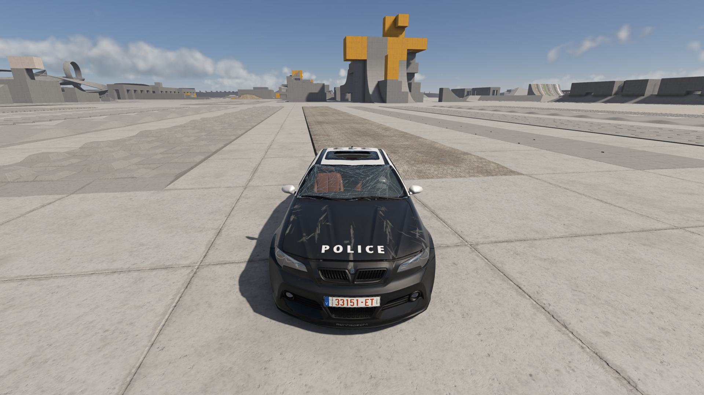
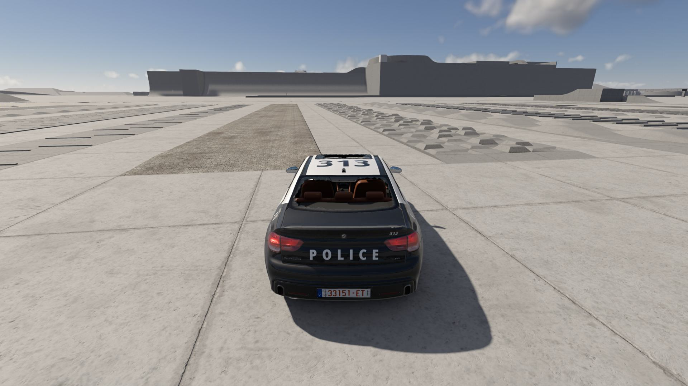
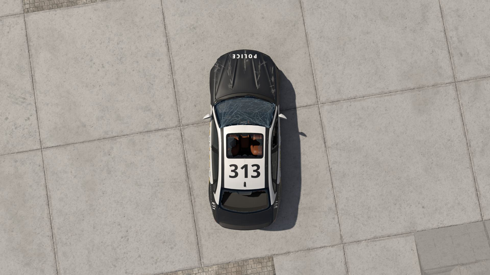

# sustained - 20261114-192929_sustained_resumed-control-v2-full-vulkan_r1

_assisted roof scrape v2: additive translation to 4 m/s for 30 seconds, preserving internal node motion; real collisions_

Remaining queues: `{"bake": 0, "jobs": 0, "stamps": 0}`

Tuning: `if scratches_detect then scratches_detect.setPaintEnabled(true) end; scratches_paint.setDamageResolution(4096); scratches_paint.setBakeBudget(6); scratches_paint.setFlushInterval(0.2); scratches_paint.setProjectionBudget(6); scratches_paint.setLayerBudget(24)`

Settled: False after 30.004 s - 2356 frames, 78.5 fps average from sampled wall intervals (background limiter lifted)
Went past upside down: True (lowest up-vector z -1.0)

## Marks

| contacts | passed filters | impacts | streams | stamps | projections | bakes | missed | jobs dropped | deferred frames |
|---|---|---|---|---|---|---|---|---|---|
| 17899 | 9288 | 30 | 647 | 67 | 137 | 101 | 0.0% | 0 | 2 |

Rejected contacts: PartExcluded 6210, BelowThresh 2393, NormalForce 8

Body materials: METAL 9231, PLASTIC 57

Surfaces: ASPHALT 7917, COBBLESTONE 1371

## Cost

| | avg | p95 | max |
|---|---|---|---|
| painter (GE), ms/frame | 1.401 | 4.653 | 59.623 |
| whole frame, ms | 12.045 (p50) | 16.582 | 71.984 |
| all GE Lua, ms | | 5.717 | 60.564 |
| physics + vehicle Lua, ms | | 0.083 | 0.536 |
| render, ms | | 1.905 | |

- Painter frames over 4 ms: 126; worst flush (project + bake) 59.593 ms, worst composite 0.169 ms.
- Detector: 3.217 us per contact, 79.916 ms total, worst frame 1.807 ms (profiled; the timer adds a little).

### Worst frames

| t (s) | frame ms | painter ms | GE Lua ms | physics+VLUA ms | render ms |
|---|---|---|---|---|---|
| 0.49 | 71.98 | 59.62 | 0.93 | 0.06 | 1.36 |
| 12.99 | 56.22 | 43.10 | 0.69 | 0.05 | 1.21 |
| 11.95 | 54.88 | 43.40 | 0.75 | 0.05 | 1.37 |
| 12.57 | 54.43 | 42.14 | 0.81 | 0.05 | 1.17 |
| 1.30 | 52.63 | 40.27 | 0.94 | 0.07 | 1.33 |

## Screenshots

