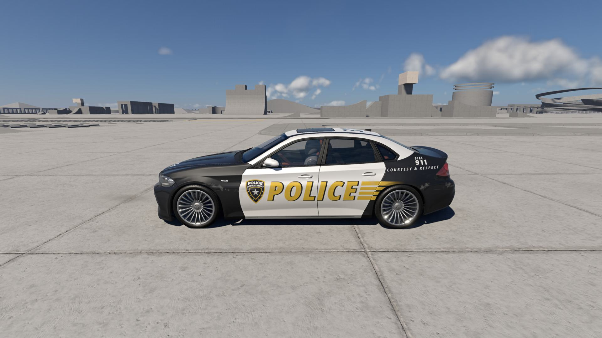
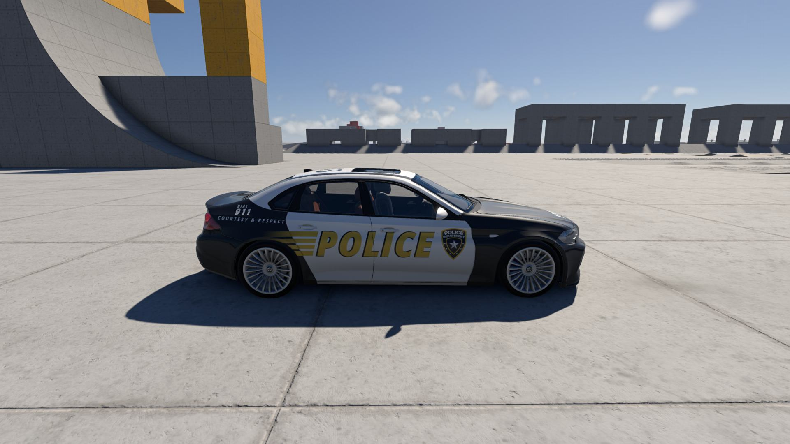
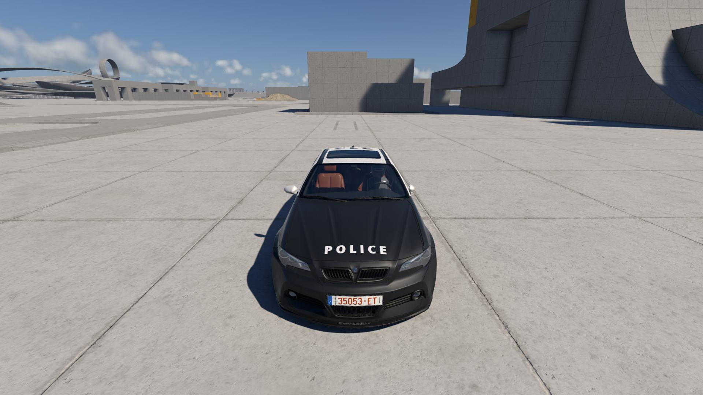
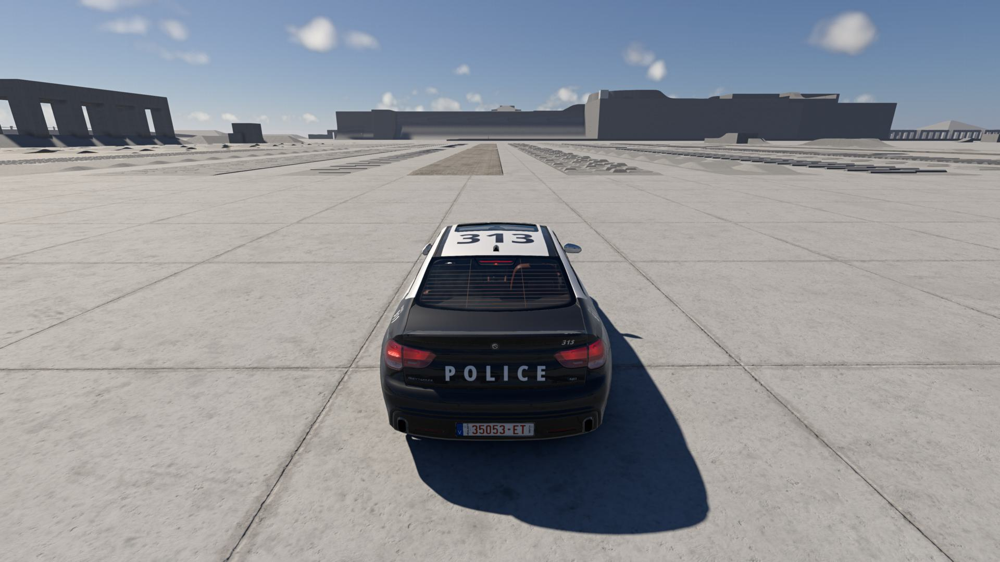
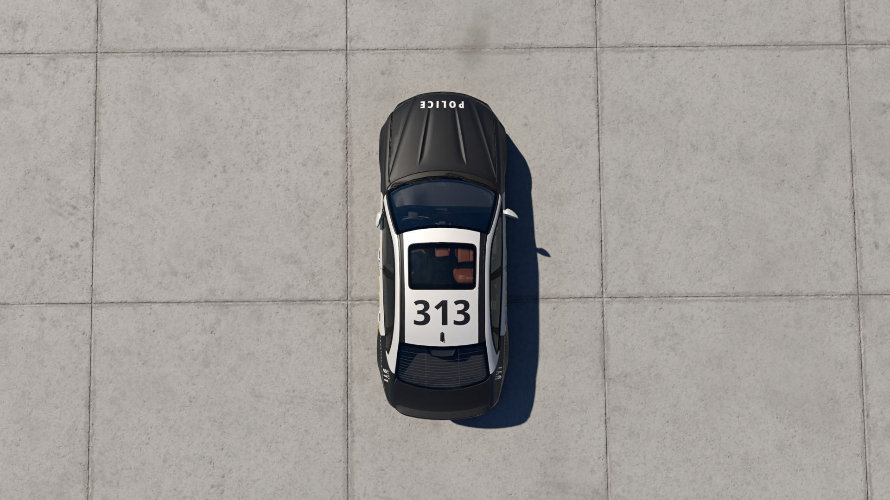

# sideslide - 20261114-190412_sideslide_resumed-control-v2-full-warm_r1

_on its side, sliding along the ground at 14 m/s - one long scrape_

Remaining queues: `{"bake": 0, "jobs": 0, "stamps": 0}`

Tuning: `if scratches_detect then scratches_detect.setPaintEnabled(true) end; scratches_paint.setDamageResolution(4096); scratches_paint.setBakeBudget(6); scratches_paint.setFlushInterval(0.2); scratches_paint.setProjectionBudget(6); scratches_paint.setLayerBudget(24)`

Settled: True after 4.288 s - 156 frames, 39.2 fps average from sampled wall intervals (background limiter lifted)
Went past upside down: True (lowest up-vector z -0.175)

## Marks

| contacts | passed filters | impacts | streams | stamps | projections | bakes | missed | jobs dropped | deferred frames |
|---|---|---|---|---|---|---|---|---|---|
| 1300 | 291 | 104 | 59 | 163 | 88 | 56 | 0.0% | 0 | 11 |

Rejected contacts: Wheel 718, BelowThresh 290, NormalForce 1

Body materials: METAL 214, PLASTIC 77

Surfaces: ASPHALT 291

## Cost

| | avg | p95 | max |
|---|---|---|---|
| painter (GE), ms/frame | 15.174 | 40.878 | 55.071 |
| whole frame, ms | 14.469 (p50) | 50.69 | 70.811 |
| all GE Lua, ms | | 42.444 | 56.07 |
| physics + vehicle Lua, ms | | 5.508 | 7.443 |
| render, ms | | 2.232 | |

- Painter frames over 4 ms: 73; worst flush (project + bake) 55.041 ms, worst composite 0.09 ms.
- Detector: 1.583 us per contact, 4.55 ms total, worst frame 0.434 ms (profiled; the timer adds a little).

### Worst frames

| t (s) | frame ms | painter ms | GE Lua ms | physics+VLUA ms | render ms |
|---|---|---|---|---|---|
| 0.62 | 70.81 | 43.67 | 1.04 | 2.46 | 2.36 |
| 0.39 | 66.11 | 55.07 | 0.74 | 0.13 | 1.95 |
| 2.74 | 59.93 | 52.68 | 0.76 | 1.43 | 1.47 |
| 2.95 | 54.57 | 33.22 | 1.21 | 7.44 | 1.68 |
| 0.69 | 53.26 | 43.31 | 41.98 | 0.12 | 2.80 |

## Screenshots

