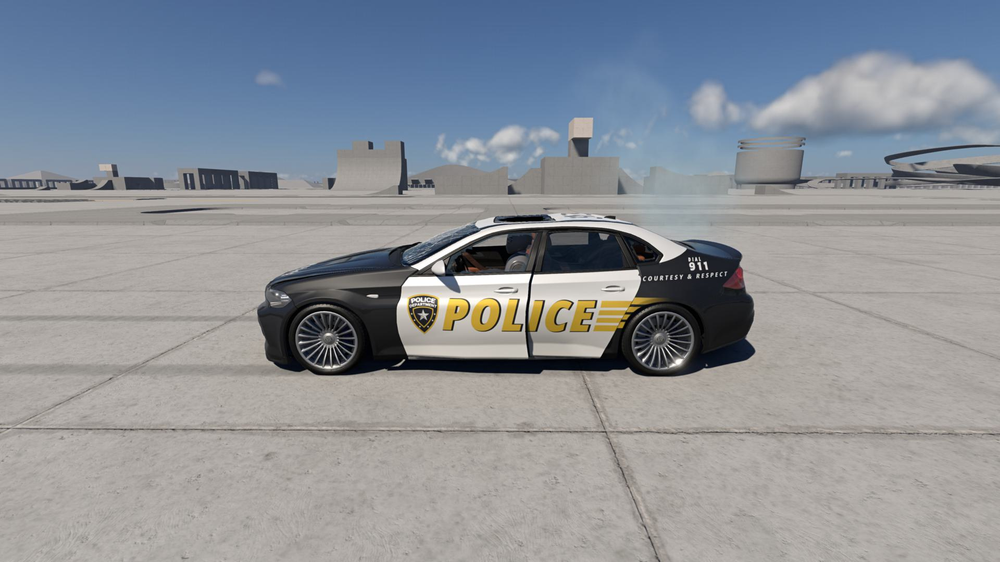
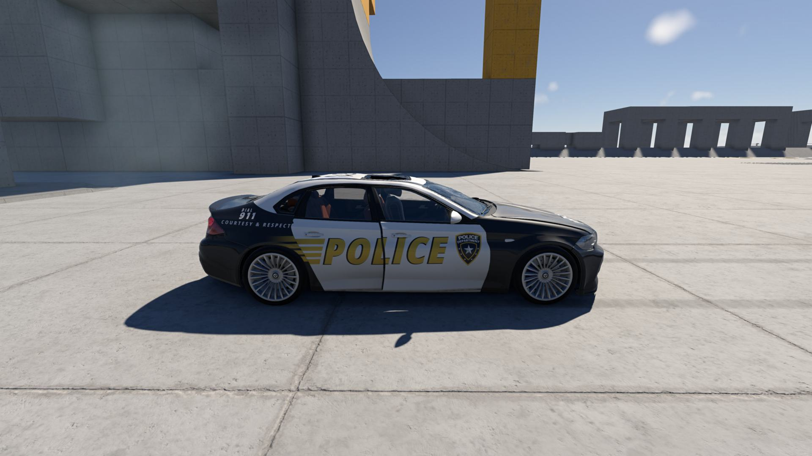
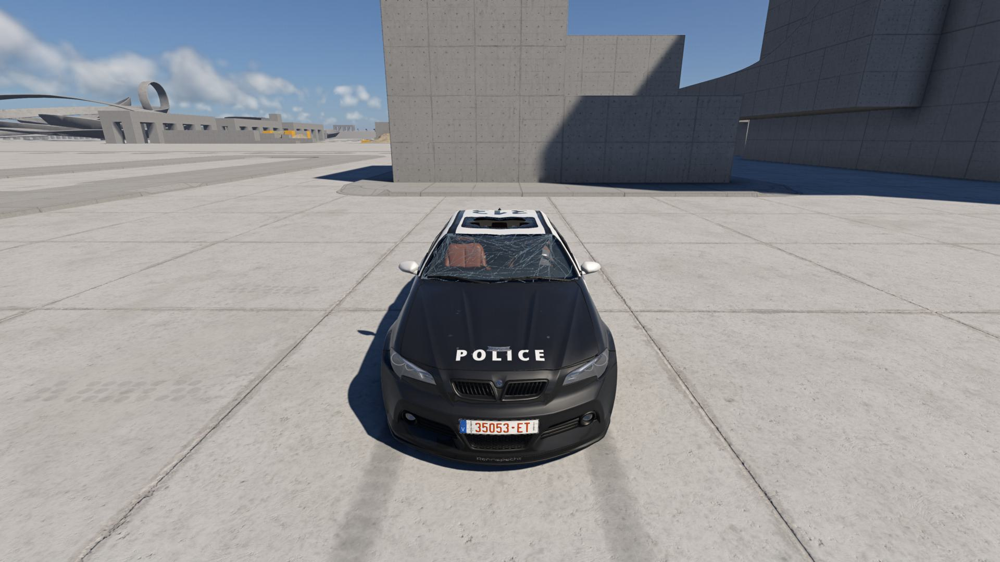
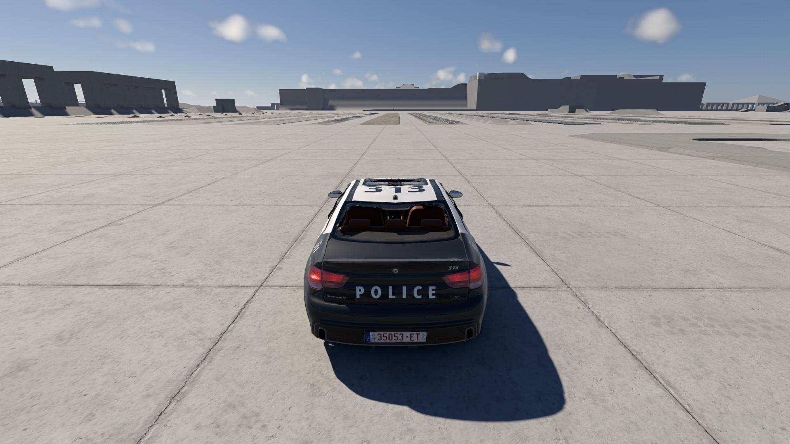
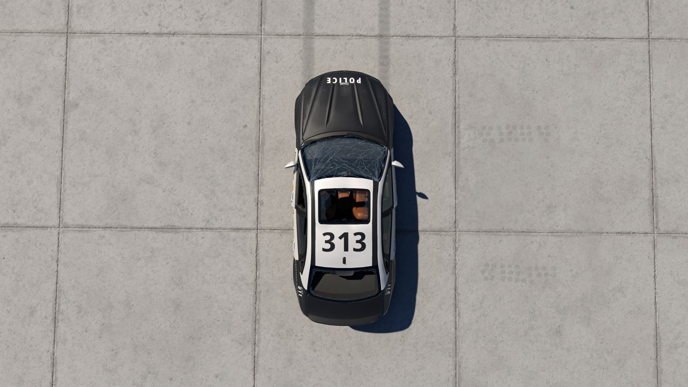

# roofdrop - 20261114-190428_roofdrop_resumed-control-v2-full-warm_r1

_dropped upside down from about 1 m - roof impacts_

Remaining queues: `{"bake": 0, "jobs": 0, "stamps": 0}`

Tuning: `if scratches_detect then scratches_detect.setPaintEnabled(true) end; scratches_paint.setDamageResolution(4096); scratches_paint.setBakeBudget(6); scratches_paint.setFlushInterval(0.2); scratches_paint.setProjectionBudget(6); scratches_paint.setLayerBudget(24)`

Settled: True after 5.134 s - 418 frames, 81.2 fps average from sampled wall intervals (background limiter lifted)
Went past upside down: True (lowest up-vector z -1.0)

## Marks

| contacts | passed filters | impacts | streams | stamps | projections | bakes | missed | jobs dropped | deferred frames |
|---|---|---|---|---|---|---|---|---|---|
| 1146 | 48 | 48 | 0 | 52 | 18 | 16 | 0.0% | 0 | 0 |

Rejected contacts: PartExcluded 673, BelowThresh 425

Body materials: METAL 46, PLASTIC 2

Surfaces: ASPHALT 48

## Cost

| | avg | p95 | max |
|---|---|---|---|
| painter (GE), ms/frame | 1.63 | 12.844 | 38.988 |
| whole frame, ms | 11.259 (p50) | 25.145 | 48.215 |
| all GE Lua, ms | | 13.799 | 39.825 |
| physics + vehicle Lua, ms | | 0.072 | 1.504 |
| render, ms | | 2.522 | |

- Painter frames over 4 ms: 28; worst flush (project + bake) 36.586 ms, worst composite 0.081 ms.
- Detector: 1.501 us per contact, 3.887 ms total, worst frame 0.455 ms (profiled; the timer adds a little).

### Worst frames

| t (s) | frame ms | painter ms | GE Lua ms | physics+VLUA ms | render ms |
|---|---|---|---|---|---|
| 0.74 | 48.21 | 36.62 | 0.95 | 0.05 | 1.87 |
| 2.25 | 46.97 | 36.30 | 0.98 | 0.05 | 2.29 |
| 0.75 | 46.74 | 38.99 | 37.63 | 0.06 | 1.97 |
| 2.04 | 45.25 | 34.54 | 0.98 | 0.08 | 1.95 |
| 1.57 | 44.02 | 32.57 | 0.78 | 0.03 | 1.96 |

## Screenshots

