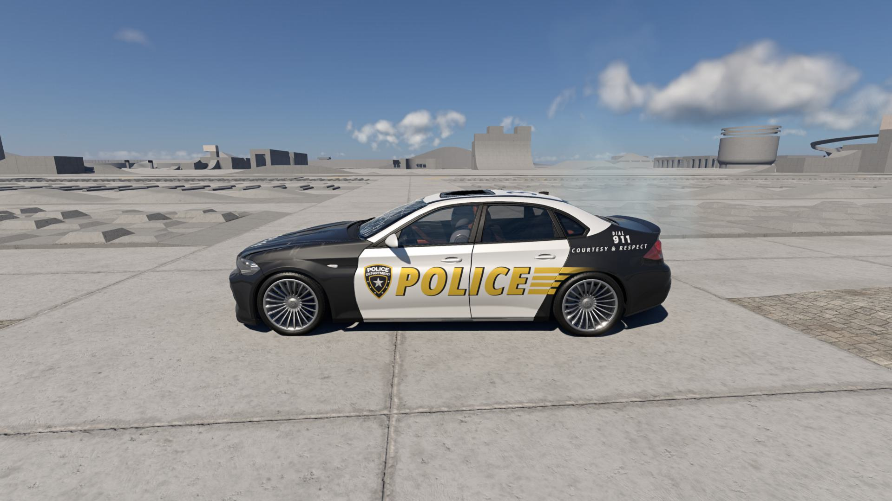
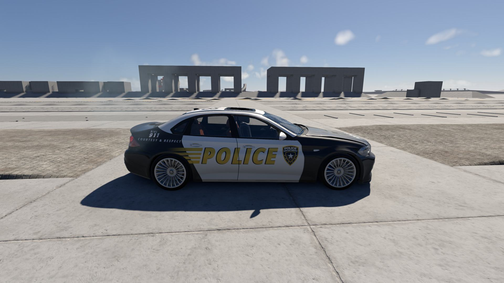
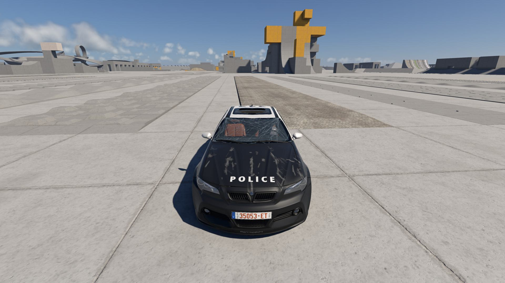
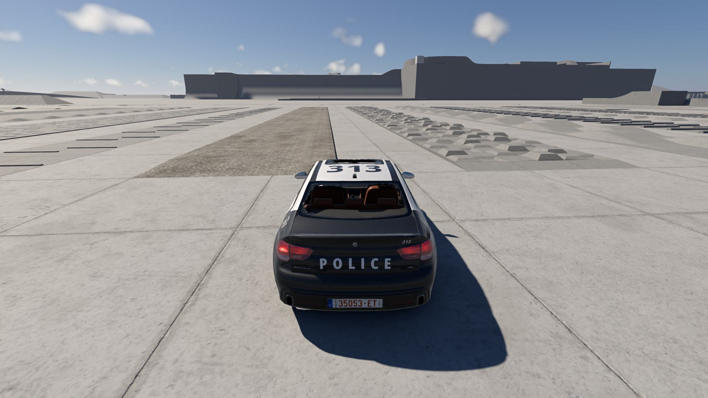
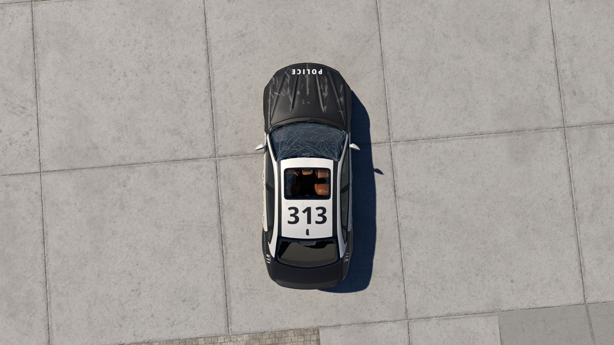

# sustained - 20261114-190446_sustained_resumed-control-v2-full-warm_r1

_assisted roof scrape v2: additive translation to 4 m/s for 30 seconds, preserving internal node motion; real collisions_

Remaining queues: `{"bake": 0, "jobs": 0, "stamps": 0}`

Tuning: `if scratches_detect then scratches_detect.setPaintEnabled(true) end; scratches_paint.setDamageResolution(4096); scratches_paint.setBakeBudget(6); scratches_paint.setFlushInterval(0.2); scratches_paint.setProjectionBudget(6); scratches_paint.setLayerBudget(24)`

Settled: False after 30.001 s - 2451 frames, 80.7 fps average from sampled wall intervals (background limiter lifted)
Went past upside down: True (lowest up-vector z -1.0)

## Marks

| contacts | passed filters | impacts | streams | stamps | projections | bakes | missed | jobs dropped | deferred frames |
|---|---|---|---|---|---|---|---|---|---|
| 14152 | 8164 | 82 | 521 | 171 | 177 | 137 | 0.0% | 0 | 2 |

Rejected contacts: PartExcluded 5254, BelowThresh 688, NormalForce 46

Body materials: METAL 8136, PLASTIC 28

Surfaces: ASPHALT 7989, COBBLESTONE 175

## Cost

| | avg | p95 | max |
|---|---|---|---|
| painter (GE), ms/frame | 2.618 | 27.916 | 446.441 |
| whole frame, ms | 10.484 (p50) | 38.263 | 454.143 |
| all GE Lua, ms | | 28.789 | 447.703 |
| physics + vehicle Lua, ms | | 0.09 | 4.242 |
| render, ms | | 2.413 | |

- Painter frames over 4 ms: 239; worst flush (project + bake) 59.496 ms, worst composite 0.155 ms.
- Detector: 3.642 us per contact, 73.927 ms total, worst frame 1.265 ms (profiled; the timer adds a little).

### Worst frames

| t (s) | frame ms | painter ms | GE Lua ms | physics+VLUA ms | render ms |
|---|---|---|---|---|---|
| 2.63 | 454.14 | 446.44 | 33.47 | 0.06 | 1.54 |
| 2.59 | 71.59 | 39.60 | 0.80 | 0.74 | 6.47 |
| 0.48 | 69.55 | 59.55 | 1.16 | 0.07 | 2.51 |
| 1.97 | 65.53 | 55.23 | 0.78 | 0.05 | 1.90 |
| 0.89 | 60.44 | 51.29 | 1.01 | 1.95 | 1.62 |

## Screenshots

