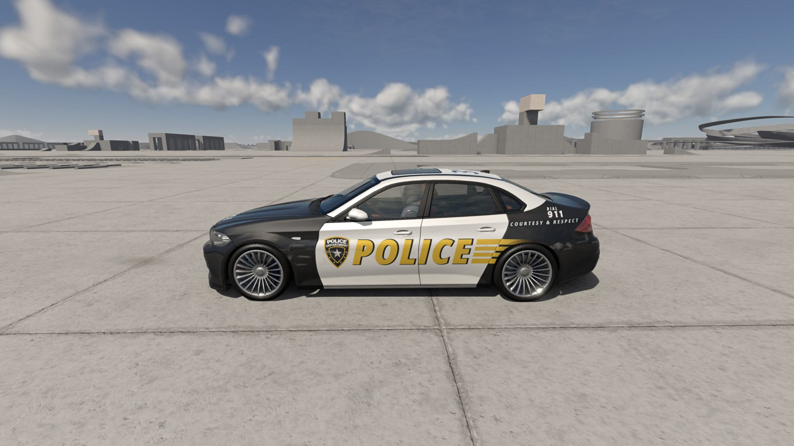
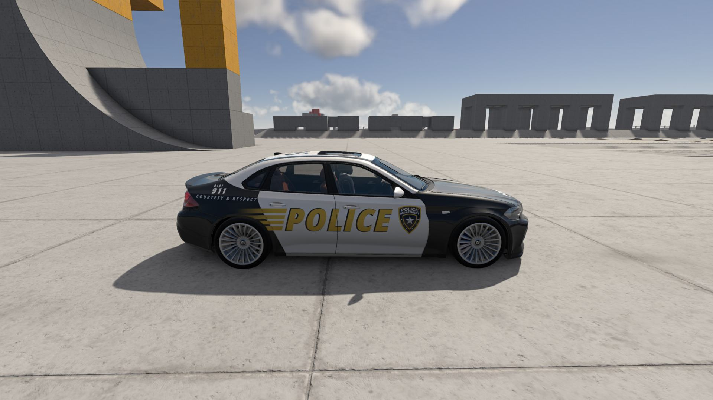
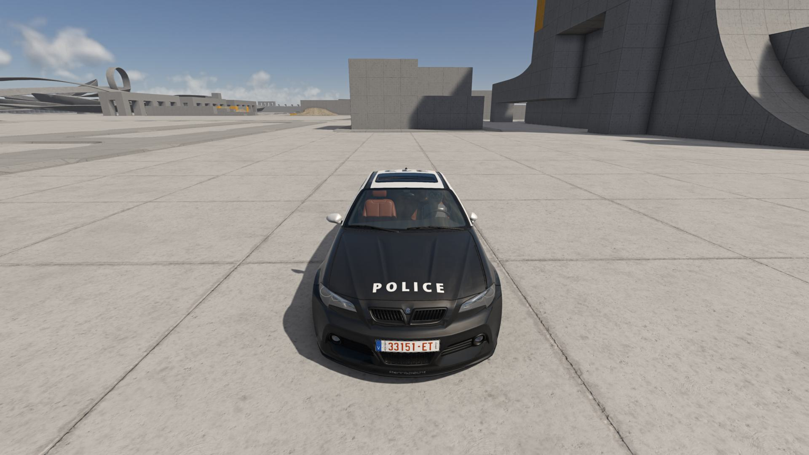
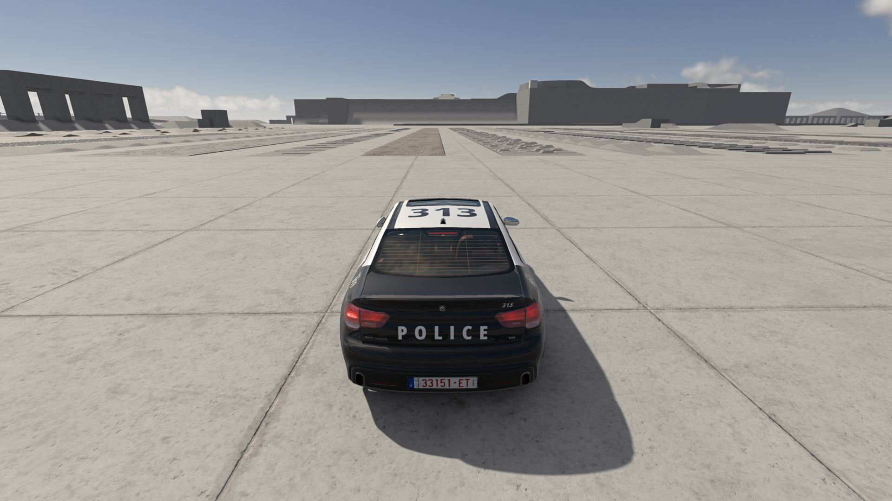
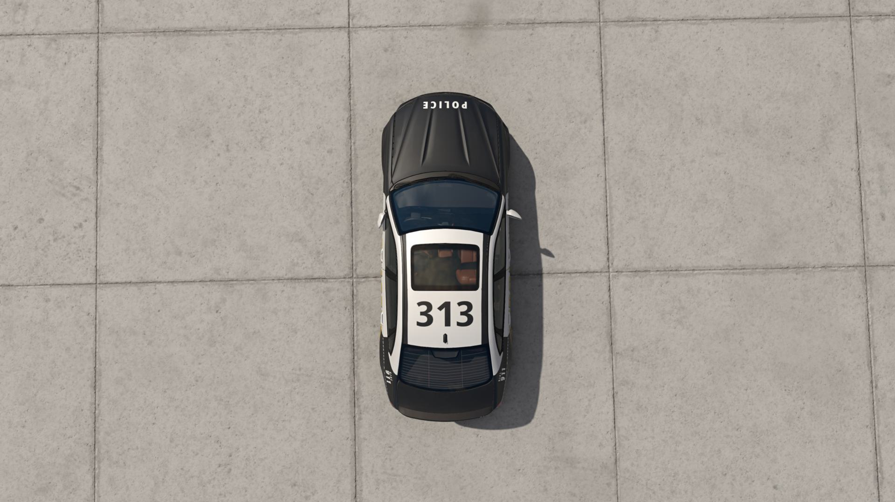

# sideslide - 20261114-210905_sideslide_resumed-fixed2-full-d3d12-warm_r1

_on its side, sliding along the ground at 14 m/s - one long scrape_

Remaining queues: `{"bake": 0, "jobs": 0, "stamps": 0}`

Tuning: `if scratches_detect then scratches_detect.setPaintEnabled(true) end; scratches_paint.setDamageResolution(4096); scratches_paint.setBakeBudget(3); scratches_paint.setFlushInterval(0.05); scratches_paint.setProjectionBudget(6); scratches_paint.setLayerBudget(24); scratches_paint.setCoverageCoalescing(false); scratches_paint.setPanelGrouping(true)`

Settled: True after 4.178 s - 238 frames, 49.3 fps average from sampled wall intervals (background limiter lifted)
Went past upside down: True (lowest up-vector z -0.15)

## Marks

| contacts | passed filters | impacts | streams | stamps | projections | bakes | missed | jobs dropped | deferred frames |
|---|---|---|---|---|---|---|---|---|---|
| 2289 | 461 | 92 | 101 | 151 | 91 | 124 | 0.0% | 0 | 2 |

Rejected contacts: Wheel 1244, BelowThresh 583, NormalForce 1

Body materials: METAL 339, PLASTIC 122

Surfaces: ASPHALT 461

## Cost

| | avg | p95 | max |
|---|---|---|---|
| painter (GE), ms/frame | 11.528 | 27.516 | 39.085 |
| whole frame, ms | 22.779 (p50) | 35.443 | 46.612 |
| all GE Lua, ms | | 28.599 | 40.139 |
| physics + vehicle Lua, ms | | 0.102 | 1.888 |
| render, ms | | 2.106 | |

- Painter frames over 4 ms: 153; worst flush (project + bake) 39.05 ms, worst composite 0.103 ms.
- Detector: 1.49 us per contact, 7.532 ms total, worst frame 0.526 ms (profiled; the timer adds a little).

### Worst frames

| t (s) | frame ms | painter ms | GE Lua ms | physics+VLUA ms | render ms |
|---|---|---|---|---|---|
| 0.18 | 46.61 | 34.59 | 0.93 | 0.06 | 2.78 |
| 2.98 | 45.54 | 39.09 | 12.11 | 0.05 | 1.46 |
| 1.44 | 41.60 | 31.08 | 12.66 | 0.06 | 1.52 |
| 1.69 | 40.48 | 30.50 | 12.49 | 0.06 | 1.88 |
| 3.60 | 40.05 | 29.16 | 0.77 | 0.03 | 1.83 |

## Screenshots

