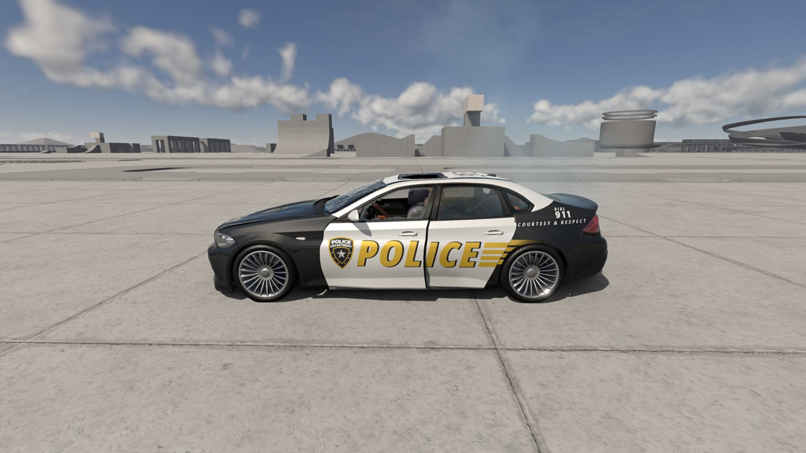
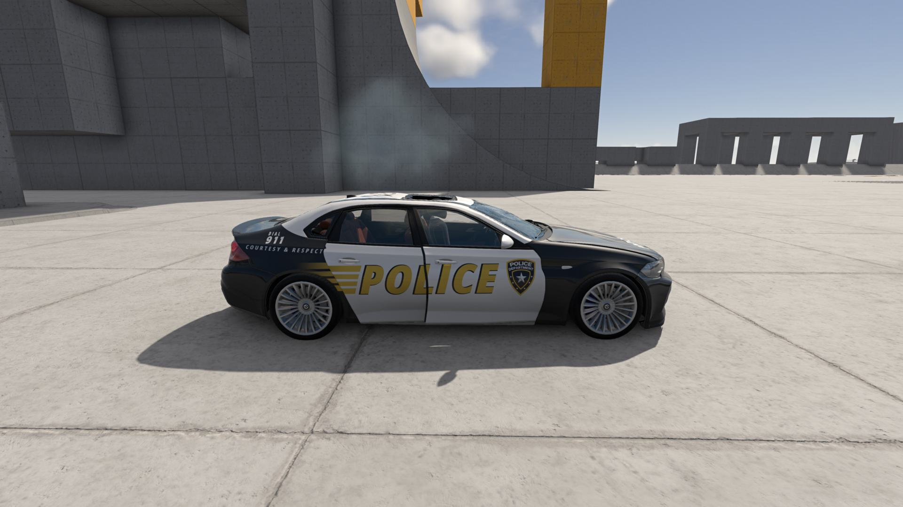
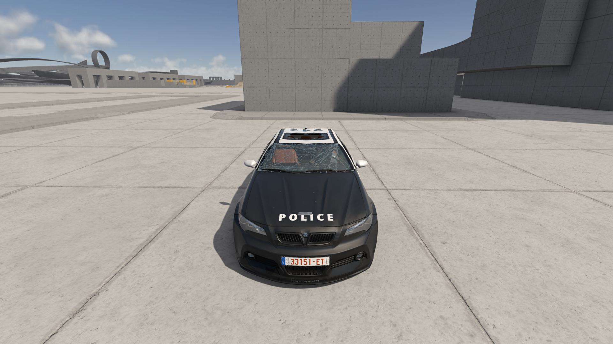
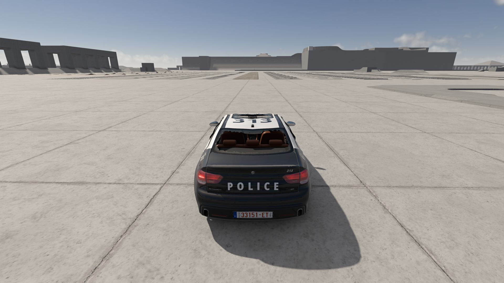
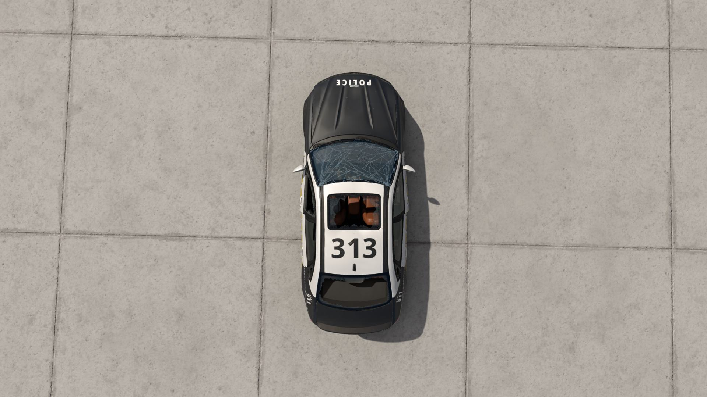

# roofdrop - 20261114-210922_roofdrop_resumed-fixed2-full-d3d12-warm_r1

_dropped upside down from about 1 m - roof impacts_

Remaining queues: `{"bake": 0, "jobs": 0, "stamps": 0}`

Tuning: `if scratches_detect then scratches_detect.setPaintEnabled(true) end; scratches_paint.setDamageResolution(4096); scratches_paint.setBakeBudget(3); scratches_paint.setFlushInterval(0.05); scratches_paint.setProjectionBudget(6); scratches_paint.setLayerBudget(24); scratches_paint.setCoverageCoalescing(false); scratches_paint.setPanelGrouping(true)`

Settled: True after 5.38 s - 456 frames, 84.5 fps average from sampled wall intervals (background limiter lifted)
Went past upside down: True (lowest up-vector z -1.0)

## Marks

| contacts | passed filters | impacts | streams | stamps | projections | bakes | missed | jobs dropped | deferred frames |
|---|---|---|---|---|---|---|---|---|---|
| 1269 | 49 | 49 | 0 | 50 | 17 | 23 | 0.0% | 0 | 0 |

Rejected contacts: PartExcluded 687, BelowThresh 533

Body materials: METAL 47, PLASTIC 2

Surfaces: ASPHALT 49

## Cost

| | avg | p95 | max |
|---|---|---|---|
| painter (GE), ms/frame | 1.662 | 17.176 | 30.352 |
| whole frame, ms | 11.037 (p50) | 23.931 | 42.343 |
| all GE Lua, ms | | 17.94 | 31.31 |
| physics + vehicle Lua, ms | | 0.07 | 0.272 |
| render, ms | | 2.064 | |

- Painter frames over 4 ms: 40; worst flush (project + bake) 30.323 ms, worst composite 0.06 ms.
- Detector: 1.373 us per contact, 4.196 ms total, worst frame 0.592 ms (profiled; the timer adds a little).

### Worst frames

| t (s) | frame ms | painter ms | GE Lua ms | physics+VLUA ms | render ms |
|---|---|---|---|---|---|
| 0.52 | 42.34 | 30.12 | 0.78 | 0.07 | 1.83 |
| 5.27 | 41.89 | 30.35 | 0.84 | 0.03 | 1.53 |
| 1.14 | 41.24 | 29.94 | 0.75 | 0.06 | 1.73 |
| 2.21 | 40.67 | 29.71 | 0.88 | 0.05 | 1.66 |
| 2.49 | 40.64 | 29.57 | 0.93 | 0.03 | 2.00 |

## Screenshots

