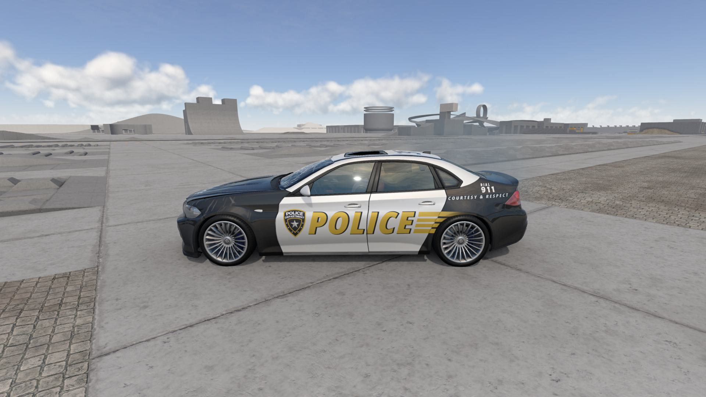
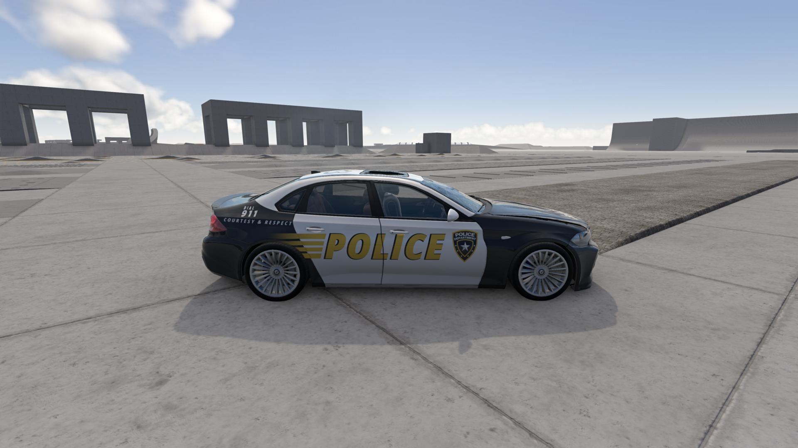
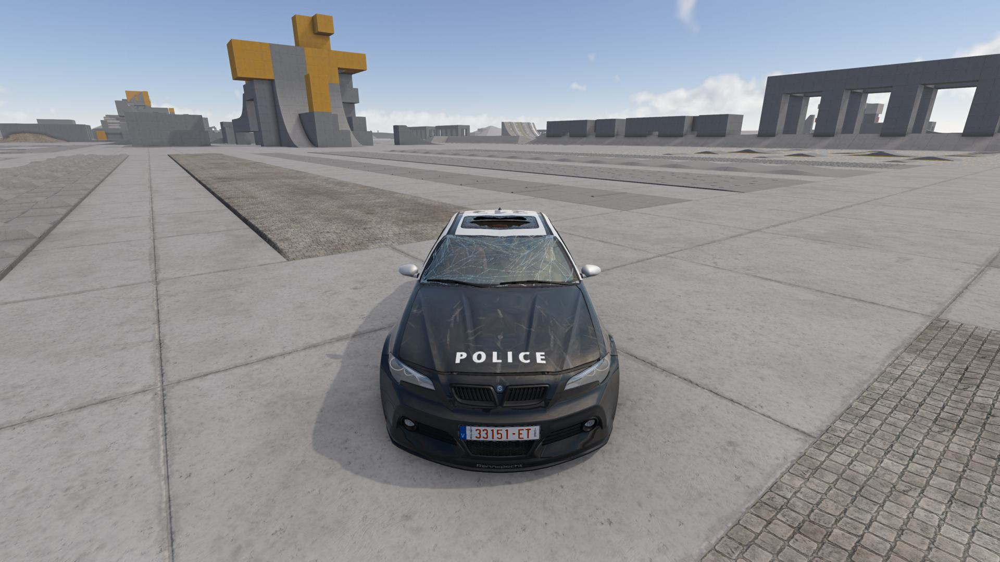
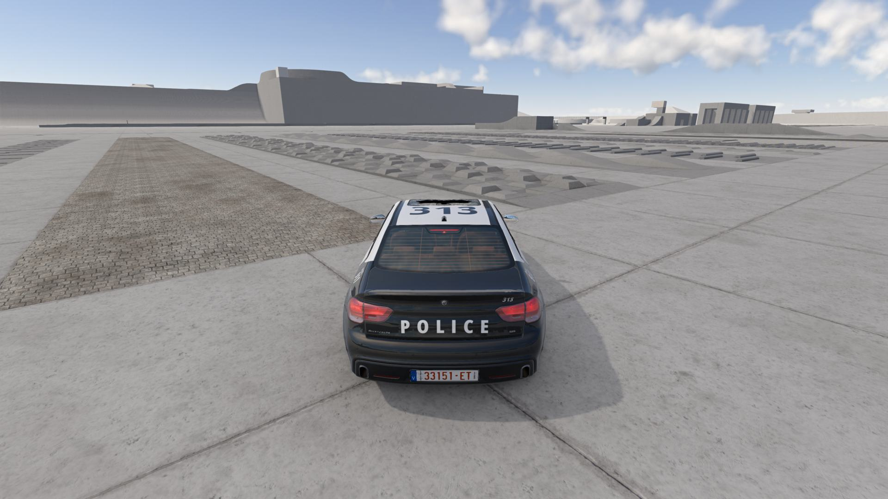
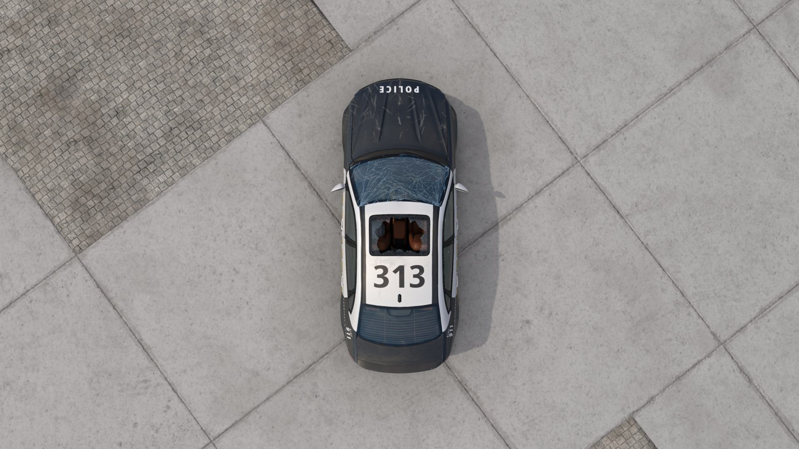

# sustained - 20261114-210940_sustained_resumed-fixed2-full-d3d12-warm_r1

_assisted roof scrape v2: additive translation to 4 m/s for 30 seconds, preserving internal node motion; real collisions_

Remaining queues: `{"bake": 0, "jobs": 0, "stamps": 0}`

Tuning: `if scratches_detect then scratches_detect.setPaintEnabled(true) end; scratches_paint.setDamageResolution(4096); scratches_paint.setBakeBudget(3); scratches_paint.setFlushInterval(0.05); scratches_paint.setProjectionBudget(6); scratches_paint.setLayerBudget(24); scratches_paint.setCoverageCoalescing(false); scratches_paint.setPanelGrouping(true)`

Settled: False after 30.005 s - 2420 frames, 80.1 fps average from sampled wall intervals (background limiter lifted)
Went past upside down: True (lowest up-vector z -1.0)

## Marks

| contacts | passed filters | impacts | streams | stamps | projections | bakes | missed | jobs dropped | deferred frames |
|---|---|---|---|---|---|---|---|---|---|
| 15987 | 9465 | 44 | 561 | 89 | 201 | 214 | 0.0% | 0 | 0 |

Rejected contacts: PartExcluded 5377, BelowThresh 1125, NormalForce 20

Body materials: METAL 9458, PLASTIC 7

Surfaces: ASPHALT 9035, COBBLESTONE 430

## Cost

| | avg | p95 | max |
|---|---|---|---|
| painter (GE), ms/frame | 3.069 | 23.945 | 36.756 |
| whole frame, ms | 10.717 (p50) | 31.112 | 50.288 |
| all GE Lua, ms | | 24.922 | 37.747 |
| physics + vehicle Lua, ms | | 0.09 | 2.872 |
| render, ms | | 2.112 | |

- Painter frames over 4 ms: 391; worst flush (project + bake) 36.726 ms, worst composite 0.117 ms.
- Detector: 3.681 us per contact, 77.993 ms total, worst frame 0.549 ms (profiled; the timer adds a little).

### Worst frames

| t (s) | frame ms | painter ms | GE Lua ms | physics+VLUA ms | render ms |
|---|---|---|---|---|---|
| 26.56 | 50.29 | 35.11 | 1.03 | 0.06 | 2.17 |
| 27.33 | 48.32 | 36.76 | 0.82 | 0.10 | 1.71 |
| 1.76 | 47.13 | 34.82 | 0.83 | 0.06 | 2.50 |
| 27.44 | 46.94 | 35.38 | 0.86 | 0.06 | 1.67 |
| 12.94 | 46.05 | 34.94 | 0.90 | 0.06 | 1.69 |

## Screenshots

