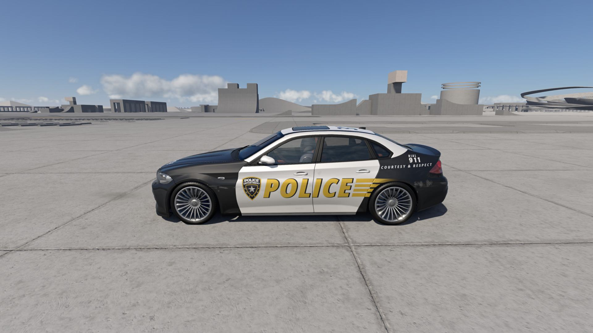
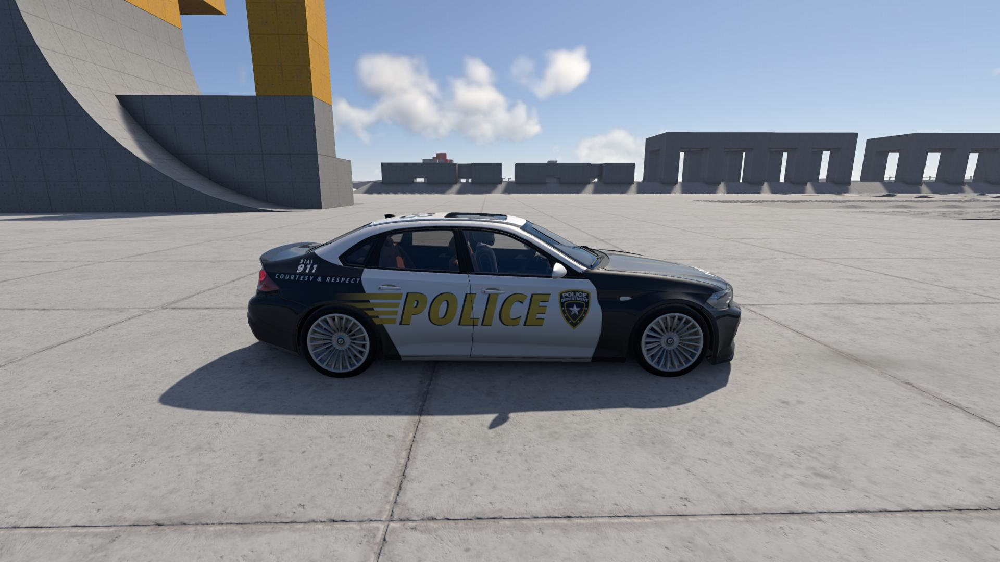
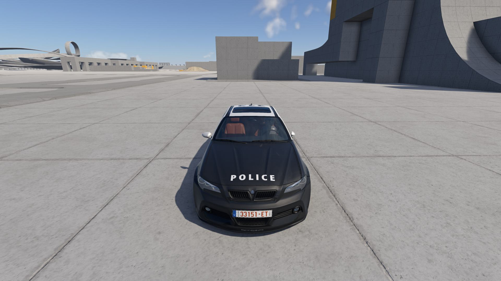
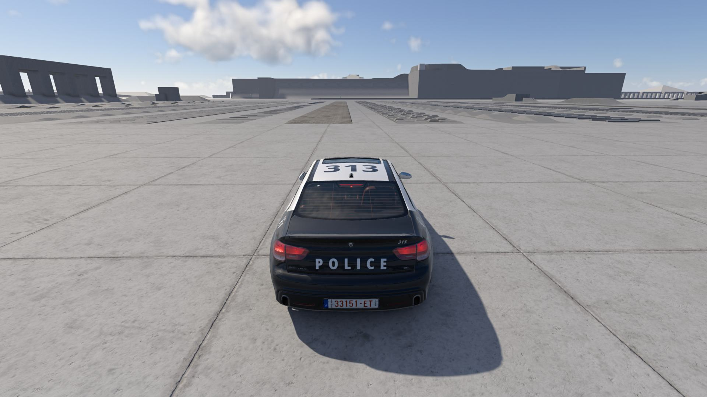
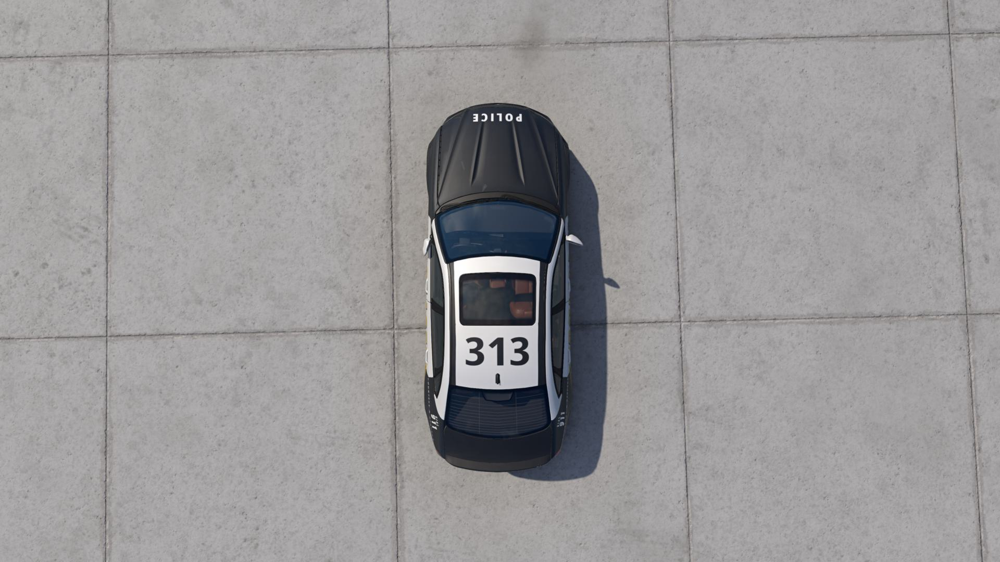

# sideslide - 20261114-201512_sideslide_resumed-fixed2-full-vulkan-warm_r1

_on its side, sliding along the ground at 14 m/s - one long scrape_

Remaining queues: `{"bake": 0, "jobs": 0, "stamps": 0}`

Tuning: `if scratches_detect then scratches_detect.setPaintEnabled(true) end; scratches_paint.setDamageResolution(4096); scratches_paint.setBakeBudget(3); scratches_paint.setFlushInterval(0.05); scratches_paint.setProjectionBudget(6); scratches_paint.setLayerBudget(24); scratches_paint.setCoverageCoalescing(false); scratches_paint.setPanelGrouping(true)`

Settled: True after 4.505 s - 284 frames, 62.2 fps average from sampled wall intervals (background limiter lifted)
Went past upside down: True (lowest up-vector z -0.163)

## Marks

| contacts | passed filters | impacts | streams | stamps | projections | bakes | missed | jobs dropped | deferred frames |
|---|---|---|---|---|---|---|---|---|---|
| 2401 | 443 | 103 | 97 | 148 | 96 | 122 | 0.0% | 0 | 1 |

Rejected contacts: Wheel 1240, BelowThresh 717, NormalForce 1

Body materials: METAL 326, PLASTIC 117

Surfaces: ASPHALT 443

## Cost

| | avg | p95 | max |
|---|---|---|---|
| painter (GE), ms/frame | 3.949 | 19.082 | 35.904 |
| whole frame, ms | 12.897 (p50) | 31.923 | 46.685 |
| all GE Lua, ms | | 20.028 | 36.709 |
| physics + vehicle Lua, ms | | 0.1 | 0.31 |
| render, ms | | 1.753 | |

- Painter frames over 4 ms: 52; worst flush (project + bake) 35.869 ms, worst composite 0.103 ms.
- Detector: 1.516 us per contact, 7.6 ms total, worst frame 0.684 ms (profiled; the timer adds a little).

### Worst frames

| t (s) | frame ms | painter ms | GE Lua ms | physics+VLUA ms | render ms |
|---|---|---|---|---|---|
| 0.17 | 46.68 | 33.80 | 0.99 | 0.09 | 1.58 |
| 4.34 | 46.11 | 33.35 | 0.79 | 0.08 | 1.35 |
| 0.23 | 42.81 | 35.90 | 0.90 | 0.07 | 1.53 |
| 0.74 | 41.92 | 21.95 | 5.39 | 0.06 | 1.45 |
| 0.45 | 37.68 | 19.08 | 4.45 | 0.07 | 2.12 |

## Screenshots

