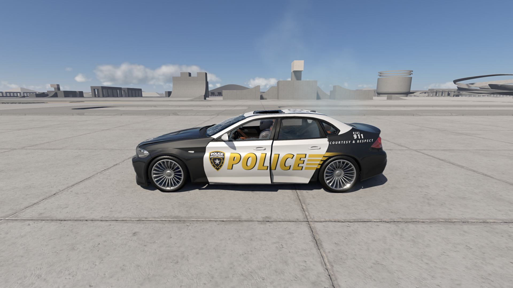
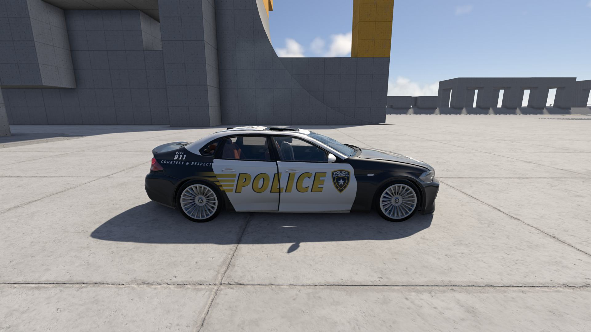
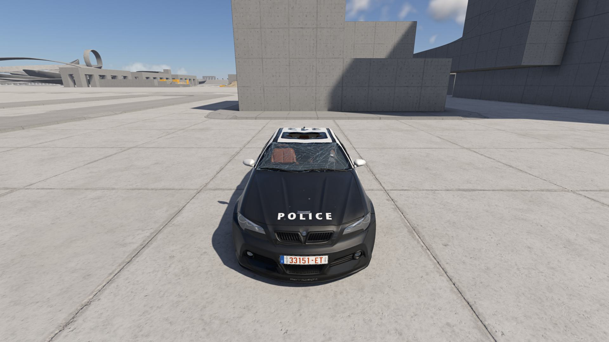
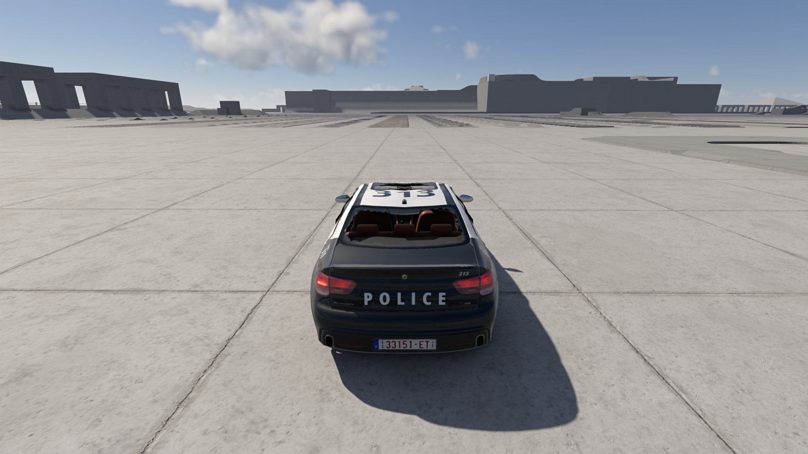
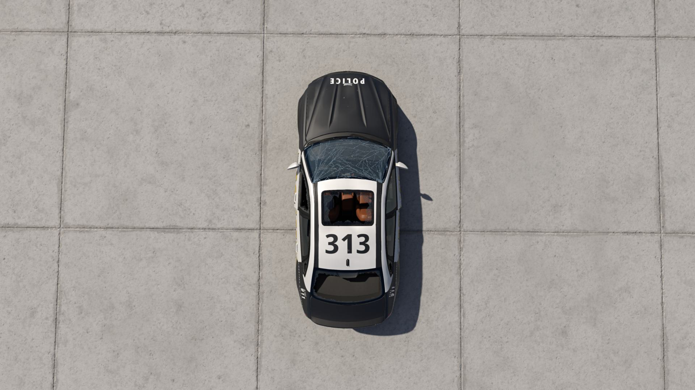

# roofdrop - 20261114-201529_roofdrop_resumed-fixed2-full-vulkan-warm_r1

_dropped upside down from about 1 m - roof impacts_

Remaining queues: `{"bake": 0, "jobs": 0, "stamps": 0}`

Tuning: `if scratches_detect then scratches_detect.setPaintEnabled(true) end; scratches_paint.setDamageResolution(4096); scratches_paint.setBakeBudget(3); scratches_paint.setFlushInterval(0.05); scratches_paint.setProjectionBudget(6); scratches_paint.setLayerBudget(24); scratches_paint.setCoverageCoalescing(false); scratches_paint.setPanelGrouping(true)`

Settled: True after 6.217 s - 466 frames, 74.9 fps average from sampled wall intervals (background limiter lifted)
Went past upside down: True (lowest up-vector z -1.0)

## Marks

| contacts | passed filters | impacts | streams | stamps | projections | bakes | missed | jobs dropped | deferred frames |
|---|---|---|---|---|---|---|---|---|---|
| 1346 | 56 | 56 | 0 | 55 | 18 | 26 | 0.0% | 0 | 0 |

Rejected contacts: PartExcluded 763, BelowThresh 527

Body materials: METAL 55, PLASTIC 1

Surfaces: ASPHALT 56

## Cost

| | avg | p95 | max |
|---|---|---|---|
| painter (GE), ms/frame | 1.401 | 4.191 | 38.212 |
| whole frame, ms | 12.616 (p50) | 17.937 | 49.7 |
| all GE Lua, ms | | 5.063 | 39.45 |
| physics + vehicle Lua, ms | | 0.088 | 0.303 |
| render, ms | | 1.937 | |

- Painter frames over 4 ms: 24; worst flush (project + bake) 38.19 ms, worst composite 0.081 ms.
- Detector: 1.818 us per contact, 5.308 ms total, worst frame 0.619 ms (profiled; the timer adds a little).

### Worst frames

| t (s) | frame ms | painter ms | GE Lua ms | physics+VLUA ms | render ms |
|---|---|---|---|---|---|
| 0.54 | 49.70 | 37.01 | 0.83 | 0.15 | 1.86 |
| 0.80 | 49.49 | 36.56 | 0.80 | 0.06 | 1.41 |
| 5.15 | 49.34 | 38.21 | 0.75 | 0.04 | 1.11 |
| 3.62 | 48.89 | 35.71 | 1.13 | 0.11 | 1.34 |
| 2.49 | 48.79 | 35.37 | 0.90 | 0.05 | 1.16 |

## Screenshots

