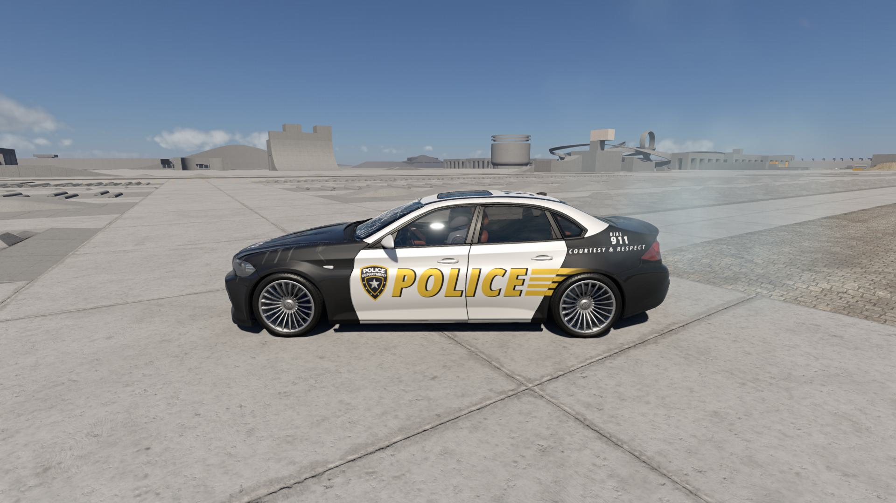
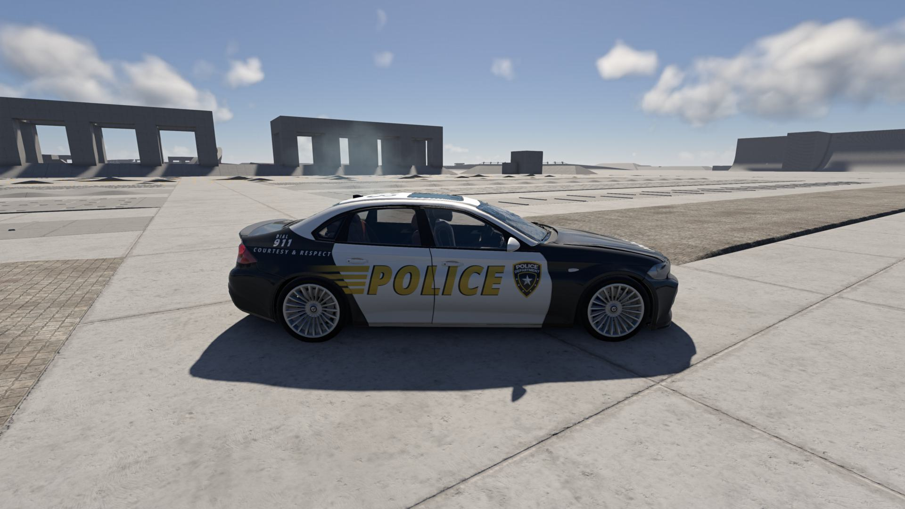
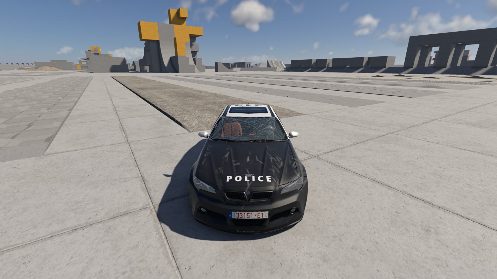
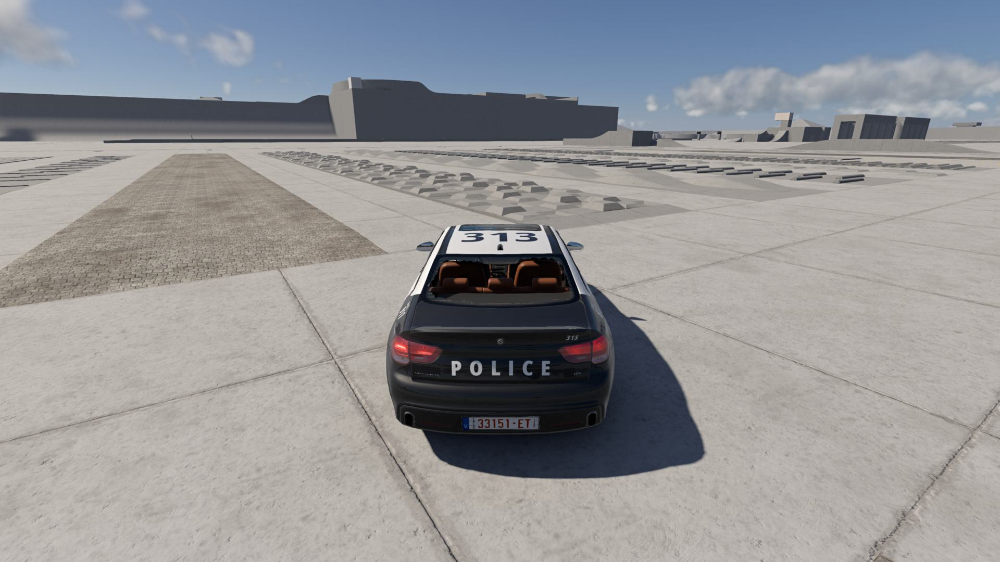
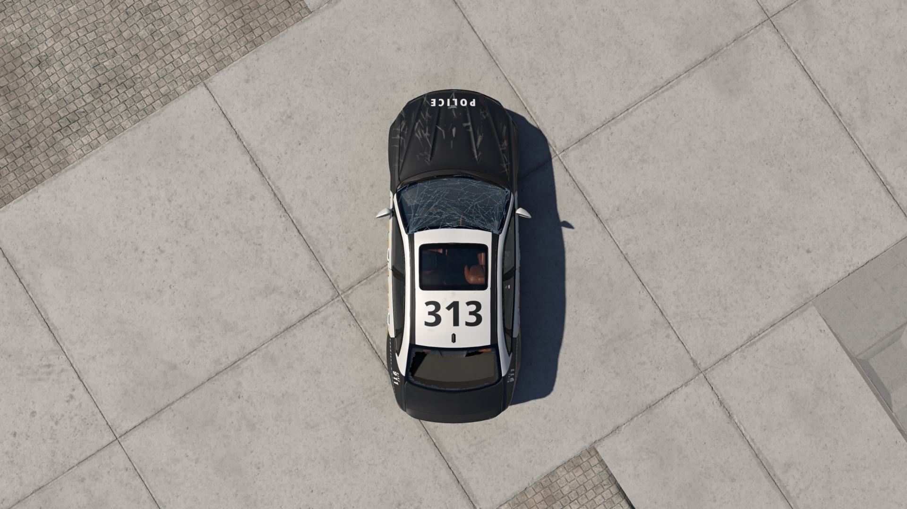

# sustained - 20261114-201547_sustained_resumed-fixed2-full-vulkan-warm_r1

_assisted roof scrape v2: additive translation to 4 m/s for 30 seconds, preserving internal node motion; real collisions_

Remaining queues: `{"bake": 0, "jobs": 0, "stamps": 0}`

Tuning: `if scratches_detect then scratches_detect.setPaintEnabled(true) end; scratches_paint.setDamageResolution(4096); scratches_paint.setBakeBudget(3); scratches_paint.setFlushInterval(0.05); scratches_paint.setProjectionBudget(6); scratches_paint.setLayerBudget(24); scratches_paint.setCoverageCoalescing(false); scratches_paint.setPanelGrouping(true)`

Settled: False after 30.004 s - 2302 frames, 76.8 fps average from sampled wall intervals (background limiter lifted)
Went past upside down: True (lowest up-vector z -1.0)

## Marks

| contacts | passed filters | impacts | streams | stamps | projections | bakes | missed | jobs dropped | deferred frames |
|---|---|---|---|---|---|---|---|---|---|
| 12861 | 6530 | 58 | 472 | 96 | 166 | 183 | 0.0% | 0 | 0 |

Rejected contacts: PartExcluded 5160, BelowThresh 1157, NormalForce 14

Body materials: METAL 6508, PLASTIC 22

Surfaces: ASPHALT 6385, COBBLESTONE 145

## Cost

| | avg | p95 | max |
|---|---|---|---|
| painter (GE), ms/frame | 2.108 | 25.509 | 35.997 |
| whole frame, ms | 11.983 (p50) | 32.71 | 48.239 |
| all GE Lua, ms | | 26.435 | 38.336 |
| physics + vehicle Lua, ms | | 0.089 | 0.563 |
| render, ms | | 1.876 | |

- Painter frames over 4 ms: 170; worst flush (project + bake) 35.976 ms, worst composite 0.435 ms.
- Detector: 3.575 us per contact, 66.408 ms total, worst frame 1.725 ms (profiled; the timer adds a little).

### Worst frames

| t (s) | frame ms | painter ms | GE Lua ms | physics+VLUA ms | render ms |
|---|---|---|---|---|---|
| 18.88 | 48.24 | 35.60 | 0.75 | 0.04 | 1.22 |
| 27.12 | 48.14 | 35.97 | 0.79 | 0.05 | 1.49 |
| 15.02 | 48.06 | 35.42 | 0.78 | 0.06 | 1.28 |
| 27.89 | 48.04 | 35.17 | 0.89 | 0.05 | 1.52 |
| 16.21 | 47.92 | 34.72 | 0.76 | 0.05 | 1.25 |

## Screenshots

