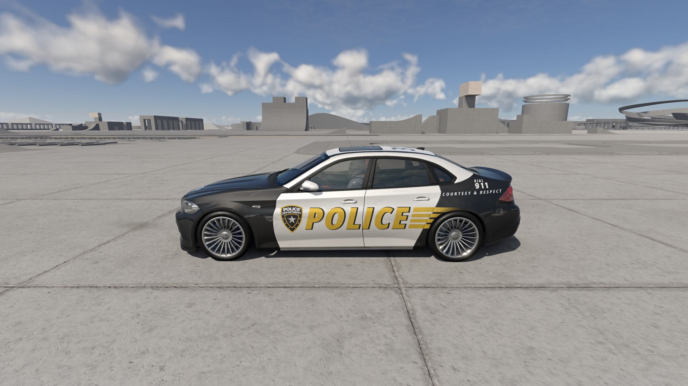
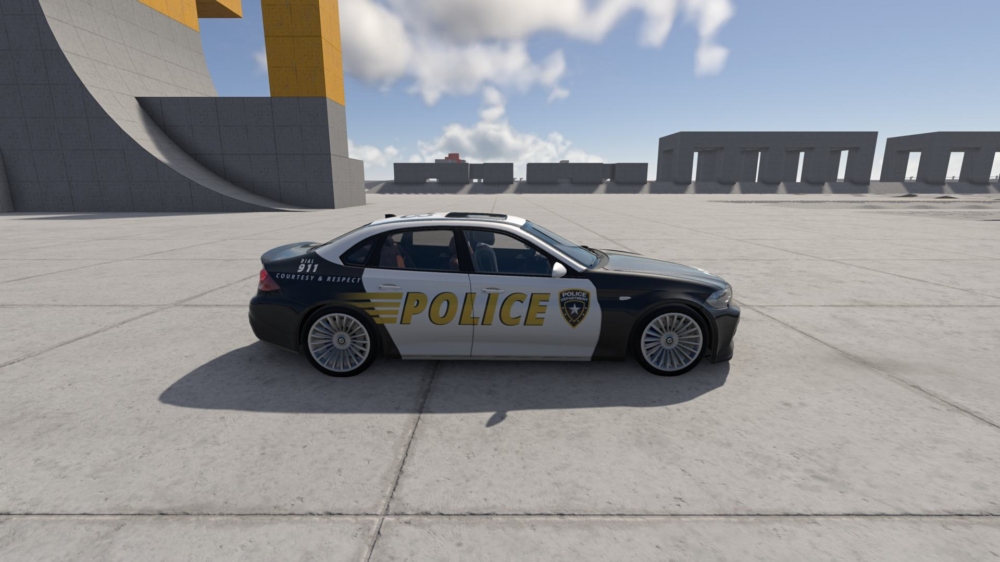
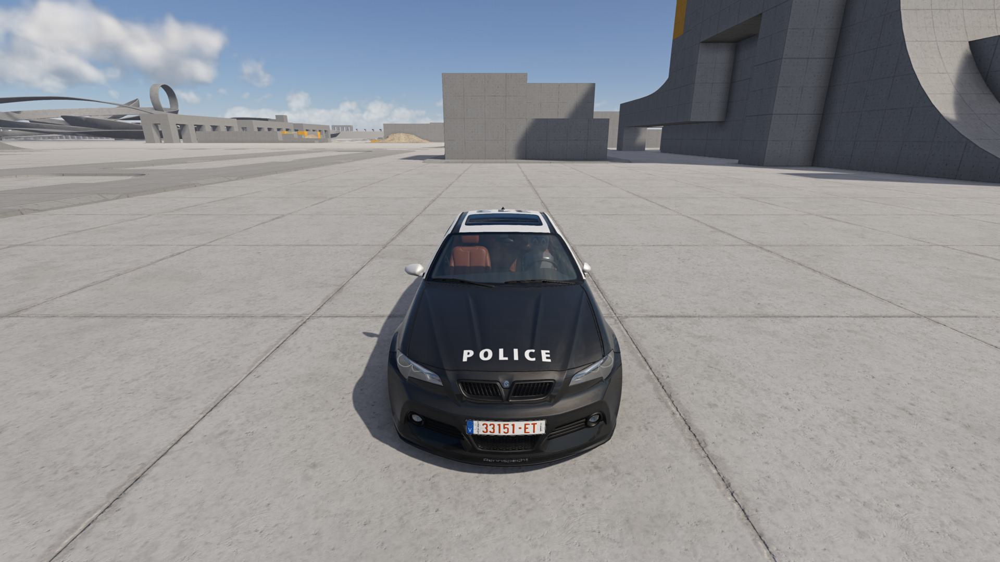
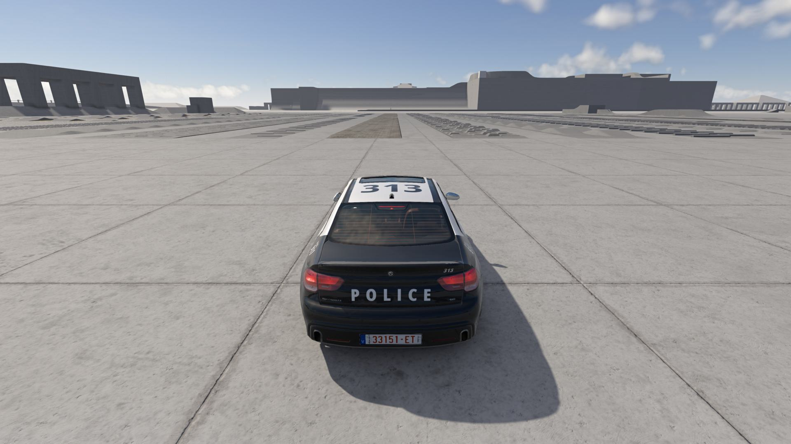
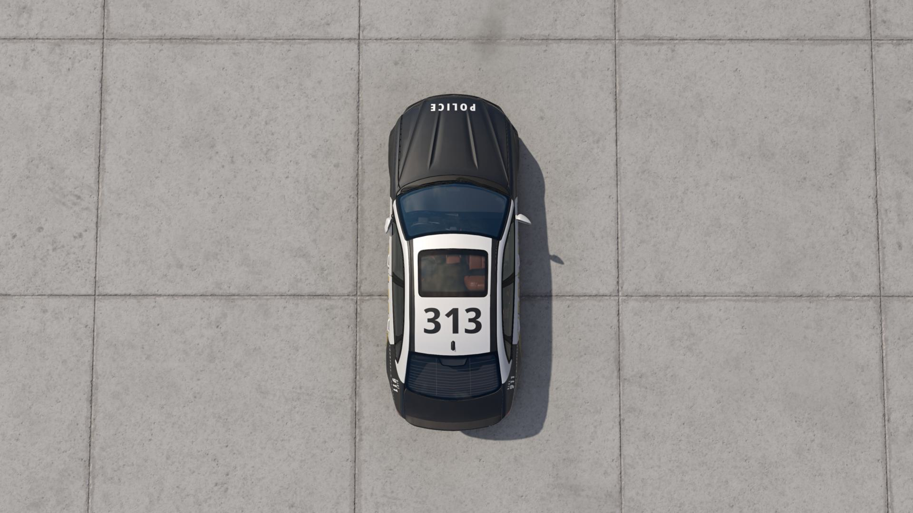

# sideslide - 20261114-211200_sideslide_resumed-fixed2-half-d3d12-warm_r1

_on its side, sliding along the ground at 14 m/s - one long scrape_

Remaining queues: `{"bake": 0, "jobs": 0, "stamps": 0}`

Tuning: `if scratches_detect then scratches_detect.setPaintEnabled(true) end; scratches_paint.setDamageResolution(2048); scratches_paint.setBakeBudget(3); scratches_paint.setFlushInterval(0.05); scratches_paint.setProjectionBudget(6); scratches_paint.setLayerBudget(24); scratches_paint.setCoverageCoalescing(true); scratches_paint.setPanelGrouping(true)`

Settled: True after 4.2 s - 304 frames, 72.2 fps average from sampled wall intervals (background limiter lifted)
Went past upside down: True (lowest up-vector z -0.165)

## Marks

| contacts | passed filters | impacts | streams | stamps | projections | bakes | missed | jobs dropped | deferred frames |
|---|---|---|---|---|---|---|---|---|---|
| 2655 | 580 | 91 | 118 | 120 | 102 | 128 | 0.0% | 0 | 1 |

Rejected contacts: Wheel 1392, BelowThresh 680, NormalForce 3

Body materials: METAL 428, PLASTIC 152

Surfaces: ASPHALT 580

## Cost

| | avg | p95 | max |
|---|---|---|---|
| painter (GE), ms/frame | 4.906 | 23.657 | 35.497 |
| whole frame, ms | 11.072 (p50) | 31.316 | 44.507 |
| all GE Lua, ms | | 25.441 | 38.401 |
| physics + vehicle Lua, ms | | 0.1 | 1.194 |
| render, ms | | 2.329 | |

- Painter frames over 4 ms: 97; worst flush (project + bake) 35.463 ms, worst composite 0.132 ms.
- Detector: 1.667 us per contact, 8.015 ms total, worst frame 0.499 ms (profiled; the timer adds a little).

### Worst frames

| t (s) | frame ms | painter ms | GE Lua ms | physics+VLUA ms | render ms |
|---|---|---|---|---|---|
| 2.25 | 44.51 | 34.80 | 1.35 | 0.05 | 2.21 |
| 0.18 | 43.77 | 35.50 | 0.79 | 0.08 | 1.92 |
| 0.33 | 41.60 | 34.49 | 2.32 | 0.07 | 1.42 |
| 2.44 | 40.58 | 33.00 | 0.74 | 0.33 | 1.69 |
| 2.72 | 40.24 | 32.45 | 0.93 | 0.95 | 1.39 |

## Screenshots

