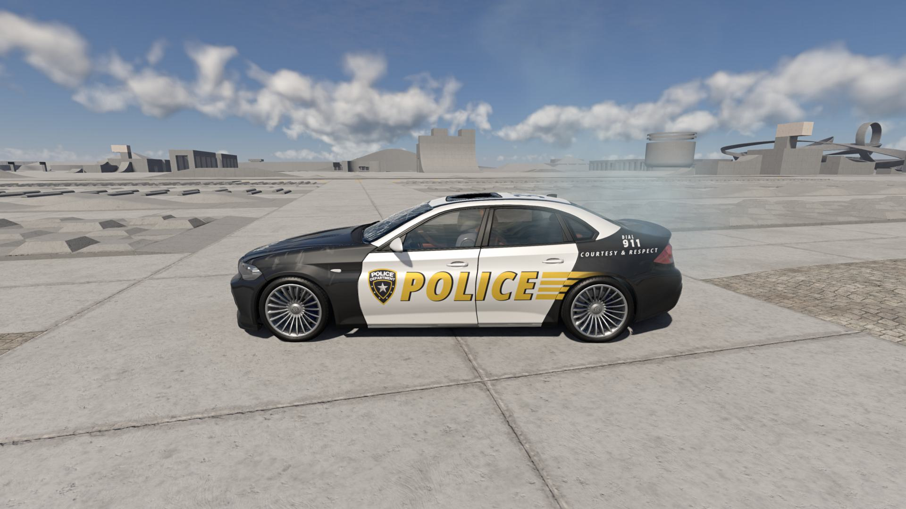
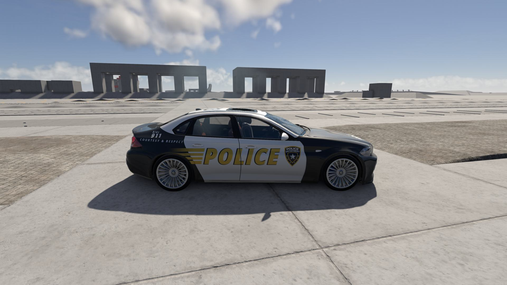
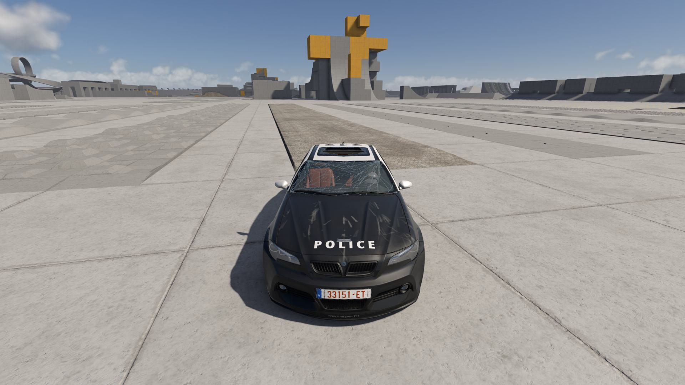
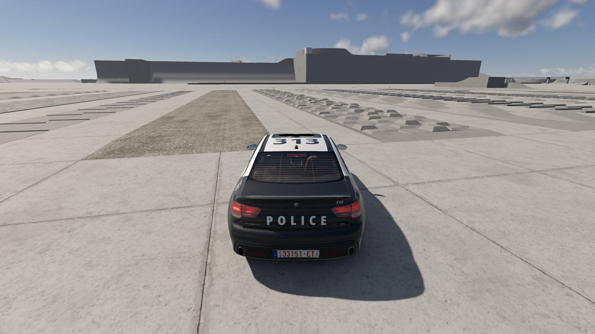
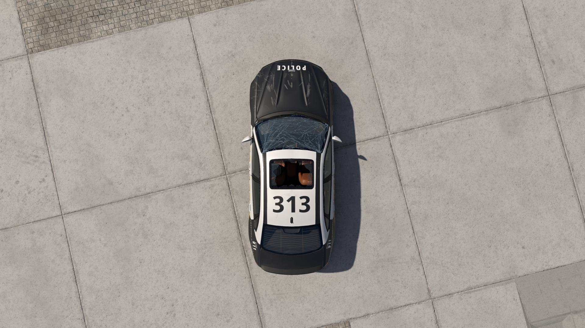

# sustained - 20261114-211217_sustained_resumed-fixed2-half-d3d12-warm_r1

_assisted roof scrape v2: additive translation to 4 m/s for 30 seconds, preserving internal node motion; real collisions_

Remaining queues: `{"bake": 0, "jobs": 0, "stamps": 0}`

Tuning: `if scratches_detect then scratches_detect.setPaintEnabled(true) end; scratches_paint.setDamageResolution(2048); scratches_paint.setBakeBudget(3); scratches_paint.setFlushInterval(0.05); scratches_paint.setProjectionBudget(6); scratches_paint.setLayerBudget(24); scratches_paint.setCoverageCoalescing(true); scratches_paint.setPanelGrouping(true)`

Settled: False after 30.004 s - 2594 frames, 85.7 fps average from sampled wall intervals (background limiter lifted)
Went past upside down: True (lowest up-vector z -1.0)

## Marks

| contacts | passed filters | impacts | streams | stamps | projections | bakes | missed | jobs dropped | deferred frames |
|---|---|---|---|---|---|---|---|---|---|
| 15380 | 7498 | 55 | 524 | 85 | 168 | 184 | 0.0% | 0 | 0 |

Rejected contacts: PartExcluded 6582, BelowThresh 1264, NormalForce 36

Body materials: METAL 7488, PLASTIC 10

Surfaces: ASPHALT 7229, COBBLESTONE 269

## Cost

| | avg | p95 | max |
|---|---|---|---|
| painter (GE), ms/frame | 1.791 | 20.929 | 33.84 |
| whole frame, ms | 10.687 (p50) | 28.177 | 412.583 |
| all GE Lua, ms | | 21.824 | 34.674 |
| physics + vehicle Lua, ms | | 0.082 | 0.388 |
| render, ms | | 2.054 | |

- Painter frames over 4 ms: 203; worst flush (project + bake) 33.812 ms, worst composite 0.179 ms.
- Detector: 3.082 us per contact, 67.441 ms total, worst frame 0.55 ms (profiled; the timer adds a little).

### Worst frames

| t (s) | frame ms | painter ms | GE Lua ms | physics+VLUA ms | render ms |
|---|---|---|---|---|---|
| 1.94 | 412.58 | 0.01 | 0.76 | 0.04 | 1.68 |
| 22.03 | 44.50 | 32.13 | 0.80 | 0.06 | 2.21 |
| 13.41 | 44.10 | 31.91 | 1.03 | 0.10 | 2.17 |
| 22.87 | 43.81 | 32.32 | 0.87 | 0.05 | 1.74 |
| 0.45 | 42.94 | 33.00 | 1.05 | 0.05 | 1.62 |

## Screenshots

