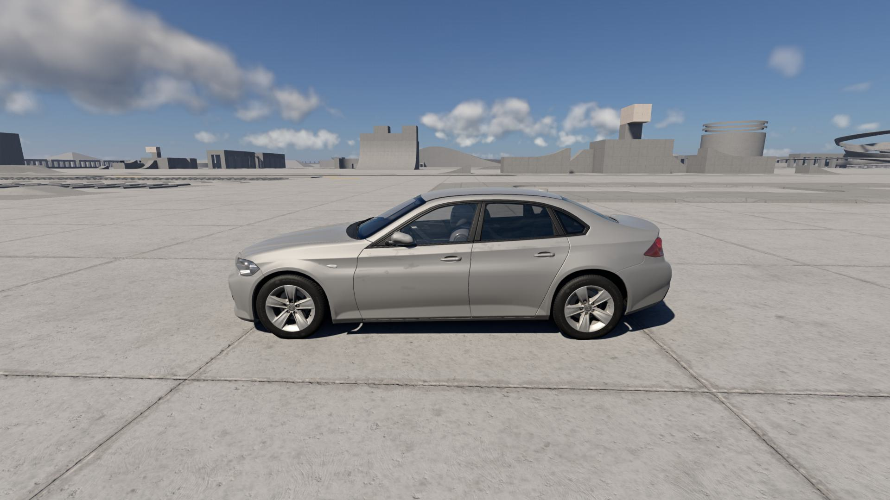
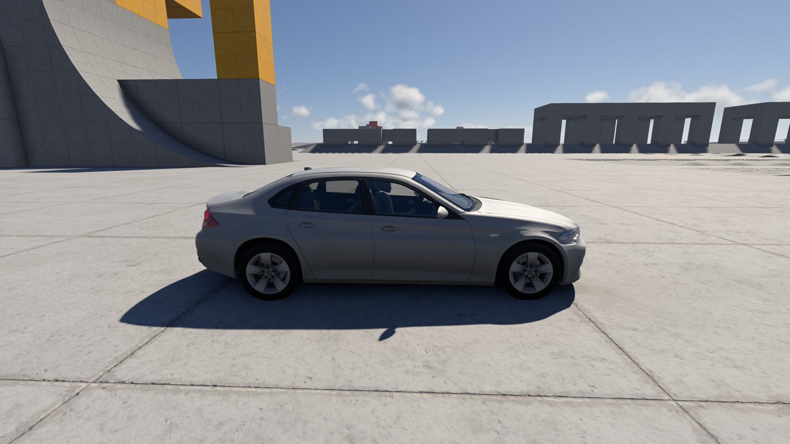
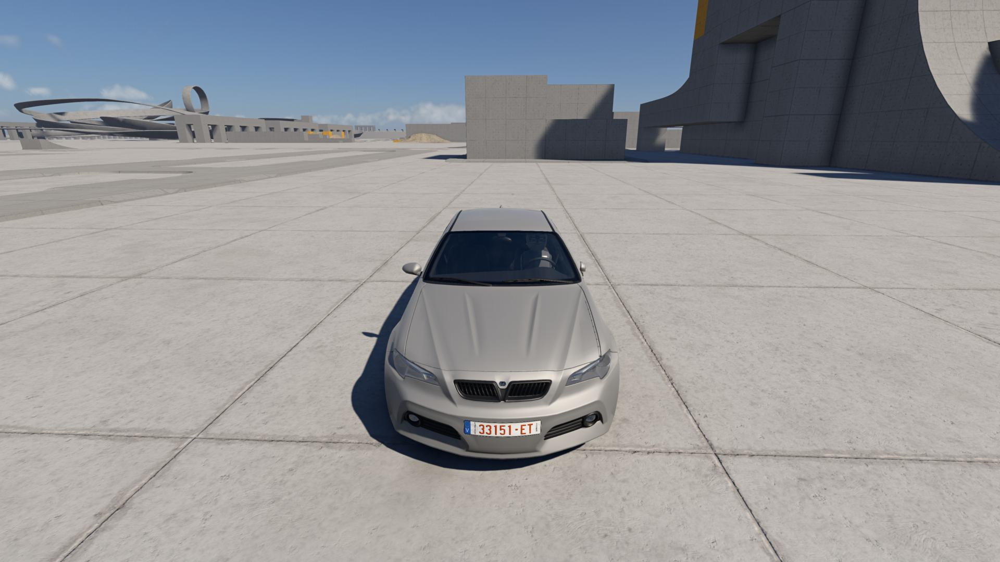
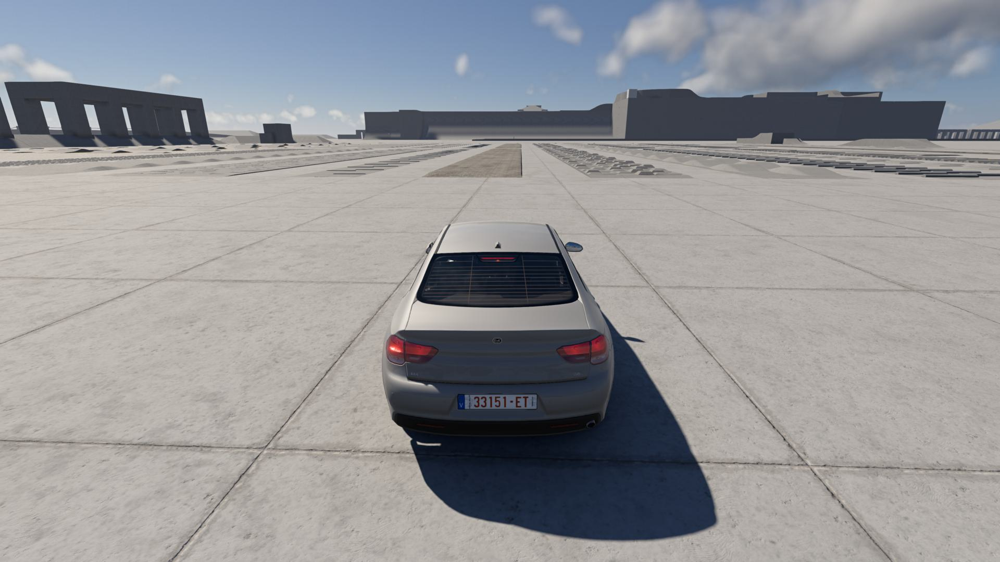
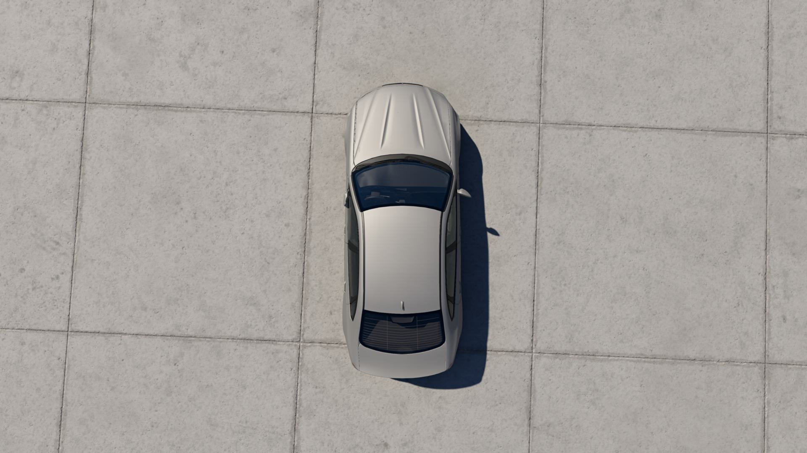

# sideslide - 20261114-202833_sideslide_resumed-full-vk-func-stock-844_150_A

_on its side, sliding along the ground at 14 m/s - one long scrape_

Remaining queues: `{"bake": 0, "jobs": 0, "stamps": 0}`

Tuning: `scratches_paint.setDamageResolution(4096); scratches_paint.setBakeBudget(3); scratches_paint.setFlushInterval(0.05); scratches_paint.setCoverageCoalescing(false); scratches_paint.setPanelGrouping(true)`

Settled: True after 9.948 s - 718 frames, 72.0 fps average from sampled wall intervals (background limiter lifted)
Went past upside down: True (lowest up-vector z -0.476)

## Marks

| contacts | passed filters | impacts | streams | stamps | projections | bakes | missed | jobs dropped | deferred frames |
|---|---|---|---|---|---|---|---|---|---|
| 5321 | 609 | 53 | 77 | 99 | 81 | 98 | 0.0% | 0 | 1 |

Rejected contacts: BelowThresh 3355, Wheel 1305, PartExcluded 52

Body materials: METAL 408, PLASTIC 201

Surfaces: ASPHALT 609

## Cost

| | avg | p95 | max |
|---|---|---|---|
| painter (GE), ms/frame | 1.892 | 15.787 | 39.917 |
| whole frame, ms | 12.36 (p50) | 29.411 | 53.882 |
| all GE Lua, ms | | 16.877 | 41.268 |
| physics + vehicle Lua, ms | | 0.103 | 0.538 |
| render, ms | | 2.114 | |

- Painter frames over 4 ms: 71; worst flush (project + bake) 39.895 ms, worst composite 0.373 ms.
- Detector: 1.742 us per contact, 14.729 ms total, worst frame 0.645 ms (profiled; the timer adds a little).

### Worst frames

| t (s) | frame ms | painter ms | GE Lua ms | physics+VLUA ms | render ms |
|---|---|---|---|---|---|
| 0.19 | 53.88 | 39.92 | 1.09 | 0.10 | 2.57 |
| 4.45 | 47.89 | 34.21 | 0.92 | 0.08 | 1.37 |
| 5.62 | 47.24 | 35.16 | 0.93 | 0.05 | 1.66 |
| 4.26 | 46.68 | 34.13 | 0.97 | 0.08 | 1.45 |
| 3.87 | 46.12 | 33.02 | 0.93 | 0.05 | 1.87 |

## Screenshots

