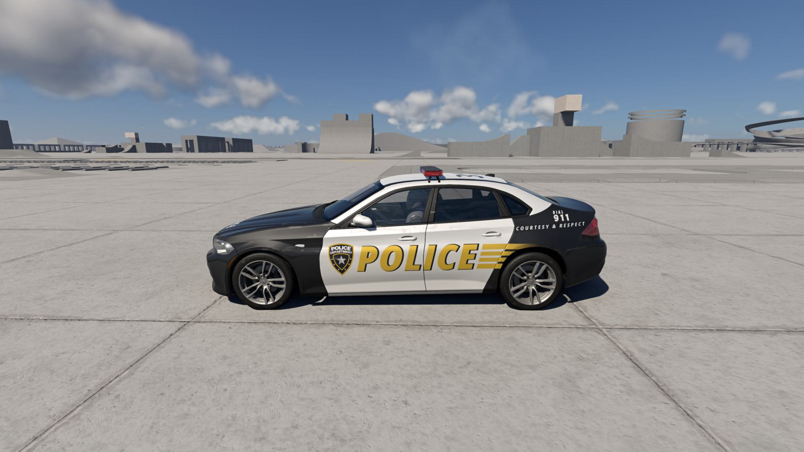
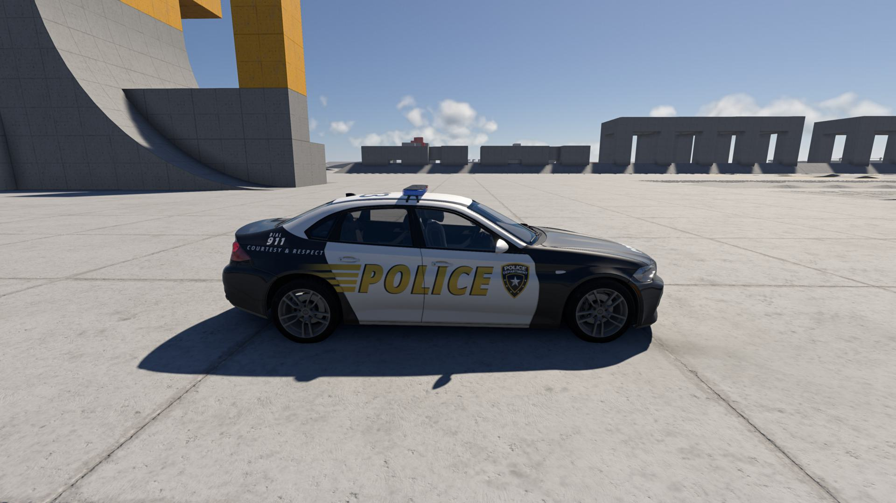
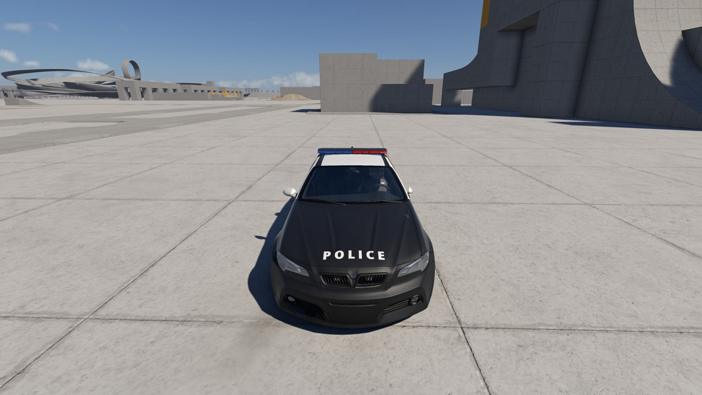
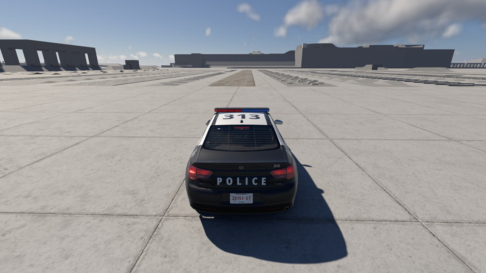
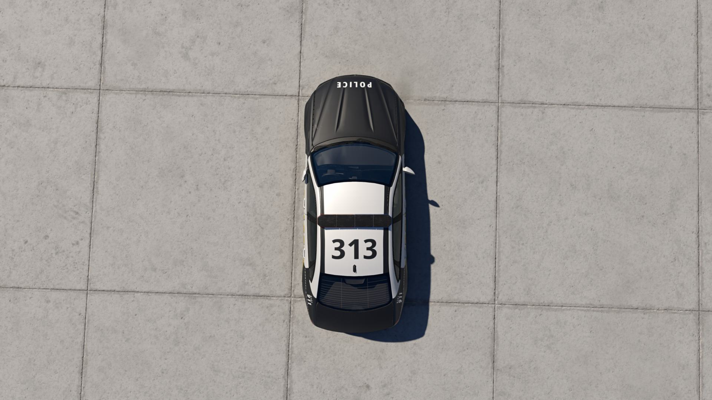

# sideslide - 20261114-202900_sideslide_resumed-full-vk-func-stock-844_police_A

_on its side, sliding along the ground at 14 m/s - one long scrape_

Remaining queues: `{"bake": 0, "jobs": 0, "stamps": 0}`

Tuning: `scratches_paint.setDamageResolution(4096); scratches_paint.setBakeBudget(3); scratches_paint.setFlushInterval(0.05); scratches_paint.setCoverageCoalescing(false); scratches_paint.setPanelGrouping(true)`

Settled: True after 4.419 s - 268 frames, 60.7 fps average from sampled wall intervals (background limiter lifted)
Went past upside down: True (lowest up-vector z -0.48)

## Marks

| contacts | passed filters | impacts | streams | stamps | projections | bakes | missed | jobs dropped | deferred frames |
|---|---|---|---|---|---|---|---|---|---|
| 1207 | 641 | 50 | 89 | 91 | 88 | 101 | 0.0% | 0 | 1 |

Rejected contacts: BelowThresh 384, PartExcluded 114, Wheel 66, NormalForce 2

Body materials: METAL 434, PLASTIC 207

Surfaces: ASPHALT 641

## Cost

| | avg | p95 | max |
|---|---|---|---|
| painter (GE), ms/frame | 4.437 | 20.594 | 39.831 |
| whole frame, ms | 13.501 (p50) | 31.507 | 49.024 |
| all GE Lua, ms | | 22.066 | 40.994 |
| physics + vehicle Lua, ms | | 0.135 | 1.041 |
| render, ms | | 2.041 | |

- Painter frames over 4 ms: 60; worst flush (project + bake) 39.808 ms, worst composite 0.12 ms.
- Detector: 4.138 us per contact, 8.848 ms total, worst frame 0.644 ms (profiled; the timer adds a little).

### Worst frames

| t (s) | frame ms | painter ms | GE Lua ms | physics+VLUA ms | render ms |
|---|---|---|---|---|---|
| 0.18 | 49.02 | 39.83 | 1.16 | 0.11 | 1.57 |
| 0.36 | 48.93 | 34.08 | 3.35 | 0.07 | 1.52 |
| 3.42 | 37.87 | 28.33 | 0.86 | 0.05 | 1.36 |
| 2.94 | 34.88 | 23.30 | 2.24 | 0.09 | 1.85 |
| 0.81 | 34.78 | 19.05 | 2.92 | 0.13 | 1.56 |

## Screenshots

