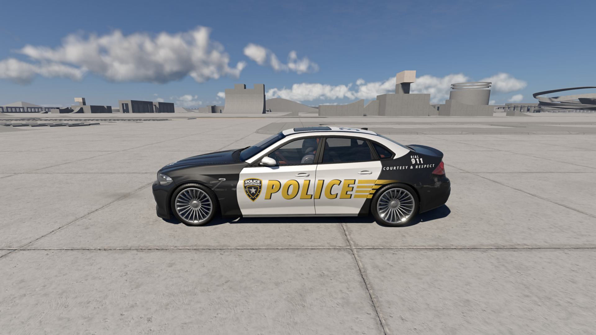
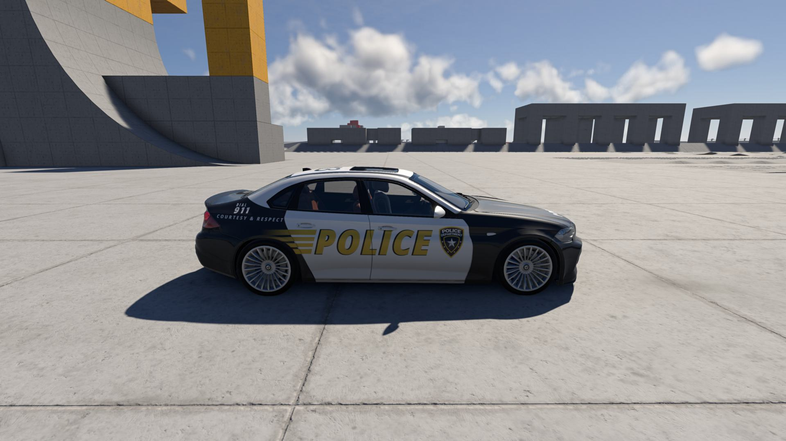
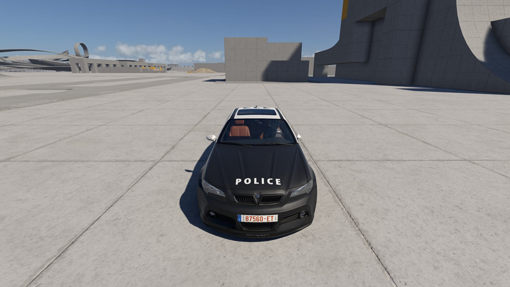
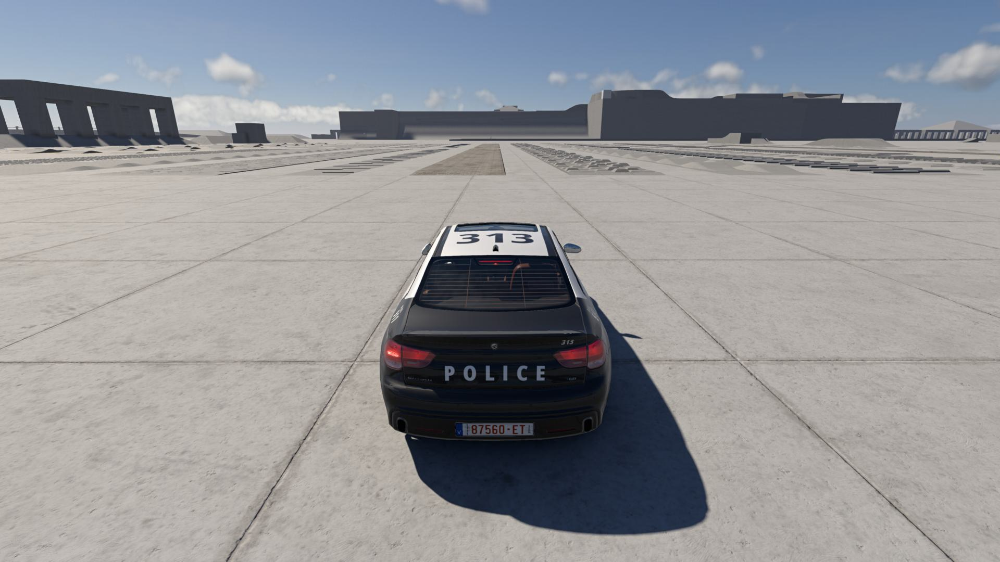
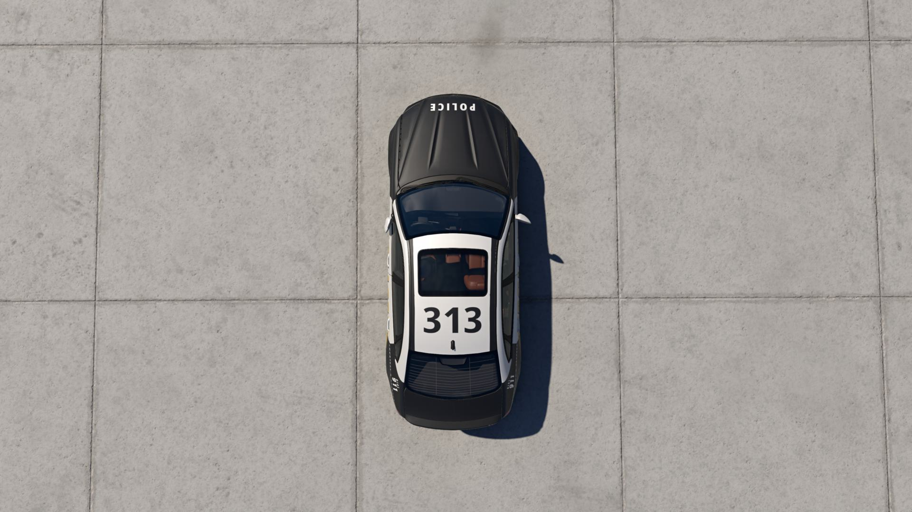

# sideslide - 20261114-203314_sideslide_resumed-full-vk-func-wash

_on its side, sliding along the ground at 14 m/s - one long scrape_

Remaining queues: `{"bake": 0, "jobs": 0, "stamps": 0}`

Settled: True after 4.214 s - 262 frames, 62.3 fps average from sampled wall intervals (background limiter lifted)
Went past upside down: True (lowest up-vector z -0.166)

## Marks

| contacts | passed filters | impacts | streams | stamps | projections | bakes | missed | jobs dropped | deferred frames |
|---|---|---|---|---|---|---|---|---|---|
| 2451 | 476 | 90 | 113 | 125 | 100 | 125 | 0.0% | 0 | 1 |

Rejected contacts: Wheel 1337, BelowThresh 634, NormalForce 4

Body materials: METAL 354, PLASTIC 122

Surfaces: ASPHALT 476

## Cost

| | avg | p95 | max |
|---|---|---|---|
| painter (GE), ms/frame | 4.233 | 20.027 | 41.484 |
| whole frame, ms | 13.594 (p50) | 31.443 | 52.578 |
| all GE Lua, ms | | 20.94 | 42.512 |
| physics + vehicle Lua, ms | | 0.092 | 1.335 |
| render, ms | | 1.576 | |

- Painter frames over 4 ms: 44; worst flush (project + bake) 41.46 ms, worst composite 0.175 ms.
- Detector: 1.44 us per contact, 6.878 ms total, worst frame 0.502 ms (profiled; the timer adds a little).

### Worst frames

| t (s) | frame ms | painter ms | GE Lua ms | physics+VLUA ms | render ms |
|---|---|---|---|---|---|
| 0.19 | 52.58 | 41.48 | 0.90 | 0.10 | 1.35 |
| 0.97 | 35.99 | 18.75 | 4.89 | 0.07 | 1.77 |
| 2.24 | 34.94 | 28.92 | 0.82 | 0.03 | 1.34 |
| 0.26 | 33.98 | 26.70 | 2.78 | 0.05 | 1.35 |
| 0.35 | 32.99 | 22.88 | 1.99 | 0.06 | 1.87 |

## Screenshots

