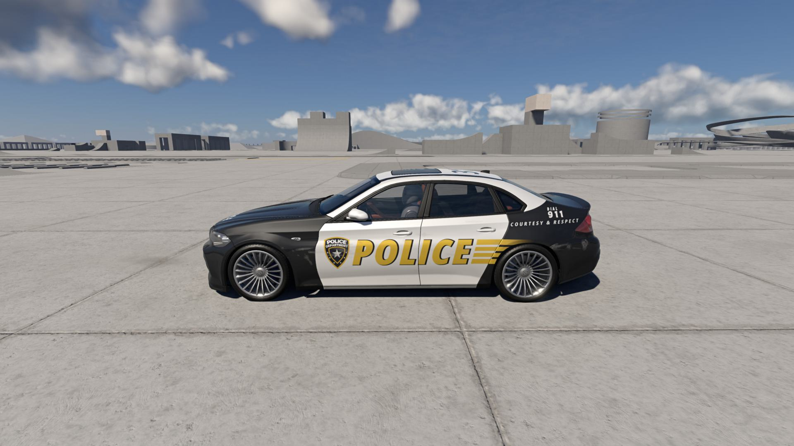
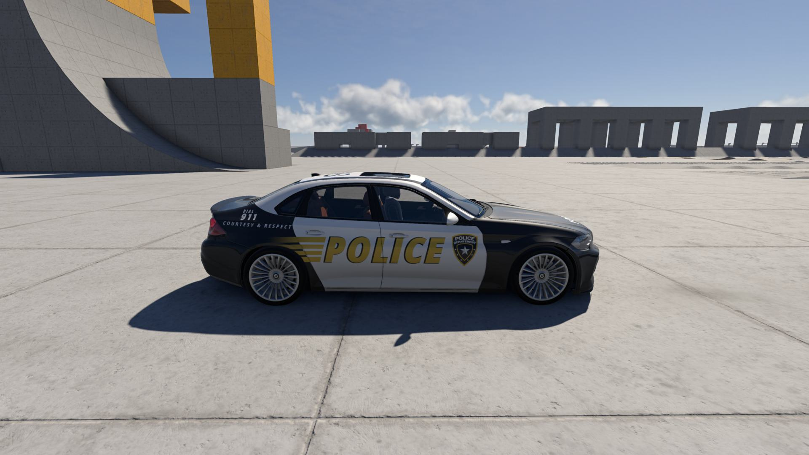
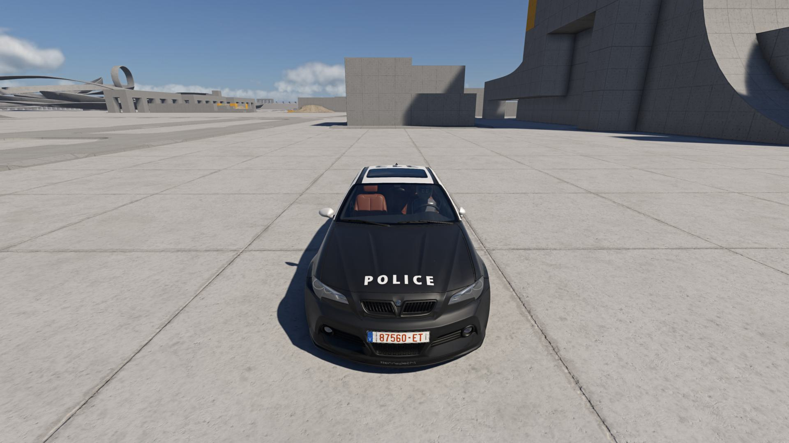
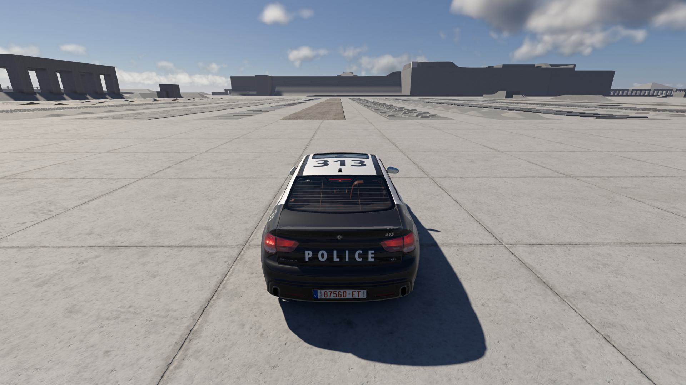
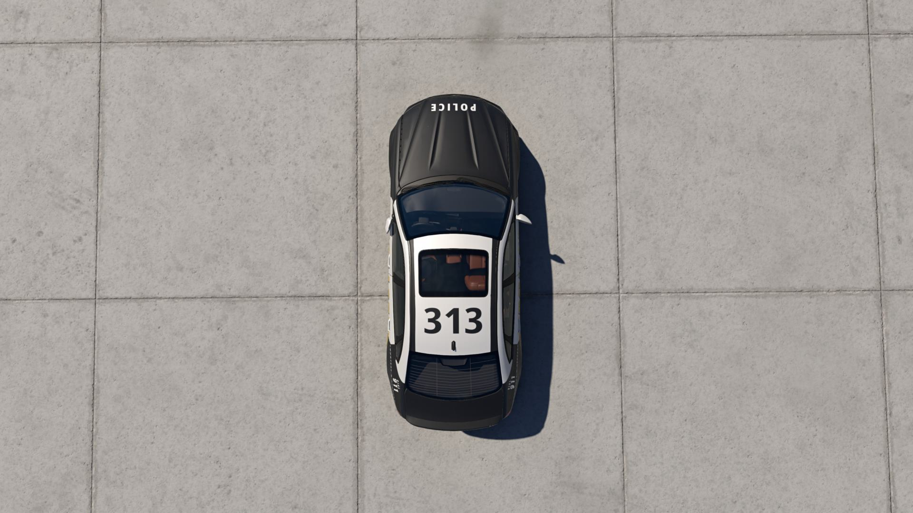

# sideslide - 20261114-203900_sideslide_resumed-full-vk-wash-guarded

_on its side, sliding along the ground at 14 m/s - one long scrape_

Remaining queues: `{"bake": 0, "jobs": 0, "stamps": 0}`

Tuning: `scratches_paint.setDamageResolution(4096); scratches_paint.setBakeBudget(3); scratches_paint.setFlushInterval(0.05); scratches_paint.setPanelGrouping(true); scratches_paint.setCoverageCoalescing(false)`

Settled: True after 4.219 s - 242 frames, 57.2 fps average from sampled wall intervals (background limiter lifted)
Went past upside down: True (lowest up-vector z -0.165)

## Marks

| contacts | passed filters | impacts | streams | stamps | projections | bakes | missed | jobs dropped | deferred frames |
|---|---|---|---|---|---|---|---|---|---|
| 2245 | 483 | 88 | 90 | 148 | 84 | 116 | 0.0% | 0 | 1 |

Rejected contacts: Wheel 1140, BelowThresh 617, NormalForce 5

Body materials: METAL 364, PLASTIC 119

Surfaces: ASPHALT 483

## Cost

| | avg | p95 | max |
|---|---|---|---|
| painter (GE), ms/frame | 4.355 | 21.552 | 41.687 |
| whole frame, ms | 15.36 (p50) | 32.715 | 54.648 |
| all GE Lua, ms | | 22.598 | 43.205 |
| physics + vehicle Lua, ms | | 0.129 | 0.289 |
| render, ms | | 2.348 | |

- Painter frames over 4 ms: 74; worst flush (project + bake) 41.662 ms, worst composite 0.136 ms.
- Detector: 1.788 us per contact, 8.63 ms total, worst frame 0.943 ms (profiled; the timer adds a little).

### Worst frames

| t (s) | frame ms | painter ms | GE Lua ms | physics+VLUA ms | render ms |
|---|---|---|---|---|---|
| 0.19 | 54.65 | 41.69 | 1.21 | 0.08 | 1.76 |
| 0.28 | 49.80 | 30.51 | 3.22 | 0.09 | 2.75 |
| 3.65 | 45.75 | 33.64 | 0.98 | 0.05 | 1.92 |
| 0.77 | 40.54 | 23.11 | 3.95 | 0.08 | 2.37 |
| 0.38 | 37.76 | 24.98 | 7.02 | 0.10 | 2.17 |

## Screenshots

