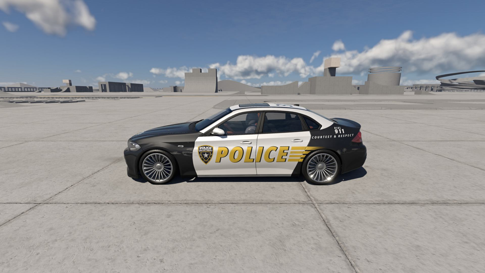
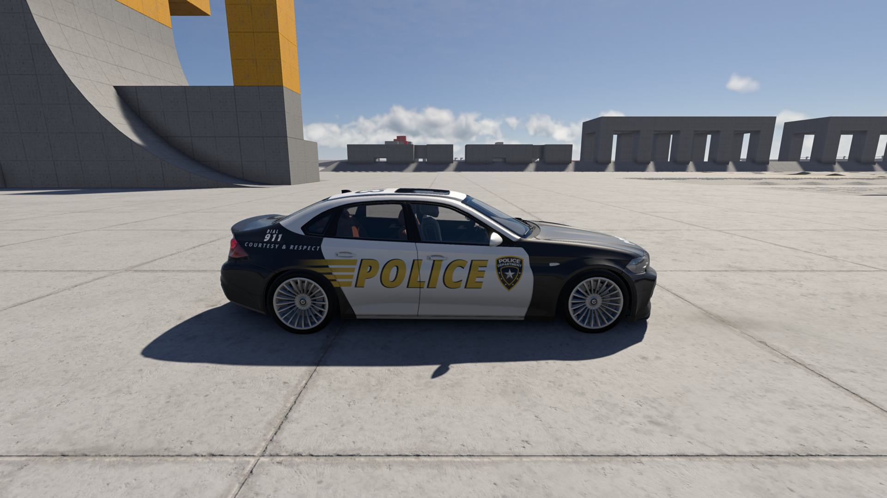
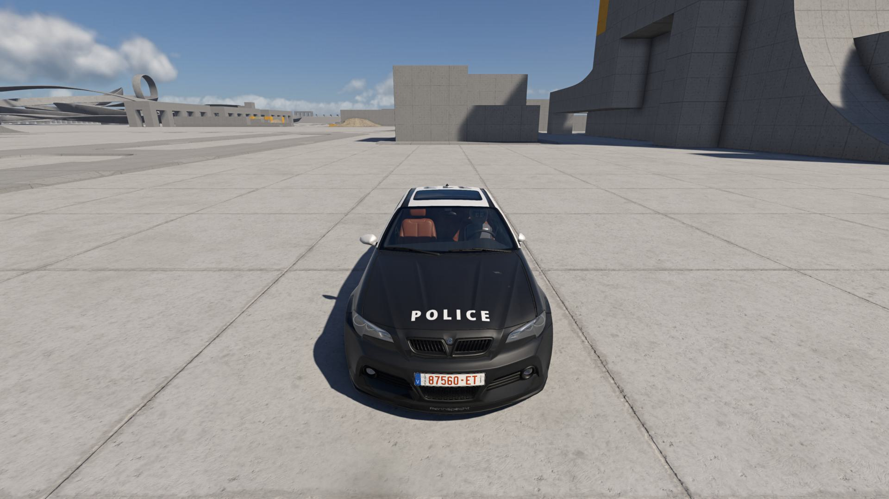
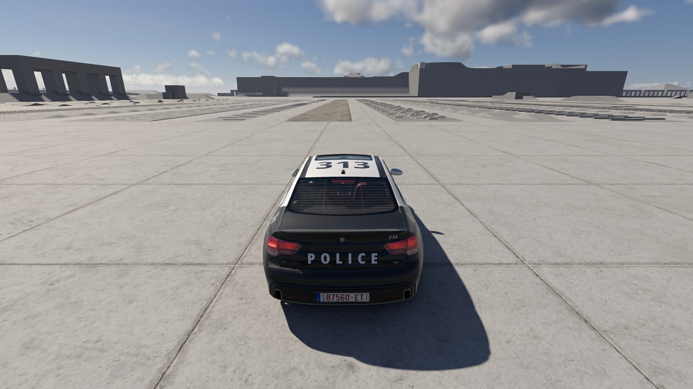
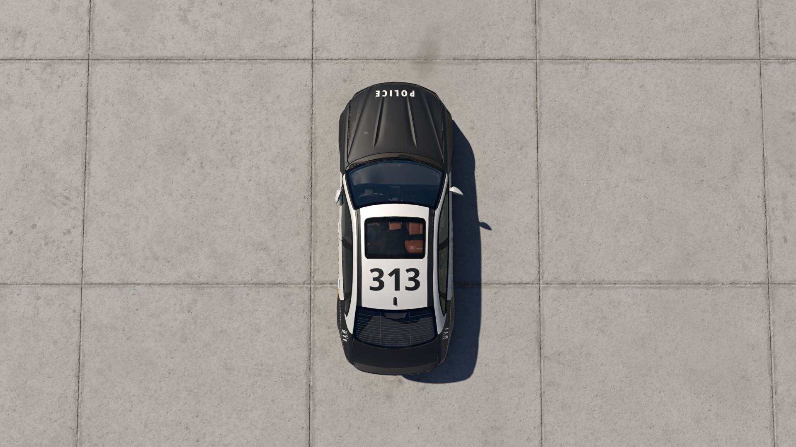

# sideslide - 20261114-204154_sideslide_resumed-full-vk-wash-safe

_on its side, sliding along the ground at 14 m/s - one long scrape_

Remaining queues: `{"bake": 0, "jobs": 0, "stamps": 0}`

Tuning: `scratches_paint.setDamageResolution(4096); scratches_paint.setBakeBudget(3); scratches_paint.setFlushInterval(0.05); scratches_paint.setPanelGrouping(true); scratches_paint.setCoverageCoalescing(false)`

Settled: True after 4.347 s - 271 frames, 62.0 fps average from sampled wall intervals (background limiter lifted)
Went past upside down: True (lowest up-vector z -0.172)

## Marks

| contacts | passed filters | impacts | streams | stamps | projections | bakes | missed | jobs dropped | deferred frames |
|---|---|---|---|---|---|---|---|---|---|
| 2111 | 417 | 113 | 104 | 147 | 91 | 128 | 0.0% | 0 | 1 |

Rejected contacts: Wheel 1099, BelowThresh 593, NormalForce 2

Body materials: METAL 310, PLASTIC 107

Surfaces: ASPHALT 417

## Cost

| | avg | p95 | max |
|---|---|---|---|
| painter (GE), ms/frame | 4.176 | 19.206 | 40.86 |
| whole frame, ms | 13.54 (p50) | 31.889 | 53.695 |
| all GE Lua, ms | | 20.163 | 41.868 |
| physics + vehicle Lua, ms | | 0.087 | 0.148 |
| render, ms | | 1.61 | |

- Painter frames over 4 ms: 48; worst flush (project + bake) 40.839 ms, worst composite 0.106 ms.
- Detector: 1.321 us per contact, 6.862 ms total, worst frame 0.562 ms (profiled; the timer adds a little).

### Worst frames

| t (s) | frame ms | painter ms | GE Lua ms | physics+VLUA ms | render ms |
|---|---|---|---|---|---|
| 0.18 | 53.70 | 40.86 | 0.88 | 0.06 | 1.26 |
| 3.51 | 45.82 | 33.97 | 0.82 | 0.03 | 1.20 |
| 0.33 | 42.87 | 29.98 | 2.95 | 0.05 | 1.38 |
| 3.32 | 41.29 | 29.57 | 0.86 | 0.05 | 1.22 |
| 2.51 | 33.41 | 21.84 | 2.05 | 0.05 | 1.21 |

## Screenshots

