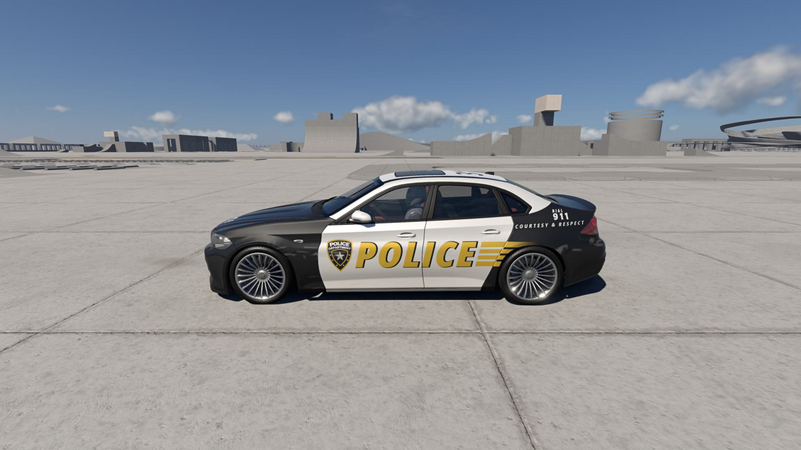
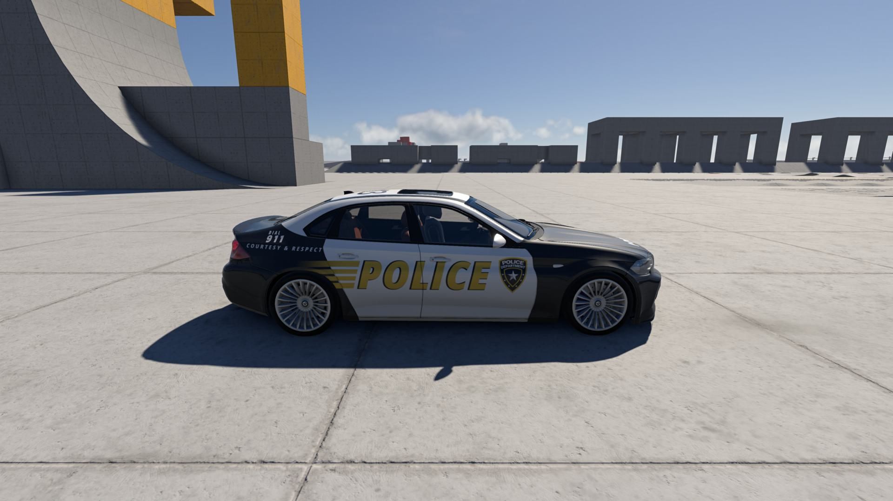
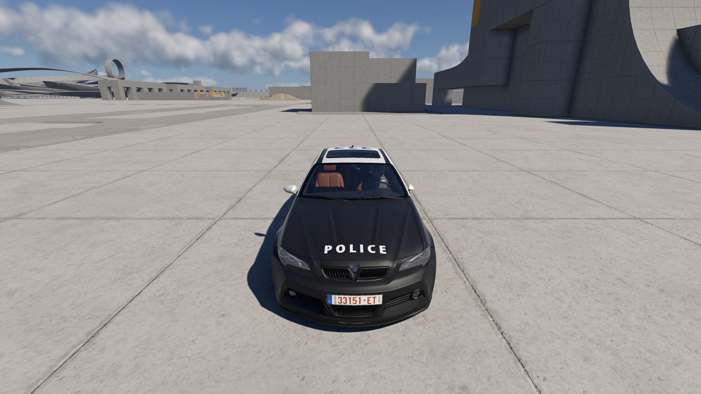
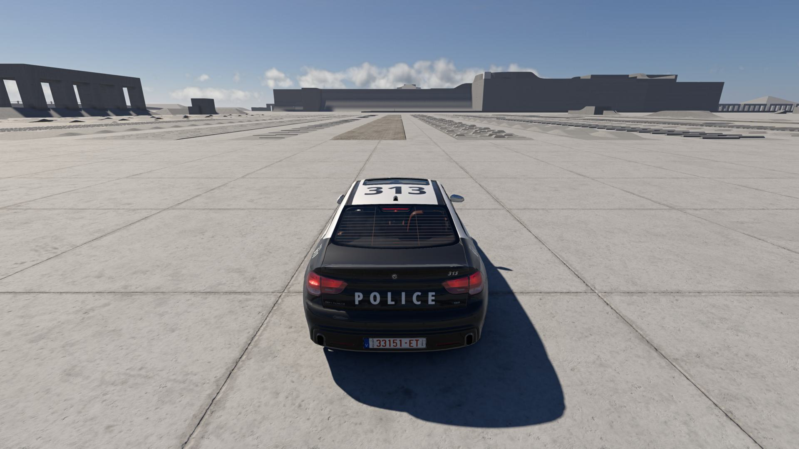
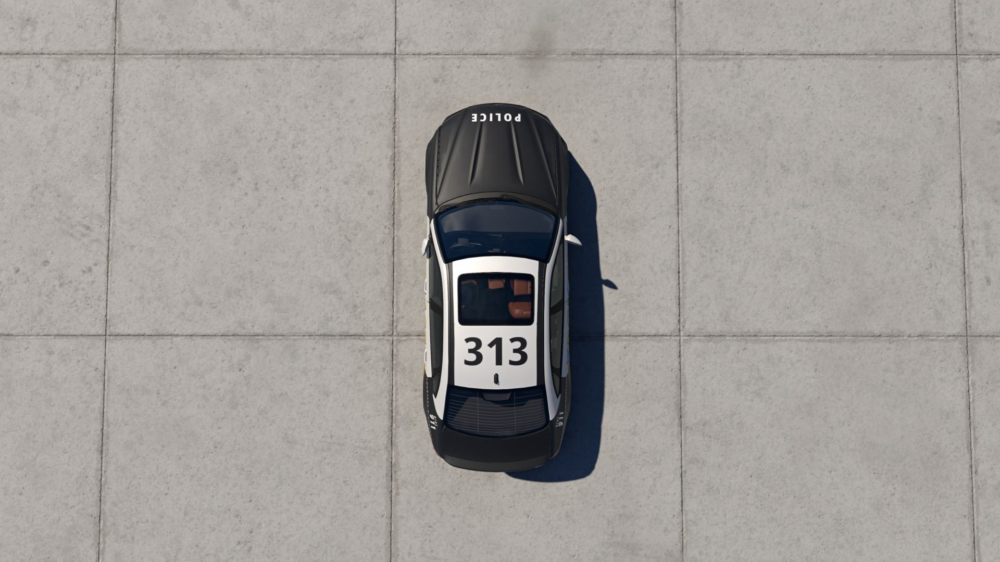

# sideslide - 20261114-210326_sideslide_resumed-grouped-full-b6-vulkan-cold_r1

_on its side, sliding along the ground at 14 m/s - one long scrape_

Remaining queues: `{"bake": 0, "jobs": 0, "stamps": 0}`

Tuning: `if scratches_detect then scratches_detect.setPaintEnabled(true) end; scratches_paint.setDamageResolution(4096); scratches_paint.setBakeBudget(6); scratches_paint.setFlushInterval(0.05); scratches_paint.setProjectionBudget(6); scratches_paint.setLayerBudget(24); scratches_paint.setCoverageCoalescing(false); scratches_paint.setPanelGrouping(true)`

Settled: True after 4.263 s - 306 frames, 60.5 fps average from sampled wall intervals (background limiter lifted)
Went past upside down: True (lowest up-vector z -0.168)

## Marks

| contacts | passed filters | impacts | streams | stamps | projections | bakes | missed | jobs dropped | deferred frames |
|---|---|---|---|---|---|---|---|---|---|
| 2540 | 593 | 87 | 124 | 131 | 112 | 85 | 0.0% | 0 | 1 |

Rejected contacts: Wheel 1300, BelowThresh 644, NormalForce 3

Body materials: METAL 444, PLASTIC 149

Surfaces: ASPHALT 593

## Cost

| | avg | p95 | max |
|---|---|---|---|
| painter (GE), ms/frame | 5.441 | 27.076 | 41.261 |
| whole frame, ms | 12.97 (p50) | 33.772 | 52.233 |
| all GE Lua, ms | | 28.055 | 42.427 |
| physics + vehicle Lua, ms | | 0.102 | 1.473 |
| render, ms | | 1.751 | |

- Painter frames over 4 ms: 104; worst flush (project + bake) 41.242 ms, worst composite 0.095 ms.
- Detector: 1.573 us per contact, 8.819 ms total, worst frame 0.722 ms (profiled; the timer adds a little).

### Worst frames

| t (s) | frame ms | painter ms | GE Lua ms | physics+VLUA ms | render ms |
|---|---|---|---|---|---|
| 0.18 | 52.23 | 41.26 | 0.90 | 0.10 | 1.31 |
| 3.60 | 45.72 | 33.43 | 0.91 | 0.08 | 1.23 |
| 0.30 | 38.21 | 29.55 | 1.36 | 0.06 | 1.34 |
| 0.62 | 38.05 | 30.82 | 0.87 | 0.58 | 1.26 |
| 1.16 | 37.95 | 29.97 | 1.17 | 0.06 | 1.36 |

## Screenshots

