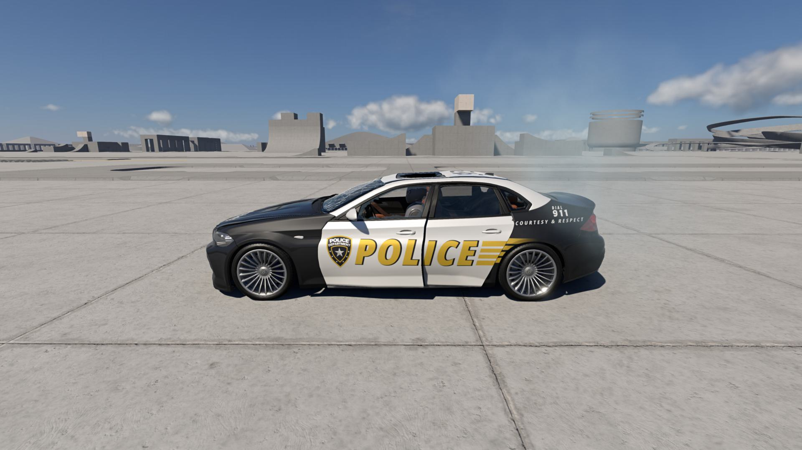
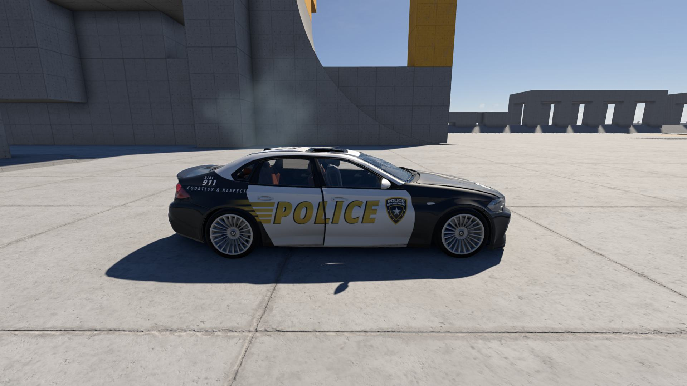
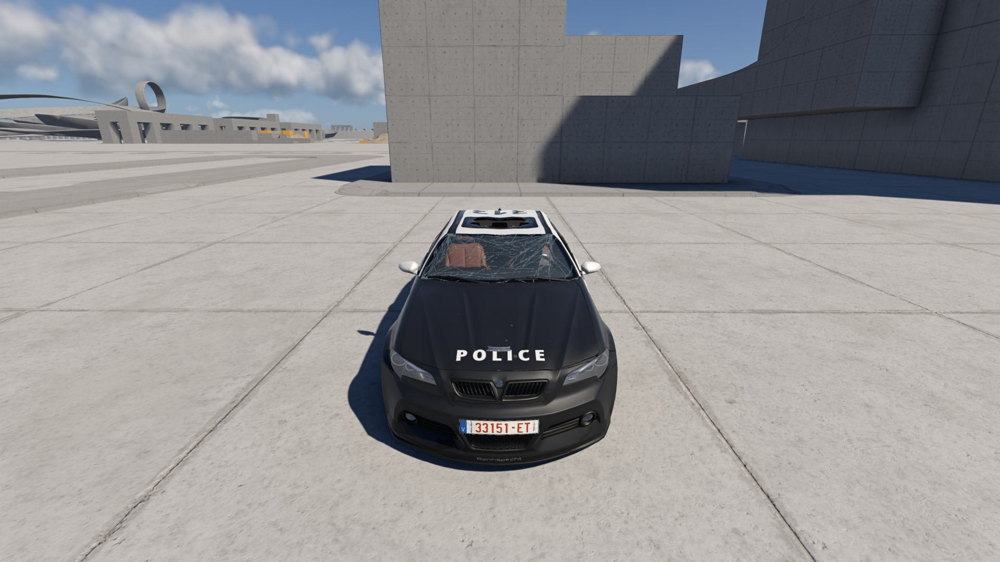
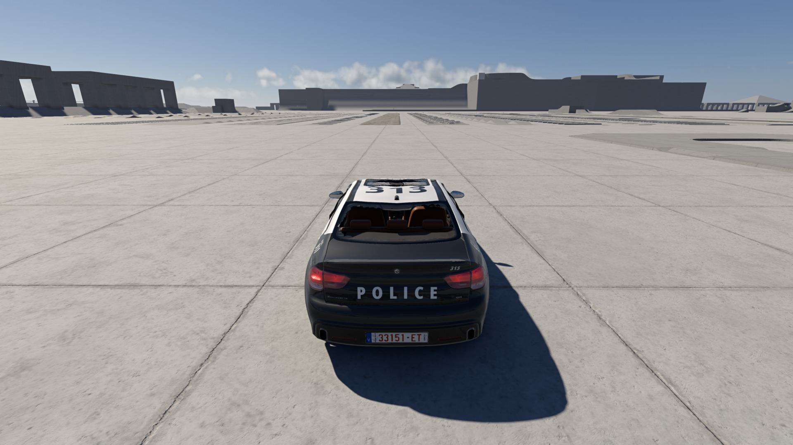
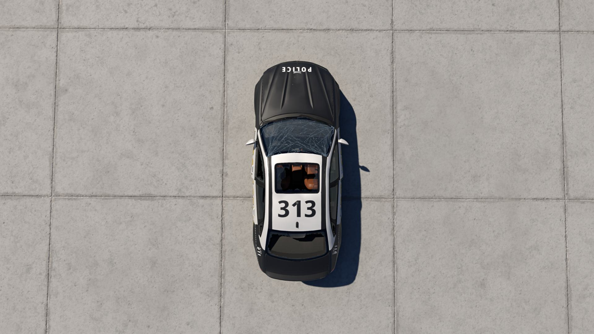

# roofdrop - 20261114-210343_roofdrop_resumed-grouped-full-b6-vulkan-cold_r1

_dropped upside down from about 1 m - roof impacts_

Remaining queues: `{"bake": 0, "jobs": 0, "stamps": 0}`

Tuning: `if scratches_detect then scratches_detect.setPaintEnabled(true) end; scratches_paint.setDamageResolution(4096); scratches_paint.setBakeBudget(6); scratches_paint.setFlushInterval(0.05); scratches_paint.setProjectionBudget(6); scratches_paint.setLayerBudget(24); scratches_paint.setCoverageCoalescing(false); scratches_paint.setPanelGrouping(true)`

Settled: True after 6.481 s - 498 frames, 76.7 fps average from sampled wall intervals (background limiter lifted)
Went past upside down: True (lowest up-vector z -1.0)

## Marks

| contacts | passed filters | impacts | streams | stamps | projections | bakes | missed | jobs dropped | deferred frames |
|---|---|---|---|---|---|---|---|---|---|
| 1363 | 59 | 59 | 0 | 48 | 17 | 19 | 0.0% | 0 | 0 |

Rejected contacts: PartExcluded 773, BelowThresh 531

Body materials: METAL 58, PLASTIC 1

Surfaces: ASPHALT 59

## Cost

| | avg | p95 | max |
|---|---|---|---|
| painter (GE), ms/frame | 1.281 | 2.356 | 36.471 |
| whole frame, ms | 12.528 (p50) | 16.394 | 48.973 |
| all GE Lua, ms | | 3.303 | 37.345 |
| physics + vehicle Lua, ms | | 0.075 | 0.149 |
| render, ms | | 1.584 | |

- Painter frames over 4 ms: 23; worst flush (project + bake) 36.446 ms, worst composite 0.057 ms.
- Detector: 1.433 us per contact, 4.669 ms total, worst frame 0.708 ms (profiled; the timer adds a little).

### Worst frames

| t (s) | frame ms | painter ms | GE Lua ms | physics+VLUA ms | render ms |
|---|---|---|---|---|---|
| 1.13 | 48.97 | 35.86 | 0.94 | 0.04 | 1.19 |
| 2.49 | 48.94 | 35.52 | 0.82 | 0.04 | 1.21 |
| 0.52 | 48.81 | 36.10 | 0.75 | 0.08 | 1.47 |
| 1.87 | 48.19 | 36.47 | 0.93 | 0.06 | 1.09 |
| 2.20 | 48.06 | 35.85 | 0.91 | 0.05 | 1.13 |

## Screenshots

