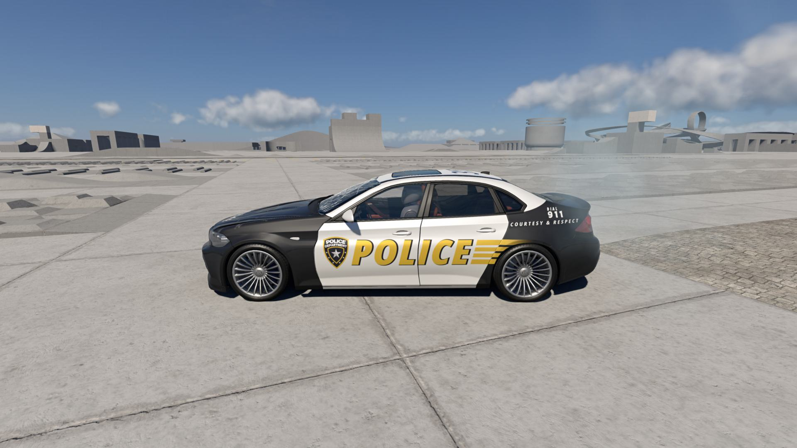
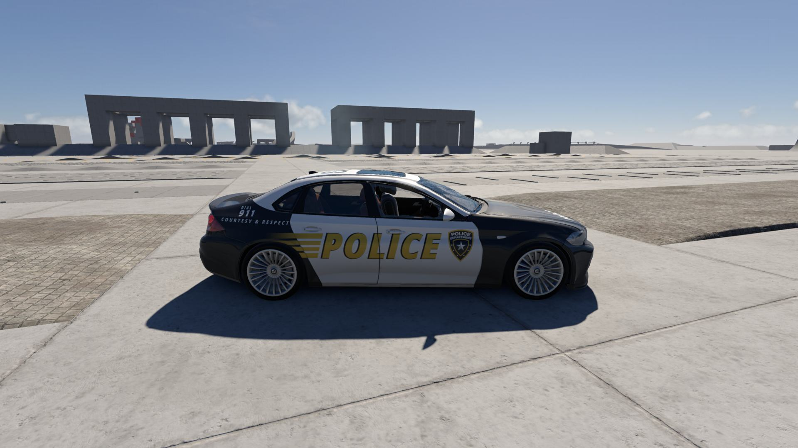
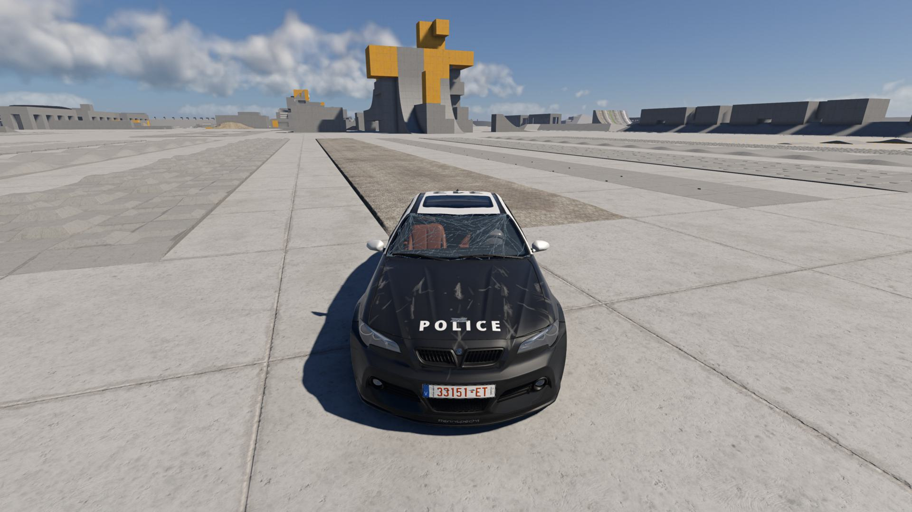
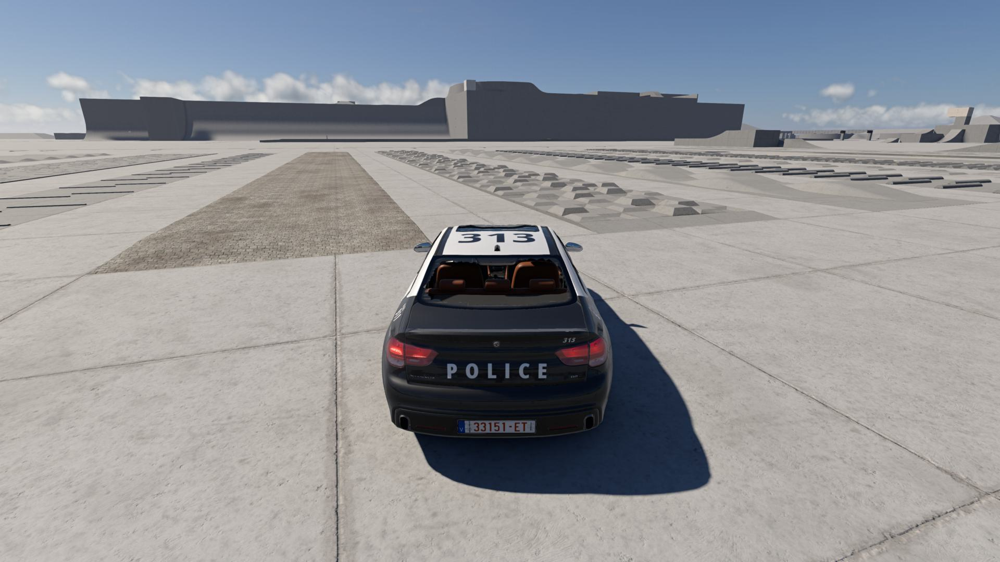
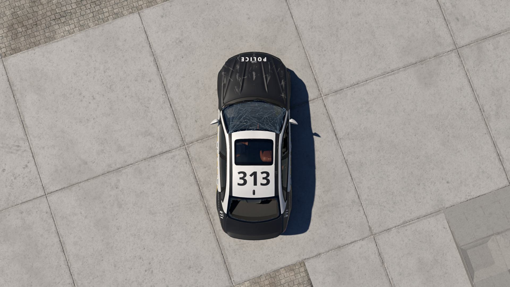

# sustained - 20261114-210402_sustained_resumed-grouped-full-b6-vulkan-cold_r1

_assisted roof scrape v2: additive translation to 4 m/s for 30 seconds, preserving internal node motion; real collisions_

Remaining queues: `{"bake": 0, "jobs": 0, "stamps": 0}`

Tuning: `if scratches_detect then scratches_detect.setPaintEnabled(true) end; scratches_paint.setDamageResolution(4096); scratches_paint.setBakeBudget(6); scratches_paint.setFlushInterval(0.05); scratches_paint.setProjectionBudget(6); scratches_paint.setLayerBudget(24); scratches_paint.setCoverageCoalescing(false); scratches_paint.setPanelGrouping(true)`

Settled: False after 30.004 s - 2360 frames, 78.7 fps average from sampled wall intervals (background limiter lifted)
Went past upside down: True (lowest up-vector z -1.0)

## Marks

| contacts | passed filters | impacts | streams | stamps | projections | bakes | missed | jobs dropped | deferred frames |
|---|---|---|---|---|---|---|---|---|---|
| 16208 | 7081 | 52 | 611 | 96 | 157 | 145 | 0.0% | 0 | 0 |

Rejected contacts: PartExcluded 6190, BelowThresh 2919, NormalForce 18

Body materials: METAL 7059, PLASTIC 22

Surfaces: ASPHALT 5527, COBBLESTONE 1554

## Cost

| | avg | p95 | max |
|---|---|---|---|
| painter (GE), ms/frame | 1.997 | 25.808 | 36.923 |
| whole frame, ms | 11.725 (p50) | 32.832 | 48.149 |
| all GE Lua, ms | | 26.782 | 37.9 |
| physics + vehicle Lua, ms | | 0.085 | 1.16 |
| render, ms | | 1.769 | |

- Painter frames over 4 ms: 176; worst flush (project + bake) 36.902 ms, worst composite 0.104 ms.
- Detector: 2.884 us per contact, 67.673 ms total, worst frame 0.446 ms (profiled; the timer adds a little).

### Worst frames

| t (s) | frame ms | painter ms | GE Lua ms | physics+VLUA ms | render ms |
|---|---|---|---|---|---|
| 28.43 | 48.15 | 35.36 | 0.94 | 0.06 | 1.30 |
| 4.68 | 47.83 | 34.26 | 0.96 | 0.08 | 1.48 |
| 15.91 | 47.20 | 34.77 | 1.00 | 0.07 | 1.32 |
| 4.13 | 47.18 | 33.98 | 0.86 | 0.06 | 1.21 |
| 18.11 | 47.13 | 32.16 | 0.92 | 0.05 | 2.18 |

## Screenshots

