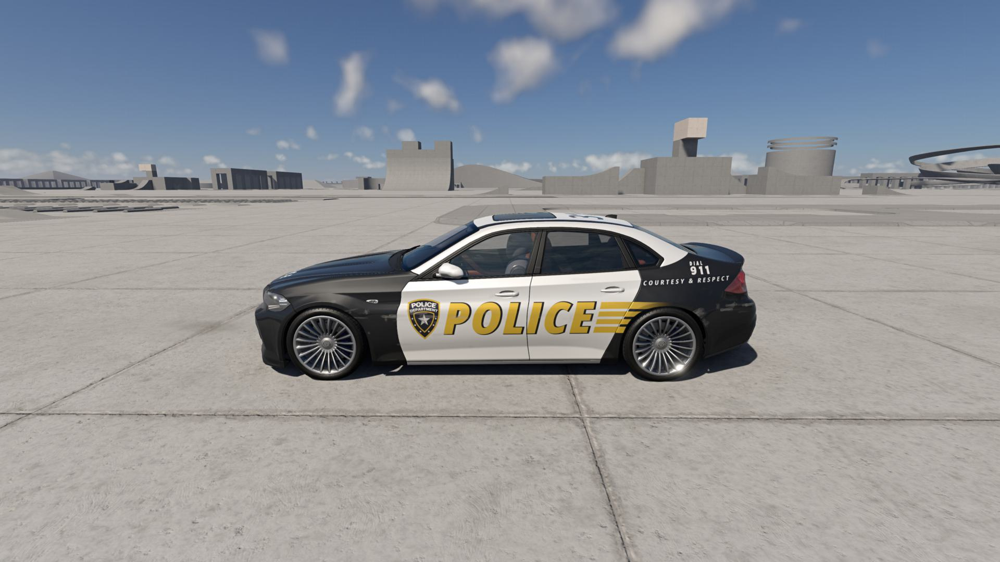
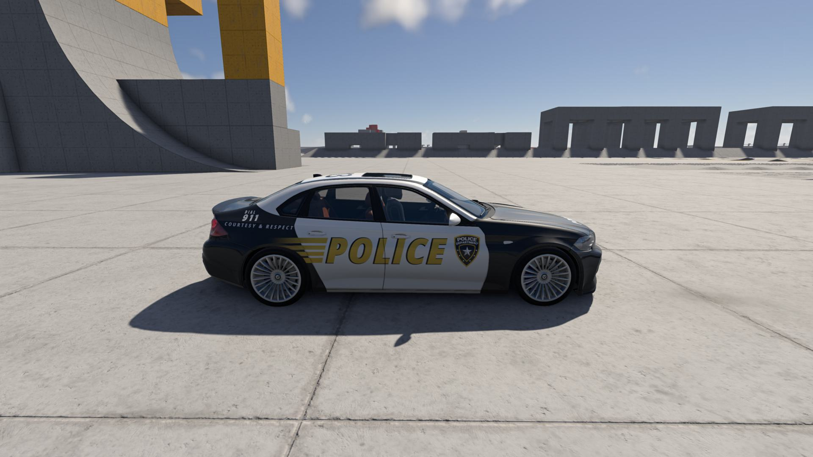
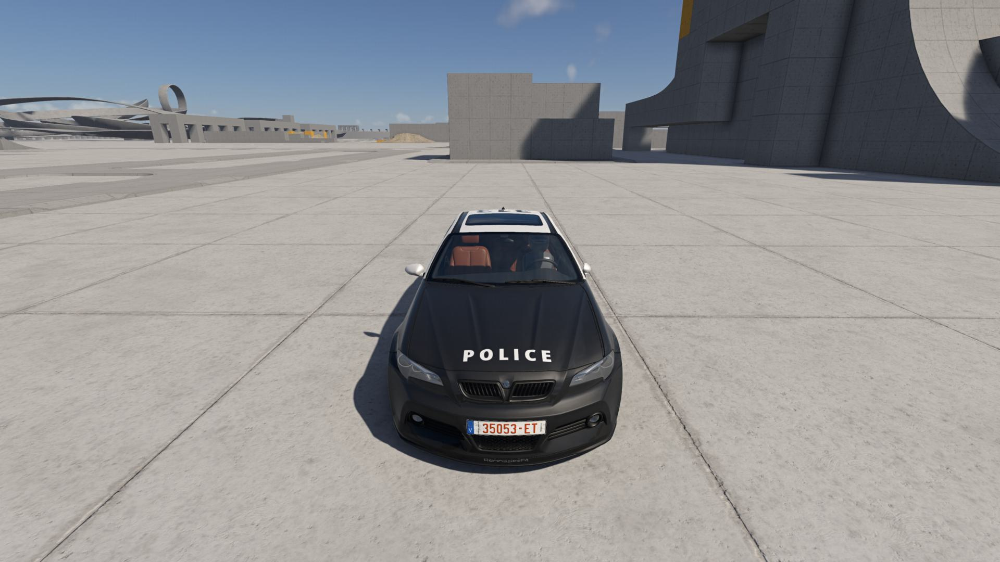
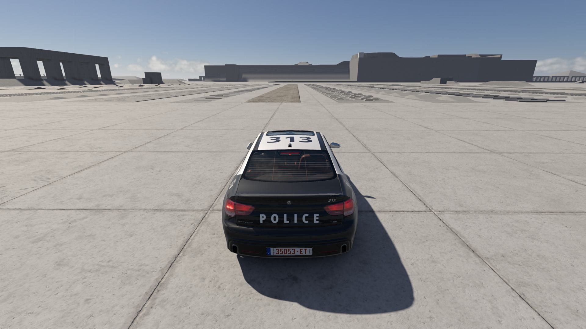
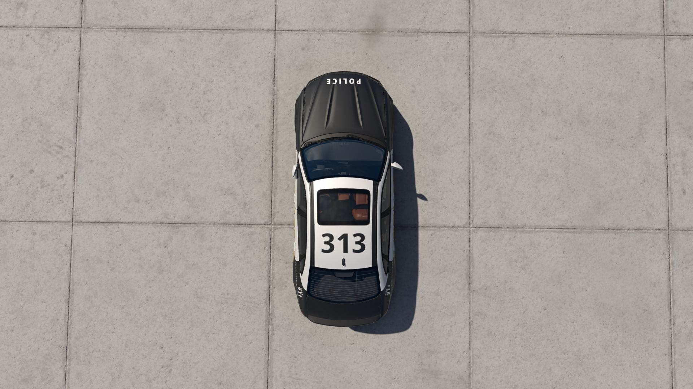

# sideslide - 20261114-184420_sideslide_resumed-grouped-half-untraced_r1

_on its side, sliding along the ground at 14 m/s - one long scrape_

Remaining queues: `{"bake": 0, "jobs": 0, "stamps": 0}`

Tuning: `scratches_paint.setDamageResolution(2048); scratches_paint.setBakeBudget(3); scratches_paint.setFlushInterval(0.05); scratches_paint.setProjectionBudget(6); scratches_paint.setLayerBudget(24); scratches_paint.setCoverageCoalescing(true); scratches_paint.setPanelGrouping(true)`

Settled: True after 4.202 s - 323 frames, 77.5 fps average from sampled wall intervals (background limiter lifted)
Went past upside down: True (lowest up-vector z -0.17)

## Marks

| contacts | passed filters | impacts | streams | stamps | projections | bakes | missed | jobs dropped | deferred frames |
|---|---|---|---|---|---|---|---|---|---|
| 2817 | 667 | 84 | 118 | 115 | 99 | 144 | 0.0% | 0 | 1 |

Rejected contacts: Wheel 1515, BelowThresh 634, NormalForce 1

Body materials: METAL 485, PLASTIC 182

Surfaces: ASPHALT 667

## Cost

| | avg | p95 | max |
|---|---|---|---|
| painter (GE), ms/frame | 4.936 | 27.035 | 40.745 |
| whole frame, ms | 10.255 (p50) | 33.872 | 47.425 |
| all GE Lua, ms | | 28.09 | 41.776 |
| physics + vehicle Lua, ms | | 0.092 | 0.215 |
| render, ms | | 1.957 | |

- Painter frames over 4 ms: 89; worst flush (project + bake) 40.712 ms, worst composite 0.168 ms.
- Detector: 1.519 us per contact, 7.666 ms total, worst frame 0.387 ms (profiled; the timer adds a little).

### Worst frames

| t (s) | frame ms | painter ms | GE Lua ms | physics+VLUA ms | render ms |
|---|---|---|---|---|---|
| 0.77 | 47.42 | 40.75 | 1.83 | 0.04 | 1.90 |
| 1.72 | 43.74 | 37.62 | 0.84 | 0.03 | 1.43 |
| 0.18 | 40.68 | 30.01 | 0.96 | 0.09 | 1.89 |
| 2.22 | 39.75 | 33.66 | 1.01 | 0.05 | 1.44 |
| 0.98 | 39.68 | 32.55 | 1.74 | 0.04 | 1.68 |

## Screenshots

