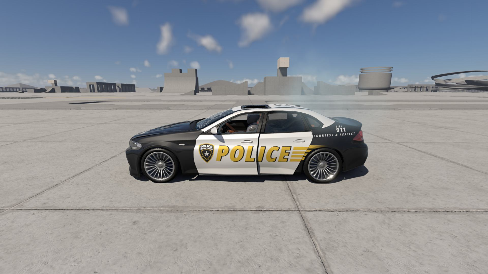
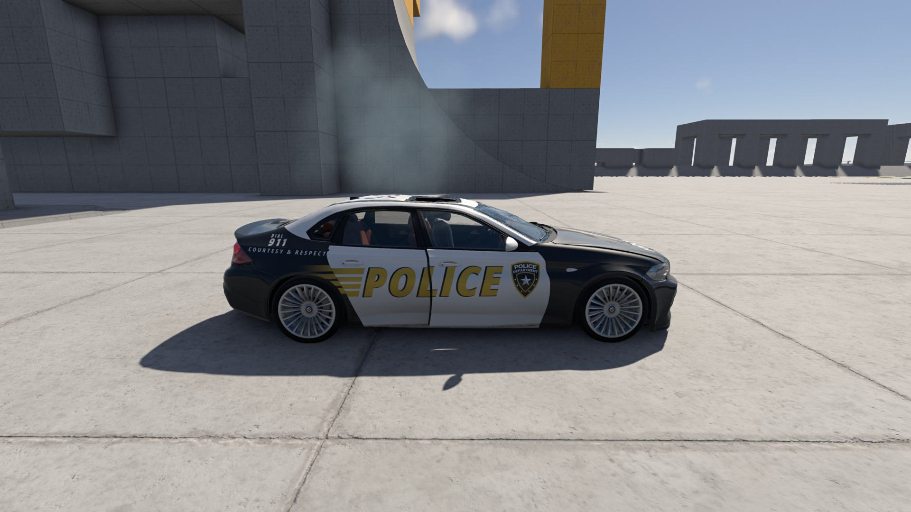
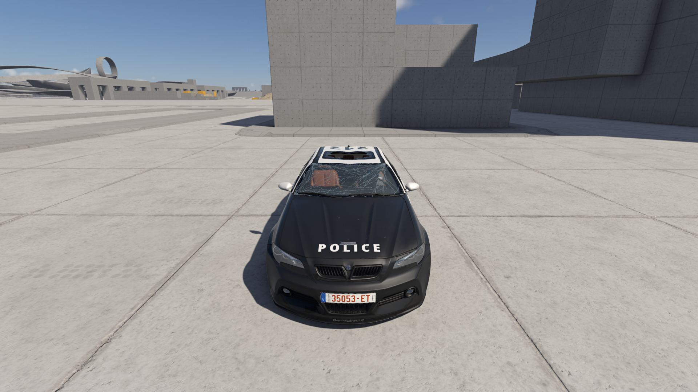
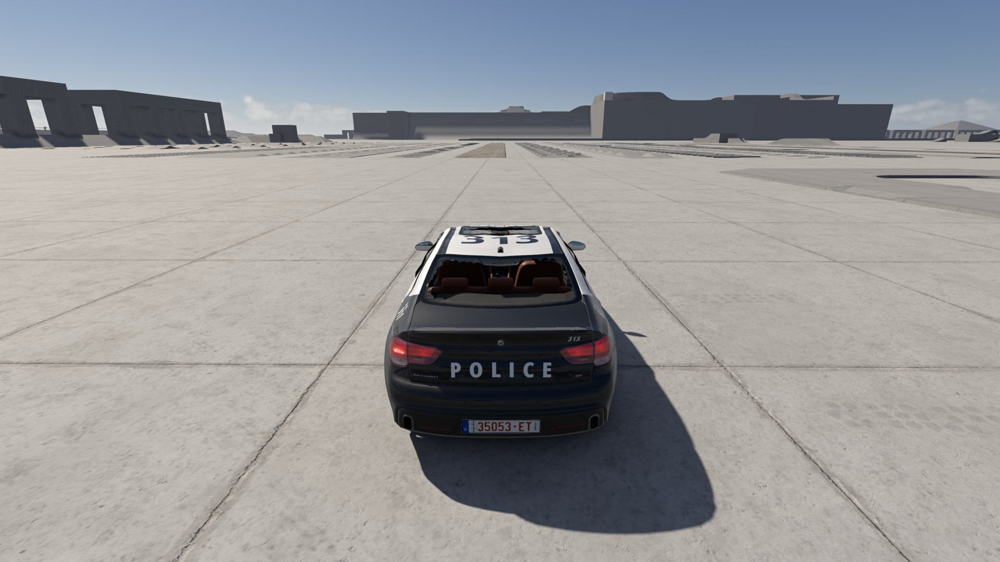
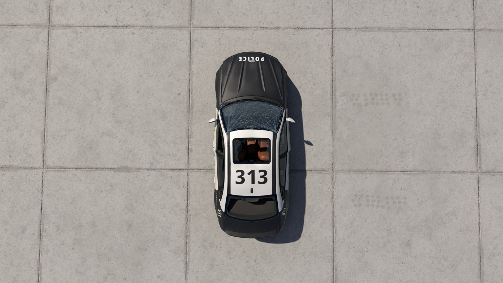

# roofdrop - 20261114-184436_roofdrop_resumed-grouped-half-untraced_r1

_dropped upside down from about 1 m - roof impacts_

Remaining queues: `{"bake": 0, "jobs": 0, "stamps": 0}`

Tuning: `scratches_paint.setDamageResolution(2048); scratches_paint.setBakeBudget(3); scratches_paint.setFlushInterval(0.05); scratches_paint.setProjectionBudget(6); scratches_paint.setLayerBudget(24); scratches_paint.setCoverageCoalescing(true); scratches_paint.setPanelGrouping(true)`

Settled: True after 5.148 s - 446 frames, 86.4 fps average from sampled wall intervals (background limiter lifted)
Went past upside down: True (lowest up-vector z -1.0)

## Marks

| contacts | passed filters | impacts | streams | stamps | projections | bakes | missed | jobs dropped | deferred frames |
|---|---|---|---|---|---|---|---|---|---|
| 1202 | 46 | 46 | 0 | 47 | 16 | 23 | 0.0% | 0 | 0 |

Rejected contacts: PartExcluded 707, BelowThresh 449

Body materials: METAL 44, PLASTIC 2

Surfaces: ASPHALT 46

## Cost

| | avg | p95 | max |
|---|---|---|---|
| painter (GE), ms/frame | 1.16 | 3.916 | 30.864 |
| whole frame, ms | 11.071 (p50) | 13.739 | 42.843 |
| all GE Lua, ms | | 4.78 | 32.734 |
| physics + vehicle Lua, ms | | 0.073 | 0.161 |
| render, ms | | 2.153 | |

- Painter frames over 4 ms: 22; worst flush (project + bake) 30.837 ms, worst composite 0.105 ms.
- Detector: 1.262 us per contact, 3.577 ms total, worst frame 0.349 ms (profiled; the timer adds a little).

### Worst frames

| t (s) | frame ms | painter ms | GE Lua ms | physics+VLUA ms | render ms |
|---|---|---|---|---|---|
| 0.53 | 42.84 | 30.85 | 0.86 | 0.10 | 1.72 |
| 0.81 | 42.39 | 29.95 | 0.93 | 0.05 | 2.06 |
| 3.70 | 41.87 | 30.11 | 0.86 | 0.04 | 1.73 |
| 1.84 | 41.59 | 29.53 | 0.88 | 0.05 | 1.65 |
| 1.14 | 40.95 | 29.46 | 0.95 | 0.05 | 1.87 |

## Screenshots

