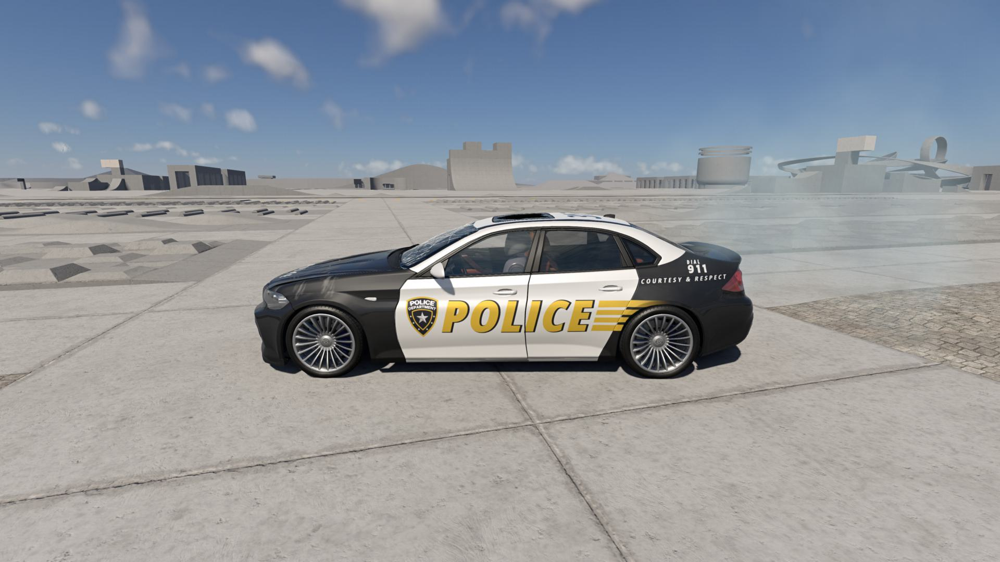
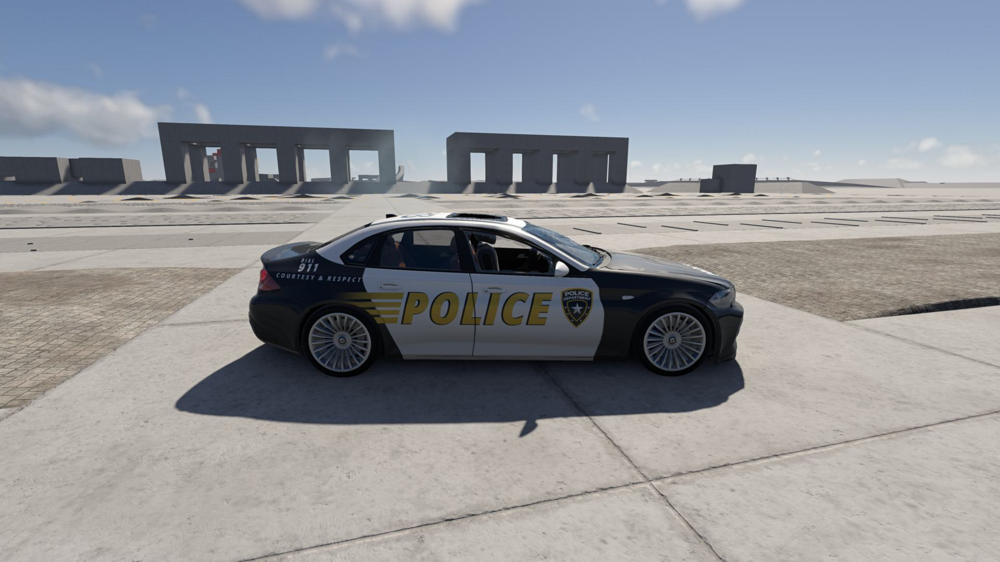
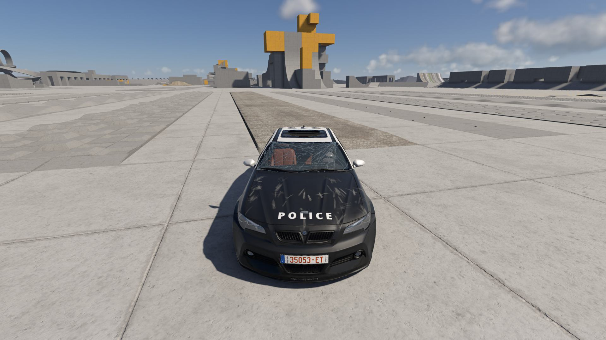
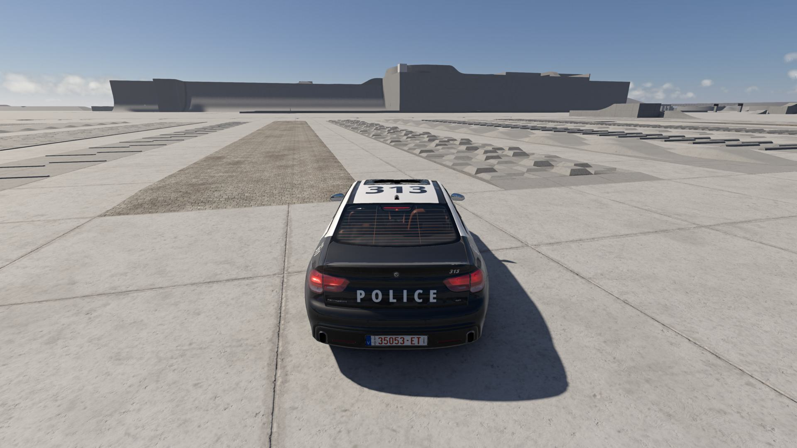
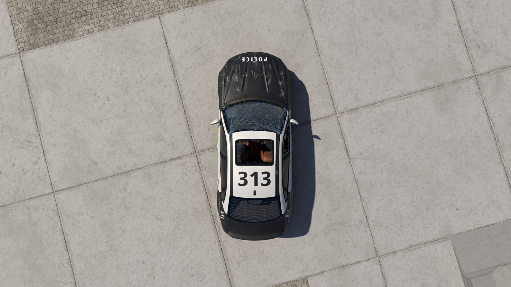

# sustained - 20261114-184453_sustained_resumed-grouped-half-untraced_r1

_assisted roof scrape v2: additive translation to 4 m/s for 30 seconds, preserving internal node motion; real collisions_

Remaining queues: `{"bake": 0, "jobs": 0, "stamps": 0}`

Tuning: `scratches_paint.setDamageResolution(2048); scratches_paint.setBakeBudget(3); scratches_paint.setFlushInterval(0.05); scratches_paint.setProjectionBudget(6); scratches_paint.setLayerBudget(24); scratches_paint.setCoverageCoalescing(true); scratches_paint.setPanelGrouping(true)`

Settled: False after 30.004 s - 2552 frames, 83.7 fps average from sampled wall intervals (background limiter lifted)
Went past upside down: True (lowest up-vector z -1.0)

## Marks

| contacts | passed filters | impacts | streams | stamps | projections | bakes | missed | jobs dropped | deferred frames |
|---|---|---|---|---|---|---|---|---|---|
| 15532 | 7977 | 70 | 598 | 125 | 223 | 246 | 0.0% | 0 | 0 |

Rejected contacts: PartExcluded 6259, BelowThresh 1259, NormalForce 37

Body materials: METAL 7972, PLASTIC 5

Surfaces: ASPHALT 7374, COBBLESTONE 603

## Cost

| | avg | p95 | max |
|---|---|---|---|
| painter (GE), ms/frame | 2.528 | 26.654 | 613.496 |
| whole frame, ms | 10.509 (p50) | 34.94 | 624.654 |
| all GE Lua, ms | | 27.532 | 614.61 |
| physics + vehicle Lua, ms | | 0.083 | 0.407 |
| render, ms | | 2.285 | |

- Painter frames over 4 ms: 243; worst flush (project + bake) 613.468 ms, worst composite 0.11 ms.
- Detector: 3.068 us per contact, 68.585 ms total, worst frame 0.396 ms (profiled; the timer adds a little).

### Worst frames

| t (s) | frame ms | painter ms | GE Lua ms | physics+VLUA ms | render ms |
|---|---|---|---|---|---|
| 25.09 | 624.65 | 613.50 | 0.91 | 0.05 | 1.78 |
| 22.46 | 42.60 | 31.01 | 0.86 | 0.05 | 1.74 |
| 24.36 | 42.58 | 31.27 | 0.68 | 0.04 | 1.78 |
| 13.92 | 42.46 | 30.53 | 0.81 | 0.06 | 1.94 |
| 2.30 | 42.23 | 31.77 | 0.81 | 0.04 | 1.78 |

## Screenshots

