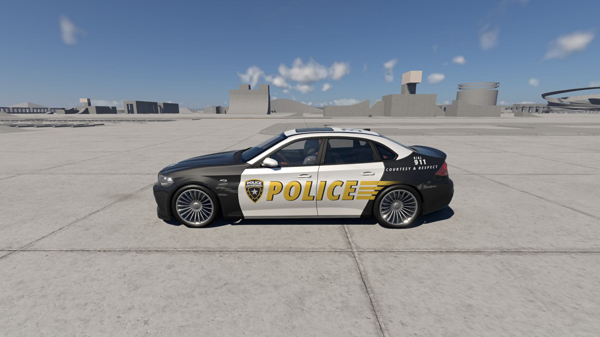
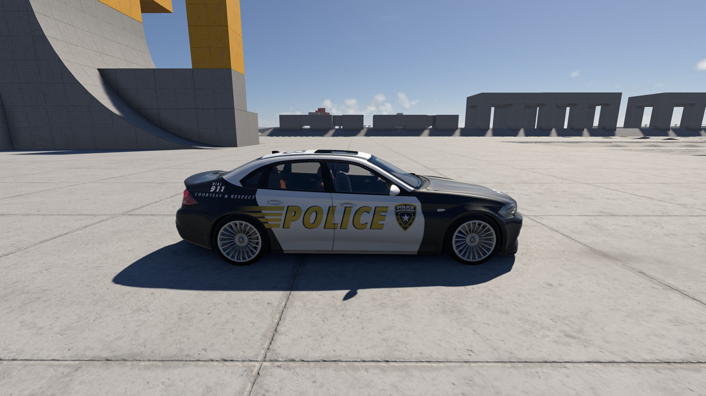
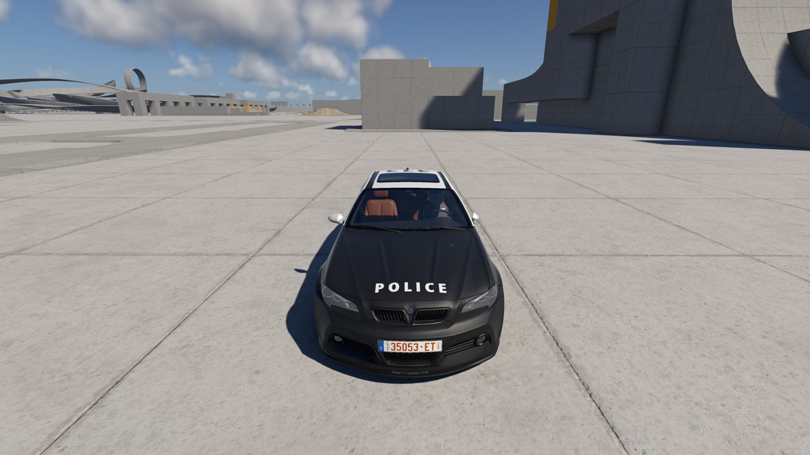
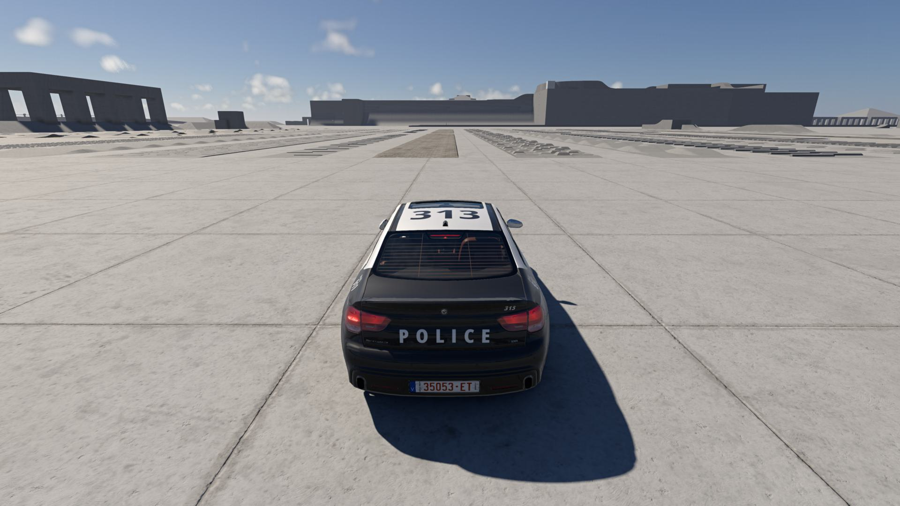
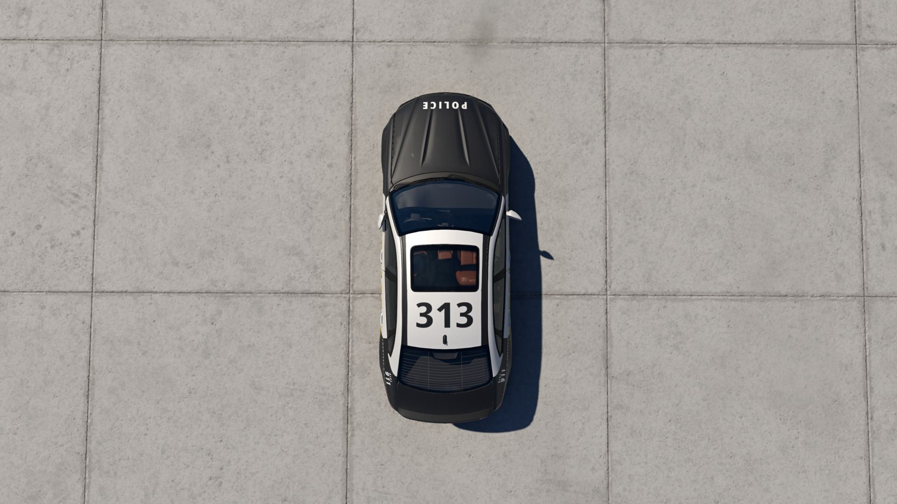

# sideslide - 20261114-182850_sideslide_resumed-grouped-half-warm_r1

_on its side, sliding along the ground at 14 m/s - one long scrape_

Remaining queues: `{"bake": 0, "jobs": 0, "stamps": 0}`

Tuning: `scratches_paint.setDamageResolution(2048); scratches_paint.setBakeBudget(3); scratches_paint.setFlushInterval(0.05); scratches_paint.setProjectionBudget(6); scratches_paint.setLayerBudget(24); scratches_paint.setCoverageCoalescing(true); scratches_paint.setPanelGrouping(true)`

Settled: True after 4.201 s - 316 frames, 75.6 fps average from sampled wall intervals (background limiter lifted)
Went past upside down: True (lowest up-vector z -0.166)

## Marks

| contacts | passed filters | impacts | streams | stamps | projections | bakes | missed | jobs dropped | deferred frames |
|---|---|---|---|---|---|---|---|---|---|
| 2530 | 636 | 86 | 127 | 112 | 100 | 149 | 0.0% | 0 | 1 |

Rejected contacts: Wheel 1217, BelowThresh 677

Body materials: METAL 464, PLASTIC 172

Surfaces: ASPHALT 636

## Cost

| | avg | p95 | max |
|---|---|---|---|
| painter (GE), ms/frame | 5.031 | 27.948 | 40.115 |
| whole frame, ms | 10.419 (p50) | 34.601 | 50.892 |
| all GE Lua, ms | | 28.788 | 41.443 |
| physics + vehicle Lua, ms | | 0.089 | 0.264 |
| render, ms | | 2.145 | |

- Painter frames over 4 ms: 91; worst flush (project + bake) 40.083 ms, worst composite 0.156 ms.
- Detector: 1.629 us per contact, 7.63 ms total, worst frame 0.542 ms (profiled; the timer adds a little).

### Worst frames

| t (s) | frame ms | painter ms | GE Lua ms | physics+VLUA ms | render ms |
|---|---|---|---|---|---|
| 0.18 | 50.89 | 40.11 | 0.86 | 0.06 | 1.97 |
| 2.75 | 44.84 | 38.42 | 0.92 | 0.08 | 1.40 |
| 1.45 | 44.64 | 36.41 | 1.15 | 0.06 | 1.65 |
| 2.99 | 43.09 | 31.13 | 0.89 | 0.06 | 1.73 |
| 1.98 | 42.25 | 34.42 | 0.78 | 0.03 | 2.00 |

## Screenshots

