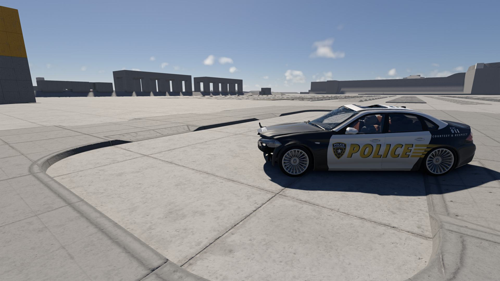
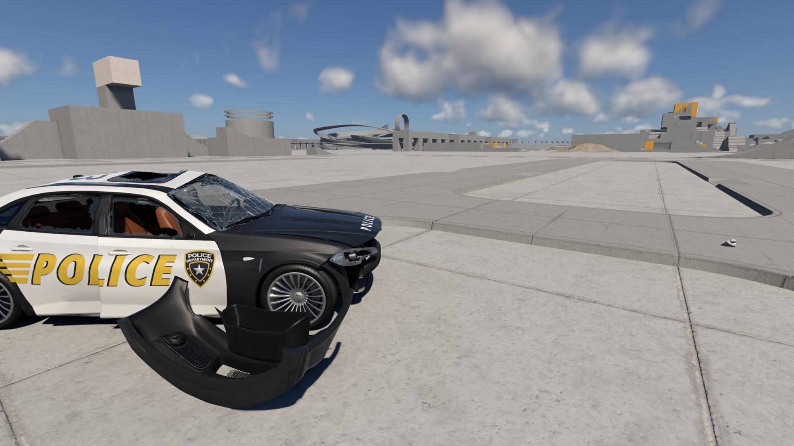
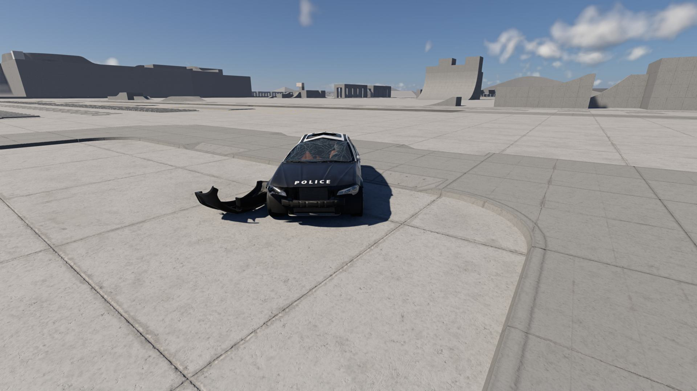
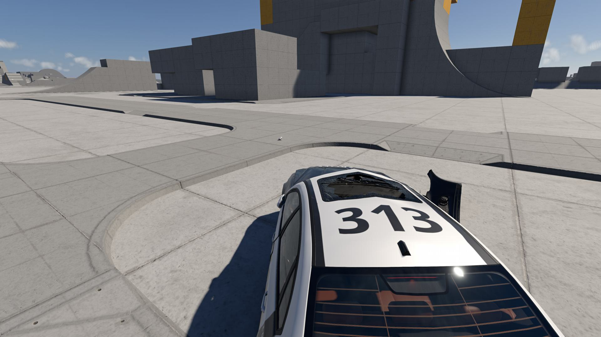
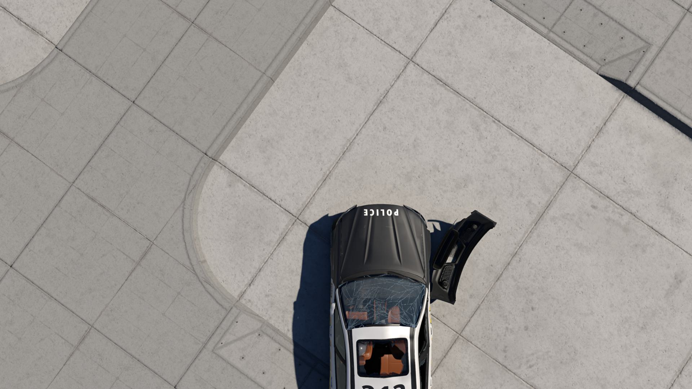

# rollover - 20261114-182907_rollover_resumed-grouped-half-warm_r1

_thrown sideways at 15 m/s, leaning 70 deg into the motion - tumbles over the roof_

Remaining queues: `{"bake": 0, "jobs": 0, "stamps": 0}`

Tuning: `scratches_paint.setDamageResolution(2048); scratches_paint.setBakeBudget(3); scratches_paint.setFlushInterval(0.05); scratches_paint.setProjectionBudget(6); scratches_paint.setLayerBudget(24); scratches_paint.setCoverageCoalescing(true); scratches_paint.setPanelGrouping(true)`

Settled: True after 8.091 s - 671 frames, 82.8 fps average from sampled wall intervals (background limiter lifted)
Went past upside down: True (lowest up-vector z -0.999)

## Marks

| contacts | passed filters | impacts | streams | stamps | projections | bakes | missed | jobs dropped | deferred frames |
|---|---|---|---|---|---|---|---|---|---|
| 4627 | 147 | 61 | 22 | 102 | 56 | 71 | 0.0% | 0 | 0 |

Rejected contacts: Wheel 2225, BelowThresh 2012, PartExcluded 243

Body materials: METAL 76, PLASTIC 71

Surfaces: ASPHALT 147

## Cost

| | avg | p95 | max |
|---|---|---|---|
| painter (GE), ms/frame | 2.292 | 24.045 | 33.668 |
| whole frame, ms | 10.995 (p50) | 31.31 | 43.782 |
| all GE Lua, ms | | 25.022 | 34.574 |
| physics + vehicle Lua, ms | | 0.088 | 0.236 |
| render, ms | | 2.073 | |

- Painter frames over 4 ms: 75; worst flush (project + bake) 33.641 ms, worst composite 0.1 ms.
- Detector: 1.099 us per contact, 8.338 ms total, worst frame 0.346 ms (profiled; the timer adds a little).

### Worst frames

| t (s) | frame ms | painter ms | GE Lua ms | physics+VLUA ms | render ms |
|---|---|---|---|---|---|
| 6.59 | 43.78 | 31.45 | 0.79 | 0.06 | 1.57 |
| 6.71 | 42.97 | 30.92 | 0.88 | 0.06 | 2.03 |
| 2.77 | 42.96 | 33.67 | 0.87 | 0.05 | 1.40 |
| 0.61 | 42.80 | 30.92 | 0.88 | 0.10 | 1.85 |
| 1.25 | 42.31 | 30.19 | 0.94 | 0.05 | 1.81 |

## Screenshots

