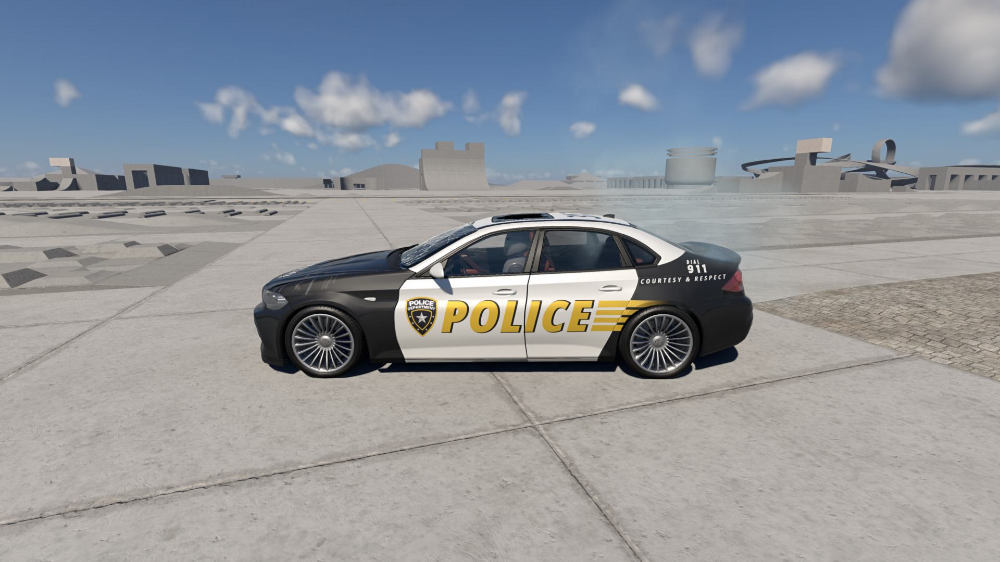
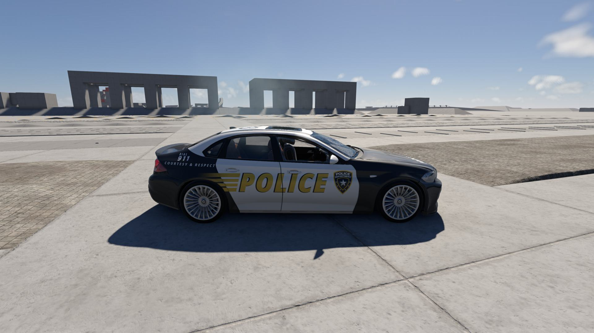
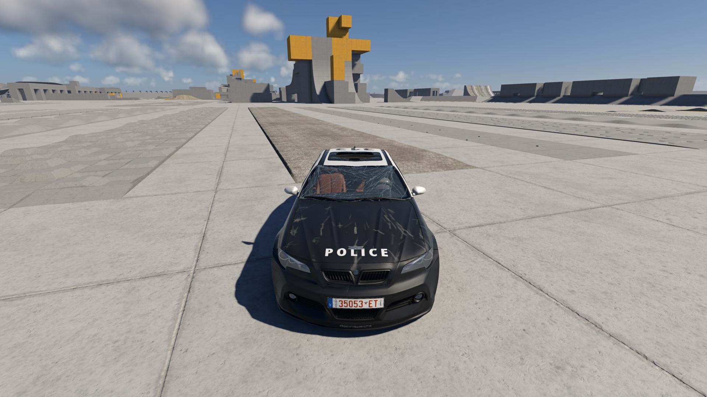
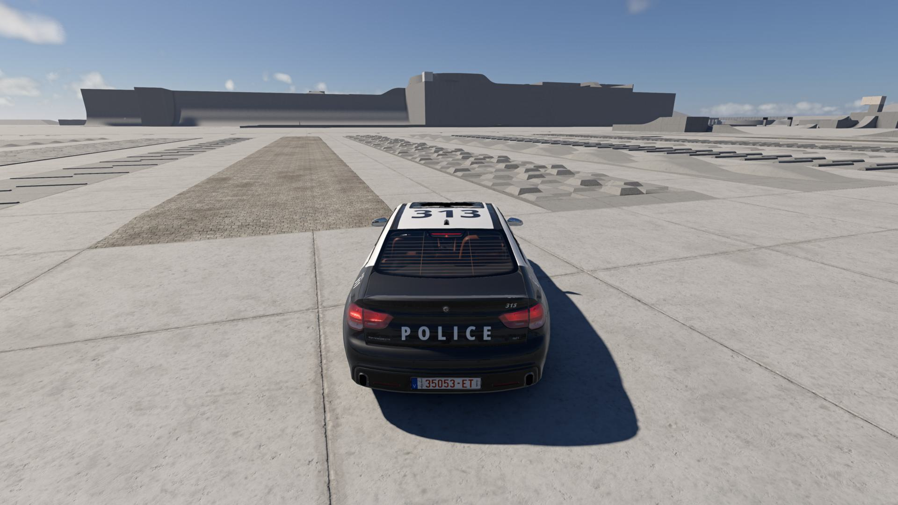
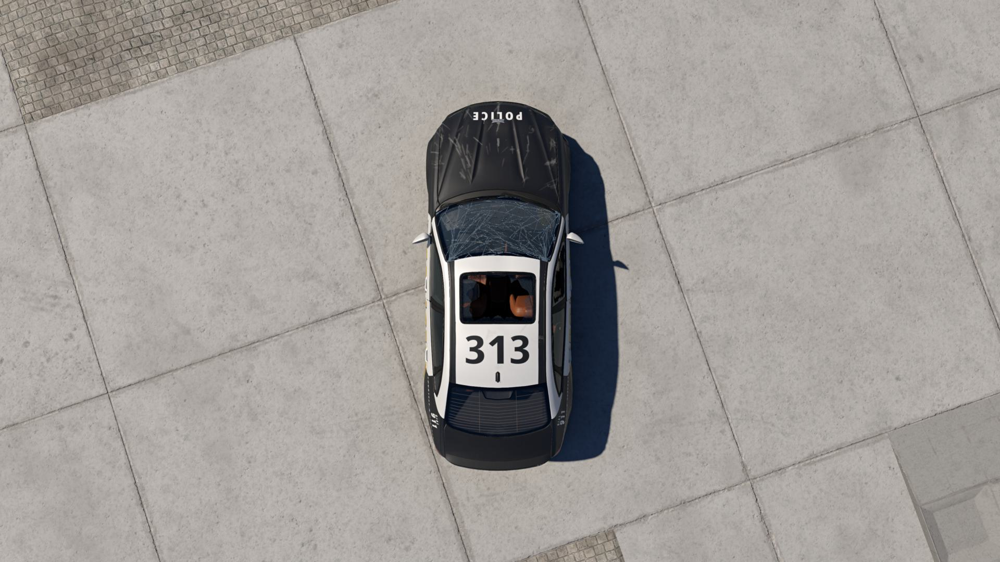

# sustained - 20261114-182927_sustained_resumed-grouped-half-warm_r1

_assisted roof scrape v2: additive translation to 4 m/s for 30 seconds, preserving internal node motion; real collisions_

Remaining queues: `{"bake": 0, "jobs": 0, "stamps": 0}`

Tuning: `scratches_paint.setDamageResolution(2048); scratches_paint.setBakeBudget(3); scratches_paint.setFlushInterval(0.05); scratches_paint.setProjectionBudget(6); scratches_paint.setLayerBudget(24); scratches_paint.setCoverageCoalescing(true); scratches_paint.setPanelGrouping(true)`

Settled: False after 30.004 s - 2553 frames, 85.1 fps average from sampled wall intervals (background limiter lifted)
Went past upside down: True (lowest up-vector z -1.0)

## Marks

| contacts | passed filters | impacts | streams | stamps | projections | bakes | missed | jobs dropped | deferred frames |
|---|---|---|---|---|---|---|---|---|---|
| 15432 | 7947 | 66 | 521 | 113 | 206 | 223 | 0.0% | 0 | 0 |

Rejected contacts: PartExcluded 6411, BelowThresh 1060, NormalForce 14

Body materials: METAL 7934, PLASTIC 13

Surfaces: ASPHALT 6896, COBBLESTONE 1051

## Cost

| | avg | p95 | max |
|---|---|---|---|
| painter (GE), ms/frame | 2.069 | 24.675 | 32.743 |
| whole frame, ms | 10.592 (p50) | 31.621 | 43.947 |
| all GE Lua, ms | | 25.534 | 33.591 |
| physics + vehicle Lua, ms | | 0.083 | 0.883 |
| render, ms | | 2.298 | |

- Painter frames over 4 ms: 206; worst flush (project + bake) 32.671 ms, worst composite 0.093 ms.
- Detector: 3.218 us per contact, 68.721 ms total, worst frame 0.395 ms (profiled; the timer adds a little).

### Worst frames

| t (s) | frame ms | painter ms | GE Lua ms | physics+VLUA ms | render ms |
|---|---|---|---|---|---|
| 29.58 | 43.95 | 14.51 | 0.82 | 0.06 | 2.83 |
| 1.22 | 43.32 | 32.49 | 0.80 | 0.05 | 1.77 |
| 25.11 | 42.46 | 32.12 | 1.13 | 0.06 | 2.00 |
| 29.98 | 42.29 | 30.32 | 0.95 | 0.04 | 1.79 |
| 13.53 | 42.03 | 31.01 | 0.73 | 0.04 | 1.64 |

## Screenshots

