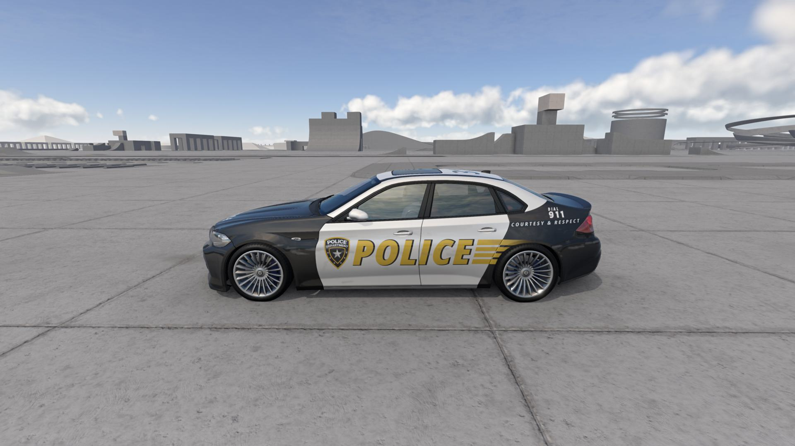
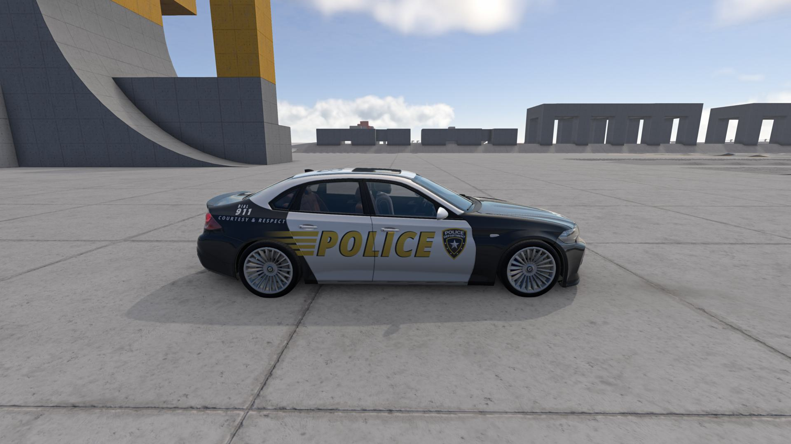
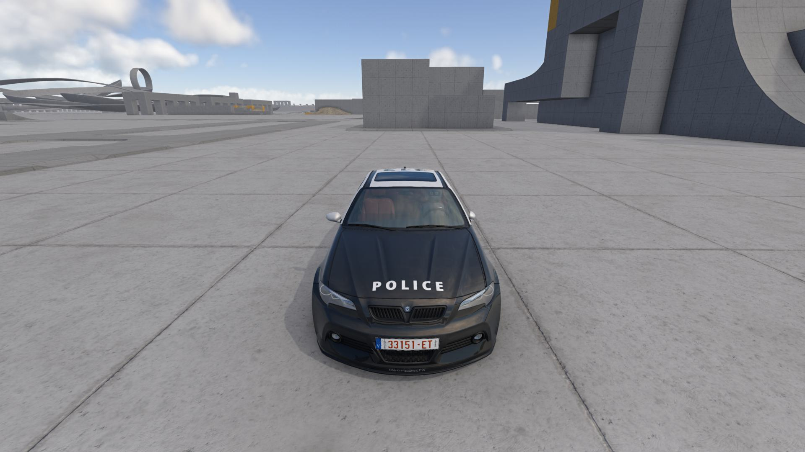
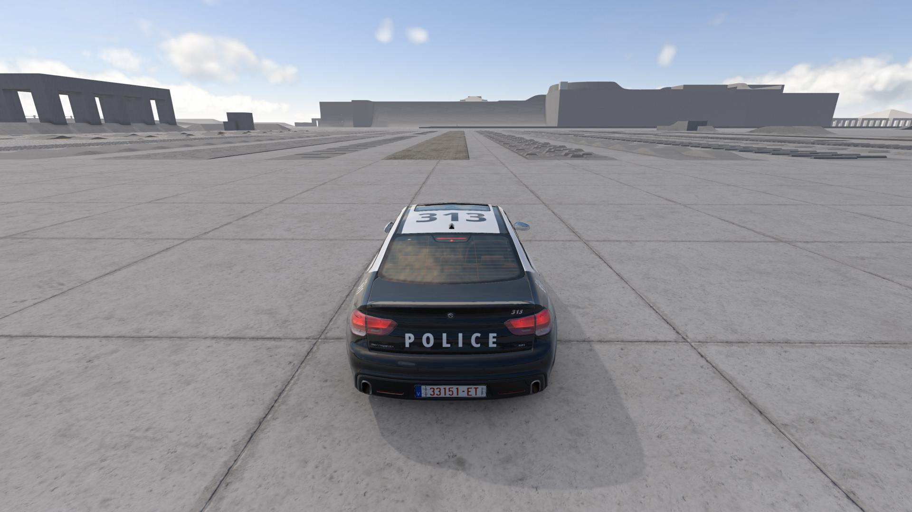
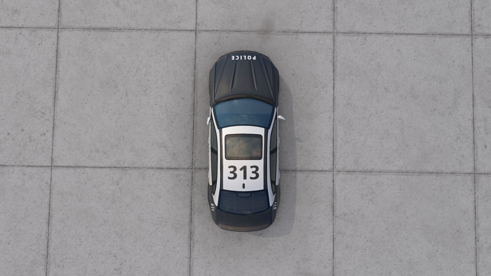

# sideslide - 20261114-191156_sideslide_resumed-grouped-quarter-d3d12_r1

_on its side, sliding along the ground at 14 m/s - one long scrape_

Remaining queues: `{"bake": 0, "jobs": 0, "stamps": 0}`

Tuning: `if scratches_detect then scratches_detect.setPaintEnabled(true) end; scratches_paint.setDamageResolution(1024); scratches_paint.setBakeBudget(3); scratches_paint.setFlushInterval(0.05); scratches_paint.setProjectionBudget(6); scratches_paint.setLayerBudget(24); scratches_paint.setCoverageCoalescing(true); scratches_paint.setPanelGrouping(true)`

Settled: True after 4.252 s - 345 frames, 80.8 fps average from sampled wall intervals (background limiter lifted)
Went past upside down: True (lowest up-vector z -0.167)

## Marks

| contacts | passed filters | impacts | streams | stamps | projections | bakes | missed | jobs dropped | deferred frames |
|---|---|---|---|---|---|---|---|---|---|
| 2989 | 678 | 93 | 138 | 104 | 98 | 159 | 0.0% | 0 | 1 |

Rejected contacts: Wheel 1607, BelowThresh 702, NormalForce 2

Body materials: METAL 502, PLASTIC 176

Surfaces: ASPHALT 678

## Cost

| | avg | p95 | max |
|---|---|---|---|
| painter (GE), ms/frame | 4.329 | 27.693 | 35.855 |
| whole frame, ms | 9.726 (p50) | 34.31 | 45.888 |
| all GE Lua, ms | | 28.727 | 36.978 |
| physics + vehicle Lua, ms | | 0.086 | 0.268 |
| render, ms | | 2.221 | |

- Painter frames over 4 ms: 50; worst flush (project + bake) 35.821 ms, worst composite 1.571 ms.
- Detector: 1.645 us per contact, 9.08 ms total, worst frame 0.466 ms (profiled; the timer adds a little).

### Worst frames

| t (s) | frame ms | painter ms | GE Lua ms | physics+VLUA ms | render ms |
|---|---|---|---|---|---|
| 0.18 | 45.89 | 34.64 | 0.88 | 0.06 | 1.91 |
| 1.98 | 42.17 | 35.86 | 0.80 | 0.04 | 1.52 |
| 0.58 | 42.06 | 35.43 | 2.01 | 0.07 | 1.74 |
| 2.44 | 40.03 | 33.35 | 1.95 | 0.08 | 1.69 |
| 0.48 | 40.01 | 32.79 | 5.55 | 0.05 | 1.73 |

## Screenshots

