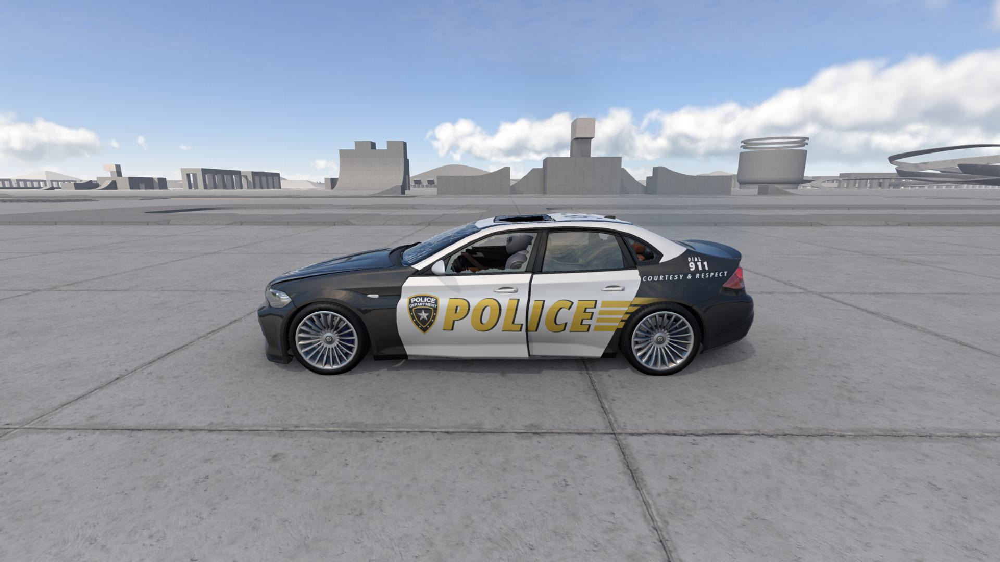
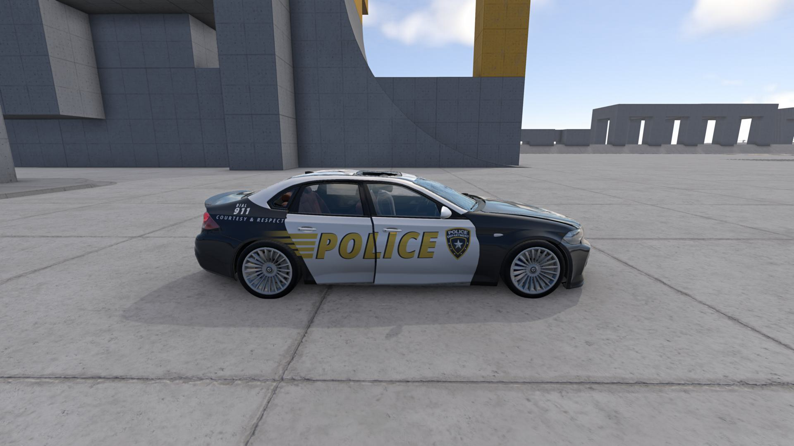
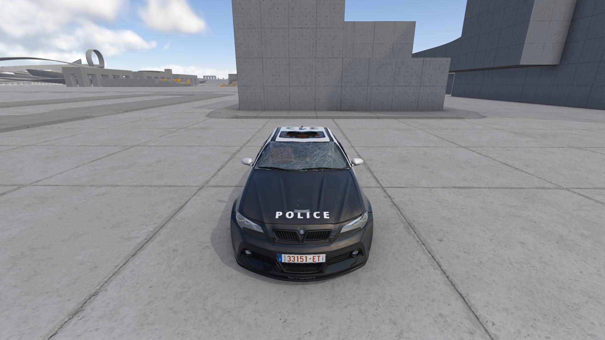
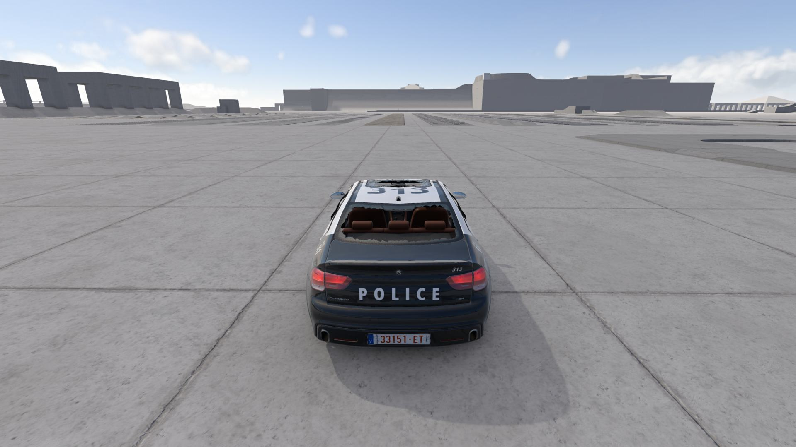
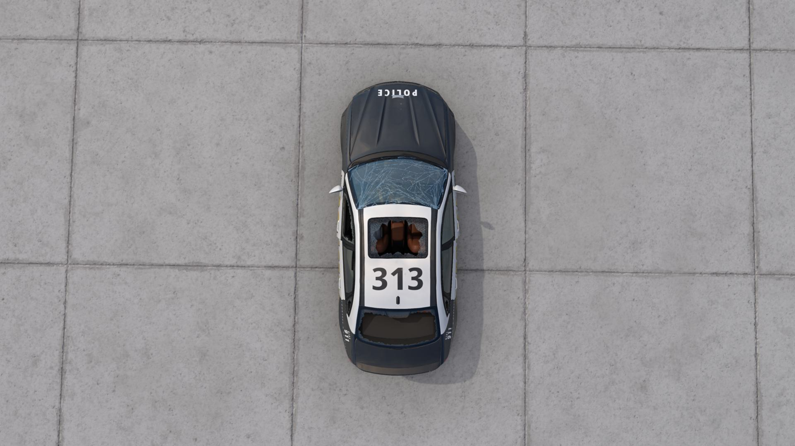

# roofdrop - 20261114-191213_roofdrop_resumed-grouped-quarter-d3d12_r1

_dropped upside down from about 1 m - roof impacts_

Remaining queues: `{"bake": 0, "jobs": 0, "stamps": 0}`

Tuning: `if scratches_detect then scratches_detect.setPaintEnabled(true) end; scratches_paint.setDamageResolution(1024); scratches_paint.setBakeBudget(3); scratches_paint.setFlushInterval(0.05); scratches_paint.setProjectionBudget(6); scratches_paint.setLayerBudget(24); scratches_paint.setCoverageCoalescing(true); scratches_paint.setPanelGrouping(true)`

Settled: True after 5.28 s - 461 frames, 87.3 fps average from sampled wall intervals (background limiter lifted)
Went past upside down: True (lowest up-vector z -1.0)

## Marks

| contacts | passed filters | impacts | streams | stamps | projections | bakes | missed | jobs dropped | deferred frames |
|---|---|---|---|---|---|---|---|---|---|
| 1218 | 54 | 54 | 0 | 58 | 14 | 22 | 0.0% | 0 | 0 |

Rejected contacts: PartExcluded 702, BelowThresh 462

Body materials: METAL 52, PLASTIC 2

Surfaces: ASPHALT 54

## Cost

| | avg | p95 | max |
|---|---|---|---|
| painter (GE), ms/frame | 0.994 | 2.023 | 30.412 |
| whole frame, ms | 11.095 (p50) | 12.784 | 42.168 |
| all GE Lua, ms | | 2.809 | 31.421 |
| physics + vehicle Lua, ms | | 0.075 | 0.205 |
| render, ms | | 2.083 | |

- Painter frames over 4 ms: 16; worst flush (project + bake) 30.38 ms, worst composite 0.095 ms.
- Detector: 1.379 us per contact, 4.648 ms total, worst frame 0.737 ms (profiled; the timer adds a little).

### Worst frames

| t (s) | frame ms | painter ms | GE Lua ms | physics+VLUA ms | render ms |
|---|---|---|---|---|---|
| 0.52 | 42.17 | 30.41 | 0.83 | 0.05 | 1.69 |
| 1.83 | 41.53 | 29.47 | 0.86 | 0.05 | 1.67 |
| 1.40 | 41.50 | 29.68 | 0.83 | 0.04 | 1.61 |
| 2.47 | 41.44 | 29.89 | 0.80 | 0.05 | 1.64 |
| 0.79 | 40.82 | 29.43 | 0.72 | 0.04 | 1.75 |

## Screenshots

