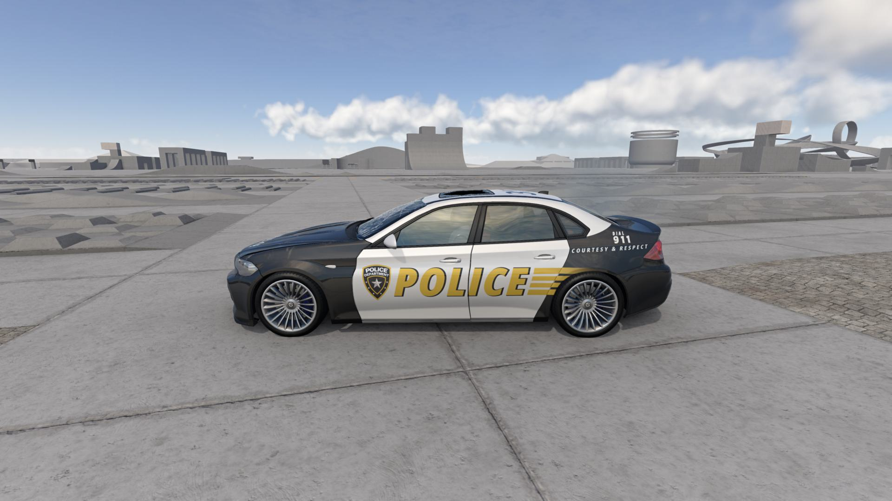
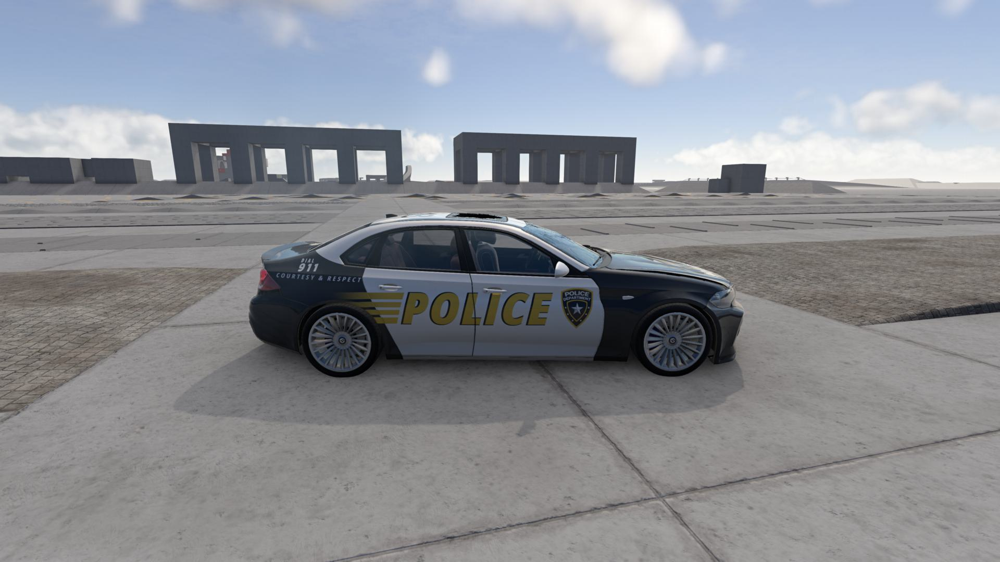
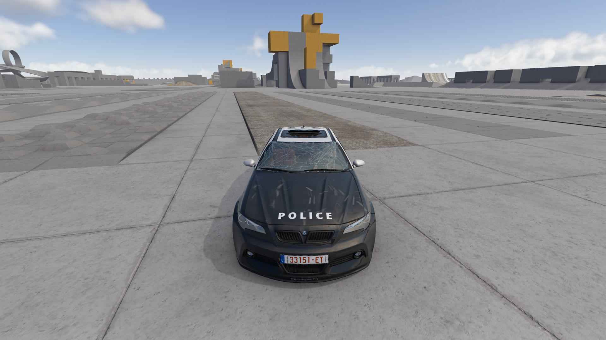
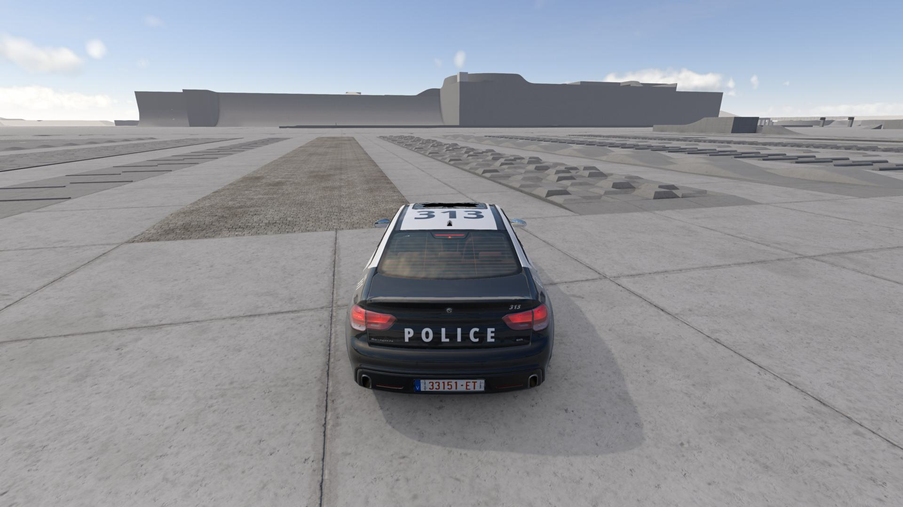
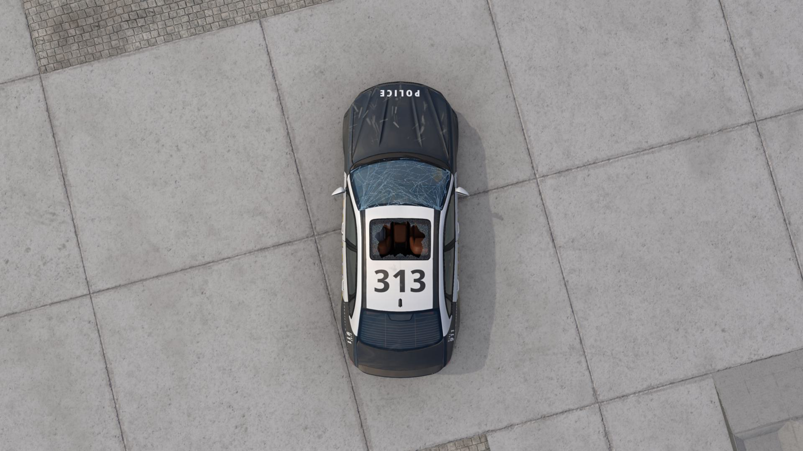

# sustained - 20261114-191230_sustained_resumed-grouped-quarter-d3d12_r1

_assisted roof scrape v2: additive translation to 4 m/s for 30 seconds, preserving internal node motion; real collisions_

Remaining queues: `{"bake": 0, "jobs": 0, "stamps": 0}`

Tuning: `if scratches_detect then scratches_detect.setPaintEnabled(true) end; scratches_paint.setDamageResolution(1024); scratches_paint.setBakeBudget(3); scratches_paint.setFlushInterval(0.05); scratches_paint.setProjectionBudget(6); scratches_paint.setLayerBudget(24); scratches_paint.setCoverageCoalescing(true); scratches_paint.setPanelGrouping(true)`

Settled: False after 30.011 s - 2607 frames, 86.9 fps average from sampled wall intervals (background limiter lifted)
Went past upside down: True (lowest up-vector z -1.0)

## Marks

| contacts | passed filters | impacts | streams | stamps | projections | bakes | missed | jobs dropped | deferred frames |
|---|---|---|---|---|---|---|---|---|---|
| 14994 | 8130 | 54 | 498 | 103 | 165 | 191 | 0.0% | 0 | 0 |

Rejected contacts: PartExcluded 5822, BelowThresh 1005, NormalForce 37

Body materials: METAL 8117, PLASTIC 13

Surfaces: ASPHALT 7934, COBBLESTONE 196

## Cost

| | avg | p95 | max |
|---|---|---|---|
| painter (GE), ms/frame | 1.641 | 21.478 | 37.862 |
| whole frame, ms | 10.697 (p50) | 28.542 | 54.135 |
| all GE Lua, ms | | 22.626 | 39.046 |
| physics + vehicle Lua, ms | | 0.08 | 0.401 |
| render, ms | | 2.244 | |

- Painter frames over 4 ms: 159; worst flush (project + bake) 37.827 ms, worst composite 0.16 ms.
- Detector: 3.43 us per contact, 72.901 ms total, worst frame 0.396 ms (profiled; the timer adds a little).

### Worst frames

| t (s) | frame ms | painter ms | GE Lua ms | physics+VLUA ms | render ms |
|---|---|---|---|---|---|
| 11.37 | 54.14 | 0.01 | 0.98 | 0.05 | 2.40 |
| 26.59 | 47.14 | 35.52 | 1.29 | 0.09 | 1.84 |
| 0.44 | 43.75 | 37.86 | 0.80 | 0.05 | 1.36 |
| 13.58 | 43.46 | 32.41 | 0.81 | 0.04 | 1.69 |
| 12.12 | 43.25 | 31.94 | 0.89 | 0.06 | 1.77 |

## Screenshots

