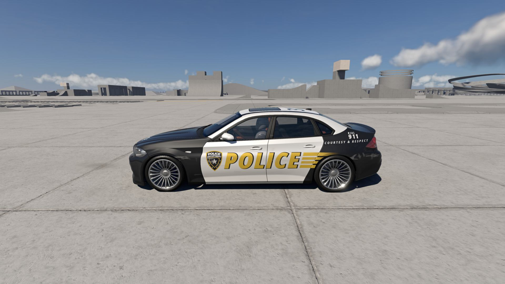
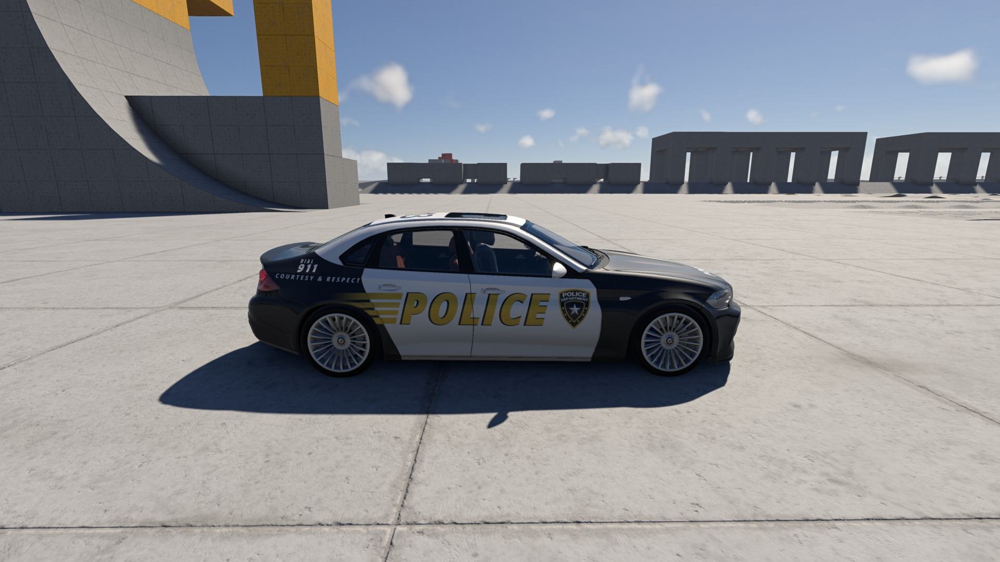
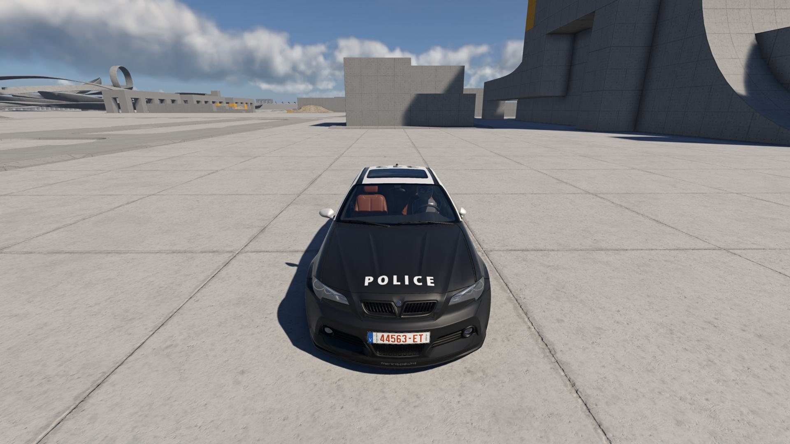
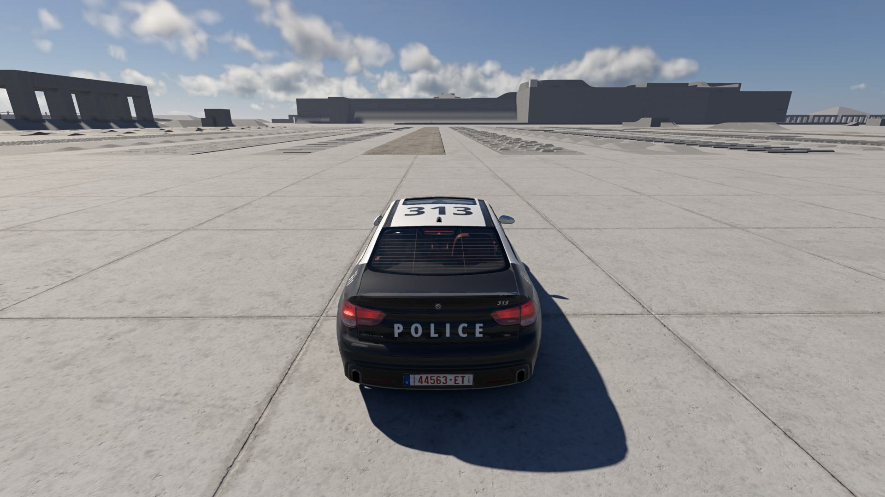
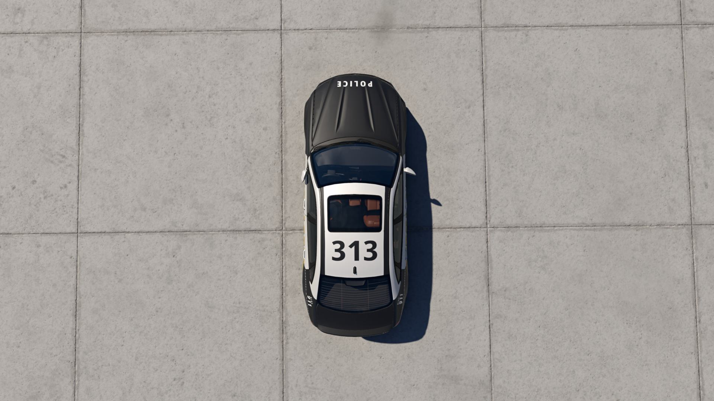

# sideslide - 20261114-181606_sideslide_resumed-half-b3-fast-coalesced_r1

_on its side, sliding along the ground at 14 m/s - one long scrape_

Remaining queues: `{"bake": 0, "jobs": 0, "stamps": 0}`

Tuning: `scratches_paint.setDamageResolution(2048); scratches_paint.setBakeBudget(3); scratches_paint.setFlushInterval(0.05); scratches_paint.setProjectionBudget(2); scratches_paint.setLayerBudget(12); scratches_paint.setCoverageCoalescing(true)`

Settled: True after 4.202 s - 322 frames, 75.0 fps average from sampled wall intervals (background limiter lifted)
Went past upside down: True (lowest up-vector z -0.153)

## Marks

| contacts | passed filters | impacts | streams | stamps | projections | bakes | missed | jobs dropped | deferred frames |
|---|---|---|---|---|---|---|---|---|---|
| 2966 | 692 | 86 | 130 | 111 | 102 | 166 | 0.0% | 0 | 53 |

Rejected contacts: Wheel 1626, BelowThresh 645, NormalForce 3

Body materials: METAL 510, PLASTIC 182

Surfaces: ASPHALT 692

## Cost

| | avg | p95 | max |
|---|---|---|---|
| painter (GE), ms/frame | 5.928 | 26.742 | 31.698 |
| whole frame, ms | 10.345 (p50) | 32.814 | 42.244 |
| all GE Lua, ms | | 27.557 | 32.646 |
| physics + vehicle Lua, ms | | 0.088 | 0.217 |
| render, ms | | 1.96 | |

- Painter frames over 4 ms: 121; worst flush (project + bake) 31.665 ms, worst composite 0.118 ms.
- Detector: 1.475 us per contact, 8.627 ms total, worst frame 0.652 ms (profiled; the timer adds a little).

### Worst frames

| t (s) | frame ms | painter ms | GE Lua ms | physics+VLUA ms | render ms |
|---|---|---|---|---|---|
| 0.18 | 42.24 | 30.80 | 0.76 | 0.05 | 1.74 |
| 3.29 | 38.69 | 31.70 | 0.90 | 0.04 | 1.45 |
| 3.41 | 37.89 | 31.30 | 0.92 | 0.04 | 1.52 |
| 1.15 | 37.07 | 31.13 | 0.77 | 0.04 | 1.34 |
| 3.35 | 37.06 | 30.69 | 0.85 | 0.04 | 1.39 |

## Screenshots

