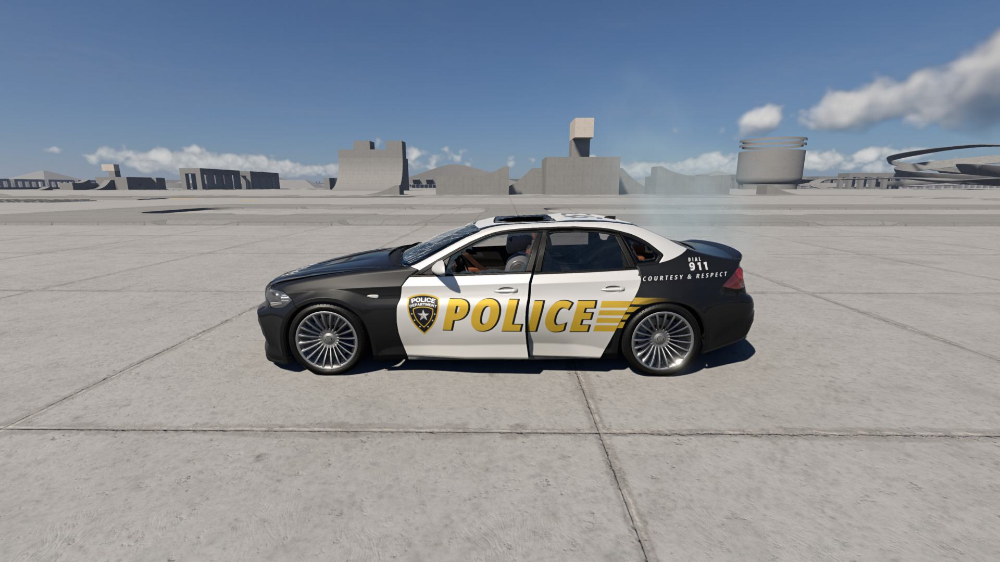
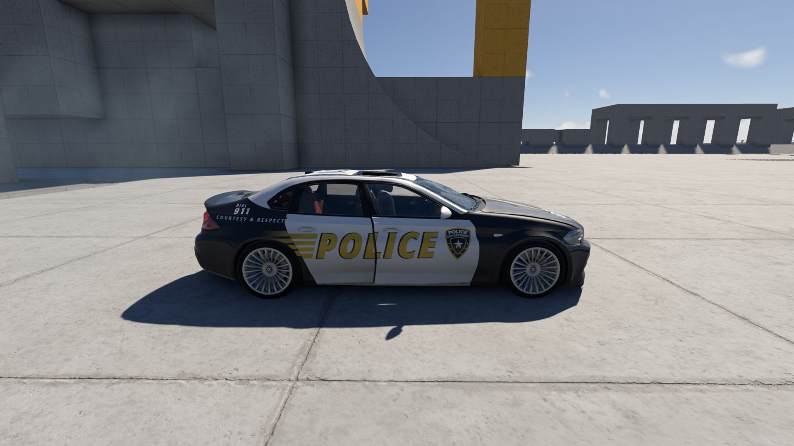
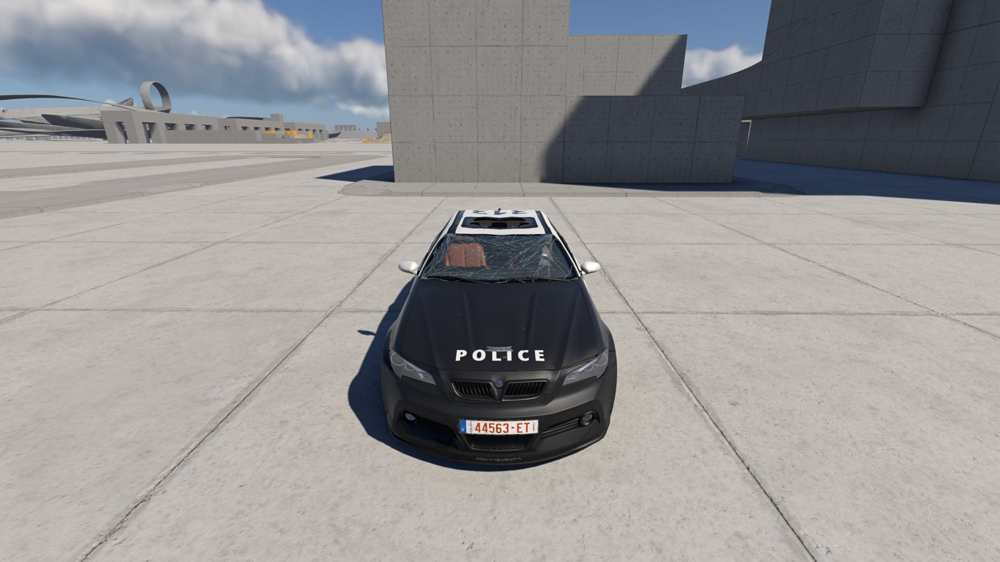
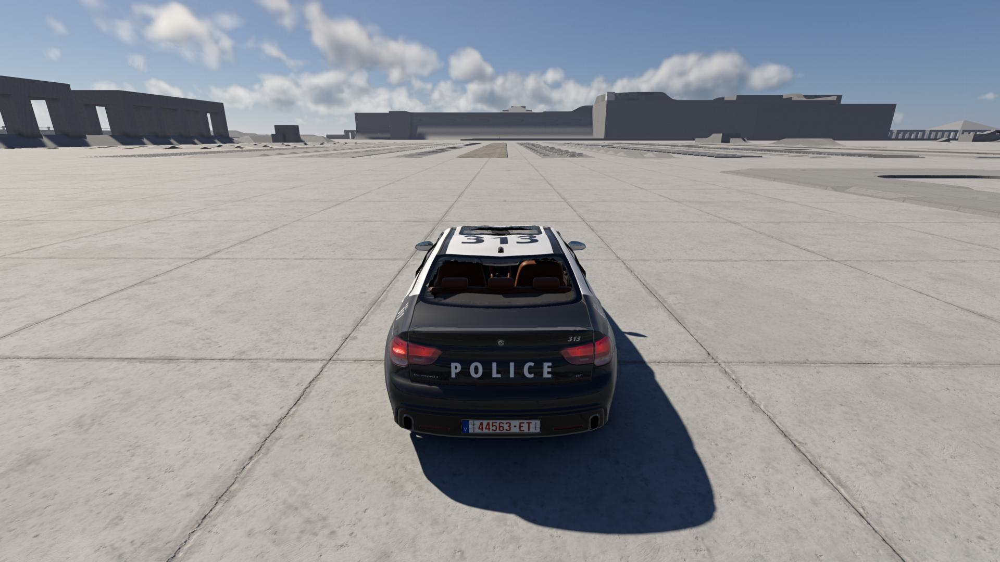
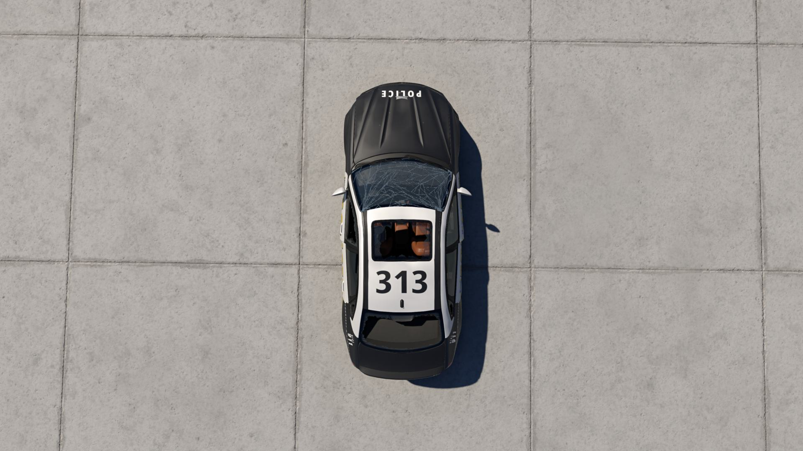

# roofdrop - 20261114-181623_roofdrop_resumed-half-b3-fast-coalesced_r1

_dropped upside down from about 1 m - roof impacts_

Remaining queues: `{"bake": 0, "jobs": 0, "stamps": 0}`

Tuning: `scratches_paint.setDamageResolution(2048); scratches_paint.setBakeBudget(3); scratches_paint.setFlushInterval(0.05); scratches_paint.setProjectionBudget(2); scratches_paint.setLayerBudget(12); scratches_paint.setCoverageCoalescing(true)`

Settled: True after 5.313 s - 457 frames, 85.8 fps average from sampled wall intervals (background limiter lifted)
Went past upside down: True (lowest up-vector z -1.0)

## Marks

| contacts | passed filters | impacts | streams | stamps | projections | bakes | missed | jobs dropped | deferred frames |
|---|---|---|---|---|---|---|---|---|---|
| 1180 | 51 | 51 | 0 | 54 | 20 | 23 | 0.0% | 0 | 1 |

Rejected contacts: PartExcluded 688, BelowThresh 441

Body materials: METAL 49, PLASTIC 2

Surfaces: ASPHALT 51

## Cost

| | avg | p95 | max |
|---|---|---|---|
| painter (GE), ms/frame | 1.126 | 4.93 | 33.498 |
| whole frame, ms | 11.177 (p50) | 13.247 | 43.277 |
| all GE Lua, ms | | 5.723 | 34.552 |
| physics + vehicle Lua, ms | | 0.068 | 0.203 |
| render, ms | | 1.993 | |

- Painter frames over 4 ms: 25; worst flush (project + bake) 33.457 ms, worst composite 0.074 ms.
- Detector: 1.361 us per contact, 4.175 ms total, worst frame 0.615 ms (profiled; the timer adds a little).

### Worst frames

| t (s) | frame ms | painter ms | GE Lua ms | physics+VLUA ms | render ms |
|---|---|---|---|---|---|
| 2.19 | 43.28 | 31.54 | 1.12 | 0.06 | 1.80 |
| 0.81 | 42.63 | 30.50 | 0.78 | 0.06 | 1.82 |
| 0.52 | 42.45 | 31.37 | 0.79 | 0.09 | 1.76 |
| 1.14 | 42.14 | 30.96 | 0.86 | 0.08 | 1.75 |
| 3.64 | 41.23 | 29.70 | 0.83 | 0.04 | 2.10 |

## Screenshots

