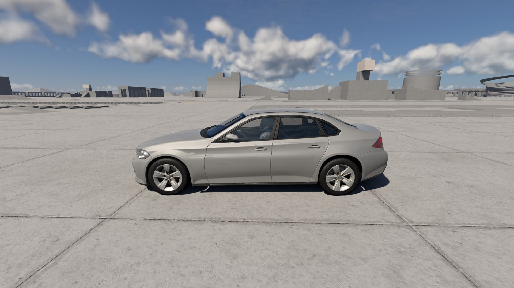
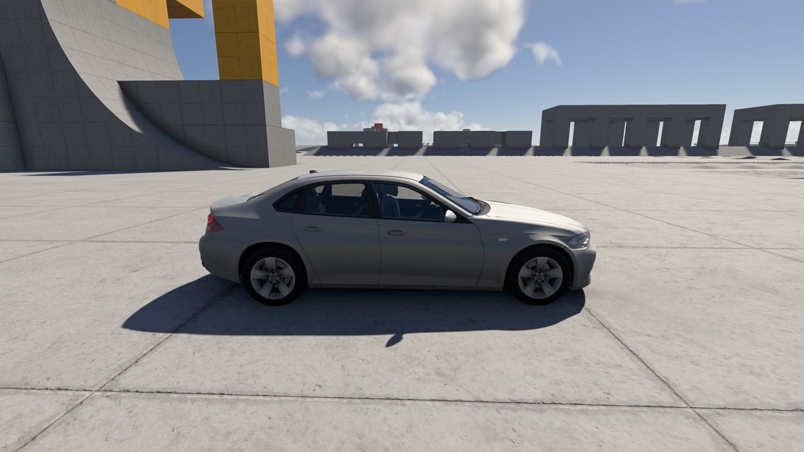
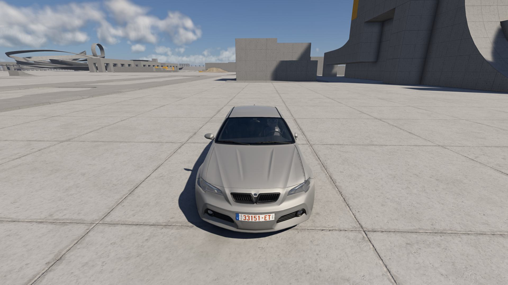
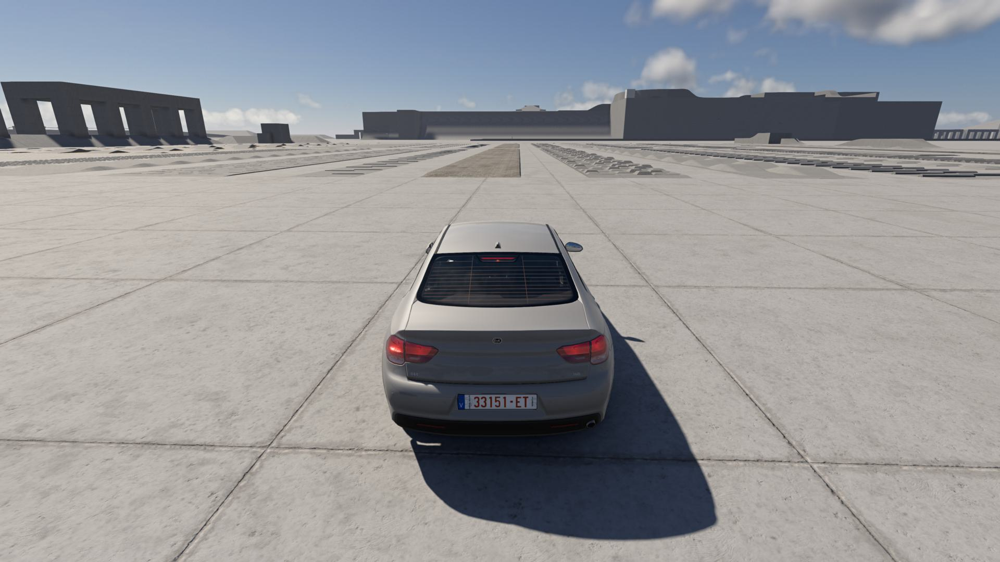
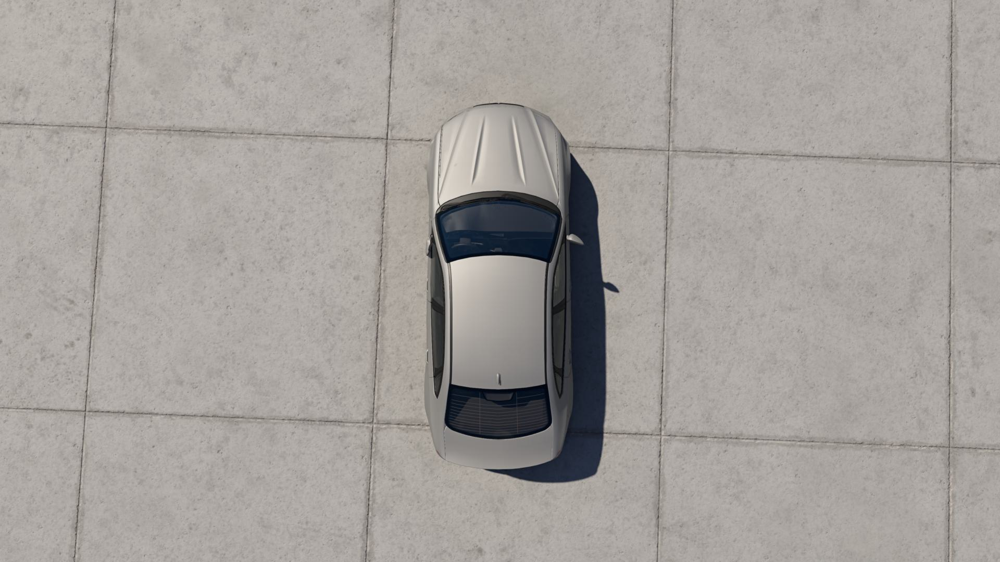

# sideslide - 20261114-211437_sideslide_resumed-half-d3d-func-stock-844_150_A

_on its side, sliding along the ground at 14 m/s - one long scrape_

Remaining queues: `{"bake": 0, "jobs": 0, "stamps": 0}`

Tuning: `scratches_paint.setDamageResolution(2048); scratches_paint.setBakeBudget(3); scratches_paint.setFlushInterval(0.05); scratches_paint.setCoverageCoalescing(true); scratches_paint.setPanelGrouping(true)`

Settled: True after 9.903 s - 857 frames, 86.4 fps average from sampled wall intervals (background limiter lifted)
Went past upside down: True (lowest up-vector z -0.479)

## Marks

| contacts | passed filters | impacts | streams | stamps | projections | bakes | missed | jobs dropped | deferred frames |
|---|---|---|---|---|---|---|---|---|---|
| 6008 | 744 | 47 | 83 | 83 | 88 | 99 | 0.0% | 0 | 1 |

Rejected contacts: BelowThresh 3742, Wheel 1432, PartExcluded 87, NormalForce 3

Body materials: METAL 462, PLASTIC 282

Surfaces: ASPHALT 744

## Cost

| | avg | p95 | max |
|---|---|---|---|
| painter (GE), ms/frame | 1.977 | 21.001 | 34.57 |
| whole frame, ms | 10.658 (p50) | 27.39 | 43.763 |
| all GE Lua, ms | | 21.949 | 35.6 |
| physics + vehicle Lua, ms | | 0.082 | 1.243 |
| render, ms | | 2.106 | |

- Painter frames over 4 ms: 88; worst flush (project + bake) 34.542 ms, worst composite 0.179 ms.
- Detector: 1.542 us per contact, 14.727 ms total, worst frame 0.759 ms (profiled; the timer adds a little).

### Worst frames

| t (s) | frame ms | painter ms | GE Lua ms | physics+VLUA ms | render ms |
|---|---|---|---|---|---|
| 1.74 | 43.76 | 32.62 | 1.03 | 0.07 | 1.81 |
| 2.89 | 42.91 | 31.62 | 0.72 | 0.05 | 1.66 |
| 2.54 | 41.51 | 30.48 | 0.90 | 0.04 | 1.66 |
| 1.07 | 41.33 | 34.57 | 0.89 | 0.06 | 1.48 |
| 2.39 | 40.65 | 29.76 | 1.02 | 0.06 | 1.67 |

## Screenshots

