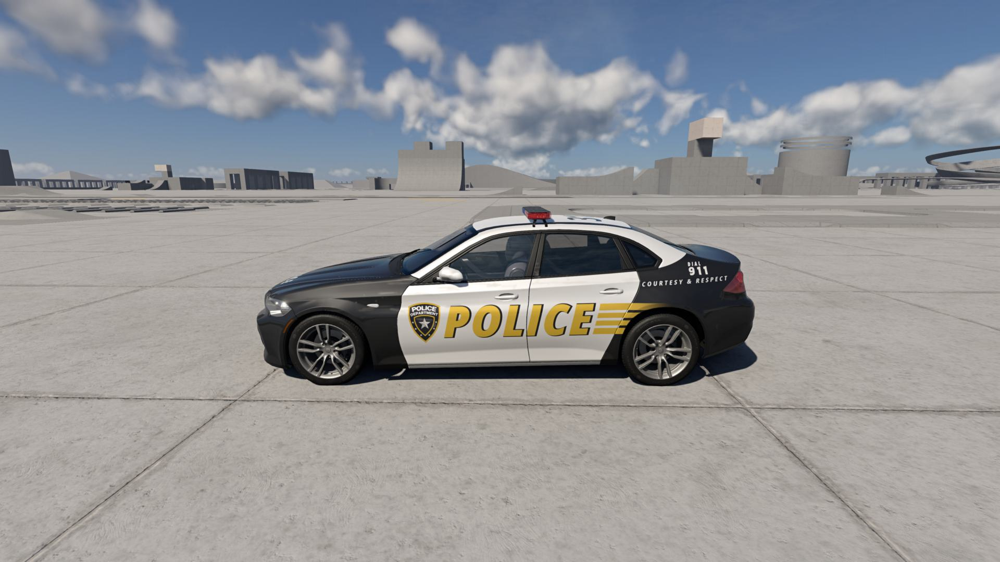
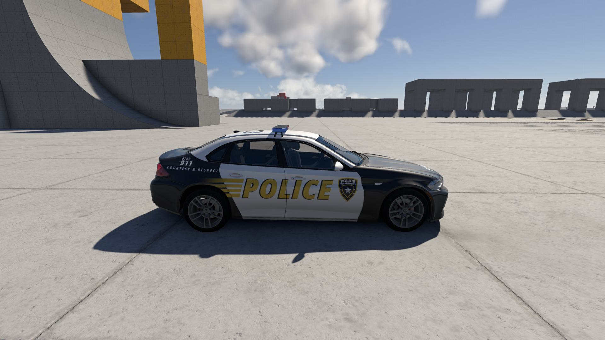
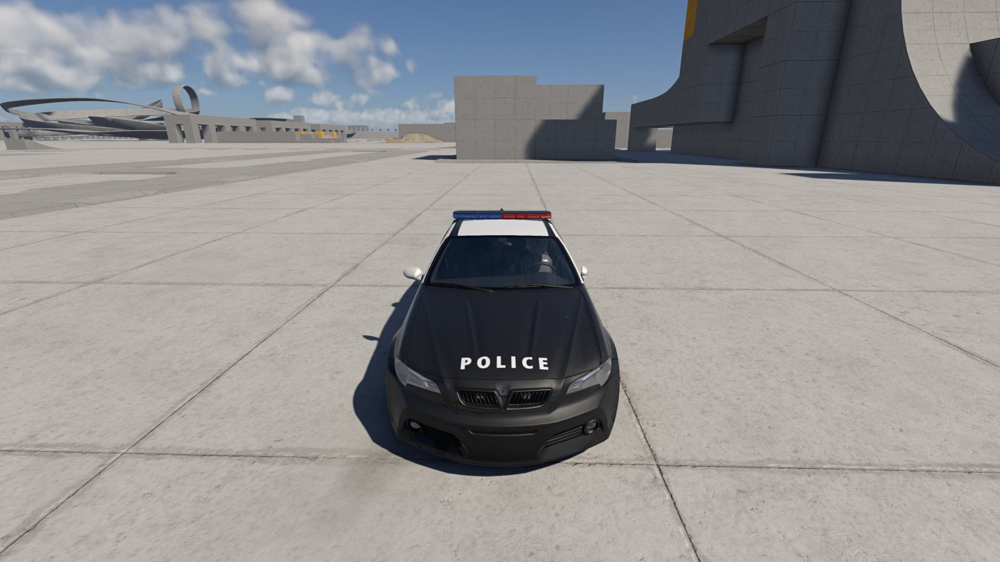
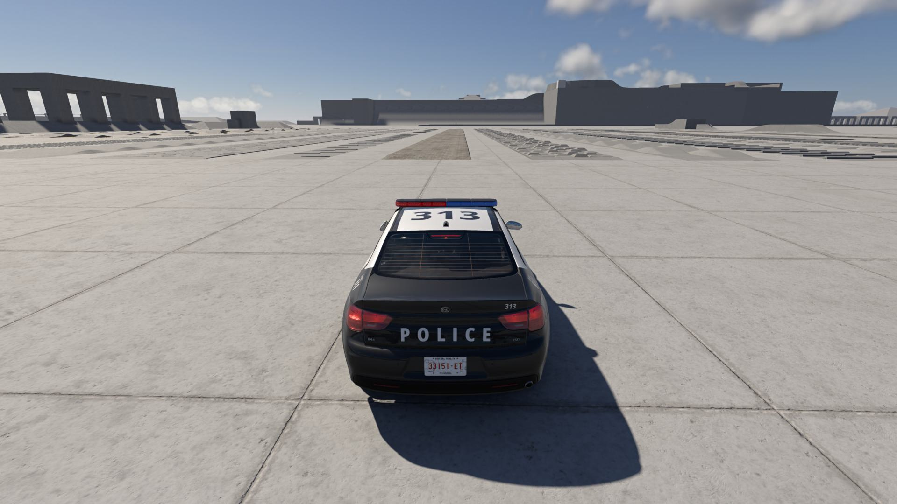
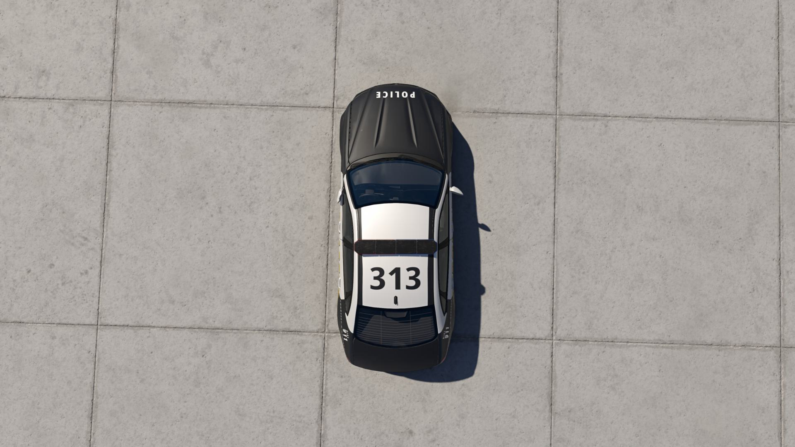

# sideslide - 20261114-211504_sideslide_resumed-half-d3d-func-stock-844_police_A

_on its side, sliding along the ground at 14 m/s - one long scrape_

Remaining queues: `{"bake": 0, "jobs": 0, "stamps": 0}`

Tuning: `scratches_paint.setDamageResolution(2048); scratches_paint.setBakeBudget(3); scratches_paint.setFlushInterval(0.05); scratches_paint.setCoverageCoalescing(true); scratches_paint.setPanelGrouping(true)`

Settled: True after 4.418 s - 325 frames, 73.6 fps average from sampled wall intervals (background limiter lifted)
Went past upside down: True (lowest up-vector z -0.482)

## Marks

| contacts | passed filters | impacts | streams | stamps | projections | bakes | missed | jobs dropped | deferred frames |
|---|---|---|---|---|---|---|---|---|---|
| 1474 | 763 | 40 | 94 | 76 | 90 | 99 | 0.0% | 0 | 1 |

Rejected contacts: BelowThresh 489, PartExcluded 157, Wheel 63, NormalForce 2

Body materials: METAL 506, PLASTIC 257

Surfaces: ASPHALT 763

## Cost

| | avg | p95 | max |
|---|---|---|---|
| painter (GE), ms/frame | 4.66 | 24.673 | 38.448 |
| whole frame, ms | 10.49 (p50) | 32.54 | 47.534 |
| all GE Lua, ms | | 25.626 | 39.474 |
| physics + vehicle Lua, ms | | 0.147 | 1.711 |
| render, ms | | 2.505 | |

- Painter frames over 4 ms: 78; worst flush (project + bake) 38.369 ms, worst composite 0.142 ms.
- Detector: 3.9 us per contact, 9.485 ms total, worst frame 0.572 ms (profiled; the timer adds a little).

### Worst frames

| t (s) | frame ms | painter ms | GE Lua ms | physics+VLUA ms | render ms |
|---|---|---|---|---|---|
| 0.38 | 47.53 | 38.45 | 17.90 | 0.11 | 2.20 |
| 2.54 | 42.57 | 35.99 | 0.81 | 0.05 | 1.48 |
| 4.01 | 39.04 | 28.92 | 0.78 | 0.04 | 1.69 |
| 3.15 | 38.56 | 31.76 | 0.69 | 0.04 | 1.64 |
| 1.05 | 38.47 | 28.39 | 3.05 | 0.25 | 2.50 |

## Screenshots

