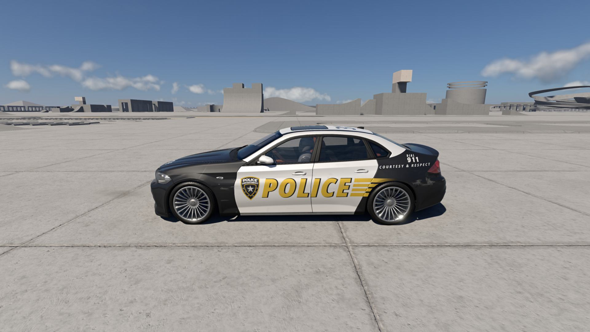
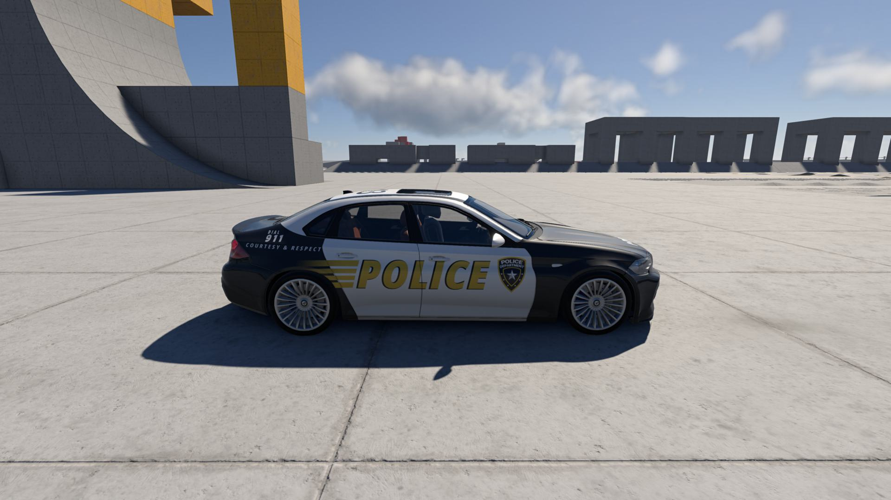
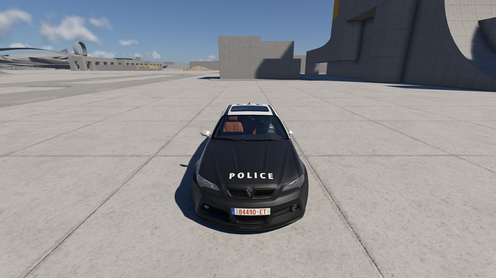
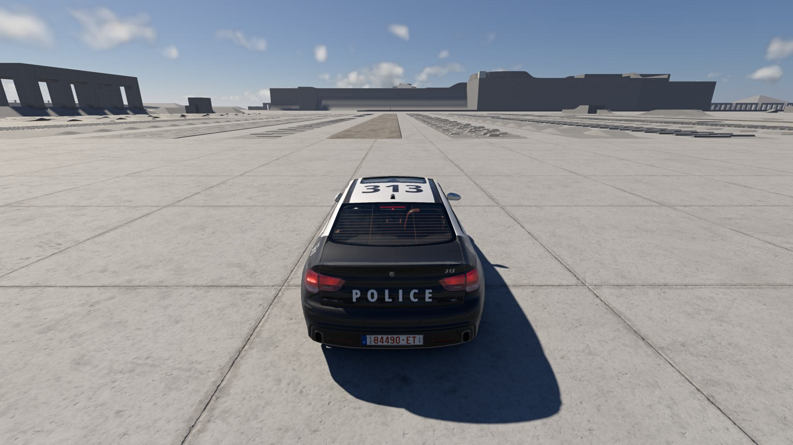
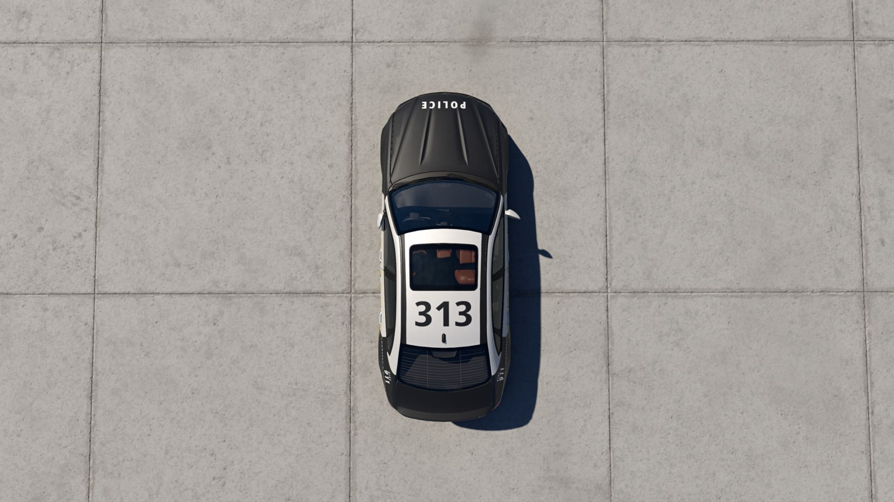

# sideslide - 20261114-211916_sideslide_resumed-half-d3d-func-wash

_on its side, sliding along the ground at 14 m/s - one long scrape_

Remaining queues: `{"bake": 0, "jobs": 0, "stamps": 0}`

Tuning: `scratches_paint.setDamageResolution(2048); scratches_paint.setBakeBudget(3); scratches_paint.setFlushInterval(0.05); scratches_paint.setPanelGrouping(true); scratches_paint.setCoverageCoalescing(true)`

Settled: True after 4.222 s - 323 frames, 76.3 fps average from sampled wall intervals (background limiter lifted)
Went past upside down: True (lowest up-vector z -0.164)

## Marks

| contacts | passed filters | impacts | streams | stamps | projections | bakes | missed | jobs dropped | deferred frames |
|---|---|---|---|---|---|---|---|---|---|
| 2864 | 609 | 86 | 127 | 114 | 109 | 133 | 0.0% | 0 | 1 |

Rejected contacts: Wheel 1505, BelowThresh 750

Body materials: METAL 455, PLASTIC 154

Surfaces: ASPHALT 609

## Cost

| | avg | p95 | max |
|---|---|---|---|
| painter (GE), ms/frame | 5.094 | 25.068 | 36.949 |
| whole frame, ms | 10.24 (p50) | 32.526 | 48.58 |
| all GE Lua, ms | | 25.84 | 39.613 |
| physics + vehicle Lua, ms | | 0.092 | 0.45 |
| render, ms | | 1.946 | |

- Painter frames over 4 ms: 98; worst flush (project + bake) 36.913 ms, worst composite 0.137 ms.
- Detector: 1.609 us per contact, 8.157 ms total, worst frame 0.437 ms (profiled; the timer adds a little).

### Worst frames

| t (s) | frame ms | painter ms | GE Lua ms | physics+VLUA ms | render ms |
|---|---|---|---|---|---|
| 0.18 | 48.58 | 36.95 | 0.95 | 0.07 | 1.75 |
| 1.68 | 43.65 | 35.37 | 0.89 | 0.04 | 1.82 |
| 1.15 | 41.90 | 34.65 | 0.90 | 0.05 | 1.74 |
| 3.24 | 41.75 | 30.66 | 0.89 | 0.05 | 1.76 |
| 2.41 | 41.70 | 35.25 | 0.88 | 0.07 | 1.53 |

## Screenshots

